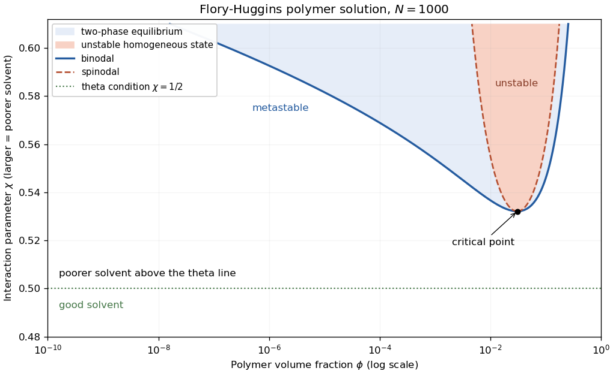

<h1 id="section-a/a3/a/solution">Solution</h1>

↑ **Parent:** [A](../a.md)

Use polymer [volume fraction](../../../../../volume-fraction.md) $\phi$ and interaction parameter $\chi$, increasing toward poor-solvent conditions. The [Flory–Huggins solution theory](../../../../../flory-huggins-solution-theory.md) free energy per lattice site is

$$
\frac{f}{k_BT}=\frac\phi N\ln\phi+(1-\phi)\ln(1-\phi)+\chi\phi(1-\phi).
$$

The common-tangent construction gives the [binodal](../../../../../binodal.md); $f''=0$ gives the [spinodal](../../../../../spinodal.md), $2\chi_s=1/(N\phi)+1/(1-\phi)$. Its critical point is $\phi_c=1/(1+\sqrt N)$, $\chi_c=\frac12(1+N^{-1/2})^2$. Above the binodal in this $\chi$ plot, the solution separates into polymer-poor and polymer-rich phases; between binodal and spinodal it is metastable, while inside the spinodal a homogeneous state is unstable.

The line $\chi=1/2$ is the [theta solvent](../../../../../theta-solvent.md) condition for a long dilute chain. Below it is the [good solvent](../../../../../good-solvent.md) side; above it is the [poor solvent](../../../../../poor-solvent.md) side. Poor solvent does not imply that every composition is already phase separated. Independently, a homogeneous solution is dilute for $\phi\ll\phi^*$, [semidilute](../../../../../semidilute-polymer-solution.md) for $\phi\gg\phi^*$ below close packing, and concentrated as $\phi$ approaches one.

**[Figure 1](#section-a/a3/a/image-solvent-quality-and-phase-separation-in-a-polymer-solution). Solvent quality and phase separation in a polymer solution**. Calculated Flory-Huggins binodal and spinodal for $N=1000$. Larger $\chi$ means poorer solvent quality; the dashed horizontal line is the dilute-chain theta condition. The concentration regimes are distinct from the coexistence boundaries.

## ↑ Ancestors (14)

1. [A](../a.md)
2. [A3](../../a3.md)
3. [Section A](../../../section-a.md)
4. [2007](../../../../2007-split.md)
5. [Past exam of the quantum condensed matter course of the University of Cambridge](../../../../split.md)
6. [Quantum Condensed Matter course of the University of Cambridge](../../../../../quantum-condensed-matter-course-of-the-university-of-cambridge.md)
7. [Physics course of the year 3 of the natural sciences course of the University of Cambridge](../../../../../physics-course-of-the-year-3-of-the-natural-sciences-course-of-the-university-of-cambridge.md)
8. [Year 3 of the natural sciences course of the University of Cambridge](../../../../../year-3-of-the-natural-sciences-course-of-the-university-of-cambridge.md)
9. [Year of the natural sciences course of the University of Cambridge](../../../../../year-of-the-natural-sciences-course-of-the-university-of-cambridge.md)
10. [Natural sciences course of the University of Cambridge](../../../../../natural-sciences-course-of-the-university-of-cambridge.md)
11. [Course of the University of Cambridge](../../../../../course-of-the-university-of-cambridge.md)
12. [University of Cambridge](../../../../../university-of-cambridge-split.md)
13. [List of universities](../../../../../list-of-universities.md)
14. [Codex Wiki](../../../../../split.md)
