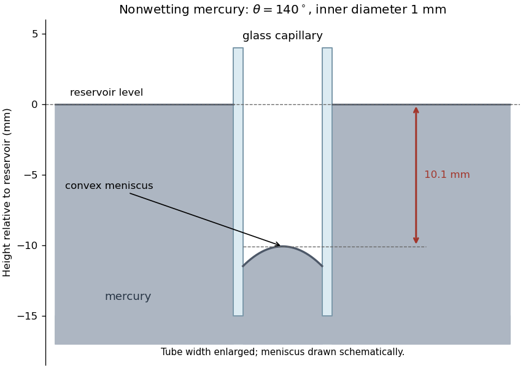

<h1 id="section-a/a4/d/solution">Solution</h1>

↑ **Parent:** [D](../d.md)

The liquid does not wet the glass because $\cos140^\circ<0$. The [liquid meniscus](../../../../../meniscus-liquid-surface.md) is convex, with the capillary mercury level depressed below the reservoir. Balancing vertical surface-tension force against the hydrostatic column gives [Jurin's law](../../../../../jurin-s-law.md), using the inner radius $r=0.5\,\mathrm{mm}$:

$$
\boxed{h=\frac{2\gamma\cos\theta}{\rho gr}=\frac{2(0.436)\cos140^\circ}{(1.35\times10^4)(9.81)(5\times10^{-4})}=-1.01\times10^{-2}\,\mathrm m.}
$$

Thus the depression is approximately **$10.1\,\mathrm{mm}$**. The simple height law neglects small meniscus-volume corrections. Mercury's high [surface tension](../../../../../surface-tension-split.md) reflects strong [metallic bonding](../../../../../metallic-bonding.md), not merely dispersion between weakly interacting molecular units.

**[Figure 2](#section-a/a4/d/image-nonwetting-mercury-is-depressed-in-a-glass-capillary-and-has-a-convex-meniscus). Nonwetting mercury is depressed in a glass capillary and has a convex meniscus**. Original schematic with the tube width enlarged relative to the vertical scale. The arrow marks the approximate hydrostatic depression; the drawn meniscus shape is schematic.

## ↑ Ancestors (14)

1. [D](../d.md)
2. [A4](../../a4.md)
3. [Section A](../../../section-a.md)
4. [2007](../../../../2007-split.md)
5. [Past exam of the quantum condensed matter course of the University of Cambridge](../../../../split.md)
6. [Quantum Condensed Matter course of the University of Cambridge](../../../../../quantum-condensed-matter-course-of-the-university-of-cambridge.md)
7. [Physics course of the year 3 of the natural sciences course of the University of Cambridge](../../../../../physics-course-of-the-year-3-of-the-natural-sciences-course-of-the-university-of-cambridge.md)
8. [Year 3 of the natural sciences course of the University of Cambridge](../../../../../year-3-of-the-natural-sciences-course-of-the-university-of-cambridge.md)
9. [Year of the natural sciences course of the University of Cambridge](../../../../../year-of-the-natural-sciences-course-of-the-university-of-cambridge.md)
10. [Natural sciences course of the University of Cambridge](../../../../../natural-sciences-course-of-the-university-of-cambridge.md)
11. [Course of the University of Cambridge](../../../../../course-of-the-university-of-cambridge.md)
12. [University of Cambridge](../../../../../university-of-cambridge-split.md)
13. [List of universities](../../../../../list-of-universities.md)
14. [Codex Wiki](../../../../../split.md)
