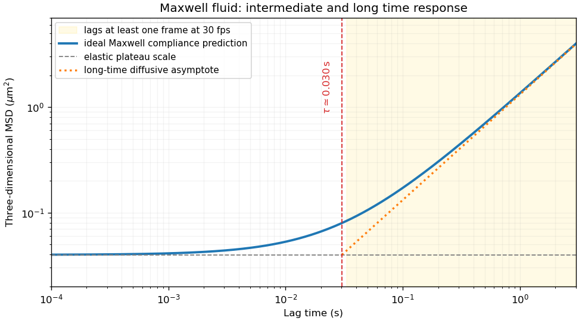
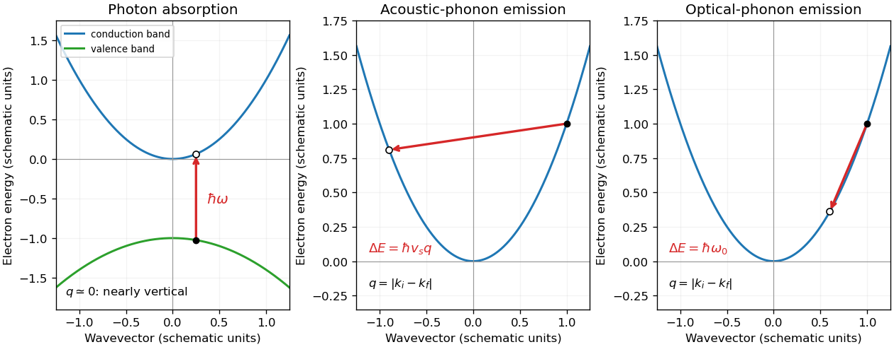

# 2008

↑ **Parent:** [Past exam of the quantum condensed matter course of the University of Cambridge](../past-exam-of-the-quantum-condensed-matter-course-of-the-university-of-cambridge.md)

Official past-paper archive: [https://www.sp.phy.cam.ac.uk/drp2/home.](https://www.sp.phy.cam.ac.uk/drp2/home.) The direct PDF link has not yet been verified.

**Table of contents**

- [Section A](#section-a)
  - [A1](#section-a/a1)
    - [a](#section-a/a1/a)
      - [Solution](#section-a/a1/a/solution)
    - [b](#section-a/a1/b)
      - [Solution](#section-a/a1/b/solution)
    - [c](#section-a/a1/c)
      - [Solution](#section-a/a1/c/solution)
  - [A2](#section-a/a2)
    - [a](#section-a/a2/a)
      - [Solution](#section-a/a2/a/solution)
    - [b](#section-a/a2/b)
      - [Solution](#section-a/a2/b/solution)
    - [c](#section-a/a2/c)
      - [Solution](#section-a/a2/c/solution)
    - [d](#section-a/a2/d)
      - [Solution](#section-a/a2/d/solution)
  - [A3](#section-a/a3)
    - [a](#section-a/a3/a)
      - [Solution](#section-a/a3/a/solution)
    - [b](#section-a/a3/b)
      - [Solution](#section-a/a3/b/solution)
    - [c](#section-a/a3/c)
      - [Solution](#section-a/a3/c/solution)
    - [d](#section-a/a3/d)
      - [Solution](#section-a/a3/d/solution)
    - [e](#section-a/a3/e)
      - [Solution](#section-a/a3/e/solution)
    - [f](#section-a/a3/f)
      - [Solution](#section-a/a3/f/solution)
    - [g](#section-a/a3/g)
      - [Solution](#section-a/a3/g/solution)
  - [A4](#section-a/a4)
    - [a](#section-a/a4/a)
      - [Solution](#section-a/a4/a/solution)
      - [i](#section-a/a4/a/i)
        - [Solution](#section-a/a4/a/i/solution)
      - [ii](#section-a/a4/a/ii)
        - [Solution](#section-a/a4/a/ii/solution)
      - [iii](#section-a/a4/a/iii)
        - [Solution](#section-a/a4/a/iii/solution)
      - [iv](#section-a/a4/a/iv)
        - [Solution](#section-a/a4/a/iv/solution)
    - [b](#section-a/a4/b)
      - [Solution](#section-a/a4/b/solution)
    - [c](#section-a/a4/c)
      - [Solution](#section-a/a4/c/solution)
    - [d](#section-a/a4/d)
      - [i](#section-a/a4/d/i)
        - [Solution](#section-a/a4/d/i/solution)
      - [ii](#section-a/a4/d/ii)
        - [Solution](#section-a/a4/d/ii/solution)
    - [e](#section-a/a4/e)
      - [Solution](#section-a/a4/e/solution)
- [Section B](#section-b)
  - [B1](#section-b/b1)
    - [a](#section-b/b1/a)
      - [Solution](#section-b/b1/a/solution)
    - [b](#section-b/b1/b)
      - [Solution](#section-b/b1/b/solution)
    - [c](#section-b/b1/c)
      - [Solution](#section-b/b1/c/solution)
  - [B2](#section-b/b2)
    - [a](#section-b/b2/a)
      - [Solution](#section-b/b2/a/solution)
    - [b](#section-b/b2/b)
      - [Solution](#section-b/b2/b/solution)
    - [c](#section-b/b2/c)
      - [Solution](#section-b/b2/c/solution)
    - [d](#section-b/b2/d)
      - [Solution](#section-b/b2/d/solution)
  - [B3](#section-b/b3)
    - [a](#section-b/b3/a)
      - [Solution](#section-b/b3/a/solution)
    - [b](#section-b/b3/b)
      - [Solution](#section-b/b3/b/solution)
    - [c](#section-b/b3/c)
      - [Solution](#section-b/b3/c/solution)
    - [Solution](#section-b/b3/solution)
  - [B4](#section-b/b4)
    - [Solution](#section-b/b4/solution)

## Section A

↑ **Parent:** [2008](2008.md)

<h3 id="section-a/a1">A1</h3>

↑ **Parent:** [Section A](#section-a)

<h4 id="section-a/a1/a">a</h4>

↑ **Parent:** [A1](#section-a/a1)

<h5 id="section-a/a1/a/solution">Solution</h5>

↑ **Parent:** [A](#section-a/a1/a)

For complete wetting, the meniscus has curvature radius equal to the capillary radius $r=d/2$. The [Young–Laplace equation](../surface-tension.md#young-laplace-equation) gives the supporting [pressure](../pressure.md) difference $\Delta p=2\gamma/r=4\gamma/d$. Balance it against the [hydrostatic pressure](../fluid-mechanics.md#hydrostatic-pressure) $\rho gh$. Taking the sap's [mass density](../fluid-mechanics.md#density) to be water-like, $\rho\simeq10^3\ \mathrm{kg\,m^{-3}}$, gives

$$
\boxed{h_{\max}=\frac{4\gamma}{\rho gd}=\frac{4(0.072)}{(10^3)(9.81)(10^{-6})}\simeq29\ \mathrm m.}
$$

This is the height supported by the stipulated capillary-pressure model. The density assumption is needed because the [surface tension](../surface-tension.md) and capillary diameter alone do not determine a height.

<h4 id="section-a/a1/b">b</h4>

↑ **Parent:** [A1](#section-a/a1)

<h5 id="section-a/a1/b/solution">Solution</h5>

↑ **Parent:** [B](#section-a/a1/b)

For the symmetric [regular solution model](../mixture.md#regular-solution), the dimensionless mixing [free energy](../thermodynamic-potential.md#thermodynamic-free-energy) is $f/(k_BT)=\phi\log\phi+(1-\phi)\log(1-\phi)+\chi\phi(1-\phi)$. At the [thermodynamic critical point](../critical-phenomenon.md#thermodynamic-critical-point), its second and third [derivatives](../calculus.md#derivative) in composition vanish. The third derivative gives $\phi_c=1/2$; the second then gives $4-2\chi_c=0$. Therefore

$$
\boxed{\chi_c=2,\qquad T_c=600\ \mathrm K/2=300\ \mathrm K.}
$$

This uses the equal-size, composition-symmetric mixture model.

<h4 id="section-a/a1/c">c</h4>

↑ **Parent:** [A1](#section-a/a1)

<h5 id="section-a/a1/c/solution">Solution</h5>

↑ **Parent:** [C](#section-a/a1/c)

The mean interface height fluctuation is zero; its [root mean square](../analysis.md#root-mean-square) roughness is obtained by summing the mode variances. Replacing the two-dimensional [wavevector](../elasticity-physics.md#wavevector) sum by its continuum density gives the [thermal roughness of a tension-dominated interface](../surface-tension.md#thermal-roughness-of-a-tension-dominated-interface):

$$
\langle h^2\rangle\simeq\frac{A}{(2\pi)^2}\int_{q_{\min}}^{q_{\max}}2\pi q\,dq\,\frac{k_BT}{A\gamma q^2}
=\frac{k_BT}{2\pi\gamma}\log\frac{q_{\max}}{q_{\min}}.
$$

Take $q_{\min}=2\pi/L$ with $L=\sqrt A=10^{-2}\ \mathrm m$, and $q_{\max}=2\pi/d$ with $d=2\times10^{-10}\ \mathrm m$. At $T=300\ \mathrm K$,

$$
\boxed{\langle h^2\rangle\simeq3.08\times10^{-19}\ \mathrm{m^2},\qquad\sqrt{\langle h^2\rangle}\simeq0.55\ \mathrm{nm}.}
$$

The logarithm makes the answer only weakly sensitive to order-one choices of cutoff. Gravity has been omitted as stipulated; the fixed mean height removes the zero [wavevector](../elasticity-physics.md#wavevector) mode.

<h3 id="section-a/a2">A2</h3>

↑ **Parent:** [Section A](#section-a)

<h4 id="section-a/a2/a">a</h4>

↑ **Parent:** [A2](#section-a/a2)

<h5 id="section-a/a2/a/solution">Solution</h5>

↑ **Parent:** [A](#section-a/a2/a)

A [liquid crystal](../critical-phenomenon.md#liquid-crystal) flows like a liquid while retaining some molecular order. In a [nematic liquid crystal](../critical-phenomenon.md#nematic-liquid-crystal), elongated molecules have long-range orientational order but no ordinary positional lattice. The [nematic director](../critical-phenomenon.md#nematic-director) $\boldsymbol n$ specifies the preferred axis, with $\boldsymbol n$ and $-\boldsymbol n$ equivalent for head-tail-symmetric molecules. The [nematic order parameter](../critical-phenomenon.md#nematic-order-parameter) $S=\langle(3\cos^2\theta-1)/2\rangle$ distinguishes an isotropic distribution, $S=0$, from perfect parallel alignment, $S=1$. A [smectic phase](../critical-phenomenon.md#smectic-phase) additionally has a periodic layered density modulation, while molecules remain mobile within layers.

The broken rotational symmetry allows [birefringence](../maxwell-equations.md#birefringence) and distinct elastic costs for [nematic splay](../critical-phenomenon.md#nematic-splay), [nematic twist](../critical-phenomenon.md#nematic-twist) and [nematic bend](../critical-phenomenon.md#nematic-bend). Under crossed polarizers, rotating a thin aligned sample changes the transmitted intensity because its two optical polarization components acquire different phases. Heating through a nematic-to-isotropic transition removes that orientational birefringence. An [electric field](../electric-field.md) can rotate the director if the [dielectric anisotropy of a nematic](../critical-phenomenon.md#dielectric-anisotropy-of-a-nematic) favors alignment, explaining the optical switching principle of a liquid-crystal cell. Molecular shape, [temperature](../temperature.md), concentration and surface anchoring determine which ordered phase appears.

<h4 id="section-a/a2/b">b</h4>

↑ **Parent:** [A2](#section-a/a2)

<h5 id="section-a/a2/b/solution">Solution</h5>

↑ **Parent:** [B](#section-a/a2/b)

The restoring force in ideal [rubber elasticity](../polymer.md#rubber-elasticity) is mainly entropic: stretching restricts the conformations of network strands. A [Gaussian chain](../mathematical-biology.md#gaussian-chain) of $N_s$ statistical segments of length $b$ has extension [free energy](../thermodynamic-potential.md#thermodynamic-free-energy) $3k_BTR^2/(2N_sb^2)$, so its small-extension spring constant is proportional to $T$. For an affine network with active-strand [number density](../statistical-physics.md#number-density) $\nu_s$, the shear modulus is approximately $G=\nu_sk_BT$. Increasing the [cross-link](../polymer.md#cross-link) density normally raises $G$ and shortens the strands; [polymer entanglement](../polymer.md#polymer-entanglement) can add effective constraints. Dangling ends and loops do not contribute like elastically active bridges, while junction fluctuations reduce the affine-network estimate.

For incompressible uniaxial stretching by ratio $\lambda$, the nominal tensile [stress](../continuum-mechanics.md#stress) is $G(\lambda-\lambda^{-2})$ in the ideal Gaussian-network model. Finite contour length causes stronger stiffening as strands approach full extension; swelling dilutes the active strands and changes their reference conformations. A direct demonstration is to hang a load from a stretched rubber strip and warm it gently: an entropy-dominated network tends to contract under that fixed load. This [temperature](../temperature.md) dependence contrasts with a model based solely on stretching bond energies. The simple formula assumes equilibrium, adequate cross-linking and temperatures away from glass transitions or degradation.

<h4 id="section-a/a2/c">c</h4>

↑ **Parent:** [A2](#section-a/a2)

<h5 id="section-a/a2/c/solution">Solution</h5>

↑ **Parent:** [C](#section-a/a2/c)

[DLVO theory](../mixture.md#dlvo-theory) combines the attractive [Van der Waals force](../force.md#van-der-waals-force) with repulsion between overlapping electrical double layers. A charged colloid attracts counterions; their electrostatic and osmotic response screens its field over the [Debye length](../physics.md#debye-length). Adding salt generally shortens this range and can lower the repulsive aggregation barrier, allowing particles to reach the strongly bound primary minimum. A shallow secondary minimum can instead give weak reversible association. Whether Brownian encounters cause rapid aggregation depends on barrier heights relative to $k_BT$, not just on the sign of the force at one separation.

Adsorbed or grafted polymer layers can provide [steric stabilization](../mixture.md#steric-stabilization): overlap costs chain [entropy](../entropy.md) and increases the local [osmotic pressure](../cell-membrane.md#osmotic-pressure). Nonadsorbing smaller particles or polymers can create a [depletion force](../mixture.md#depletion-force), because bringing large surfaces together increases the volume accessible to the smaller species. Polymer bridging can be attractive when one chain binds more than one particle. A useful comparison experiment varies salt concentration while monitoring scattered light or aggregation, then repeats with a sterically protected suspension. Charge, solvent quality, polymer coverage and particle size determine which interaction dominates; none is a universal constant of all colloids.

<h4 id="section-a/a2/d">d</h4>

↑ **Parent:** [A2](#section-a/a2)

<h5 id="section-a/a2/d/solution">Solution</h5>

↑ **Parent:** [D](#section-a/a2/d)

For a microscopic swimmer, the [Reynolds number](../dynamic-viscosity.md#reynolds-number) $\mathrm{Re}=\rho UL/\eta$ is usually small. Taking $L=2\ \mu\mathrm m$, $U=20\ \mu\mathrm{m\,s^{-1}}$ and water-like properties gives $\mathrm{Re}\simeq4\times10^{-5}$. The [Stokes equations](../stokes-flow.md#stokes-equation) then balance viscous [stress](../continuum-mechanics.md#stress) and [pressure](../pressure.md) almost instantaneously, so a swimmer cannot coast appreciably when its propulsive stroke stops.

The [scallop theorem](../stokes-flow.md#scallop-theorem) rules out a reciprocal opening-and-closing stroke in an otherwise unchanged Newtonian environment: reversing the sequence of shapes reverses the motion, and changing the stroke speed does not prevent cancellation. Organisms therefore use nonreciprocal motion. A sperm-like bending wave travels along a flagellum; a bacterium can rotate a helical flagellar bundle. The unequal parallel and perpendicular drag of a slender filament converts those motions into a net thrust. A freely suspended swimmer is [force-free](../stokes-flow.md#force-free) and [torque-free](../stokes-flow.md#torque-free) overall, so body drag balances thrust and the body counter-rotates against the rotating bundle. Tracking a body and its flagellum together can reveal these opposite rotations. The [helical microswimmer with a spherical head](../stokes-flow.md#helical-microswimmer-with-a-spherical-head) makes that force and torque balance quantitative.

<h3 id="section-a/a3">A3</h3>

↑ **Parent:** [Section A](#section-a)

<h4 id="section-a/a3/a">a</h4>

↑ **Parent:** [A3](#section-a/a3)

<h5 id="section-a/a3/a/solution">Solution</h5>

↑ **Parent:** [A](#section-a/a3/a)

A [linear viscoelastic fluid](../rheology.md#linear-viscoelastic-fluid) responds linearly to small imposed [strain](../continuum-mechanics.md#strain) histories but retains memory of earlier deformation. For shear [strain](../continuum-mechanics.md#strain) $\gamma(t)$ and a relaxed initial state, [Boltzmann superposition](../rheology.md#boltzmann-superposition) gives

$$
\sigma(t)=\int_{-\infty}^tG(t-s)\dot\gamma(s)\,ds.
$$

Here $G(t)$ is the causal [relaxation modulus](../rheology.md#relaxation-modulus), the [stress](../continuum-mechanics.md#stress) following a unit step [strain](../continuum-mechanics.md#strain). Doubling a sufficiently small [strain](../continuum-mechanics.md#strain) history doubles the [stress](../continuum-mechanics.md#stress), and responses to added histories add. Elasticity stores deformation [energy](../energy.md); [viscosity](../dynamic-viscosity.md) dissipates it. Linearity is an amplitude approximation, not an assertion that the material has no relaxation times.

<h4 id="section-a/a3/b">b</h4>

↑ **Parent:** [A3](#section-a/a3)

<h5 id="section-a/a3/b/solution">Solution</h5>

↑ **Parent:** [B](#section-a/a3/b)

The [Maxwell model](../rheology.md#linear-maxwell-fluid) has a spring of modulus $G_0$ in series with a [dashpot](../rheology.md#dashpot) of [viscosity](../dynamic-viscosity.md) $\eta$. Their stresses are equal and strains add, giving $\dot\gamma=\dot\sigma/G_0+\sigma/\eta$. After a step [strain](../continuum-mechanics.md#strain) $\gamma_0$, the [strain](../continuum-mechanics.md#strain) rate is zero for $t>0$, so $\dot\sigma=-\sigma/\tau$ with $\tau=\eta/G_0$. Initially the spring takes the step, $\sigma(0^+)=G_0\gamma_0$. Hence

$$
\boxed{G(t)=G_0e^{-t/\tau},\qquad\tau=\eta/G_0.}
$$

<h4 id="section-a/a3/c">c</h4>

↑ **Parent:** [A3](#section-a/a3)

<h5 id="section-a/a3/c/solution">Solution</h5>

↑ **Parent:** [C](#section-a/a3/c)

For the convention $\gamma=\operatorname{Re}(\gamma_0e^{i\omega t})$, the [complex viscoelastic modulus](../rheology.md#dynamic-modulus) is $G^*=i\omega\int_0^\infty G(t)e^{-i\omega t}dt$. Thus

$$
G^*=\frac{i\omega\eta}{1+i\omega\tau},\qquad
\boxed{G'=G_0\frac{(\omega\tau)^2}{1+(\omega\tau)^2},\quad
G''=G_0\frac{\omega\tau}{1+(\omega\tau)^2}.}
$$

The [storage modulus](../rheology.md#storage-modulus) exceeds the [loss modulus](../rheology.md#loss-modulus) for $\omega\tau>1$, so the response is predominantly solid-like above the crossover

$$
\boxed{\omega_c=1/\tau,\qquad f_c=1/(2\pi\tau).}
$$

At low frequency $G^*\simeq i\omega\eta$; at high frequency $G^*\to G_0$.

<h4 id="section-a/a3/d">d</h4>

↑ **Parent:** [A3](#section-a/a3)

<h5 id="section-a/a3/d/solution">Solution</h5>

↑ **Parent:** [D](#section-a/a3/d)

The [creep compliance](../rheology.md#creep-compliance) is the [strain](../continuum-mechanics.md#strain) per unit step [stress](../continuum-mechanics.md#stress): if $\sigma(t)=\sigma_0H(t)$, then $\gamma(t)=\sigma_0J(t)$ for $t>0$. A [Newtonian fluid](../viscous-fluid-flow.md#newtonian-fluid) obeys $\sigma=\eta\dot\gamma$, so under constant [stress](../continuum-mechanics.md#stress) its initially zero [strain](../continuum-mechanics.md#strain) grows as $\gamma=\sigma_0t/\eta$. Therefore

$$
\boxed{J(t)=t/\eta.}
$$

<h4 id="section-a/a3/e">e</h4>

↑ **Parent:** [A3](#section-a/a3)

<h5 id="section-a/a3/e/solution">Solution</h5>

↑ **Parent:** [E](#section-a/a3/e)

[Passive microrheology](../rheology.md#passive-microrheology) uses thermal bead motion as a probe of mechanical compliance. The [fluctuation-dissipation theorem](../quantum-field-theory.md#fluctuation-dissipation-theorem) relates equilibrium displacement fluctuations to the same linear response measured by a small applied force. The stated thermal [stress](../continuum-mechanics.md#stress) scale has units of [energy](../energy.md) per bead volume; dividing the mean-square displacement by $a^2$ provides a dimensionless effective [strain](../continuum-mechanics.md#strain). With that prescribed analogy,

$$
J(t)=\frac{\langle\Delta r^2(t)\rangle/a^2}{k_BT/(\pi a^3)},\qquad
\boxed{\langle\Delta r^2(t)\rangle=\frac{k_BT}{\pi a}J(t).}
$$

The displacement is relative to the starting position, and the variance here is the sum over three spatial coordinates. For a Newtonian fluid, substitution gives $\langle\Delta r^2\rangle=k_BTt/(\pi\eta a)=6Dt$, exactly the [Stokes–Einstein relation](../stokes-flow.md#stokes-einstein-relation) $D=k_BT/(6\pi\eta a)$.

The continuum interpretation assumes a dilute no-slip spherical probe, thermal equilibrium, linear response and a homogeneous incompressible medium on the bead scale. The stated [stress](../continuum-mechanics.md#stress) estimate is an effective scale for the analogy; a literal instantaneous [stress](../continuum-mechanics.md#stress) variance would also require a microscopic or temporal averaging prescription.

<h4 id="section-a/a3/f">f</h4>

↑ **Parent:** [A3](#section-a/a3)

<h5 id="section-a/a3/f/solution">Solution</h5>

↑ **Parent:** [F](#section-a/a3/f)

Under a step [stress](../continuum-mechanics.md#stress), the Maxwell spring extends immediately by $\sigma_0/G_0$, while the dashpot adds $\sigma_0t/\eta$. Hence $J(t)=G_0^{-1}+t/\eta$, and the [microrheology of a Maxwell fluid](../rheology.md#microrheology-of-a-maxwell-fluid) relation gives

$$
\boxed{\langle\Delta r^2(t)\rangle=\frac{k_BT}{\pi aG_0}\left(1+\frac t\tau\right),\qquad\tau=\eta/G_0.}
$$

This idealized overdamped relation describes an elastic plateau followed by long-time [diffusion](../thermodynamics.md#diffusion). Its nonzero extrapolated intercept is not the actual displacement variance at exactly zero lag, which is zero. Inertia or fast solvent relaxation must resolve the initial rise; those processes were omitted from the ideal spring-dashpot model.

<h4 id="section-a/a3/g">g</h4>

↑ **Parent:** [A3](#section-a/a3)

<h5 id="section-a/a3/g/solution">Solution</h5>

↑ **Parent:** [G](#section-a/a3/g)

An entropic network has approximately one thermal [energy](../energy.md) of elastic cost per mesh volume, giving $G_0\sim k_BT/\xi^3$. At $T=300\ \mathrm K$, the supplied mesh size and [viscosity](../dynamic-viscosity.md) give

$$
\boxed{G_0\sim0.033\ \mathrm{Pa},\qquad\tau=\eta/G_0\sim0.030\ \mathrm s.}
$$

The intermediate-time plateau in the three-dimensional [mean squared displacement](../brownian-motion.md#mean-squared-displacement) is

$$
\boxed{\langle\Delta r^2\rangle_{\rm plateau}\sim\frac{\xi^3}{\pi a}=4.0\times10^{-14}\ \mathrm{m^2},\qquad r_{\rm rms}\sim0.20\ \mu\mathrm m.}
$$

After the omitted fast initial transient, the log-log sketch is approximately flat for $t\ll\tau$, crosses over near $\tau$, and grows linearly for $t\gg\tau$. The figure shows the Maxwell compliance prediction over this range.

**[Figure 1](#section-a/a3/g/image-elastic-plateau-and-diffusive-growth-in-the-ideal-maxwell-microrheology-prediction-with-the-video-time-scale-marked). Elastic plateau and diffusive growth in the ideal Maxwell microrheology prediction, with the video time scale marked**.

An ordinary 25–30 frame-per-second recording samples intervals of about $0.03$–$0.04\ \mathrm s$, comparable to $\tau$. It therefore has little access to a clear plateau at lags well below the crossover, even if its positional precision resolves a displacement of a few tenths of a micrometre. Higher frame rates and calibrated localization noise would improve the modulus measurement. The bead radius is only twice the mesh size, so treating the network as a homogeneous continuum is also an approximation.

<h3 id="section-a/a4">A4</h3>

↑ **Parent:** [Section A](#section-a)

<h4 id="section-a/a4/a">a</h4>

↑ **Parent:** [A4](#section-a/a4)

<h5 id="section-a/a4/a/solution">Solution</h5>

↑ **Parent:** [A](#section-a/a4/a)

Take the same segment length and a large common number of steps. The ideal walks have size proportional to $N^{1/2}$; excluded volume swells a three-dimensional chain to approximately $N^{0.59}$ and a two-dimensional chain to $N^{3/4}$. Projection changes an isotropic walk's prefactor, rather than its exponent. The projected three-dimensional ideal walk has a smaller planar size than an otherwise equal two-dimensional ideal walk. Therefore the asymptotic ordering is

$$
\boxed{\text{(iii)}<\text{(i)}<\text{(iv)}<\text{(ii)}.}
$$

The following subparts make the size and projection factors explicit. Comparing root-mean-square sizes gives the same ordering as comparing mean distance magnitudes here.

<h5 id="section-a/a4/a/i">i</h5>

↑ **Parent:** [A](#section-a/a4/a)

<h6 id="section-a/a4/a/i/solution">Solution</h6>

↑ **Parent:** [I](#section-a/a4/a/i)

For the planar [random walk](../random-walk.md) with independent steps of length $b$, cross terms vanish and $\langle R^2\rangle=Nb^2$. Thus $R_{\rm rms}=bN^{1/2}$. At large $N$, the planar Gaussian end distribution gives $\langle R\rangle\simeq b\sqrt{\pi N}/2$.

<h5 id="section-a/a4/a/ii">ii</h5>

↑ **Parent:** [A](#section-a/a4/a)

<h6 id="section-a/a4/a/ii/solution">Solution</h6>

↑ **Parent:** [Ii](#section-a/a4/a/ii)

A planar [self-avoiding walk](../combinatorics.md#self-avoiding-walk) cannot revisit its occupied sites. In the good-solvent scaling regime, the [two-dimensional Flory approximation](../polymer.md#two-dimensional-flory-approximation) gives $R\sim bN^{3/4}$, larger at large $N$ than either ideal walk and the projected three-dimensional self-avoiding walk. This is a scaling statement, with microscopic prefactors dependent on the walk model.

<h5 id="section-a/a4/a/iii">iii</h5>

↑ **Parent:** [A](#section-a/a4/a)

<h6 id="section-a/a4/a/iii/solution">Solution</h6>

↑ **Parent:** [Iii](#section-a/a4/a/iii)

For an isotropic three-dimensional ideal walk, each Cartesian component contributes $Nb^2/3$ to the mean square. Keeping two components gives $\langle R_{\rm proj}^2\rangle=2Nb^2/3$. The [planar projection of an isotropic random vector](../random-variable.md#planar-projection-of-an-isotropic-random-vector) therefore has $R_{{\rm proj},{\rm rms}}=b\sqrt{2N/3}$, smaller than the unprojected planar ideal walk by $\sqrt{2/3}$. The corresponding two-dimensional Gaussian mean distance has the same ratio.

<h5 id="section-a/a4/a/iv">iv</h5>

↑ **Parent:** [A](#section-a/a4/a)

<h6 id="section-a/a4/a/iv/solution">Solution</h6>

↑ **Parent:** [Iv](#section-a/a4/a/iv)

A three-dimensional [self-avoiding walk](../combinatorics.md#self-avoiding-walk) has swollen size $R\sim bN^\nu$, with $\nu\simeq0.59$; the three-dimensional [Flory approximation](../polymer.md#flory-approximation) gives the nearby estimate $3/5$. Isotropic projection gives $\langle R_{\rm proj}^2\rangle=(2/3)\langle R^2\rangle$, preserving this exponent. For the mean distance rather than its root mean square, the orientation average instead gives $\langle R_{\rm proj}\rangle=(\pi/4)\langle R\rangle$. Neither prefactor changes its position between the ideal $N^{1/2}$ walks and the planar swollen $N^{3/4}$ walk.

<h4 id="section-a/a4/b">b</h4>

↑ **Parent:** [A4](#section-a/a4)

<h5 id="section-a/a4/b/solution">Solution</h5>

↑ **Parent:** [B](#section-a/a4/b)

The [Kuhn length](../mathematical-biology.md#kuhn-length) $l_K$ is the segment length of an equivalent [freely jointed chain](../mathematical-biology.md#ideal-chain) chosen to match contour length $L$ and the unperturbed mean-square end-to-end distance: $\langle R^2\rangle=Ll_K$. Since $R\leq L$, its maximum finite-chain value is $l_K=L$, attained by a straight rigid rod. Independent steps of length $b$ have $L=Nb$ and $\langle R^2\rangle=Nb^2$, so

$$
\boxed{l_K=b.}
$$

For a long freely rotating chain with fixed angle $\alpha$ between successive forward bond vectors, orientational correlations decay as $c^s$ with $c=\cos\alpha$. Summing them gives the [Kuhn length of a freely rotating chain](../mathematical-biology.md#kuhn-length-of-a-freely-rotating-chain):

$$
l_K\simeq b\frac{1+c}{1-c}.
$$

Positive persistence increases the statistical segment length, while negative bond correlations can reduce it. A chemical internal bond angle is supplementary to this forward-vector angle, so the cosine convention matters. Near the perfectly aligned limit the finite-chain bound $l_K\leq L$ replaces the long-chain asymptotic formula.

<h4 id="section-a/a4/c">c</h4>

↑ **Parent:** [A4](#section-a/a4)

<h5 id="section-a/a4/c/solution">Solution</h5>

↑ **Parent:** [C](#section-a/a4/c)

Write $\ell$ for a segment length and $v_2$ for the excluded-area coefficient, so that the interaction term has the correct dimensions. For a coil of planar size $R$ and area of order $R^2$, the [two-dimensional Flory approximation](../polymer.md#two-dimensional-flory-approximation) is

$$
\frac F{k_BT}\sim\frac{R^2}{N\ell^2}+\frac{v_2N^2}{R^2}.
$$

The first term is the entropic stretching cost and the second counts repulsive monomer contacts. Minimization gives $2R/(N\ell^2)-2v_2N^2/R^3=0$, hence

$$
R\sim(v_2\ell^2)^{1/4}N^{3/4},\qquad\boxed{\nu_{2d}=3/4.}
$$

For $v_2$ of order $\ell^2$ this becomes $R\sim\ell N^{3/4}$. The parameter multiplying $N^2/A$ in a two-dimensional interaction [energy](../energy.md) must have dimensions of area; it cannot simultaneously denote an unsquared bond length.

<h4 id="section-a/a4/d">d</h4>

↑ **Parent:** [A4](#section-a/a4)

<h5 id="section-a/a4/d/i">i</h5>

↑ **Parent:** [D](#section-a/a4/d)

<h6 id="section-a/a4/d/i/solution">Solution</h6>

↑ **Parent:** [I](#section-a/a4/d/i)

The [polymer overlap concentration](../mixture.md#polymer-overlap-concentration) is reached when the number of chains per coil area is of order one. If $n_c$ is the chain number per unit interfacial area, then $n_c^*R^2\sim1$. Equivalently, the monomer area fraction is $\phi^*\sim N\ell^2/R^2$, assuming an occupied monomer area of order $\ell^2$. Below this scale coils are mostly separate; above it they interpenetrate.

<h5 id="section-a/a4/d/ii">ii</h5>

↑ **Parent:** [D](#section-a/a4/d)

<h6 id="section-a/a4/d/ii/solution">Solution</h6>

↑ **Parent:** [Ii](#section-a/a4/d/ii)

For the planar good-solvent coil, $R\sim\ell N^{3/4}$. The [two-dimensional polymer overlap fraction](../mixture.md#two-dimensional-polymer-overlap-fraction) is therefore

$$
\phi^*\sim\frac{N\ell^2}{\ell^2N^{3/2}}=N^{-1/2},\qquad
\boxed{\phi^*\sim10^{-2}=1\%.}
$$

This is a scaling estimate; the monomer geometry and choice of coil radius set order-one numerical factors.

<h4 id="section-a/a4/e">e</h4>

↑ **Parent:** [A4](#section-a/a4)

<h5 id="section-a/a4/e/solution">Solution</h5>

↑ **Parent:** [E](#section-a/a4/e)

Here the [osmotic pressure](../cell-membrane.md#osmotic-pressure) is a two-dimensional surface [pressure](../pressure.md), with units of [energy](../energy.md) per area. In the dilute regime, independent whole chains provide the translational [entropy](../entropy.md), so

$$
\boxed{\Pi\sim\frac{k_BT}{\ell^2}\frac\phi N,\qquad\phi\ll\phi^*.}
$$

In the [semidilute polymer solution](../mixture.md#semidilute-polymer-solution), use a correlation blob containing $g$ monomers. Within it the chain still follows the planar good-solvent law $\xi\sim\ell g^{3/4}$. Its area fraction is $\phi\sim g\ell^2/\xi^2\sim g^{-1/2}$, so $g\sim\phi^{-2}$ and $\xi\sim\ell\phi^{-3/2}$. There is about one independent thermal contribution per blob area. The [semidilute osmotic pressure of a two-dimensional polymer solution](../mixture.md#semidilute-osmotic-pressure-of-a-two-dimensional-polymer-solution) is thus

$$
\boxed{\Pi\sim\frac{k_BT}{\xi^2}\sim\frac{k_BT}{\ell^2}\phi^3,\qquad\phi^*\ll\phi\ll1.}
$$

It is independent of total chain length once each chain contains many blobs. The two estimates agree at $\phi^*\sim N^{-1/2}$, where each gives $(k_BT/\ell^2)N^{-3/2}$.

## Section B

↑ **Parent:** [2008](2008.md)

<h3 id="section-b/b1">B1</h3>

↑ **Parent:** [Section B](#section-b)

<h4 id="section-b/b1/a">a</h4>

↑ **Parent:** [B1](#section-b/b1)

<h5 id="section-b/b1/a/solution">Solution</h5>

↑ **Parent:** [A](#section-b/b1/a)

For a single carrier type with unit Hall factor, the magnitude of the [Hall voltage](../relativistic-electromagnetism.md#hall-voltage) is $V_H=IB/(net)$, where $t$ is the slab thickness parallel to the [magnetic field](../magnetic-field.md). Therefore

$$
\boxed{n=\frac{IB}{etV_H}=1.25\times10^{24}\ \mathrm{m^{-3}}.}
$$

The longitudinal [electrical resistivity](../electric-charge.md#electrical-resistivity) is $\rho=Rwt/L=1000(2\times10^{-3})(0.5\times10^{-3})/(5\times10^{-3})=0.20\ \Omega\mathrm m$. Using $1/\rho=ne\mu$, the [electron mobility](../electric-charge.md#electron-mobility) magnitude is

$$
\boxed{\mu=\frac1{\rho ne}=2.5\times10^{-5}\ \mathrm{m^2\,V^{-1}s^{-1}}=0.25\ \mathrm{cm^2\,V^{-1}s^{-1}}.}
$$

Without the Hall polarity these data do not identify the carrier charge sign. The inference assumes one dominant carrier population; electron-hole compensation would require a multicarrier analysis.

<h4 id="section-b/b1/b">b</h4>

↑ **Parent:** [B1](#section-b/b1)

<h5 id="section-b/b1/b/solution">Solution</h5>

↑ **Parent:** [B](#section-b/b1/b)

Put $N=N_xN_yN_z$ primitive cells in a periodic box. In each reciprocal-space direction, the allowed Bloch wavevectors are spaced by $2\pi/L_i$, giving $N_i$ independent values in the first [Brillouin zone](../bloch-s-theorem.md#brillouin-zone). There are consequently $N$ wavevectors per band and, including two [electron](../physics.md#electron) spin states at each [wavevector](../elasticity-physics.md#wavevector),

$$
\boxed{2N\text{ states per band in the whole crystal},\qquad2\text{ states per atom}.}
$$

The total and per-atom counts are different; a factor $N$ cannot remain in the per-atom count for this monatomic lattice.

In independent-electron [band theory](../bloch-s-theorem.md#electronic-band-structure), a partially occupied band permits low-energy changes of occupancy and gives a metal. Filled bands separated from empty bands by a finite [band gap](../bloch-s-theorem.md#band-gap) give a [band insulator](../bloch-s-theorem.md#band-insulator) at zero [temperature](../temperature.md). An odd number of electrons per primitive cell cannot fill spin-degenerate bands, whereas an even number can; even filling alone does not ensure an insulator if bands overlap. Magnetic symmetry breaking and strong correlations, such as a [Mott insulator](../bloch-s-theorem.md#mott-insulator), go beyond this simple counting criterion.

<h4 id="section-b/b1/c">c</h4>

↑ **Parent:** [B1](#section-b/b1)

<h5 id="section-b/b1/c/solution">Solution</h5>

↑ **Parent:** [C](#section-b/b1/c)

A [plasmon](../physics.md#plasmon) is a quantum of a collective longitudinal oscillation of [electron](../physics.md#electron) density against the positive background. A small charge displacement creates an electric restoring field; Newton's law then gives the plasma angular frequency. Assuming approximately one conduction [electron](../physics.md#electron) per atom and spacing $d=3\ \text{\AA}$ gives $n\sim d^{-3}=3.7\times10^{28}\ \mathrm{m^{-3}}$. Hence

$$
\boxed{\omega_p=\sqrt{\frac{ne^2}{\varepsilon_0m_e}}\sim1.1\times10^{16}\ \mathrm{s^{-1}}.}
$$

The ordinary frequency is about $1.7\times10^{15}\ \mathrm{Hz}$, with [energy](../energy.md) $\hbar\omega_p\sim7\ \mathrm{eV}$. A different conduction-electron count per atom changes this estimate by its square root; dielectric and band-structure corrections also modify the simplest free-electron result.

<h3 id="section-b/b2">B2</h3>

↑ **Parent:** [Section B](#section-b)

<h4 id="section-b/b2/a">a</h4>

↑ **Parent:** [B2](#section-b/b2)

<h5 id="section-b/b2/a/solution">Solution</h5>

↑ **Parent:** [A](#section-b/b2/a)

The [tight-binding approximation](../bloch-s-theorem.md#tight-binding) starts with localized atomic orbitals. Their overlap allows hopping, broadening each atomic [energy](../energy.md) into a band. For example, a single orbital on a simple cubic lattice with nearest-neighbor hopping gives $E(\boldsymbol k)=E_0-2t[\cos(k_xa)+\cos(k_ya)+\cos(k_za)]$. Small overlap means a narrow band; orbital symmetry and hopping signs determine its extrema and dispersion.

The [nearly-free electron model](../bloch-s-theorem.md#nearly-free-electron-model) starts instead with free-electron parabolas, folded into the [Brillouin zone](../bloch-s-theorem.md#brillouin-zone), and treats the periodic crystal potential as a perturbation. Near a Bragg plane, states differing by a reciprocal vector become degenerate and mix, opening a gap approximately $2|V_{\boldsymbol G}|$. Away from such degeneracies, the [energy](../energy.md) remains close to the free-electron dispersion. These are complementary limits of the same Bloch-band framework, not different counts of electronic states. Both can give metals or insulators depending on filling and band overlap, but their natural basis functions and useful expansion parameters differ.

<h4 id="section-b/b2/b">b</h4>

↑ **Parent:** [B2](#section-b/b2)

<h5 id="section-b/b2/b/solution">Solution</h5>

↑ **Parent:** [B](#section-b/b2/b)

[Thomas-Fermi screening](../quantum-mechanics.md#thomas-fermi-screening) treats the carrier density locally as that of a uniform [electron](../physics.md#electron) gas whose chemical potential is shifted by the slowly varying [electrostatic potential](../electric-field.md#electric-potential). Linearizing gives $\delta n=(\partial n/\partial\mu)e\varphi$ for electrons. The resulting screened Poisson equation has inverse screening length

$$
k_s^2=\frac{e^2}{\varepsilon}\frac{\partial n}{\partial\mu}.
$$

For a degenerate gas, $\partial n/\partial\mu=g_{\rm vol}(E_F)$ including both spins, giving [Thomas-Fermi screening length](../quantum-mechanics.md#thomas-fermi-screening-length) $k_s^{-1}$. A nondegenerate [semiconductor](../semiconductor.md) instead has $\partial n/\partial\mu=n/(k_BT)$, giving the [Debye length](../physics.md#debye-length) $\sqrt{\varepsilon k_BT/(ne^2)}$. Electrons and holes contribute additively to the charge susceptibility when both are present; the lattice permittivity replaces the vacuum value.

The approximation requires a potential varying slowly compared with microscopic electronic length scales and a small perturbation for the linearized result. It captures smooth electrostatic screening, but not the full nonlocal response or [Friedel oscillations](../quantum-mechanics.md#friedel-oscillations). Low carrier density or carrier freeze-out can make a [semiconductor](../semiconductor.md)'s screening much weaker than a metal's.

<h4 id="section-b/b2/c">c</h4>

↑ **Parent:** [B2](#section-b/b2)

<h5 id="section-b/b2/c/solution">Solution</h5>

↑ **Parent:** [C](#section-b/b2/c)

The [Hubbard model](../statistical-physics.md#hubbard-model) combines band motion and local repulsion:

$$
H=-t\sum_{\langle ij\rangle,\sigma}(c_{i\sigma}^\dagger c_{j\sigma}+\mathrm{h.c.})+U\sum_i n_{i\uparrow}n_{i\downarrow}.
$$

Hopping favors itinerant states, while positive $U$ penalizes simultaneous opposite-spin occupation on one site. In a uniform mean-field treatment, a spin imbalance reduces the interaction cost but raises the band-filling [energy](../energy.md). The [Stoner criterion](../statistical-physics.md#stoner-criterion) for instability of the unpolarized metal is $Ug_\uparrow(E_F)>1$ when $g_\uparrow$ is the density of states per site, per [energy](../energy.md), for one spin. Using a total two-spin density of states changes the displayed numerical convention.

The ordered mean-field state has exchange-split spin bands and a spontaneous magnetization, with the kinetic and interaction costs balancing at equilibrium. This is a model of itinerant [ferromagnetism](../electromagnetism.md#ferromagnetism), not a guarantee that every repulsive Hubbard system becomes ferromagnetic. Filling, lattice structure and competing order matter: near half filling on a bipartite lattice, antiferromagnetism and a [Mott insulator](../bloch-s-theorem.md#mott-insulator) can be favored instead. The approximation also omits important spin fluctuations and strong-correlation effects.

<h4 id="section-b/b2/d">d</h4>

↑ **Parent:** [B2](#section-b/b2)

<h5 id="section-b/b2/d/solution">Solution</h5>

↑ **Parent:** [D](#section-b/b2/d)

In a two-dimensional [electron](../physics.md#electron) system under a perpendicular [magnetic field](../magnetic-field.md), orbital energies form [Landau levels](../quantum-theory.md#landau-level) with spacing $\hbar\omega_c$. Each resolved spin level has $eBA/h$ states in area $A$. At integer filling, the [integer quantum Hall effect](../relativistic-electromagnetism.md#integer-quantum-hall-effect) has Hall conductance $\sigma_{xy}=\nu e^2/h$ in magnitude and vanishing longitudinal conductance in the ideal plateau regime; inversion of the conductivity tensor gives Hall resistance $h/(\nu e^2)$.

A Hall-bar experiment cools the sample, passes a small current and records longitudinal and transverse voltages while sweeping the field. The Hall resistance develops plateaus while the longitudinal resistance develops minima. Disorder broadens the Landau levels and localizes many bulk states, allowing the chemical potential to move through a range of carrier density without changing the number of conducting edge channels. Extended states near a Landau-level center allow transitions between plateaus. Spin splitting determines which integer sequence is resolved. The robustness comes from the quantum state and its edge transport, rather than the Hall bar having a specially calibrated geometric width.

<h3 id="section-b/b3">B3</h3>

↑ **Parent:** [Section B](#section-b)

<h4 id="section-b/b3/a">a</h4>

↑ **Parent:** [B3](#section-b/b3)

<h5 id="section-b/b3/a/solution">Solution</h5>

↑ **Parent:** [A](#section-b/b3/a)

For [photon absorption](../quantum-mechanics.md#photon-absorption) or emission, [electron](../physics.md#electron) [energy](../energy.md) changes by $\pm\hbar\omega$ and crystal [wavevector](../elasticity-physics.md#wavevector) by $\pm\boldsymbol q$ modulo a reciprocal lattice vector. Optical [photon](../quantum-mechanics.md#photon) momentum is normally tiny on the [Brillouin zone](../bloch-s-theorem.md#brillouin-zone) scale, so interband optical transitions are approximately vertical on an energy-wavevector diagram. A direct-gap [semiconductor](../semiconductor.md) can therefore absorb a [photon](../quantum-mechanics.md#photon) between valence and conduction states near the same [wavevector](../elasticity-physics.md#wavevector); an indirect transition usually needs an additional [phonon](../quantum-ideal-gas-statistics.md#phonon) or another source of momentum. Occupation and optical matrix elements impose further restrictions.

Within one ideal parabolic band of a clean metal, such a small [photon](../quantum-mechanics.md#photon) momentum cannot normally supply the required finite [energy](../energy.md) difference. Intraband optical absorption then relies on momentum relaxation by impurities, phonons or boundaries, as in the finite-scattering-time Drude response. Interband transitions can still occur. The first panel shows the near-vertical direct transition.

**[Figure 2](#section-b/b3/a/image-energy-and-momentum-transfer-in-a-direct-optical-transition-acoustic-phonon-emission-and-optical-phonon-emission). Energy and momentum transfer in a direct optical transition, acoustic-phonon emission and optical-phonon emission**.

<h4 id="section-b/b3/b">b</h4>

↑ **Parent:** [B3](#section-b/b3)

<h5 id="section-b/b3/b/solution">Solution</h5>

↑ **Parent:** [B](#section-b/b3/b)

For an [acoustic phonon](../quantum-ideal-gas-statistics.md#acoustic-phonon) with $\omega_q\simeq v_sq$, [energy](../energy.md) and [crystal momentum](../bloch-s-theorem.md#crystal-momentum) conservation require $E_{\boldsymbol k'}-E_{\boldsymbol k}=\pm\hbar v_sq$ and $\boldsymbol k'-\boldsymbol k=\pm\boldsymbol q+\boldsymbol G$. The [sound speed](../compressible-flow.md#speed-of-sound) is usually much smaller than the relevant [electron](../physics.md#electron) velocity in a metal, so scattering can change the [electron](../physics.md#electron)'s direction substantially while changing its [energy](../energy.md) only slightly. It is approximately elastic for many transport calculations, though its finite [energy](../energy.md) transfer is essential for cooling.

The middle panel gives an allowed backscattering example with a small [energy](../energy.md) loss. In a degenerate metal, the [Pauli exclusion principle](../tensor-product-of-quantum-systems.md#pauli-exclusion-principle) blocks occupied final states, restricting low-temperature scattering to a thermal neighborhood of the [Fermi surface](../fermi-liquid.md#fermi-surface). Phonon occupations also shrink on cooling. A normal process has $\boldsymbol G=0$; an [Umklapp process](../quantum-ideal-gas-statistics.md#umklapp-scattering) transfers reciprocal-lattice momentum. In semiconductors, accessible valleys and their separation add further momentum constraints.

<h4 id="section-b/b3/c">c</h4>

↑ **Parent:** [B3](#section-b/b3)

<h5 id="section-b/b3/c/solution">Solution</h5>

↑ **Parent:** [C](#section-b/b3/c)

An [optical phonon](../quantum-ideal-gas-statistics.md#optical-phonon) often has approximately constant [energy](../energy.md) $\hbar\omega_0$ over the relevant [wavevector](../elasticity-physics.md#wavevector) range. Its absorption or emission therefore moves the [electron](../physics.md#electron) between [energy](../energy.md) surfaces separated by this finite amount, with the [phonon](../quantum-ideal-gas-statistics.md#phonon) supplying the associated [crystal momentum](../bloch-s-theorem.md#crystal-momentum) modulo a reciprocal vector. The last panel shows emission between two points on a parabolic [conduction band](../quantum-mechanics.md#conduction-band).

Emission from a band with a lower edge requires at least $\hbar\omega_0$ of available kinetic [energy](../energy.md) and an unoccupied final state. For nondegenerate hot carriers this produces a threshold and can lead to rapid [energy](../energy.md) loss in successive [phonon](../quantum-ideal-gas-statistics.md#phonon) emissions. Absorption is weighted by the [Bose-Einstein distribution](../quantum-ideal-gas-statistics.md#bose-einstein-distribution) $n_B(\omega_0)$, while emission has the factor $n_B+1$; absorption is strongly suppressed at $k_BT\ll\hbar\omega_0$. In a metal, Pauli blocking also prevents an [electron](../physics.md#electron) near the Fermi [energy](../energy.md) from simply dropping into the occupied Fermi sea.

<h4 id="section-b/b3/solution">Solution</h4>

↑ **Parent:** [B3](#section-b/b3)

Let $\alpha=\hbar^2/(2m^*)$, so the initial conduction-electron kinetic [energy](../energy.md) is $E_1=\alpha k_1^2$. In the normal momentum-conserving process with the final hole fixed at zero [wavevector](../elasticity-physics.md#wavevector), the two final conduction electrons obey $\boldsymbol k_1=\boldsymbol k_2+\boldsymbol k_3$. Their total kinetic [energy](../energy.md) satisfies

$$
\alpha(k_2^2+k_3^2)=\frac{E_1}2+\frac\alpha2|\boldsymbol k_2-\boldsymbol k_3|^2\geq\frac{E_1}2.
$$

Energy conservation for [impact ionization](../optical-instrument.md#impact-ionization) is $E_1=E_g+\alpha(k_2^2+k_3^2)$. Consequently $E_1\geq E_g+E_1/2$, giving

$$
\boxed{E_{1,\min}=2E_g.}
$$

The bound is attained when $\boldsymbol k_2=\boldsymbol k_3=\boldsymbol k_1/2$; opposite spins permit the two electrons to share that [wavevector](../elasticity-physics.md#wavevector). Fixing the hole momentum is essential: a mobile final hole gives a different threshold. This is the threshold for [impact ionization with a hole at zero momentum](../optical-instrument.md#impact-ionization-with-a-hole-at-zero-momentum).

The two hot electrons subsequently redistribute [energy](../energy.md) by electron-electron collisions and transfer it to the lattice by [electron-phonon scattering](../quantum-ideal-gas-statistics.md#electron-phonon-scattering). Optical-phonon emission can provide large discrete losses while the electrons are hot; acoustic phonons dominate later small [energy](../energy.md) exchanges. Electron-electron collisions alone conserve the [electron](../physics.md#electron) system's total [energy](../energy.md) and do not cool it into the lattice. The electron-hole pair eventually recombines radiatively or through nonradiative channels, such as defect-assisted recombination or [Auger recombination](../quantum-mechanics.md#auger-recombination). Recombination is distinct from the preceding intraband cooling.

<h3 id="section-b/b4">B4</h3>

↑ **Parent:** [Section B](#section-b)

<h4 id="section-b/b4/solution">Solution</h4>

↑ **Parent:** [B4](#section-b/b4)

Only states within an [energy](../energy.md) window of order $k_BT$ around the [Fermi energy](../quantum-ideal-gas-statistics.md#fermi-energy) can change occupation in a degenerate metal. A [Sommerfeld expansion](../quantum-ideal-gas-statistics.md#sommerfeld-expansion) gives electronic [energy](../energy.md) above its zero-temperature value proportional to $g(E_F)(k_BT)^2$, hence $C_e=\gamma T$. Three-dimensional linear-dispersion [acoustic phonons](../quantum-ideal-gas-statistics.md#acoustic-phonon) have density of states proportional to $\omega^2$; integrating their Bose occupations gives thermal [energy](../energy.md) proportional to $T^4$ and the [Debye heat capacity](../quantum-ideal-gas-statistics.md#debye-heat-capacity) $C_{
m ph}=\beta T^3$. Thus $C/T=\gamma+\beta T^2$ at sufficiently low [temperature](../temperature.md) in the normal state.

Reading the straight low-temperature fit gives approximately $\gamma\simeq33\ \mathrm{mJ\,mol^{-1}K^{-2}}$ and $\beta\simeq3.8\ \mathrm{mJ\,mol^{-1}K^{-4}}$. These estimates agree with the reported fit to this material in the original experiment.[Figure 3 caption: low-temperature normal-state coefficients for Ba4Na2Ge25](../physics-bibliography.md#superconductivity-in-the-filled-cage-compounds-ba6ge25-and-ba4na2ge25-by-friedrich-malte-grosche-and-others) Treating the graph values as approximate, the molar [density of states](../quantum-ideal-gas-statistics.md#density-of-states) is

$$
\boxed{g(E_F)=\frac{3\gamma}{\pi^2k_B^2}\simeq5.3\times10^{43}\ \mathrm{J^{-1}mol^{-1}}\simeq14\ \mathrm{eV^{-1}}\text{ per formula unit}.}
$$

The stipulated two electrons per formula unit give $n=2N_A/V_m\simeq2.62\times10^{27}\ \mathrm{m^{-3}}$. For a single spin-degenerate parabolic band, the molar density of states is $g(E_F)=3(2N_A)/(2E_F)=3N_A/E_F$. Hence

$$
\boxed{E_F\simeq3.4\times10^{-20}\ \mathrm J\simeq0.21\ \mathrm{eV},\qquad
k_F=(3\pi^2n)^{1/3}\simeq4.3\times10^9\ \mathrm{m^{-1}},\qquad
m^*=\frac{\hbar^2k_F^2}{2E_F}\simeq3.2m_e.}
$$

These are model-dependent effective parameters inferred from the measured heat capacity and assumed carrier count, rather than an independent determination of a unique band structure.

Using the Debye prefactor stated in the question gives

$$
\boxed{\Theta_D=\left(\frac{12\pi^4N_Ak_B}{5\beta}\right)^{1/3}\simeq80\ \mathrm K.}
$$

This prefactor counts three effective modes per formula unit. Consistently choosing the same count for the [Debye wavevector](../quantum-ideal-gas-statistics.md#debye-wavevector) gives $k_D=(6\pi^2N_A/V_m)^{1/3}\simeq4.3\times10^9\ \mathrm{m^{-1}}$. The corresponding average [sound speed](../compressible-flow.md#speed-of-sound) is

$$
\boxed{v_D=\frac{k_B\Theta_D}{\hbar k_D}\simeq2.5\times10^3\ \mathrm{m\,s^{-1}}.}
$$

There is a normalization choice here: a formula unit has 31 atoms. With the conventional full atomic-mode count, the molar Debye coefficient contains an additional factor 31, and both $\Theta_D$ and $k_D$ increase by $31^{1/3}$. That convention gives $\Theta_D\simeq251\ \mathrm K$ and $k_D\simeq1.34\times10^{10}\ \mathrm{m^{-1}}$, while leaving the inferred [sound speed](../compressible-flow.md#speed-of-sound) unchanged. The [mode count in the Debye model](../quantum-ideal-gas-statistics.md#mode-count-in-the-debye-model) must be used consistently; mixing the printed [temperature](../temperature.md) with an atomic-count [wavevector](../elasticity-physics.md#wavevector) gives an erroneous [sound speed](../compressible-flow.md#speed-of-sound).

The upward curvature above about $3\ \mathrm K$ indicates low-energy vibrations missing from a pure acoustic $T^3$ model. In this cage compound, the original analysis fits an additional localized mode with $\hbar\Omega/k_B\simeq32\ \mathrm K$, assigned to a [rattling mode](../quantum-ideal-gas-statistics.md#rattling-mode) of a barium guest atom.[Page 247003-3 and Figure 3: extra Einstein-mode contribution](../physics-bibliography.md#superconductivity-in-the-filled-cage-compounds-ba6ge25-and-ba4na2ge25-by-friedrich-malte-grosche-and-others) At temperatures high compared with all relevant [phonon](../quantum-ideal-gas-statistics.md#phonon) energies, the full lattice approaches the [Dulong-Petit law](../heat.md#dulong-petit-law), $C_{
m lattice}\to3(31)R=93R\simeq773\ \mathrm{J\,mol^{-1}K^{-1}}$. The reduced three-mode model alone approaches $3R$ and omits the other branches. An approximately linear electronic term can still be added while the carriers remain degenerate, but cannot be extrapolated beyond their [Fermi temperature](../quantum-ideal-gas-statistics.md#fermi-temperature).

## ↑ Ancestors (10)

1. [Past exam of the quantum condensed matter course of the University of Cambridge](../past-exam-of-the-quantum-condensed-matter-course-of-the-university-of-cambridge.md)
2. [Quantum Condensed Matter course of the University of Cambridge](../university-of-cambridge.md#quantum-condensed-matter-course-of-the-university-of-cambridge)
3. [Physics course of the year 3 of the natural sciences course of the University of Cambridge](../university-of-cambridge.md#physics-course-of-the-year-3-of-the-natural-sciences-course-of-the-university-of-cambridge)
4. [Year 3 of the natural sciences course of the University of Cambridge](../university-of-cambridge.md#year-3-of-the-natural-sciences-course-of-the-university-of-cambridge)
5. [Year of the natural sciences course of the University of Cambridge](../university-of-cambridge.md#year-of-the-natural-sciences-course-of-the-university-of-cambridge)
6. [Natural sciences course of the University of Cambridge](../university-of-cambridge.md#natural-sciences-course-of-the-university-of-cambridge)
7. [Course of the University of Cambridge](../university-of-cambridge.md#course-of-the-university-of-cambridge)
8. [University of Cambridge](../university-of-cambridge.md)
9. [List of universities](../README.md#list-of-universities)
10. [Codex Wiki](../README.md)
