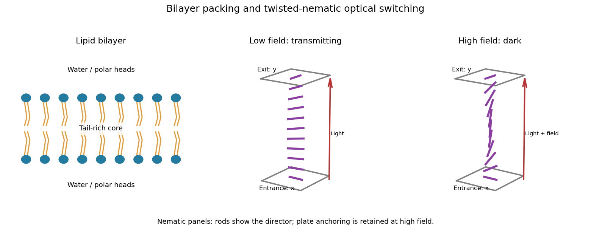

<h1 id="section-a/a2/b/solution">Solution</h1>

↑ **Parent:** [B](../b.md)

A [lipid bilayer](../../../../../lipid-bilayer.md) has two opposed leaflets: [hydrophilic](../../../../../hydrophilicity.md) heads contact the water on either side, while [hydrophobic](../../../../../hydrophobicity.md) tails meet in its interior. This arrangement reduces exposure of the tails to [water](../../../../../water.md) through the [hydrophobic effect](../../../../../hydrophobic-effect.md). Approximately cylindrical molecular packing favors a [lipid bilayer](../../../../../lipid-bilayer.md); a strongly wedge-shaped [amphiphile](../../../../../amphiphile.md) can instead form a [micelle](../../../../../micelle.md). Closing a sheet into a [lipid vesicle](../../../../../lipid-vesicle.md) removes its costly exposed edge.

Within a fluid membrane, lipids diffuse laterally, while transfer of a polar head through the hydrophobic core is much slower without assistance. The core limits passive transport of ions and many polar solutes; membrane [proteins](../../../../../protein-split.md) provide selective routes. Bending costs [free energy](../../../../../thermodynamic-free-energy.md) but does not require the large area compression associated with stretching the molecular packing, so a thin membrane can bend readily while strongly resisting area change. [Cholesterol](../../../../../cholesterol.md) and tail saturation alter packing and fluidity. In a cell, the bilayer also supports embedded [proteins](../../../../../protein-split.md) and a difference of [electric potential](../../../../../electric-potential.md) across the membrane.

**[Figure 1](#section-a/a2/b/image-lipid-bilayer-organization-and-the-low-field-and-field-aligned-states-of-a-twisted-nematic-cell). Lipid bilayer organization and the low-field and field-aligned states of a twisted nematic cell**.

## ↑ Ancestors (14)

1. [B](../b.md)
2. [A2](../../a2.md)
3. [Section A](../../../section-a.md)
4. [2009](../../../../2009-split.md)
5. [Past exam of the quantum condensed matter course of the University of Cambridge](../../../../split.md)
6. [Quantum Condensed Matter course of the University of Cambridge](../../../../../quantum-condensed-matter-course-of-the-university-of-cambridge.md)
7. [Physics course of the year 3 of the natural sciences course of the University of Cambridge](../../../../../physics-course-of-the-year-3-of-the-natural-sciences-course-of-the-university-of-cambridge.md)
8. [Year 3 of the natural sciences course of the University of Cambridge](../../../../../year-3-of-the-natural-sciences-course-of-the-university-of-cambridge.md)
9. [Year of the natural sciences course of the University of Cambridge](../../../../../year-of-the-natural-sciences-course-of-the-university-of-cambridge.md)
10. [Natural sciences course of the University of Cambridge](../../../../../natural-sciences-course-of-the-university-of-cambridge.md)
11. [Course of the University of Cambridge](../../../../../course-of-the-university-of-cambridge.md)
12. [University of Cambridge](../../../../../university-of-cambridge-split.md)
13. [List of universities](../../../../../list-of-universities.md)
14. [Codex Wiki](../../../../../split.md)
