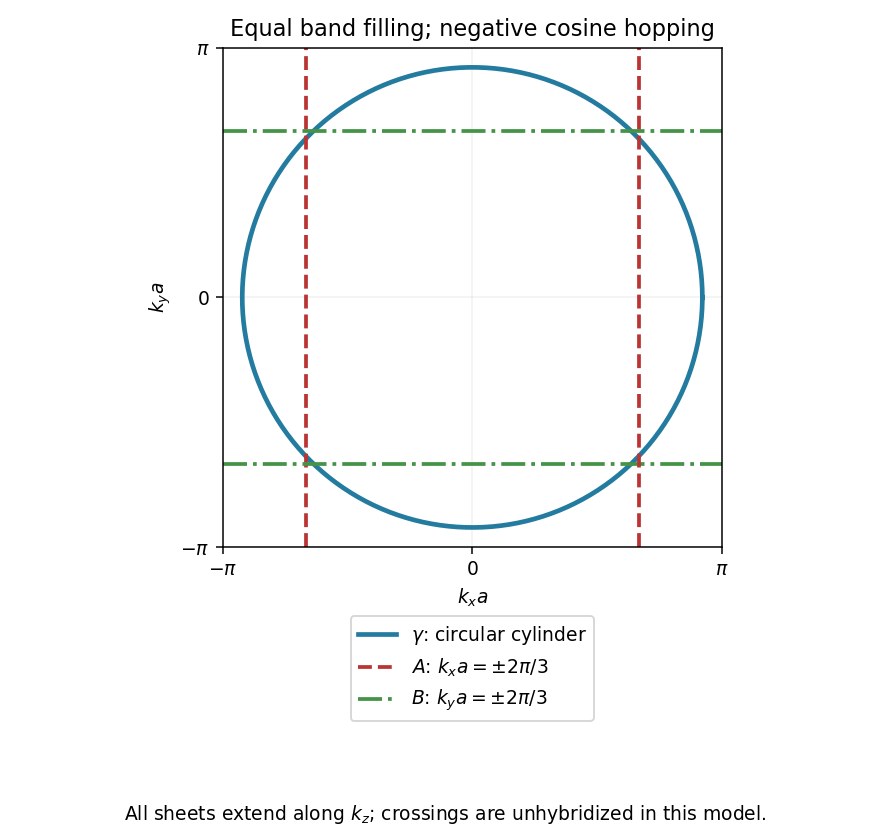

<h1 id="section-b/b3/solution">Solution</h1>

↑ **Parent:** [B3](../b3.md)

The [de Haas-van Alphen effect](../../../../de-haas-van-alphen-effect.md) is an oscillation of equilibrium [magnetization](../../../../magnetization.md), and hence [magnetic susceptibility](../../../../magnetic-susceptibility.md), as [Landau levels](../../../../landau-level.md) pass through the [Fermi energy](../../../../fermi-energy.md) when the field changes. For a fixed slice perpendicular to the field, [Onsager quantization](../../../../onsager-quantization.md) gives

$$
A_k(E_n)=\frac{2\pi eB}{\hbar}(n+\gamma).
$$

At $E_F$, successive crossings change $n$ by one, so

$$
\boxed{\Delta(1/B)=\frac{2\pi e}{\hbar A_k(E_F)},\qquad A_k(E_F)=\frac{2\pi eF}{\hbar}.}
$$

Here $F=1/\Delta(1/B)$ is the oscillation frequency in inverse field. In three dimensions, integrating the oscillatory response over the momentum parallel to the field causes most sections to cancel by phase averaging. The leading surviving contributions come from stationary, hence extremal, cross-sectional areas. Low temperature and sufficiently weak scattering are needed to resolve the levels. Measuring several field directions therefore probes the shape of the [Fermi surface](../../../../fermi-surface.md) rather than only a single scalar electron density.

For the cylindrical $\gamma$ sheet, $A_k=\pi k_F^2$. The measured frequency gives

$$
\boxed{k_F=\sqrt{\frac{2eF}{\hbar}}=7.40\times10^9\ \mathrm{m^{-1}}.}
$$

There are $4/3$ electrons per site in this band, with two spin states per wavevector. Thus the occupied disk takes fraction $2/3$ of the square [Brillouin zone](../../../../brillouin-zone.md):

$$
\frac{\pi k_F^2}{(2\pi/a)^2}=\frac23,\qquad
\boxed{a=\frac{\sqrt{8\pi/3}}{k_F}=3.91\times10^{-10}\ \mathrm m.}
$$

This uses the paper's circular, electron-occupied disk approximation and equal band populations.

In the [tight-binding approximation](../../../../tight-binding.md), hopping to the two neighbors at $\pm a\widehat x$ adds phase factors $e^{ik_xa}$ and $e^{-ik_xa}$. Their sum is $2\cos(k_xa)$; absorb twice the hopping matrix element into $t$. With no $y$ or $z$ hopping this yields $E=E_0+t\cos(k_xa)$. For $t<0$, occupancy is centered on $k_x=0$. The [filling fraction of an independent cosine band](../../../../filling-fraction-of-an-independent-cosine-band.md) is $2/3$, requiring the occupied strip $|k_x|<2\pi/(3a)$, so sheet $A$ consists of the two planes $k_x=\pm2\pi/(3a)$; sheet $B$ similarly has $k_y=\pm2\pi/(3a)$. Each extends along $k_z$, with no dispersion in that direction. The $\gamma$ sheet is a cylinder along $k_z$, of radius $k_F$.

Numerically the planar offsets are $5.35\times10^9\ \mathrm{m^{-1}}$, the zone boundary is $\pi/a=8.03\times10^9\ \mathrm{m^{-1}}$, and the cylinder radius is $k_Fa=2.894$ in dimensionless coordinates. If $t>0$ instead, the band minimum is at the zone edge; occupying its lowest two-thirds puts the planes at $k_x=\pm\pi/(3a)$ or $k_y=\pm\pi/(3a)$, with the central third unoccupied. The sign of the hopping must therefore accompany an absolute placement of these open sheets. The following sketch uses $t<0$ and the stipulated independent-band model, before any avoided crossings caused by additional interorbital hybridization.

**[Figure 2](#section-b/b3/image-independent-band-fermi-surface-cross-sections-for-negative-cosine-hopping-and-equal-populations-of-the-three-bands). Independent-band Fermi-surface cross-sections for negative cosine hopping and equal populations of the three bands**.

## ↑ Ancestors (13)

1. [B3](../b3.md)
2. [Section B](../../section-b.md)
3. [2009](../../../2009-split.md)
4. [Past exam of the quantum condensed matter course of the University of Cambridge](../../../split.md)
5. [Quantum Condensed Matter course of the University of Cambridge](../../../../quantum-condensed-matter-course-of-the-university-of-cambridge.md)
6. [Physics course of the year 3 of the natural sciences course of the University of Cambridge](../../../../physics-course-of-the-year-3-of-the-natural-sciences-course-of-the-university-of-cambridge.md)
7. [Year 3 of the natural sciences course of the University of Cambridge](../../../../year-3-of-the-natural-sciences-course-of-the-university-of-cambridge.md)
8. [Year of the natural sciences course of the University of Cambridge](../../../../year-of-the-natural-sciences-course-of-the-university-of-cambridge.md)
9. [Natural sciences course of the University of Cambridge](../../../../natural-sciences-course-of-the-university-of-cambridge.md)
10. [Course of the University of Cambridge](../../../../course-of-the-university-of-cambridge.md)
11. [University of Cambridge](../../../../university-of-cambridge-split.md)
12. [List of universities](../../../../list-of-universities.md)
13. [Codex Wiki](../../../../split.md)
