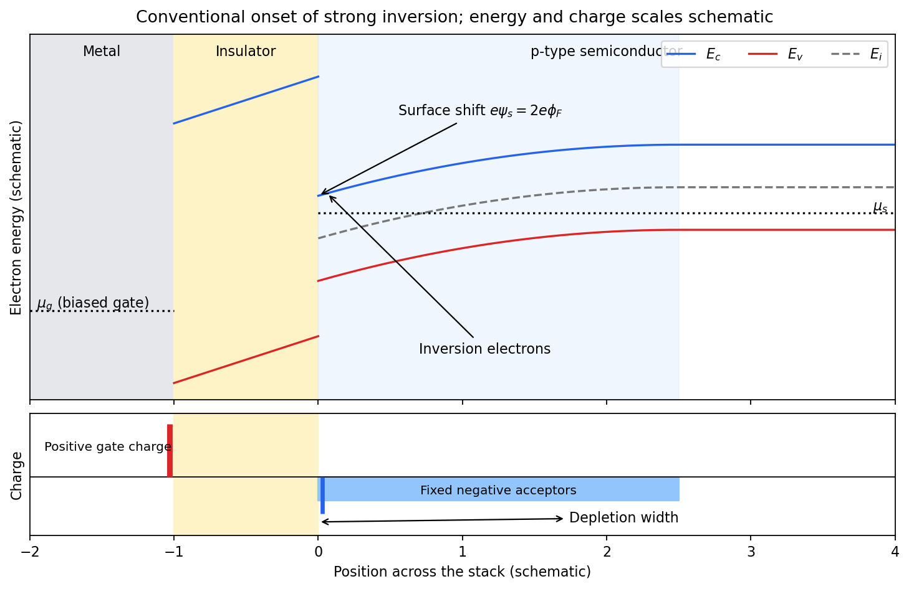
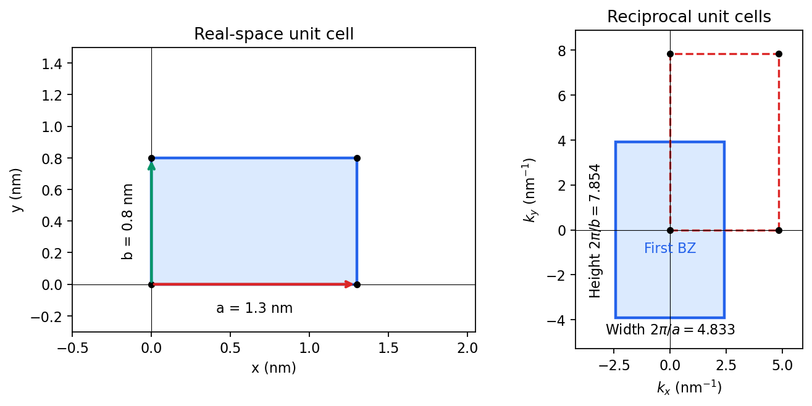
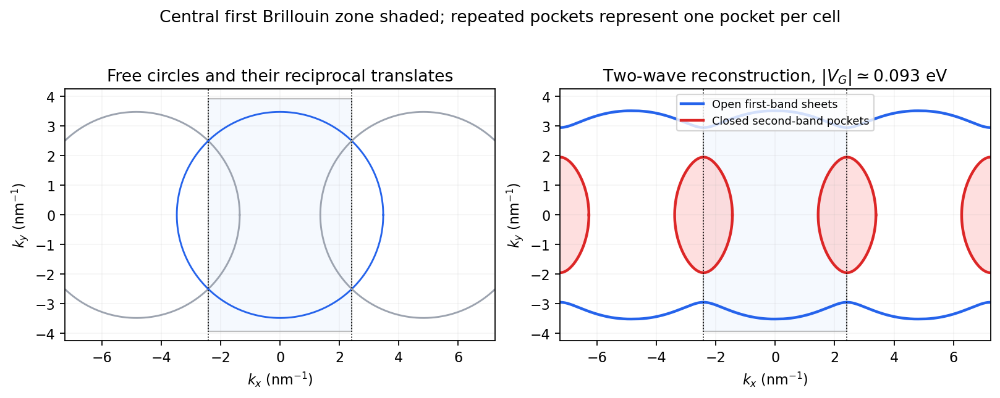

# 2012

↑ **Parent:** [Past exam of the quantum condensed matter course of the University of Cambridge](../past-exam-of-the-quantum-condensed-matter-course-of-the-university-of-cambridge.md)

Official past-paper archive: [https://www.sp.phy.cam.ac.uk/drp2/home.](https://www.sp.phy.cam.ac.uk/drp2/home.) The direct PDF link has not yet been verified.

**Table of contents**

- [1](#1)
  - [a](#1/a)
    - [Solution](#1/a/solution)
  - [b](#1/b)
    - [Solution](#1/b/solution)
  - [c](#1/c)
    - [Solution](#1/c/solution)
- [2](#2)
  - [a](#2/a)
    - [Solution](#2/a/solution)
  - [b](#2/b)
    - [Solution](#2/b/solution)
  - [c](#2/c)
    - [Solution](#2/c/solution)
- [3](#3)
  - [Solution](#3/solution)
- [4](#4)
  - [Solution](#4/solution)

## 1

↑ **Parent:** [2012](2012.md)

<h3 id="1/a">a</h3>

↑ **Parent:** [1](#1)

<h4 id="1/a/solution">Solution</h4>

↑ **Parent:** [A](#1/a)

A positive [electric potential difference](../electric-field.md#electric-potential-difference) between gate and substrate attracts [electrons](../physics.md#electron) towards the insulating interface and repels the mobile [electron holes](../quantum-mechanics.md#electron-hole) of the [p-type semiconductor](../semiconductor.md#p-type-semiconductor) substrate. The exposed, negatively charged [acceptor impurities](../semiconductor.md#acceptor-impurity) form a [depletion region](../semiconductor.md#depletion-region); the thin mobile [electron](../physics.md#electron) layer at its surface is the [semiconductor inversion layer](../semiconductor.md#semiconductor-inversion-layer). The [conduction band](../quantum-mechanics.md#conduction-band) and [valence band](../quantum-mechanics.md#valence-band) bend _downwards_ towards the positively biased gate, because the [electron](../physics.md#electron) [potential energy](../energy.md#potential-energy) is $-e\psi$.

**[Figure 1](#1/a/image-band-bending-and-charge-separation-at-the-conventional-mos-inversion-threshold). Band bending and charge separation at the conventional MOS inversion threshold**.

To specify the conventional [MOS inversion threshold](../semiconductor.md#mos-inversion-threshold), let $N_A$ be the ionized acceptor density, $n_i$ the [intrinsic carrier concentration](../semiconductor.md#intrinsic-carrier-concentration), and

$$
\phi_F=\frac{k_BT}{e}\log\frac{N_A}{n_i}>0.
$$

In the neutral bulk the intrinsic level lies $e\phi_F$ above the [semiconductor](../semiconductor.md) [chemical potential](../chemical-potential.md). A positive surface potential $\psi_s$ lowers both band edges by $e\psi_s$, giving, in the nondegenerate approximation,

$$
p_s=N_Ae^{-e\psi_s/(k_BT)},\qquad
n_s=\frac{n_i^2}{N_A}e^{e\psi_s/(k_BT)}.
$$

At $\psi_s=\phi_F$, the surface is intrinsic: $n_s=p_s=n_i$. The usual onset of _strong inversion_ instead means

$$
\boxed{\psi_s\simeq2\phi_F,\qquad n_s\simeq N_A.}
$$

Thus the surface [electron density](../chemistry.md#electron-density) has grown to the bulk majority-carrier density. The [chemical potential](../chemical-potential.md) need not actually enter the [conduction band](../quantum-mechanics.md#conduction-band). The phrase “just forms” can also refer to the earlier weak-inversion crossover; the diagram uses the conventional strong-inversion threshold and labels it explicitly.

Within the [depletion approximation](../semiconductor.md#depletion-approximation) the negative [space charge](../electric-charge.md#space-charge) is approximately $-eN_A$ over a width

$$
W_d=\sqrt{\frac{2\epsilon_s\psi_s}{eN_A}},\qquad
W_{d,\mathrm{th}}=\sqrt{\frac{4\epsilon_s\phi_F}{eN_A}},
$$

where $\epsilon_s$ is the absolute [semiconductor](../semiconductor.md) [permittivity](../permittivity.md). Its outer edge is where the bands become flat and mobile [electron holes](../quantum-mechanics.md#electron-hole) recover their bulk density. The [electrical insulator](../permittivity.md#electrical-insulator) blocks steady carrier transport while sustaining an [electric field](../electric-field.md); the [metal](../chemical-substance.md#metal) gate supplies positive surface charge balancing depletion and inversion charge. Under gate bias, the gate and substrate [electrochemical potentials](../chemical-potential.md#electrochemical-potential) are different, so a single equilibrium [Fermi level](../quantum-ideal-gas-statistics.md#fermi-level) should not be drawn through the whole biased stack.

<h3 id="1/b">b</h3>

↑ **Parent:** [1](#1)

<h4 id="1/b/solution">Solution</h4>

↑ **Parent:** [B](#1/b)

For a [hydrogenic donor state](../semiconductor.md#hydrogenic-donor-state), [dielectric screening](../quantum-mechanics.md#dielectric-screening) replaces $\epsilon_0$ by $\epsilon_r\epsilon_0$ and the [electron mass](../physics.md#electron-mass) by the [band effective mass](../bloch-s-theorem.md#band-effective-mass). The characteristic orbital radius is therefore

$$
a^*=\frac{4\pi\epsilon_0\epsilon_r\hbar^2}{m^*e^2}
=\epsilon_r\frac{m_e}{m^*}a_0.
$$

Using $a_0=0.0529177\,\mathrm{nm}$ gives

$$
\boxed{a^*=120a_0=6.35\,\mathrm{nm}.}
$$

A [donor-state overlap estimate](../semiconductor.md#donor-state-overlap-estimate) compares this radius with the mean dopant spacing $d\sim N_D^{-1/3}$. Taking $d\sim a^*$ yields

$$
\boxed{N_D\sim(a^*)^{-3}=3.91\times10^{24}\,\mathrm{m^{-3}}
=3.91\times10^{18}\,\mathrm{cm^{-3}}.}
$$

There is no sharp geometrical onset: hydrogenic [wavefunctions](../wave-function.md) have exponential tails. If “overlap” is defined by neighbouring orbital _diameters_ touching, $d\sim2a^*$, the corresponding estimate is $4.88\times10^{23}\,\mathrm{m^{-3}}$, smaller by a factor of eight. These are conventions for the onset of appreciable [orbital overlap](../chemistry.md#orbital-overlap), not an exact critical density for a [metal-insulator transition](../critical-phenomenon.md#metal-insulator-transition).

<h3 id="1/c">c</h3>

↑ **Parent:** [1](#1)

<h4 id="1/c/solution">Solution</h4>

↑ **Parent:** [C](#1/c)

The [band effective mass](../bloch-s-theorem.md#band-effective-mass) is determined by the [second derivative](../calculus.md#second-derivative) of the [dispersion relation](../dispersion-relation.md):

$$
\frac1{m^*(k)}=\frac1{\hbar^2}\frac{d^2E}{dk^2}.
$$

With the stated sign convention and $t>0$, the band minimum is at $k=0$. Expanding the [cosine](../geometry-and-topology.md#cosine), or differentiating twice, gives

$$
E(k)=E_0-2t+ta^2k^2+O(k^4),\qquad
\left.\frac{d^2E}{dk^2}\right|_0=2ta^2.
$$

Comparison with a free [electron](../physics.md#electron)'s [kinetic energy](../energy.md#kinetic-energy) $\hbar^2k^2/(2m_e)$ therefore requires

$$
\boxed{t=\frac{\hbar^2}{2m_ea^2}
=6.78\times10^{-20}\,\mathrm J
=0.423\,\mathrm{eV}.}
$$

The [hopping integral](../bloch-s-theorem.md#hopping-integral) has units of [energy](../energy.md). A negative $t$ would move the minimum to the edge of the [Brillouin zone](../bloch-s-theorem.md#brillouin-zone) and give the same positive bottom-of-band [effective mass](../bloch-s-theorem.md#band-effective-mass) with $|t|$ in this expression.

## 2

↑ **Parent:** [2012](2012.md)

<h3 id="2/a">a</h3>

↑ **Parent:** [2](#2)

<h4 id="2/a/solution">Solution</h4>

↑ **Parent:** [A](#2/a)

A [solar cell](../quantum-mechanics.md#solar-cell) uses the [photovoltaic effect](../quantum-mechanics.md#photovoltaic-effect) to turn [photon](../quantum-mechanics.md#photon) [energy](../energy.md) into electrical work. In a [semiconductor](../semiconductor.md), above-gap [photon absorption](../quantum-mechanics.md#photon-absorption) generates an [electron](../physics.md#electron) in the [conduction band](../quantum-mechanics.md#conduction-band) and an [electron hole](../quantum-mechanics.md#electron-hole) in the [valence band](../quantum-mechanics.md#valence-band). A [p-n junction](../semiconductor.md#p-n-junction), together with selective electrical contacts, collects the two carrier species at opposite terminals. Carrier [diffusion](../thermodynamics.md#diffusion) and the built-in [electric field](../electric-field.md) help separate them before [electron-hole recombination](../quantum-mechanics.md#electron-hole-recombination). Illumination maintains different [quasi-Fermi levels](../chemical-potential.md#quasi-fermi-level) for [electrons](../physics.md#electron) and [electron holes](../quantum-mechanics.md#electron-hole); their splitting, divided by $e$, sets the available terminal voltage in an ideal device. The equilibrium [built-in potential](../semiconductor.md#built-in-potential) alone cannot continuously deliver work.

For an ideal junction, the illuminated output [current density](../electric-charge.md#current-density) is

$$
J(V)=J_{\rm sc}-J_0\left(e^{eV/(k_BT)}-1\right),\qquad
V_{\rm oc}=\frac{k_BT}{e}\log\left(1+\frac{J_{\rm sc}}{J_0}\right).
$$

Here $J_{\rm sc}$ is the photogenerated short-circuit [current density](../electric-charge.md#current-density) and $J_0$ the [diode saturation current](../electrical-circuit.md#diode-saturation-current). The useful operating point maximizes $VJ$, rather than either current or voltage separately. With [solar-cell fill factor](../quantum-mechanics.md#solar-cell-fill-factor) $\mathrm{FF}=P_{\max}/(V_{\rm oc}I_{\rm sc})$,

$$
\eta=\frac{P_{\max}}{P_{\rm in}}
=\frac{V_{\rm oc}I_{\rm sc}\mathrm{FF}}{P_{\rm in}}.
$$

Series resistance, shunts, incomplete [photon absorption](../quantum-mechanics.md#photon-absorption) and [nonradiative recombination](../semiconductor.md#nonradiative-recombination) reduce the attainable efficiency.

**[Figure 2](#2/a/image-ideal-illuminated-solar-cell-current-delivered-power-and-the-maximum-power-point). Ideal illuminated solar cell: current, delivered power and the maximum-power point**.

The [Shockley-Queisser limit](../quantum-mechanics.md#shockley-queisser-limit) removes these avoidable losses but retains the following physical constraints. There is one [semiconductor](../semiconductor.md) junction with one [band gap](../bloch-s-theorem.md#band-gap); each absorbed above-gap [photon](../quantum-mechanics.md#photon) yields at most one collected [electron-hole pair](../quantum-mechanics.md#electron-hole-pair); carriers thermalize to the cell [temperature](../temperature.md); and the inverse optical process produces unavoidable [radiative recombination](../atomic-physics.md#radiative-recombination). If $\Phi_{\odot}(E)$ is the incident [photon](../quantum-mechanics.md#photon) flux per unit [energy](../energy.md), ideal [photon absorption](../quantum-mechanics.md#photon-absorption) gives

$$
J_{\rm sc}=e\int_{E_g}^{\infty}\Phi_{\odot}(E)\,dE.
$$

The same ability to absorb [light](../optics.md#light) requires the junction to emit it. At a forward voltage $V$, the emitted [photon](../quantum-mechanics.md#photon) population has a [chemical potential](../chemical-potential.md) $eV$; in the ordinary nondegenerate limit the resulting recombination current is the exponential diode term above. Maximizing $VJ$ with this radiative $J_0$, and then choosing $E_g$, gives the limiting efficiency.

A small [band gap](../bloch-s-theorem.md#band-gap) collects many [photons](../quantum-mechanics.md#photon) but gives a low voltage and large thermalization losses. A large [band gap](../bloch-s-theorem.md#band-gap) permits a larger voltage but transmits too much of the incident spectrum. Below-gap [photons](../quantum-mechanics.md#photon) are lost to transmission, excess [photon](../quantum-mechanics.md#photon) [energy](../energy.md) above the gap becomes heat, and radiative emission and its associated entropy loss keep $eV_{\rm oc}$ below $E_g$. **The optimum single-junction conversion is roughly thirty percent under ordinary unconcentrated sunlight; the precise ceiling depends on spectrum, cell [temperature](../temperature.md) and optical geometry.** The original detailed-balance calculation gave about $30\%$ at $E_g\simeq1.1\,\mathrm{eV}$ under its specified assumptions.[Detailed Balance Limit of Efficiency of p-n Junction Solar Cells, Journal of Applied Physics 32 (1961), 510–519; abstract and calculation](https://doi.org/10.1063/1.1736034) Multiple junctions and optical concentration change the assumptions and consequently change the bound.

<h3 id="2/b">b</h3>

↑ **Parent:** [2](#2)

<h4 id="2/b/solution">Solution</h4>

↑ **Parent:** [B](#2/b)

Different measurements reveal different aspects of [electronic band structure](../bloch-s-theorem.md#electronic-band-structure); a convincing determination combines their constraints.

**Angle-resolved photoemission.** In [angle-resolved photoemission spectroscopy](../physical-chemistry.md#angle-resolved-photoemission-spectroscopy), [photons](../quantum-mechanics.md#photon) of known [energy](../energy.md) eject occupied [electrons](../physics.md#electron). Measuring their [kinetic energy](../energy.md#kinetic-energy) and emission angle reconstructs [binding energy](../energy.md#binding-energy) and the component of [crystal momentum](../bloch-s-theorem.md#crystal-momentum) parallel to the surface:

$$
E_B=h\nu-\Phi-E_{\rm kin},\qquad
k_\parallel=\frac{\sqrt{2m_eE_{\rm kin}}}{\hbar}\sin\theta.
$$

Here $\Phi$ is the sample [work function](../quantum-mechanics.md#work-function) when [kinetic energy](../energy.md#kinetic-energy) is referenced to the nearby [vacuum](../physics.md#vacuum); an analyzer [energy](../energy.md) scale requires its own work-function calibration. [Momentum](../momentum.md) is conserved modulo a surface [reciprocal lattice](../quantum-scattering.md#reciprocal-lattice) vector, neglecting [photon](../quantum-mechanics.md#photon) [momentum](../momentum.md). Tracking the peaks maps occupied [dispersion relations](../dispersion-relation.md) and the [Fermi surface](../fermi-liquid.md#fermi-surface). The measured intensity also contains the [matrix element](../vector-space.md#matrix-element), the [Fermi-Dirac distribution](../quantum-ideal-gas-statistics.md#fermi-dirac-distribution) and the [spectral function](../quantum-field-theory.md#spectral-function), so an absent bright feature does not establish an absent band. For a three-dimensional solid, the perpendicular [momentum](../momentum.md) requires a final-state model. [Inverse photoemission spectroscopy](../physics.md#inverse-photoemission-spectroscopy) probes unoccupied states by injecting [electrons](../physics.md#electron) and detecting emitted [photons](../quantum-mechanics.md#photon).

**Optical [spectroscopy](../physics.md#spectroscopy).** [Photon absorption](../quantum-mechanics.md#photon-absorption) and [ellipsometry](../optics.md#ellipsometry) measure [interband transitions](../bloch-s-theorem.md#interband-transition), optical [selection rules](../atomic-physics.md#selection-rule) and the complex dielectric response. Because optical [photon](../quantum-mechanics.md#photon) [momentum](../momentum.md) is small on the scale of the [Brillouin zone](../bloch-s-theorem.md#brillouin-zone), direct transitions approximately preserve [crystal momentum](../bloch-s-theorem.md#crystal-momentum). Their onset constrains a [direct band gap](../bloch-s-theorem.md#direct-band-gap); a threshold involving a [phonon](../quantum-ideal-gas-statistics.md#phonon) can reveal an [indirect band gap](../bloch-s-theorem.md#indirect-band-gap). Peak positions constrain [energy](../energy.md) differences between bands, but the response also depends on the [joint density of states](../quantum-ideal-gas-statistics.md#joint-density-of-states) and optical [matrix elements](../vector-space.md#matrix-element), so it does not uniquely determine every $E_n(\mathbf k)$.

**Quantum [oscillations](../wave.md#oscillation) and [cyclotron resonance](../quantum-theory.md#cyclotron-resonance).** In clean samples at low [temperature](../temperature.md), the [de Haas-van Alphen effect](../quantum-theory.md#de-haas-van-alphen-effect) measures [oscillations](../wave.md#oscillation) in [magnetization](../electromagnetism.md#magnetization) and the [Shubnikov-de Haas effect](../bloch-s-theorem.md#shubnikov-de-haas-effect) measures [oscillations](../wave.md#oscillation) in [electrical resistivity](../electric-charge.md#electrical-resistivity) as the inverse [magnetic field](../magnetic-field.md) is varied. Their period in inverse [magnetic field](../magnetic-field.md) is $1/F$, where [Onsager quantization](../quantum-theory.md#onsager-quantization) relates $F$ to an extremal Fermi-surface area perpendicular to the field:

$$
F=\frac{\hbar}{2\pi e}A_{\rm ext}.
$$

Rotating the [magnetic field](../magnetic-field.md) maps the geometry of extremal orbits. The thermal [damping](../wave-equation.md#damping) determines the [cyclotron effective mass](../bloch-s-theorem.md#cyclotron-effective-mass),

$$
m_c=\frac{\hbar^2}{2\pi}\frac{\partial A}{\partial E},
$$

with the appropriate magnitude for a hole orbit. [Cyclotron resonance](../quantum-theory.md#cyclotron-resonance) supplies the corresponding dynamical mass through $\omega_c=eB/m_c$. These are detailed probes near the [Fermi level](../quantum-ideal-gas-statistics.md#fermi-level), rather than measurements of all occupied bands. [Diffraction](../quantum-scattering.md#diffraction) supplies the [reciprocal lattice](../quantum-scattering.md#reciprocal-lattice) needed to label the measured momenta, but [diffraction](../quantum-scattering.md#diffraction) by itself is not a measurement of electronic dispersion.

<h3 id="2/c">c</h3>

↑ **Parent:** [2](#2)

<h4 id="2/c/solution">Solution</h4>

↑ **Parent:** [C](#2/c)

In a weak applied field, [magnetic susceptibility](../statistical-physics.md#magnetic-susceptibility) relates [magnetization](../electromagnetism.md#magnetization) to [magnetic field intensity](../electromagnetism.md#magnetic-field-intensity), $M=\chi H$. Its sign, [temperature](../temperature.md) dependence and nonlinear field dependence distinguish several mechanisms.

**[Diamagnetism](../electromagnetism.md#diamagnetism)** is the orbital response opposing an applied [magnetic field](../magnetic-field.md), with $\chi<0$. Closed-shell atoms and filled bands generally give a weak, nearly temperature-independent response. In a simple free [electron](../physics.md#electron) [metal](../chemical-substance.md#metal), [Landau diamagnetism](../electromagnetism.md#landau-diamagnetism) contributes $\chi_L=-\chi_P/3$; the factor is specific to the isotropic parabolic-band model and is not universal in crystals.

**[Paramagnetism](../electromagnetism.md#paramagnetism)** gives $\chi>0$. Localized [magnetic moments](../electromagnetism.md#magnetic-dipole-moment) align statistically with the field against thermal disorder. For independent moments of [angular momentum](../momentum.md#angular-momentum) $J$,

$$
\chi=\frac{\mu_0n(g\mu_B)^2J(J+1)}{3k_BT},
$$

which is the [Curie law](../statistical-physics.md#curie-s-law). Exchange interactions often lead approximately to the [Curie–Weiss law](../electromagnetism.md#curie-weiss-law), $\chi=C/(T-\Theta)$, sufficiently far above any ordering [temperature](../temperature.md). The sign of $\Theta$ suggests predominantly parallel or antiparallel exchange, though it is not a complete classification. Conduction [electrons](../physics.md#electron) instead exhibit [Pauli paramagnetism](../quantum-ideal-gas-statistics.md#pauli-paramagnetism):

$$
\chi_P=\mu_0\mu_B^2g(E_F),
$$

for $g\simeq2$ and a [spin-summed density of states](../quantum-ideal-gas-statistics.md#spin-summed-density-of-states) per unit volume. Only states close to the [Fermi energy](../quantum-ideal-gas-statistics.md#fermi-energy) change occupation, making this response nearly [temperature](../temperature.md) independent when $k_BT\ll E_F$.

**[Ferromagnetism](../electromagnetism.md#ferromagnetism)** has spontaneous parallel magnetic order below a [Curie temperature](../electromagnetism.md#curie-temperature). [Exchange interaction](../electromagnetism.md#exchange-interaction), not simply classical dipole attraction, provides the dominant alignment mechanism. In the convention $H=-J_{\rm ex}\sum_{\langle ij\rangle}\mathbf S_i\cdot\mathbf S_j$, positive $J_{\rm ex}$ favours alignment. [Magnetic domains](../electromagnetism.md#magnetic-domain) can make a ferromagnet's total [magnetization](../electromagnetism.md#magnetization) vanish before an external field aligns its domains. Domain motion and anisotropy produce saturation, [hysteresis](../critical-phenomenon.md#hysteresis), [remanent magnetization](../electromagnetism.md#remanent-magnetization) and a reverse field measured by [magnetic coercivity](../critical-phenomenon.md#magnetic-coercivity).

**[Figure 3](#2/c/image-qualitative-linear-magnetic-responses-and-a-ferromagnetic-hysteresis-loop). Qualitative linear magnetic responses and a ferromagnetic hysteresis loop**.

**[Antiferromagnetism](../electromagnetism.md#antiferromagnetism)** has oppositely ordered sublattices below a [Néel temperature](../electromagnetism.md#neel-temperature); equal opposing moments give zero net [magnetization](../electromagnetism.md#magnetization) while retaining a nonzero staggered [order parameter](../critical-phenomenon.md#order-parameter). A susceptibility anomaly and [magnetic neutron diffraction](../electromagnetism.md#magnetic-neutron-diffraction) reveal this order even when bulk [magnetization](../electromagnetism.md#magnetization) vanishes. **[Ferrimagnetism](../electromagnetism.md#ferrimagnetism)** also has opposing sublattices but unequal contributions, giving a nonzero spontaneous net moment. Above their ordering [temperatures](../temperature.md) both can become paramagnetic. Measurements with a [magnetometer](../electromagnetism.md#magnetometer) as a function of field and [temperature](../temperature.md), supplemented by magnetic [diffraction](../quantum-scattering.md#diffraction), therefore distinguishes a compensated ordered material from an ordinary paramagnet.

## 3

↑ **Parent:** [2012](2012.md)

<h3 id="3/solution">Solution</h3>

↑ **Parent:** [3](#3)

Use two [plane waves](../wave-function.md#plane-wave), $|\mathbf k\rangle$ and $|\mathbf k-\mathbf G\rangle$, as a [basis](../vector-space.md#basis) near their Bragg degeneracy. The potential has [Fourier coefficients](../fourier-series.md#fourier-coefficient) $V_{\pm\mathbf G}$; its zero [Fourier coefficient](../fourier-series.md#fourier-coefficient) vanishes. All other [plane waves](../wave-function.md#plane-wave) are off [resonance](../dynamical-systems.md#resonance) and are neglected in the leading [nearly-free electron model](../bloch-s-theorem.md#nearly-free-electron-model). With $\varepsilon_{\mathbf k}=\hbar^2k^2/(2m_e)$, the [Schrödinger equation](../mathematical-physics.md#schrodinger-equation) reduces to the [Hermitian matrix](../hilbert-space.md#hermitian-operator) problem

$$
\begin{pmatrix}
\varepsilon_{\mathbf k}&V_G\\
V_G^*&\varepsilon_{\mathbf k-\mathbf G}
\end{pmatrix}
\begin{pmatrix}c_1\\c_2\end{pmatrix}
=E\begin{pmatrix}c_1\\c_2\end{pmatrix}.
$$

Setting the [characteristic polynomial](../linear-operator-theory.md#characteristic-polynomial) equal to zero gives

$$
(E-\varepsilon_{\mathbf k})(E-\varepsilon_{\mathbf k-\mathbf G})-|V_G|^2=0.
$$

Solving this [quadratic equation](../polynomial.md#quadratic-equation) gives

$$
E_\pm=\frac{\varepsilon_{\mathbf k}+\varepsilon_{\mathbf k-\mathbf G}}2
\pm\sqrt{\left(\frac{\varepsilon_{\mathbf k}-\varepsilon_{\mathbf k-\mathbf G}}2\right)^2+|V_G|^2}.
$$

For the real [cosine](../geometry-and-topology.md#cosine) potential its coefficient $V_G$ is real; the absolute-value form also allows an arbitrary choice of origin and corresponding Fourier phase.

At the Brillouin-zone boundary, $\mathbf k\cdot\mathbf G=G^2/2$, the free energies are equal. The two [standing waves](../mathematical-physics.md#standing-wave) have different [probability densities](../wave-function.md#probability-density) relative to the [lattice](../mathematical-logic.md#lattice) potential and are split by

$$
\boxed{\Delta E=2|V_G|.}
$$

Repeating this [avoided crossing](../bloch-s-theorem.md#avoided-crossing) at the [reciprocal lattice](../quantum-scattering.md#reciprocal-lattice) boundaries joins smooth branches into [energy bands](../bloch-s-theorem.md#energy-band). In one dimension a nonzero [Fourier coefficient](../fourier-series.md#fourier-coefficient) opens a gap at the corresponding crossing. In higher dimensions a direct gap at one [wavevector](../elasticity-physics.md#wavevector) need not give a common forbidden [energy](../energy.md) interval at every [wavevector](../elasticity-physics.md#wavevector): different bands may still overlap in [energy](../energy.md). The present two-dimensional example remains metallic even though the crossings are locally gapped.

For the rectangular [lattice](../mathematical-logic.md#lattice), choose real-space primitive vectors $a\widehat{\mathbf x}$ and $b\widehat{\mathbf y}$. The [reciprocal lattice](../quantum-scattering.md#reciprocal-lattice) vectors are

$$
\mathbf G_x=\frac{2\pi}{a}\widehat{\mathbf x},\qquad
\mathbf G_y=\frac{2\pi}{b}\widehat{\mathbf y}.
$$

Define the half-widths of the first [Brillouin zone](../bloch-s-theorem.md#brillouin-zone) by $K=\pi/a$ and $L=\pi/b$. Their values and the zone are

$$
\boxed{K=2.41661\,\mathrm{nm^{-1}},\quad L=3.92699\,\mathrm{nm^{-1}},\quad
-K\leq k_x\leq K,\quad -L\leq k_y\leq L.}
$$

A primitive reciprocal cell can be drawn with a corner at the origin; its centred translate is the first [Brillouin zone](../bloch-s-theorem.md#brillouin-zone) here. Its area is $4\pi^2/(ab)=37.9600\,\mathrm{nm^{-2}}$.

**[Figure 4](#3/image-real-space-primitive-cell-and-reciprocal-space-first-brillouin-zone). Real-space primitive cell and reciprocal-space first Brillouin zone**.

Including both [spin](../angular-momentum-operator.md#spin) states, counting the occupied free-electron states per unit area gives

$$
n_{2D}=2\frac{\pi k_F^2}{(2\pi)^2}=\frac{k_F^2}{2\pi}
=\frac2{ab}.
$$

Consequently

$$
\boxed{k_F=\sqrt{\frac{4\pi}{ab}}=3.47607\,\mathrm{nm^{-1}},\qquad
E_F^{(0)}=\frac{\hbar^2k_F^2}{2m_e}=0.46036\,\mathrm{eV}.}
$$

The occupied [disk](../topology.md#disk-mathematics) has precisely the area of the first [Brillouin zone](../bloch-s-theorem.md#brillouin-zone), but their shapes differ: $K<k_F<L$. It protrudes through both vertical zone boundaries and does not reach the horizontal ones. Thus two [electrons](../physics.md#electron) per cell do not imply a filled first band in the absence of a separating [band gap](../bloch-s-theorem.md#band-gap).

Fold the protruding caps by $\pm\mathbf G_x$. The original [circle](../topology.md#circle) and the translated [circle](../topology.md#circle) intersect at $k_x=K$, $k_y=\pm\sqrt{k_F^2-K^2}$. The potential mixes these states and replaces each crossing by an [avoided crossing](../bloch-s-theorem.md#avoided-crossing). The lower branch reconnects into two open sheets running across successive zones in the $k_x$ direction; the upper branch forms a closed lens-shaped pocket about a vertical zone boundary. In a reduced-zone sketch its two halves sit at opposite edges, but periodic identification makes them **one closed sheet**. This is [rectangular-lattice Fermi-surface reconstruction](../bloch-s-theorem.md#rectangular-lattice-fermi-surface-reconstruction).

**[Figure 5](#3/image-free-and-reconstructed-fermi-contours-two-open-sheets-and-one-closed-pocket-per-reciprocal-cell). Free and reconstructed Fermi contours: two open sheets and one closed pocket per reciprocal cell**.

The largest pocket in this weak-potential construction is the [lens-shaped intersection of two disks](../topology.md#lens-shaped-intersection-of-two-disks) enclosed by the intersecting free circles. Each has radius $k_F$ and their centres are separated by $2K$. If $\theta=\arccos(K/k_F)$, two sectors minus their two triangles give the [lens bound on a reconstructed Fermi pocket](../bloch-s-theorem.md#lens-bound-on-a-reconstructed-fermi-pocket):

$$
A_{\max}=2k_F^2\theta-2K\sqrt{k_F^2-K^2},\qquad
\boxed{A_{\max}=7.30680\,\mathrm{nm^{-2}}.}
$$

Opening a gap raises the upper branch at fixed [chemical potential](../chemical-potential.md) and shrinks its pocket. The reported [quantum oscillation](../quantum-theory.md#quantum-oscillation) area satisfies

$$
\boxed{0<A_k=5.74\,\mathrm{nm^{-2}}<A_{\max},\qquad
\frac{A_k}{A_{\max}}=0.786.}
$$

It is therefore consistent with this closed sheet. [Onsager quantization](../quantum-theory.md#onsager-quantization) gives $F=\hbar A_k/(2\pi e)\simeq601\,\mathrm T$. An orbit on this closed contour can return to itself under the [Lorentz force](../relativistic-electromagnetism.md#lorentz-force) and occupy quantized [Landau levels](../quantum-theory.md#landau-level). The open sheets do not enclose a finite orbit area for a perpendicular field in this two-dimensional model. The observation is consistent with the reconstructed pocket, without uniquely determining a completely arbitrary band structure.

For a quantitative rough coupling estimate, use the supplied fixed-chemical-potential approximation and retain the two waves coupled by $\mathbf G_x$. Write

$$
C=\frac{\hbar^2}{2m_e}=0.0380998\,\mathrm{eV\,nm^2},\qquad
v=|V_G|,\qquad k_x=K+q.
$$

Their upper [eigenvalue](../linear-operator-theory.md#eigenvalue) is

$$
E_+(q,k_y)=C(K^2+q^2+k_y^2)+\sqrt{4C^2K^2q^2+v^2}.
$$

Setting it equal to $Ck_F^2$ gives the pocket boundary

$$
k_y^2=k_F^2-K^2-q^2-\sqrt{4K^2q^2+(v/C)^2}.
$$

Its intersection with $k_y=0$ occurs at $q=\pm q_m$, where

$$
q_m^2=k_F^2+K^2-\sqrt{4k_F^2K^2+(v/C)^2}.
$$

The [two-wave estimate of a Bragg-gap coupling from a pocket area](../bloch-s-theorem.md#two-wave-estimate-of-a-bragg-gap-coupling-from-a-pocket-area) therefore uses

$$
A(v)=4\int_0^{q_m}
\sqrt{k_F^2-K^2-q^2-\sqrt{4K^2q^2+(v/C)^2}}\,dq.
$$

At $v=0$ this reproduces the [lens bound on a reconstructed Fermi pocket](../bloch-s-theorem.md#lens-bound-on-a-reconstructed-fermi-pocket); the pocket disappears at $v=C(k_F^2-K^2)=0.23786\,\mathrm{eV}$. [Numerical integration](../numerical-integration.md) gives $A(0.075\,\mathrm{eV})=6.22\,\mathrm{nm^{-2}}$ and $A(0.100\,\mathrm{eV})=5.54\,\mathrm{nm^{-2}}$. Matching the measured area gives $v\simeq0.0931\,\mathrm{eV}$, so the justified rough result is

$$
\boxed{|V_G|\sim0.1\,\mathrm{eV}\qquad(\Delta E\sim0.2\,\mathrm{eV}).}
$$

This estimate neglects remote plane-wave admixtures and other [Fourier coefficients](../fourier-series.md#fourier-coefficient). It also holds the [chemical potential](../chemical-potential.md) fixed as requested; an exact fixed-density calculation would determine it self-consistently after reconstruction. The numerical root is a way to implement the approximate model, not a measurement of $V_G$ to four significant figures.

## 4

↑ **Parent:** [2012](2012.md)

<h3 id="4/solution">Solution</h3>

↑ **Parent:** [4](#4)

In the [Lorentz oscillator model](../permittivity.md#lorentz-oscillator-model), each participating bound [electron](../physics.md#electron) is displaced by an applied [electric field](../electric-field.md) against a restoring force. The model replaces complicated [interband transitions](../bloch-s-theorem.md#interband-transition) by a driven [damped harmonic oscillator](../analysis.md#damped-harmonic-oscillator). If $u$ is the [electron](../physics.md#electron) displacement along the field and the [electron](../physics.md#electron) charge is $-e$, its equation of motion is

$$
m\ddot u+m\gamma\dot u+m\omega_0^2u=-eE(t).
$$

Here $\omega_0$ describes binding and $\gamma>0$ describes loss of coherent motion. For $E(t)=\operatorname{Re}(E_0e^{-i\omega t})$, the [complex amplitude](../wave.md#complex-amplitude) is

$$
u_0=-\frac{eE_0}{m(\omega_0^2-\omega^2-i\gamma\omega)}.
$$

The induced [electric dipole moment](../electrostatics.md#electric-dipole-moment) is $-eu$, so the [electric polarization](../electromagnetism.md#polarization-density) amplitude for [number density](../statistical-physics.md#number-density) $n$ is

$$
P_0=\frac{ne^2}{m}\frac{E_0}{\omega_0^2-\omega^2-i\gamma\omega}.
$$

Using $D=\epsilon_0E+P=\epsilon_0\epsilon_rE$ gives

$$
\boxed{\epsilon_r(\omega)=1+\frac{\omega_p^2}{\omega_0^2-\omega^2-i\gamma\omega},\qquad
\omega_p^2=\frac{ne^2}{\epsilon_0m}.}
$$

The paper's $\epsilon$ is this dimensionless [relative permittivity](../quantum-mechanics.md#relative-permittivity), rather than the absolute [permittivity](../permittivity.md) $\epsilon_0\epsilon_r$. Independent classes of bound [electrons](../physics.md#electron) contribute additive susceptibilities, usually with different [resonance](../dynamical-systems.md#resonance) frequencies and [optical oscillator strengths](../permittivity.md#optical-oscillator-strength).

Writing $D_\omega=(\omega_0^2-\omega^2)^2+\gamma^2\omega^2$ separates the response into

$$
\epsilon_r'=1+\frac{\omega_p^2(\omega_0^2-\omega^2)}{D_\omega},\qquad
\epsilon_r''=\frac{\omega_p^2\gamma\omega}{D_\omega}.
$$

At zero [frequency](../wave.md#frequency) the [real part](../complex-analysis.md#real-part) is $1+\omega_p^2/\omega_0^2$ and the [imaginary part](../complex-analysis.md#imaginary-part) vanishes. Near [resonance](../dynamical-systems.md#resonance) the [imaginary part](../complex-analysis.md#imaginary-part) has a positive [photon absorption](../quantum-mechanics.md#photon-absorption) peak and the [real part](../complex-analysis.md#real-part) changes rapidly, passing through $1$ at $\omega_0$. Above [resonance](../dynamical-systems.md#resonance) the [real part](../complex-analysis.md#real-part) can become negative when [damping](../wave-equation.md#damping) is sufficiently weak; at very high [frequency](../wave.md#frequency) it approaches $1$ from below while the [imaginary part](../complex-analysis.md#imaginary-part) tends to zero. Finite [damping](../wave-equation.md#damping) removes the undamped divergence.

**[Figure 6](#4/image-real-and-imaginary-relative-permittivity-optical-reflectance-and-attenuation-in-a-lorentz-oscillator-model). Real and imaginary relative permittivity, optical reflectance and attenuation in a Lorentz oscillator model**.

For a nonmagnetic material take the passive square-root branch $N=\eta+i\kappa=\sqrt{\epsilon_r}$, with $\kappa\geq0$. A [plane wave](../wave-function.md#plane-wave) then has an intensity attenuation coefficient $\alpha=2\omega\kappa/c$. Thus the imaginary [permittivity](../permittivity.md) expresses dissipation, whereas the actual [photon absorption](../quantum-mechanics.md#photon-absorption) coefficient is determined by the imaginary [refractive index](../electromagnetic-wave.md#refractive-index). The normal-incidence [power](../energy.md#power) [reflectance](../radiometry.md#reflectance) is

$$
R=\frac{(\eta-1)^2+\kappa^2}{(\eta+1)^2+\kappa^2}.
$$

A large refractive-index mismatch produces [wave reflection](../wave.md#wave-reflection) even without loss. In the undamped model $\epsilon_r<0$ between $\omega_0$ and $\sqrt{\omega_0^2+\omega_p^2}$, so the field is evanescent and [wave reflection](../wave.md#wave-reflection) is total in a semi-infinite sample. With [damping](../wave-equation.md#damping) the response includes both [wave reflection](../wave.md#wave-reflection) and [photon absorption](../quantum-mechanics.md#photon-absorption); a peak in the imaginary [permittivity](../permittivity.md) should not simply be identified with a [reflectance](../radiometry.md#reflectance) peak.

To infer the short-wavelength background from $R=0.35$, assume weak [photon absorption](../quantum-mechanics.md#photon-absorption) and take the physical [semiconductor](../semiconductor.md) branch $\eta>1$. Then

$$
\sqrt R=\frac{\eta-1}{\eta+1},\qquad
\eta=\frac{1+\sqrt{0.35}}{1-\sqrt{0.35}}=3.8973,
$$

so

$$
\boxed{\epsilon_b\simeq\eta^2=15.19\simeq15.}
$$

This is an estimate of the valence-electron background in a [frequency](../wave.md#frequency) window above the doped-carrier response and below the effective bound-electron [resonance](../dynamical-systems.md#resonance). One [reflectance](../radiometry.md#reflectance) value alone does not determine both parts of a complex dielectric constant. Even for real $\epsilon_r$, a reciprocal-index branch gives the same $R$; the ordinary background index greater than unity selects the branch used here.

Using the supplied conventional cubic [lattice](../mathematical-logic.md#lattice) parameter, the participating valence-electron [number density](../statistical-physics.md#number-density) is

$$
n_v=\frac{4\times4}{(0.56\times10^{-9}\,\mathrm m)^3}
=9.11\times10^{28}\,\mathrm{m^{-3}}.
$$

Using $m=m_e$ for the stipulated free-electron comparison gives

$$
\omega_{pv}=\sqrt{\frac{n_ve^2}{\epsilon_0m_e}}
=1.703\times10^{16}\,\mathrm{s^{-1}},\qquad
\boxed{\hbar\omega_{pv}=11.21\,\mathrm{eV}.}
$$

An [angular frequency](../lagrangian-mechanics.md#angular-frequency) “in eV” means its quantum [energy](../energy.md) $\hbar\omega$, not $h\omega$. No doped-carrier [effective mass](../bloch-s-theorem.md#band-effective-mass) should be inserted into this valence-electron count.

The low-frequency limit of the _bound-electron contribution_ obeys

$$
\epsilon_b=1+\frac{\omega_{pv}^2}{\omega_0^2}.
$$

Consequently

$$
\boxed{\hbar\omega_0=\frac{11.21\,\mathrm{eV}}{\sqrt{15.19-1}}
=2.98\,\mathrm{eV}\simeq3\,\mathrm{eV}.}
$$

This effective [resonance](../dynamical-systems.md#resonance) is much larger than the quoted $0.2\,\mathrm{eV}$ [band gap](../bloch-s-theorem.md#band-gap). There is no contradiction: the single oscillator has been assigned the strength of all sixteen participating valence [electrons](../physics.md#electron) per conventional cell, whereas the [band gap](../bloch-s-theorem.md#band-gap) is only the lowest interband excitation threshold. A real spectrum distributes [optical oscillator strength](../permittivity.md#optical-oscillator-strength) over many transitions. Equating the oscillator [resonance](../dynamical-systems.md#resonance) to the lowest threshold would misrepresent the assumed background response. Here “low [frequency](../wave.md#frequency)” means low relative to $\omega_0$; the static response of the _doped conducting sample_ also contains its free carriers.

The additional mobile carriers in doped [indium antimonide](../semiconductor.md#indium-antimonide) contribute a [Drude frequency response](../electric-charge.md#drude-frequency-response), obtained by setting their restoring [frequency](../wave.md#frequency) to zero. At [infrared](../optics.md#infrared) frequencies well below the effective valence [resonance](../dynamical-systems.md#resonance), the sum is approximately

$$
\epsilon_r(\omega)\simeq\epsilon_b-
\frac{\omega_{pc}^2}{\omega(\omega+i\gamma_c)},\qquad
\omega_{pc}^2=\frac{n_ce^2}{\epsilon_0m_c^*}.
$$

At the shorter wavelengths the carrier term is small and $R$ approaches the background value. As [wavelength](../wave-equation.md#wavelength) increases, the negative free-carrier contribution lowers the real [permittivity](../permittivity.md) towards unity. For weak [damping](../wave-equation.md#damping), refractive-index matching to [vacuum](../physics.md#vacuum) gives the [Drude-Lorentz reflectivity minimum](../electric-charge.md#drude-lorentz-reflectivity-minimum) at

$$
\boxed{\omega_{\min}\simeq\frac{\omega_{pc}}{\sqrt{\epsilon_b-1}},\qquad
\lambda_{\min}\simeq\frac{2\pi c\sqrt{\epsilon_b-1}}{\omega_{pc}}.}
$$

This minimum is near $\epsilon_r'=1$, not its zero. At the slightly lower screened [plasma frequency](../physics.md#plasma-frequency) $\omega_{pc}/\sqrt{\epsilon_b}$, the real [permittivity](../permittivity.md) crosses zero; at longer wavelengths it becomes negative and the material becomes strongly reflective. Finite [damping](../wave-equation.md#damping) prevents a perfectly vanishing minimum and rounds the edge. At still lower [frequency](../wave.md#frequency) the large conducting response also drives $R$ towards unity.

**[Figure 7](#4/image-illustrative-drude-lorentz-reflectivity-minimum-increasing-carrier-density-shifts-the-minimum-to-shorter-wavelengths). Illustrative Drude-Lorentz reflectivity minimum: increasing carrier density shifts the minimum to shorter wavelengths**.

For fixed carrier [effective mass](../bloch-s-theorem.md#band-effective-mass) and background [permittivity](../permittivity.md), $\omega_{pc}\propto\sqrt{n_c}$ and $\lambda_{\min}\propto n_c^{-1/2}$. The observed shift of the minimum towards shorter [wavelength](../wave-equation.md#wavelength) as doping increases is therefore the expected free-carrier trend. The figure is an original model illustration, not a digitization or quantitative fit of the supplied curves; the carrier [effective mass](../bloch-s-theorem.md#band-effective-mass), [damping](../wave-equation.md#damping) and their density dependence have not been specified.

## ↑ Ancestors (10)

1. [Past exam of the quantum condensed matter course of the University of Cambridge](../past-exam-of-the-quantum-condensed-matter-course-of-the-university-of-cambridge.md)
2. [Quantum Condensed Matter course of the University of Cambridge](../university-of-cambridge.md#quantum-condensed-matter-course-of-the-university-of-cambridge)
3. [Physics course of the year 3 of the natural sciences course of the University of Cambridge](../university-of-cambridge.md#physics-course-of-the-year-3-of-the-natural-sciences-course-of-the-university-of-cambridge)
4. [Year 3 of the natural sciences course of the University of Cambridge](../university-of-cambridge.md#year-3-of-the-natural-sciences-course-of-the-university-of-cambridge)
5. [Year of the natural sciences course of the University of Cambridge](../university-of-cambridge.md#year-of-the-natural-sciences-course-of-the-university-of-cambridge)
6. [Natural sciences course of the University of Cambridge](../university-of-cambridge.md#natural-sciences-course-of-the-university-of-cambridge)
7. [Course of the University of Cambridge](../university-of-cambridge.md#course-of-the-university-of-cambridge)
8. [University of Cambridge](../university-of-cambridge.md)
9. [List of universities](../README.md#list-of-universities)
10. [Codex Wiki](../README.md)
