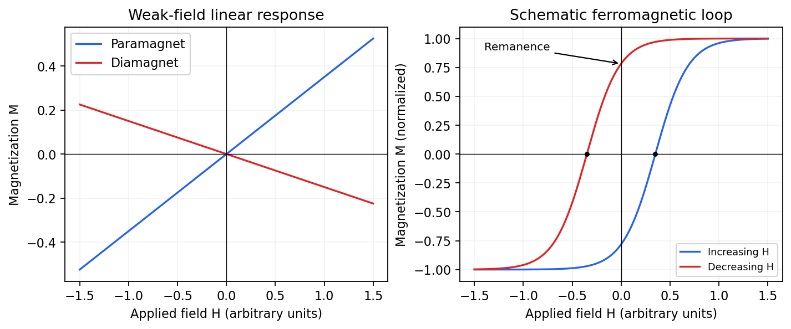

<h1 id="2/c/solution">Solution</h1>

↑ **Parent:** [C](../c.md)

In a weak applied field, [magnetic susceptibility](../../../../magnetic-susceptibility.md) relates [magnetization](../../../../magnetization.md) to [magnetic field intensity](../../../../magnetic-field-intensity.md), $M=\chi H$. Its sign, [temperature](../../../../temperature-split.md) dependence and nonlinear field dependence distinguish several mechanisms.

**[Diamagnetism](../../../../diamagnetism.md)** is the orbital response opposing an applied [magnetic field](../../../../magnetic-field-split.md), with $\chi<0$. Closed-shell atoms and filled bands generally give a weak, nearly temperature-independent response. In a simple free [electron](../../../../electron.md) [metal](../../../../metal.md), [Landau diamagnetism](../../../../landau-diamagnetism.md) contributes $\chi_L=-\chi_P/3$; the factor is specific to the isotropic parabolic-band model and is not universal in crystals.

**[Paramagnetism](../../../../paramagnetism.md)** gives $\chi>0$. Localized [magnetic moments](../../../../magnetic-dipole-moment.md) align statistically with the field against thermal disorder. For independent moments of [angular momentum](../../../../angular-momentum.md) $J$,

$$
\chi=\frac{\mu_0n(g\mu_B)^2J(J+1)}{3k_BT},
$$

which is the [Curie law](../../../../curie-s-law.md). Exchange interactions often lead approximately to the [Curie–Weiss law](../../../../curie-weiss-law.md), $\chi=C/(T-\Theta)$, sufficiently far above any ordering [temperature](../../../../temperature-split.md). The sign of $\Theta$ suggests predominantly parallel or antiparallel exchange, though it is not a complete classification. Conduction [electrons](../../../../electron.md) instead exhibit [Pauli paramagnetism](../../../../pauli-paramagnetism.md):

$$
\chi_P=\mu_0\mu_B^2g(E_F),
$$

for $g\simeq2$ and a [spin-summed density of states](../../../../spin-summed-density-of-states.md) per unit volume. Only states close to the [Fermi energy](../../../../fermi-energy.md) change occupation, making this response nearly [temperature](../../../../temperature-split.md) independent when $k_BT\ll E_F$.

**[Ferromagnetism](../../../../ferromagnetism.md)** has spontaneous parallel magnetic order below a [Curie temperature](../../../../curie-temperature.md). [Exchange interaction](../../../../exchange-interaction.md), not simply classical dipole attraction, provides the dominant alignment mechanism. In the convention $H=-J_{\rm ex}\sum_{\langle ij\rangle}\mathbf S_i\cdot\mathbf S_j$, positive $J_{\rm ex}$ favours alignment. [Magnetic domains](../../../../magnetic-domain.md) can make a ferromagnet's total [magnetization](../../../../magnetization.md) vanish before an external field aligns its domains. Domain motion and anisotropy produce saturation, [hysteresis](../../../../hysteresis.md), [remanent magnetization](../../../../remanent-magnetization.md) and a reverse field measured by [magnetic coercivity](../../../../magnetic-coercivity.md).

**[Figure 3](#2/c/image-qualitative-linear-magnetic-responses-and-a-ferromagnetic-hysteresis-loop). Qualitative linear magnetic responses and a ferromagnetic hysteresis loop**.

**[Antiferromagnetism](../../../../antiferromagnetism.md)** has oppositely ordered sublattices below a [Néel temperature](../../../../neel-temperature.md); equal opposing moments give zero net [magnetization](../../../../magnetization.md) while retaining a nonzero staggered [order parameter](../../../../order-parameter.md). A susceptibility anomaly and [magnetic neutron diffraction](../../../../magnetic-neutron-diffraction.md) reveal this order even when bulk [magnetization](../../../../magnetization.md) vanishes. **[Ferrimagnetism](../../../../ferrimagnetism.md)** also has opposing sublattices but unequal contributions, giving a nonzero spontaneous net moment. Above their ordering [temperatures](../../../../temperature-split.md) both can become paramagnetic. Measurements with a [magnetometer](../../../../magnetometer.md) as a function of field and [temperature](../../../../temperature-split.md), supplemented by magnetic [diffraction](../../../../diffraction.md), therefore distinguishes a compensated ordered material from an ordinary paramagnet.

## ↑ Ancestors (13)

1. [C](../c.md)
2. [2](../../2.md)
3. [2012](../../../2012-split.md)
4. [Past exam of the quantum condensed matter course of the University of Cambridge](../../../split.md)
5. [Quantum Condensed Matter course of the University of Cambridge](../../../../quantum-condensed-matter-course-of-the-university-of-cambridge.md)
6. [Physics course of the year 3 of the natural sciences course of the University of Cambridge](../../../../physics-course-of-the-year-3-of-the-natural-sciences-course-of-the-university-of-cambridge.md)
7. [Year 3 of the natural sciences course of the University of Cambridge](../../../../year-3-of-the-natural-sciences-course-of-the-university-of-cambridge.md)
8. [Year of the natural sciences course of the University of Cambridge](../../../../year-of-the-natural-sciences-course-of-the-university-of-cambridge.md)
9. [Natural sciences course of the University of Cambridge](../../../../natural-sciences-course-of-the-university-of-cambridge.md)
10. [Course of the University of Cambridge](../../../../course-of-the-university-of-cambridge.md)
11. [University of Cambridge](../../../../university-of-cambridge-split.md)
12. [List of universities](../../../../list-of-universities.md)
13. [Codex Wiki](../../../../split.md)
