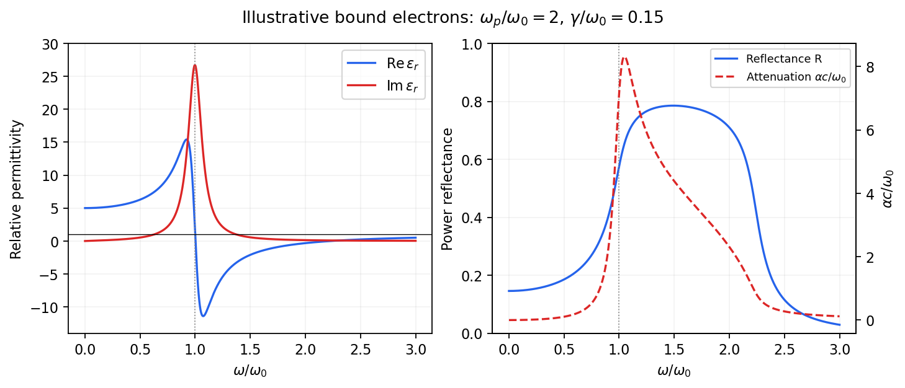
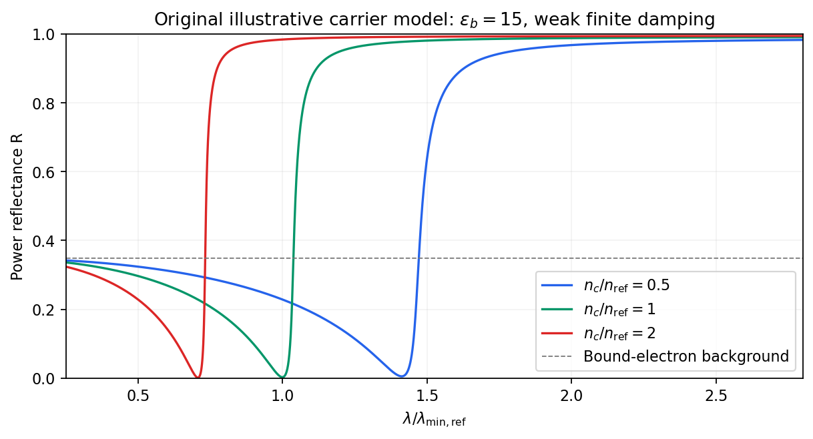

<h1 id="4/solution">Solution</h1>

↑ **Parent:** [4](../4.md)

In the [Lorentz oscillator model](../../../lorentz-oscillator-model.md), each participating bound [electron](../../../electron.md) is displaced by an applied [electric field](../../../electric-field-split.md) against a restoring force. The model replaces complicated [interband transitions](../../../interband-transition.md) by a driven [damped harmonic oscillator](../../../damped-harmonic-oscillator.md). If $u$ is the [electron](../../../electron.md) displacement along the field and the [electron](../../../electron.md) charge is $-e$, its equation of motion is

$$
m\ddot u+m\gamma\dot u+m\omega_0^2u=-eE(t).
$$

Here $\omega_0$ describes binding and $\gamma>0$ describes loss of coherent motion. For $E(t)=\operatorname{Re}(E_0e^{-i\omega t})$, the [complex amplitude](../../../complex-amplitude.md) is

$$
u_0=-\frac{eE_0}{m(\omega_0^2-\omega^2-i\gamma\omega)}.
$$

The induced [electric dipole moment](../../../electric-dipole-moment.md) is $-eu$, so the [electric polarization](../../../polarization-density.md) amplitude for [number density](../../../number-density.md) $n$ is

$$
P_0=\frac{ne^2}{m}\frac{E_0}{\omega_0^2-\omega^2-i\gamma\omega}.
$$

Using $D=\epsilon_0E+P=\epsilon_0\epsilon_rE$ gives

$$
\boxed{\epsilon_r(\omega)=1+\frac{\omega_p^2}{\omega_0^2-\omega^2-i\gamma\omega},\qquad
\omega_p^2=\frac{ne^2}{\epsilon_0m}.}
$$

The paper's $\epsilon$ is this dimensionless [relative permittivity](../../../relative-permittivity.md), rather than the absolute [permittivity](../../../permittivity-split.md) $\epsilon_0\epsilon_r$. Independent classes of bound [electrons](../../../electron.md) contribute additive susceptibilities, usually with different [resonance](../../../resonance.md) frequencies and [optical oscillator strengths](../../../optical-oscillator-strength.md).

Writing $D_\omega=(\omega_0^2-\omega^2)^2+\gamma^2\omega^2$ separates the response into

$$
\epsilon_r'=1+\frac{\omega_p^2(\omega_0^2-\omega^2)}{D_\omega},\qquad
\epsilon_r''=\frac{\omega_p^2\gamma\omega}{D_\omega}.
$$

At zero [frequency](../../../frequency.md) the [real part](../../../real-part.md) is $1+\omega_p^2/\omega_0^2$ and the [imaginary part](../../../imaginary-part.md) vanishes. Near [resonance](../../../resonance.md) the [imaginary part](../../../imaginary-part.md) has a positive [photon absorption](../../../photon-absorption.md) peak and the [real part](../../../real-part.md) changes rapidly, passing through $1$ at $\omega_0$. Above [resonance](../../../resonance.md) the [real part](../../../real-part.md) can become negative when [damping](../../../damping.md) is sufficiently weak; at very high [frequency](../../../frequency.md) it approaches $1$ from below while the [imaginary part](../../../imaginary-part.md) tends to zero. Finite [damping](../../../damping.md) removes the undamped divergence.

**[Figure 6](#4/image-real-and-imaginary-relative-permittivity-optical-reflectance-and-attenuation-in-a-lorentz-oscillator-model). Real and imaginary relative permittivity, optical reflectance and attenuation in a Lorentz oscillator model**.

For a nonmagnetic material take the passive square-root branch $N=\eta+i\kappa=\sqrt{\epsilon_r}$, with $\kappa\geq0$. A [plane wave](../../../plane-wave.md) then has an intensity attenuation coefficient $\alpha=2\omega\kappa/c$. Thus the imaginary [permittivity](../../../permittivity-split.md) expresses dissipation, whereas the actual [photon absorption](../../../photon-absorption.md) coefficient is determined by the imaginary [refractive index](../../../refractive-index.md). The normal-incidence [power](../../../power.md) [reflectance](../../../reflectance.md) is

$$
R=\frac{(\eta-1)^2+\kappa^2}{(\eta+1)^2+\kappa^2}.
$$

A large refractive-index mismatch produces [wave reflection](../../../wave-reflection.md) even without loss. In the undamped model $\epsilon_r<0$ between $\omega_0$ and $\sqrt{\omega_0^2+\omega_p^2}$, so the field is evanescent and [wave reflection](../../../wave-reflection.md) is total in a semi-infinite sample. With [damping](../../../damping.md) the response includes both [wave reflection](../../../wave-reflection.md) and [photon absorption](../../../photon-absorption.md); a peak in the imaginary [permittivity](../../../permittivity-split.md) should not simply be identified with a [reflectance](../../../reflectance.md) peak.

To infer the short-wavelength background from $R=0.35$, assume weak [photon absorption](../../../photon-absorption.md) and take the physical [semiconductor](../../../semiconductor-split.md) branch $\eta>1$. Then

$$
\sqrt R=\frac{\eta-1}{\eta+1},\qquad
\eta=\frac{1+\sqrt{0.35}}{1-\sqrt{0.35}}=3.8973,
$$

so

$$
\boxed{\epsilon_b\simeq\eta^2=15.19\simeq15.}
$$

This is an estimate of the valence-electron background in a [frequency](../../../frequency.md) window above the doped-carrier response and below the effective bound-electron [resonance](../../../resonance.md). One [reflectance](../../../reflectance.md) value alone does not determine both parts of a complex dielectric constant. Even for real $\epsilon_r$, a reciprocal-index branch gives the same $R$; the ordinary background index greater than unity selects the branch used here.

Using the supplied conventional cubic [lattice](../../../lattice.md) parameter, the participating valence-electron [number density](../../../number-density.md) is

$$
n_v=\frac{4\times4}{(0.56\times10^{-9}\,\mathrm m)^3}
=9.11\times10^{28}\,\mathrm{m^{-3}}.
$$

Using $m=m_e$ for the stipulated free-electron comparison gives

$$
\omega_{pv}=\sqrt{\frac{n_ve^2}{\epsilon_0m_e}}
=1.703\times10^{16}\,\mathrm{s^{-1}},\qquad
\boxed{\hbar\omega_{pv}=11.21\,\mathrm{eV}.}
$$

An [angular frequency](../../../angular-frequency.md) “in eV” means its quantum [energy](../../../energy-split.md) $\hbar\omega$, not $h\omega$. No doped-carrier [effective mass](../../../band-effective-mass.md) should be inserted into this valence-electron count.

The low-frequency limit of the _bound-electron contribution_ obeys

$$
\epsilon_b=1+\frac{\omega_{pv}^2}{\omega_0^2}.
$$

Consequently

$$
\boxed{\hbar\omega_0=\frac{11.21\,\mathrm{eV}}{\sqrt{15.19-1}}
=2.98\,\mathrm{eV}\simeq3\,\mathrm{eV}.}
$$

This effective [resonance](../../../resonance.md) is much larger than the quoted $0.2\,\mathrm{eV}$ [band gap](../../../band-gap.md). There is no contradiction: the single oscillator has been assigned the strength of all sixteen participating valence [electrons](../../../electron.md) per conventional cell, whereas the [band gap](../../../band-gap.md) is only the lowest interband excitation threshold. A real spectrum distributes [optical oscillator strength](../../../optical-oscillator-strength.md) over many transitions. Equating the oscillator [resonance](../../../resonance.md) to the lowest threshold would misrepresent the assumed background response. Here “low [frequency](../../../frequency.md)” means low relative to $\omega_0$; the static response of the _doped conducting sample_ also contains its free carriers.

The additional mobile carriers in doped [indium antimonide](../../../indium-antimonide.md) contribute a [Drude frequency response](../../../drude-frequency-response.md), obtained by setting their restoring [frequency](../../../frequency.md) to zero. At [infrared](../../../infrared.md) frequencies well below the effective valence [resonance](../../../resonance.md), the sum is approximately

$$
\epsilon_r(\omega)\simeq\epsilon_b-
\frac{\omega_{pc}^2}{\omega(\omega+i\gamma_c)},\qquad
\omega_{pc}^2=\frac{n_ce^2}{\epsilon_0m_c^*}.
$$

At the shorter wavelengths the carrier term is small and $R$ approaches the background value. As [wavelength](../../../wavelength.md) increases, the negative free-carrier contribution lowers the real [permittivity](../../../permittivity-split.md) towards unity. For weak [damping](../../../damping.md), refractive-index matching to [vacuum](../../../vacuum.md) gives the [Drude-Lorentz reflectivity minimum](../../../drude-lorentz-reflectivity-minimum.md) at

$$
\boxed{\omega_{\min}\simeq\frac{\omega_{pc}}{\sqrt{\epsilon_b-1}},\qquad
\lambda_{\min}\simeq\frac{2\pi c\sqrt{\epsilon_b-1}}{\omega_{pc}}.}
$$

This minimum is near $\epsilon_r'=1$, not its zero. At the slightly lower screened [plasma frequency](../../../plasma-frequency.md) $\omega_{pc}/\sqrt{\epsilon_b}$, the real [permittivity](../../../permittivity-split.md) crosses zero; at longer wavelengths it becomes negative and the material becomes strongly reflective. Finite [damping](../../../damping.md) prevents a perfectly vanishing minimum and rounds the edge. At still lower [frequency](../../../frequency.md) the large conducting response also drives $R$ towards unity.

**[Figure 7](#4/image-illustrative-drude-lorentz-reflectivity-minimum-increasing-carrier-density-shifts-the-minimum-to-shorter-wavelengths). Illustrative Drude-Lorentz reflectivity minimum: increasing carrier density shifts the minimum to shorter wavelengths**.

For fixed carrier [effective mass](../../../band-effective-mass.md) and background [permittivity](../../../permittivity-split.md), $\omega_{pc}\propto\sqrt{n_c}$ and $\lambda_{\min}\propto n_c^{-1/2}$. The observed shift of the minimum towards shorter [wavelength](../../../wavelength.md) as doping increases is therefore the expected free-carrier trend. The figure is an original model illustration, not a digitization or quantitative fit of the supplied curves; the carrier [effective mass](../../../band-effective-mass.md), [damping](../../../damping.md) and their density dependence have not been specified.

## ↑ Ancestors (12)

1. [4](../4.md)
2. [2012](../../2012-split.md)
3. [Past exam of the quantum condensed matter course of the University of Cambridge](../../split.md)
4. [Quantum Condensed Matter course of the University of Cambridge](../../../quantum-condensed-matter-course-of-the-university-of-cambridge.md)
5. [Physics course of the year 3 of the natural sciences course of the University of Cambridge](../../../physics-course-of-the-year-3-of-the-natural-sciences-course-of-the-university-of-cambridge.md)
6. [Year 3 of the natural sciences course of the University of Cambridge](../../../year-3-of-the-natural-sciences-course-of-the-university-of-cambridge.md)
7. [Year of the natural sciences course of the University of Cambridge](../../../year-of-the-natural-sciences-course-of-the-university-of-cambridge.md)
8. [Natural sciences course of the University of Cambridge](../../../natural-sciences-course-of-the-university-of-cambridge.md)
9. [Course of the University of Cambridge](../../../course-of-the-university-of-cambridge.md)
10. [University of Cambridge](../../../university-of-cambridge-split.md)
11. [List of universities](../../../list-of-universities.md)
12. [Codex Wiki](../../../split.md)
