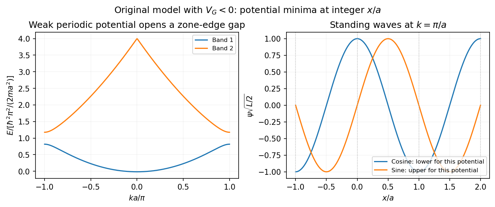
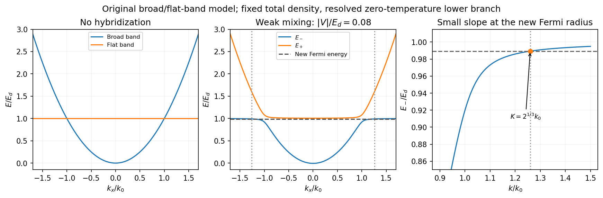

# 2013

↑ **Parent:** [Past exam of the quantum condensed matter course of the University of Cambridge](../past-exam-of-the-quantum-condensed-matter-course-of-the-university-of-cambridge.md)

Official past-paper archive: [https://www.sp.phy.cam.ac.uk/drp2/home.](https://www.sp.phy.cam.ac.uk/drp2/home.) The direct PDF link has not yet been verified.

**Table of contents**

- [1](#1)
  - [a](#1/a)
    - [Solution](#1/a/solution)
  - [b](#1/b)
    - [Solution](#1/b/solution)
  - [c](#1/c)
    - [Solution](#1/c/solution)
- [2](#2)
  - [a](#2/a)
    - [Solution](#2/a/solution)
  - [b](#2/b)
    - [Solution](#2/b/solution)
  - [c](#2/c)
    - [Solution](#2/c/solution)
- [3](#3)
  - [Solution](#3/solution)
- [4](#4)
  - [Solution](#4/solution)

## 1

↑ **Parent:** [2013](2013.md)

<h3 id="1/a">a</h3>

↑ **Parent:** [1](#1)

<h4 id="1/a/solution">Solution</h4>

↑ **Parent:** [A](#1/a)

Use the $e^{-i\omega t}$ convention, so passive [photon absorption](../quantum-mechanics.md#photon-absorption) has positive imaginary [permittivity](../permittivity.md). For a single [Lorentz oscillator model](../permittivity.md#lorentz-oscillator-model) [resonance](../dynamical-systems.md#resonance), write the [photon](../quantum-mechanics.md#photon) [energy](../energy.md) as $E=\hbar\omega$ and

$$
\epsilon_r(E)=\epsilon_b+\frac{S}{E_0^2-E^2-i\Gamma E},\qquad E_0=2\,\mathrm{eV},\quad S>0,\quad\Gamma>0.
$$

Here $S$ has units of [energy](../energy.md) squared, $\Gamma=\hbar\gamma$ is a [damping](../wave-equation.md#damping) [energy](../energy.md), and $\epsilon_b$ is an approximately constant background. The corresponding real and imaginary parts are

$$
\epsilon'_r(E)=\epsilon_b+\frac{S(E_0^2-E^2)}{(E_0^2-E^2)^2+\Gamma^2E^2},\qquad \epsilon''_r(E)=\frac{S\Gamma E}{(E_0^2-E^2)^2+\Gamma^2E^2}.
$$

Thus the [real part](../complex-analysis.md#real-part) starts above the background, rises on the low-energy side of the [resonance](../dynamical-systems.md#resonance), drops rapidly through $\epsilon'_r=\epsilon_b$ at $2\,\mathrm{eV}$, and approaches the background from below at larger [energy](../energy.md). The imaginary part starts at zero, has a positive [photon absorption](../quantum-mechanics.md#photon-absorption) peak near $2\,\mathrm{eV}$, and decays above it. For weak [damping](../wave-equation.md#damping) its peak is close to the [resonance](../dynamical-systems.md#resonance), but not exactly fixed there for arbitrary [damping](../wave-equation.md#damping). At asymptotically large [energy](../energy.md) the corrections scale as $\epsilon'_r-\epsilon_b\sim-S/E^2$ and $\epsilon''_r\sim S\Gamma/E^3$.

**[Figure 1](#1/a/image-illustrative-lorentz-dielectric-response-across-a-2-ev-resonance). Illustrative Lorentz dielectric response across a 2 eV resonance**.

**The [resonance](../dynamical-systems.md#resonance) position is fixed at 2 eV; peak height, width and background are not specified.** The figure chooses an explicit finite [damping](../wave-equation.md#damping) and oscillator strength only to illustrate the shape over 0–5 eV. In particular, a negative real [permittivity](../permittivity.md) above [resonance](../dynamical-systems.md#resonance) is possible for suitable strength and [damping](../wave-equation.md#damping), but is not forced by the [resonance](../dynamical-systems.md#resonance) [energy](../energy.md) alone. Setting [damping](../wave-equation.md#damping) exactly to zero would give a singular idealized response instead of a finite-width [photon absorption](../quantum-mechanics.md#photon-absorption) peak.

<h3 id="1/b">b</h3>

↑ **Parent:** [1](#1)

<h4 id="1/b/solution">Solution</h4>

↑ **Parent:** [B](#1/b)

In the [nearly-free electron model](../bloch-s-theorem.md#nearly-free-electron-model), the free parabola $\varepsilon_k^0=\hbar^2k^2/(2m)$ is coupled to copies shifted by reciprocal wavevectors $G=2\pi/a$. The first degeneracy is at $k=\pm\pi/a$, where the counterpropagating waves have equal [kinetic energy](../energy.md#kinetic-energy). Retaining their coupling gives two branches

$$
E_\pm(k)=V_0+\frac{\varepsilon_k^0+\varepsilon_{k-G}^0}{2}\pm\sqrt{\left(\frac{\varepsilon_k^0-\varepsilon_{k-G}^0}{2}\right)^2+|V_G|^2}.
$$

Consequently a nonzero Fourier component $V_G$ opens a gap $\boxed{\Delta E=2|V_G|}$ at the zone edge. The dispersion remains approximately free-electron-like away from the crossing, but the branches avoid crossing and their slopes flatten at the band edges. The horizontal axis can be labeled either [wavevector](../elasticity-physics.md#wavevector) $k$, with edges at $\pm\pi/a$, or physical [momentum](../momentum.md) $p=\hbar k$, with edges at $\pm\pi\hbar/a$.

At the edge, an appropriate choice of spatial origin makes $V_G$ real. The eigenstates are equal-weight standing waves. In a normalization length $L$ containing an integer number of periods, representative real forms are

$$
\boxed{\psi_c(x)=\sqrt{\frac2L}\cos\frac{\pi x}{a},\qquad \psi_s(x)=\sqrt{\frac2L}\sin\frac{\pi x}{a}.}
$$

They come from the sum and difference of $e^{i\pi x/a}$ and $e^{-i\pi x/a}$, up to a global phase. Their densities have maxima and nodes displaced by $a/2$ relative to one another. Both [wavefunctions](../wave-function.md) change sign under translation by $a$, as required by their zone-edge Bloch phase, while their densities are lattice-periodic.

**[Figure 2](#1/b/image-an-illustrative-nearly-free-electron-gap-and-its-two-zone-edge-standing-waves). An illustrative nearly-free-electron gap and its two zone-edge standing waves**.

For the figure's choice $V(x)=2V_G\cos(2\pi x/a)$ with $V_G<0$, the potential minima occur at $x=na$. The cosine state puts density there and is lower, while the sine state puts a node there and is higher. Reversing the potential's phase relative to the coordinate origin exchanges that assignment. Since the question supplies only the spatial period, it fixes the zone-edge locations and qualitative standing-wave structure, but not a numerical gap or an origin-independent choice of which drawn sine/cosine is lower.

<h3 id="1/c">c</h3>

↑ **Parent:** [1](#1)

<h4 id="1/c/solution">Solution</h4>

↑ **Parent:** [C](#1/c)

For one isotropic carrier species in the [Drude model](../electric-charge.md#drude-model), the longitudinal [electrical resistivity](../electric-charge.md#electrical-resistivity) at zero transverse [electric current](../electric-charge.md#electric-current) is $\rho_{xx}=1/(ne\mu)$, and the Hall [electrical resistivity](../electric-charge.md#electrical-resistivity) has magnitude $|\rho_{yx}|=B/(ne)$. Equivalently, the [electric field](../electric-field.md) balances the magnetic deflection through $E_y=v_xB$, while $|v_x|=\mu|E_x|$. Therefore the magnitude of the [Hall angle](../relativistic-electromagnetism.md#hall-angle) obeys

$$
\frac{|E_y|}{|E_x|}=\mu B.
$$

The required ratio gives

$$
\boxed{B=\frac{0.01}{0.2\,\mathrm{m^2\,V^{-1}\,s^{-1}}}=0.050\,\mathrm T=50\,\mathrm{mT}.}
$$

The [electron density](../chemistry.md#electron-density) cancels. With [electric current](../electric-charge.md#electric-current) along $+x$ and field along $+z$, [electrons](../physics.md#electron) have negative [Hall coefficient](../relativistic-electromagnetism.md#hall-coefficient) and hence $E_y<0$; the requested one-percent condition concerns the magnitude. This calculation assumes [electrons](../physics.md#electron) dominate transport and the transverse contacts draw no [electric current](../electric-charge.md#electric-current), so a Hall field can develop.

## 2

↑ **Parent:** [2013](2013.md)

<h3 id="2/a">a</h3>

↑ **Parent:** [2](#2)

<h4 id="2/a/solution">Solution</h4>

↑ **Parent:** [A](#2/a)

A solid stores thermal [energy](../energy.md) in [lattice](../mathematical-logic.md#lattice) vibrations and, when available, electronic and other excitations. For a nonmagnetic insulating [crystal](../thermodynamics.md#crystal) at sufficiently low [temperature](../temperature.md), the gap suppresses mobile electronic excitations and the leading bulk contribution normally comes from acoustic [phonons](../quantum-ideal-gas-statistics.md#phonon). The three-dimensional [Debye heat capacity](../quantum-ideal-gas-statistics.md#debye-heat-capacity) is

$$
C_{\rm ph}=9Nk_B\left(\frac{T}{\theta_D}\right)^3\int_0^{\theta_D/T}\frac{x^4e^x}{(e^x-1)^2}\,dx.
$$

The vibrational [density of states](../quantum-ideal-gas-statistics.md#density-of-states) scales as $\omega^2$, so only a fraction proportional to $T^3$ of the modes is thermally active at low [temperature](../temperature.md). The two limiting forms are

$$
\boxed{C_{\rm ph}\simeq\beta T^3,\quad\beta=\frac{12\pi^4Nk_B}{5\theta_D^3}\quad(T\ll\theta_D),\qquad C_{\rm ph}\to3Nk_B\quad(T\gg\theta_D).}
$$

The high-temperature value is the [Dulong-Petit law](../heat.md#dulong-petit-law), or $3R$ per mole of atoms. Optical [phonons](../quantum-ideal-gas-statistics.md#phonon) add thermally activated contributions as their characteristic energies become accessible. A multiatom cell has more branches, but still three vibrational degrees of freedom per atom.

A normal [metal](../chemical-substance.md#metal) has an additional low-temperature [electronic heat capacity](../heat.md#electronic-heat-capacity). The [Pauli exclusion principle](../tensor-product-of-quantum-systems.md#pauli-exclusion-principle) restricts excitations to a shell of width about $k_BT$ around the [Fermi energy](../quantum-ideal-gas-statistics.md#fermi-energy). The number of thermally active [electrons](../physics.md#electron) is therefore proportional to $T$, rather than the total [electron](../physics.md#electron) number contributing a classical [heat capacity](../heat.md#heat-capacity). With spin-summed electronic [density of states](../quantum-ideal-gas-statistics.md#density-of-states) $g(E_F)$ for the whole specimen,

$$
\boxed{C_{\rm el}=\gamma T,\qquad \gamma=\frac{\pi^2}{3}k_B^2g(E_F),\qquad C_{\rm metal}\simeq\gamma T+\beta T^3.}
$$

For a three-dimensional free-electron gas, $g(E_F)=3N_e/(2E_F)$ and $C_{\rm el}=(\pi^2/2)N_ek_B(T/T_F)$. Only a small fraction of the classical electronic value is accessible when $T\ll T_F$, even though the electronic term dominates the [phonon](../quantum-ideal-gas-statistics.md#phonon) term as $T\to0$ in a normal gapless [metal](../chemical-substance.md#metal).

**[Figure 3](#2/a/image-debye-lattice-heat-capacity-and-the-low-temperature-electronic-intercept-in-a-normal-metal). Debye lattice heat capacity and the low-temperature electronic intercept in a normal metal**.

Plotting $C/T$ against $T^2$ gives a straight line with intercept $\gamma$ and slope $\beta$ in the appropriate low-temperature range. This separates the electronic density-of-states information from the acoustic-phonon scale. In a [Fermi liquid](../fermi-liquid.md), the interacting [quasiparticle](../quantum-mechanics.md#quasiparticle) [density of states](../quantum-ideal-gas-statistics.md#density-of-states) replaces the free value, so an enhanced [effective mass](../bloch-s-theorem.md#band-effective-mass) enhances $\gamma$.

The qualifications matter experimentally. Superconductivity can gap electronic excitations, magnetic order adds magnetic excitations, defects can generate additional low-temperature terms, and low-dimensional or very small specimens need not obey the bulk cubic law. The Debye expression is for constant-volume [heat capacity](../heat.md#heat-capacity); constant-pressure [heat capacity](../heat.md#heat-capacity) differs through thermal expansion, although the difference is often small at low [temperature](../temperature.md). Thus the normal-metal and ordinary insulating limits are useful leading behaviors, not universal formulas for every solid in every phase.

<h3 id="2/b">b</h3>

↑ **Parent:** [2](#2)

<h4 id="2/b/solution">Solution</h4>

↑ **Parent:** [B](#2/b)

A [Peierls distortion](../quantum-ideal-gas-statistics.md#peierls-distortion) is a spontaneous [lattice](../mathematical-logic.md#lattice) modulation that can lower the [energy](../energy.md) of a one-dimensional [metal](../chemical-substance.md#metal) by opening a gap at its Fermi points. The associated change from metallic to gapped electronic behavior is a [Peierls transition](../quantum-ideal-gas-statistics.md#peierls-transition). The key [wavevector](../elasticity-physics.md#wavevector) is $2k_F$: it couples states near $+k_F$ and $-k_F$, which otherwise have the same [energy](../energy.md).

Consider a spin-degenerate chain with one orbital per atom at spacing $a$ and one [electron](../physics.md#electron) per atom. The band is half filled and $k_F=\pi/(2a)$. A distortion of period $2a$ alternates short and long bonds, doubles the primitive cell, and folds the original Fermi points onto the new zone boundary. The distortion can therefore mix the degenerate states precisely where the occupied and empty states meet.

An explicit [dimerized tight-binding chain](../quantum-ideal-gas-statistics.md#dimerized-tight-binding-chain) has alternating hopping amplitudes $-(t+\delta)$ and $-(t-\delta)$, where $t>0$. In the reduced zone $|k|\leq\pi/(2a)$,

$$
\boxed{E_\pm(k)=\pm2\sqrt{t^2\cos^2(ka)+\delta^2\sin^2(ka)},\qquad E_{\rm gap}=4|\delta|.}
$$

There are two [electrons](../physics.md#electron) per doubled cell, including [spin](../angular-momentum-operator.md#spin), so the lower band is filled and the upper one empty. Splitting the degenerate states pushes occupied levels downward and empty ones upward, giving an electronic [energy](../energy.md) gain.

**[Figure 4](#2/b/image-period-doubling-and-the-opening-of-a-half-filled-chain-gap-in-an-original-dimerized-model). Period doubling and the opening of a half-filled-chain gap in an original dimerized model**.

In weak coupling the electronic gain per length has the characteristic form $-C\delta^2\ln(t/|\delta|)$, with $C>0$. The elastic cost of moving the [ions](../chemistry.md#ion) is proportional to $+K\delta^2$. The logarithm makes the undistorted ideal one-dimensional zero-temperature [metal](../chemical-substance.md#metal) unstable to a small distortion even when the electron-lattice coupling is weak. A self-consistent balance selects a finite distortion amplitude. Two opposite dimerization patterns have the same [energy](../energy.md) for a translation-symmetric isolated chain.

The basic picture links structural modulation to electronic bond order or charge-density modulation, and can open an insulating gap. It does not assert that every real chain has exactly one [electron](../physics.md#electron) per atom or period doubling: away from half filling, a modulation at $2k_F$ need not be commensurate with two [lattice](../mathematical-logic.md#lattice) spacings. [Temperature](../temperature.md), finite chain length and fluctuations cut off the ideal logarithmic response. Interchain coupling and the real [lattice](../mathematical-logic.md#lattice) dynamics determine whether a macroscopic finite-temperature ordered phase actually forms. The strictly one-dimensional zero-temperature instability alone is not a proof of finite-temperature long-range order.

<h3 id="2/c">c</h3>

↑ **Parent:** [2](#2)

<h4 id="2/c/solution">Solution</h4>

↑ **Parent:** [C](#2/c)

A normal [Fermi liquid](../fermi-liquid.md) describes an interacting fermion system whose low-energy excitations remain continuously connected to adding particles to or removing particles from a [Fermi gas](../quantum-ideal-gas-statistics.md#fermi-gas). The elementary long-lived excitation is a [Landau quasiparticle](../fermi-liquid.md#landau-quasiparticle): adding a particle also changes the surrounding many-body state. Its [energy](../energy.md), [velocity](../classical-mechanics.md#velocity) and interactions are renormalized, even though its [electric charge](../electric-charge.md) and [spin](../angular-momentum-operator.md#spin) remain those appropriate to the excitation.

Near an isotropic [Fermi surface](../fermi-liquid.md#fermi-surface),

$$
\xi_{\mathbf k}=\varepsilon^*_{\mathbf k}-\mu\simeq\hbar v_F(k-k_F),\qquad m^*=\frac{\hbar k_F}{v_F}.
$$

Residual interactions make the [quasiparticle](../quantum-mechanics.md#quasiparticle) [energy](../energy.md) depend on the occupations of other [quasiparticles](../quantum-mechanics.md#quasiparticle), expressed by the [Landau quasiparticle energy functional](../fermi-liquid.md#landau-quasiparticle-energy-functional). Its angular components give the [Landau parameters](../fermi-liquid.md#landau-parameter) controlling density and [spin](../angular-momentum-operator.md#spin) responses. Thus the successful particle picture does not mean that interactions have become zero.

Pauli blocking restricts the final states available for low-energy collisions. In an ordinary three-dimensional [Fermi liquid](../fermi-liquid.md) with regular interactions, a representative decay law is

$$
\frac{\hbar}{\tau}=C\frac{\xi^2+(\pi k_BT)^2}{E_*},\qquad C>0.
$$

At $T=0$, the width vanishes faster than $|\xi|$, so an excitation becomes increasingly sharp as it approaches the [Fermi surface](../fermi-liquid.md#fermi-surface). Its coherent spectral weight is the [quasiparticle residue](../fermi-liquid.md#quasiparticle-residue) $Z$, and the physical [electron](../physics.md#electron) occupation has a discontinuity of height $Z$ at zero [temperature](../temperature.md). Incoherent spectral weight accounts for the remainder. The [quasiparticle](../quantum-mechanics.md#quasiparticle) occupations themselves obey a [Fermi-Dirac distribution](../quantum-ideal-gas-statistics.md#fermi-dirac-distribution).

Several leading thermodynamic signatures retain their gas-like form but have interaction-dependent coefficients. In particular,

$$
\frac{C_V}{\mathcal V}=\frac{\pi^2}{3}k_B^2N^*(0)T,\qquad \chi=\frac{\mu_0\mu_B^2N^*(0)}{1+F_0^a},\qquad \kappa=\frac{N^*(0)}{n^2(1+F_0^s)},
$$

for an isotropic spin-one-half model, with $N^*(0)$ the spin-summed [quasiparticle](../quantum-mechanics.md#quasiparticle) [density of states](../quantum-ideal-gas-statistics.md#density-of-states) per volume. [effective mass](../bloch-s-theorem.md#band-effective-mass) changes $N^*(0)$, while the dimensionless interaction parameters $F_0^a,F_0^s$ separately change the [spin](../angular-momentum-operator.md#spin) susceptibility and [compressibility](../thermodynamics.md#compressibility). Collisionless collective density motion can propagate as [zero sound](../fermi-liquid.md#zero-sound), distinct from the single-particle excitations.

The $T^2$ [quasiparticle](../quantum-mechanics.md#quasiparticle) scattering rate often underlies a low-temperature $T^2$ contribution to metallic [electrical resistivity](../electric-charge.md#electrical-resistivity), but a mechanism relaxing electrical [electric current](../electric-charge.md#electric-current) is needed. In a clean Galilean-invariant continuum, electron-electron collisions conserve total [momentum](../momentum.md) and do not alone give a finite dc [electrical resistivity](../electric-charge.md#electrical-resistivity). [Crystal](../thermodynamics.md#crystal) Umklapp scattering or other current-relaxing processes change that conclusion.

Normal liquid [helium-3](../chemical-substance.md#helium-3) and many [metals](../chemical-substance.md#metal) motivate the Fermi-liquid framework. Pairing, magnetic ordering or other transitions can reconstruct the low-energy states. Generic interacting one-dimensional fermion systems instead form a different low-energy state, so the three-dimensional [quasiparticle](../quantum-mechanics.md#quasiparticle) conclusions should not simply be transferred to a chain.

## 3

↑ **Parent:** [2013](2013.md)

<h3 id="3/solution">Solution</h3>

↑ **Parent:** [3](#3)

**Dopant atoms and carrier type.** [Substitutional semiconductor doping](../semiconductor.md#substitutional-semiconductor-doping) places a small fraction of foreign atoms on host [lattice](../mathematical-logic.md#lattice) sites. In a tetrahedrally bonded group-IV [semiconductor](../semiconductor.md), a group-V substitution such as [phosphorus](../chemical-substance.md#phosphorus) in [silicon](../chemical-substance.md#silicon) has an extra valence [electron](../physics.md#electron). A shallow donor level just below the conduction edge can release that [electron](../physics.md#electron), leaving a positively charged donor. In an [n-type semiconductor](../semiconductor.md#n-type-semiconductor), mobile [electrons](../physics.md#electron) are the majority carriers and the [chemical potential](../chemical-potential.md) shifts toward the [conduction band](../quantum-mechanics.md#conduction-band).

A group-III substitution such as [boron](../chemical-substance.md#boron) in [silicon](../chemical-substance.md#silicon) has one fewer valence [electron](../physics.md#electron). An acceptor level just above the valence edge captures an [electron](../physics.md#electron) from the valence states, leaving a mobile [electron hole](../quantum-mechanics.md#electron-hole) and a negatively charged acceptor. In a [p-type semiconductor](../semiconductor.md#p-type-semiconductor), [electron holes](../quantum-mechanics.md#electron-hole) are the majority carriers and the [chemical potential](../chemical-potential.md) shifts toward the [valence band](../quantum-mechanics.md#valence-band). The material can remain electrically neutral in both cases: mobile carrier [electric charge](../electric-charge.md) is compensated by fixed ionized impurity [electric charge](../electric-charge.md). [Dopant freeze-out](../semiconductor.md#dopant-freeze-out), compensation and degeneracy qualify the simplest one-carrier-per-dopant picture.

**Making the junction.** Choose p material at $x<0$ and n material at $x>0$. [Electrons](../physics.md#electron) initially diffuse from n to p, and [electron holes](../quantum-mechanics.md#electron-hole) from p to n, recombining near the interface. Negative ionized acceptors are exposed on the p side and positive ionized donors on the n side. They produce an [electric field](../electric-field.md) directed from n to p. The field opposes further majority-carrier [diffusion](../thermodynamics.md#diffusion) until drift and [diffusion](../thermodynamics.md#diffusion) balance and the equilibrium electrochemical potential is uniform.

The depletion regions are depleted of mobile majority carriers, not of the fixed dopant charges that create the [space charge](../electric-charge.md#space-charge). At equilibrium the conduction and valence edges bend together, while the [chemical potential](../chemical-potential.md) is flat. The specified $\Delta\phi_0$ is a [electric potential difference](../electric-field.md#electric-potential-difference): the corresponding initial chemical-potential [energy](../energy.md) separation is $e\Delta\phi_0$. This convention is required by the quoted units and width formulas. Write $\varepsilon_s=\epsilon\epsilon_0$ for the absolute [permittivity](../permittivity.md); the paper's $\epsilon$ is [relative permittivity](../quantum-mechanics.md#relative-permittivity).

**[Figure 5](#3/image-substitutional-donor-acceptor-levels-equilibrium-band-bending-fixed-space-charge-and-the-junction-electric-field). Substitutional donor/acceptor levels, equilibrium band bending, fixed space charge and the junction electric field**.

**[Poisson equation](../partial-differential-equation.md#poisson-s-equation) and widths.** Let the depleted intervals be $-w_p<x<0$ and $0<x<w_n$. Fully ionized number densities $N_A,N_D$ correspond to [electric charge](../electric-charge.md) densities $-eN_A,+eN_D$, respectively. Thus

$$
\rho(x)=\begin{cases}-eN_A,&-w_p<x<0,\\eN_D,&0<x<w_n,\\0,&\text{in the neutral regions},\end{cases}\qquad \phi''(x)=-\frac{\rho(x)}{\varepsilon_s}.
$$

The factor $e$ converts a dopant concentration to a space-charge density. Requiring zero field in both neutral regions gives [charge neutrality](../electric-charge.md#charge-neutrality),

$$
N_Aw_p=N_Dw_n.
$$

With $\mathcal E=-\phi'$, direct integration gives the triangular field

$$
\mathcal E(x)=\begin{cases}-eN_A(x+w_p)/\varepsilon_s,&-w_p\leq x\leq0,\\eN_D(x-w_n)/\varepsilon_s,&0\leq x\leq w_n.\end{cases}
$$

Continuity at the interface is the same neutrality condition. The field is negative throughout the depleted interval. Set $\phi(-w_p)=0$. Its integral gives

$$
\phi(x)=\begin{cases}eN_A(x+w_p)^2/(2\varepsilon_s),&-w_p\leq x\leq0,\\\Delta\phi_0-eN_D(w_n-x)^2/(2\varepsilon_s),&0\leq x\leq w_n.\end{cases}
$$

Potential continuity therefore requires

$$
\Delta\phi_0=\frac{e}{2\varepsilon_s}(N_Aw_p^2+N_Dw_n^2).
$$

Combining it with neutrality yields the [abrupt-junction depletion width and capacitance](../semiconductor.md#abrupt-junction-depletion-width-and-capacitance) results

$$
\boxed{w_n=\sqrt{\frac{2\varepsilon_sN_A\Delta\phi_0}{eN_D(N_A+N_D)}},\qquad w_p=\sqrt{\frac{2\varepsilon_sN_D\Delta\phi_0}{eN_A(N_A+N_D)}}.}
$$

The more lightly doped side depletes farther, because equal and opposite space charges must be exposed.

**Applied bias.** Define positive $V$ as forward bias, raising the p-side terminal potential relative to the n-side terminal. It lowers the remaining barrier from $\Delta\phi_0$ to $\Delta\phi_0-V$. [Reverse bias](../electrical-circuit.md#reverse-bias) has $V<0$ and raises that barrier. The same Poisson integration applies, with this replacement:

$$
\boxed{w_n(V)=\sqrt{\frac{2\varepsilon_sN_A(\Delta\phi_0-V)}{eN_D(N_A+N_D)}},\quad w_p(V)=\sqrt{\frac{2\varepsilon_sN_D(\Delta\phi_0-V)}{eN_A(N_A+N_D)}}.}
$$

Forward bias narrows the depleted region; [reverse bias](../electrical-circuit.md#reverse-bias) widens it. Under bias there need not be one equilibrium [chemical potential](../chemical-potential.md) across the device, so the equilibrium flat-level argument must not be reapplied unchanged. The barrier/width change is illustrated in the next figure.

**Differential [capacitance](../electromagnetism.md#capacitance) and [electric charge](../electric-charge.md) sign.** Put $B=\Delta\phi_0-V>0$ and $N_{\rm eff}=N_AN_D/(N_A+N_D)$. The signed p-side fixed [electric charge](../electric-charge.md) per unit area is

$$
Q_p=-eN_Aw_p=-\sqrt{2\varepsilon_seN_{\rm eff}B}.
$$

Differentiating with respect to forward [electric potential difference](../electric-field.md#electric-potential-difference) gives the positive [capacitance](../electromagnetism.md#capacitance) per unit area

$$
\boxed{C_A=\frac{dQ_p}{dV}=\sqrt{\frac{\varepsilon_seN_AN_D}{2(N_A+N_D)(\Delta\phi_0-V)}}=\frac{\varepsilon_s}{w_n+w_p}.}
$$

The n-side [electric charge](../electric-charge.md) is $Q_n=-Q_p$, so $dQ_n/dV=-C_A$ instead. If $Q$ denotes a positive space-charge magnitude, the positive [capacitance](../electromagnetism.md#capacitance) is $-dQ/dV$ for this forward-voltage convention. This resolves the sign implicit in the paper's positive $dQ/dV$. The total device [capacitance](../electromagnetism.md#capacitance) is $C=\mathcal A C_A$, where $\mathcal A$ is its cross-sectional area.

**Finite device and numerical sketch.** For the symmetric device, $N_A=N_D=N$ and each side has thickness $d$. Before full depletion,

$$
w_n=w_p=w=\sqrt{\frac{\varepsilon_s(\Delta\phi_0-V)}{eN}},\qquad C(V)=\frac{\mathcal A}{2}\sqrt{\frac{\varepsilon_seN}{\Delta\phi_0-V}}.
$$

Using $\varepsilon_s=12\epsilon_0=1.0625\times10^{-10}\,\mathrm{F\,m^{-1}}$, the zero-bias width on each side is $4.07\,\mathrm{\mu m}$, less than $d=10\,\mathrm{\mu m}$. The total zero-bias [capacitance](../electromagnetism.md#capacitance) is $\boxed{C(0)\simeq1.30\,\mathrm{pF}}$.

Full depletion occurs when $w=d$, so

$$
\boxed{V_{\rm fd}=\Delta\phi_0-\frac{eNd^2}{\varepsilon_s}=0.5-3.016\simeq-2.52\,\mathrm V.}
$$

At larger [reverse bias](../electrical-circuit.md#reverse-bias) the depleted thickness cannot exceed $2d$. In the ideal fully depleted slab, incremental terminal [electric charge](../electric-charge.md) changes the field uniformly through that fixed thickness, giving the [full-depletion capacitance of a symmetric junction slab](../semiconductor.md#full-depletion-capacitance-of-a-symmetric-junction-slab)

$$
\boxed{C_{\rm fd}=\frac{\varepsilon_s\mathcal A}{2d}\simeq5.31\times10^{-13}\,\mathrm F=0.531\,\mathrm{pF}.}
$$

Thus the idealized piecewise sketch over the specified range is

$$
C(V)=\begin{cases}0.531\,\mathrm{pF},&-5.0\leq V\leq V_{\rm fd},\\\displaystyle\frac{\mathcal A}{2}\sqrt{\frac{\varepsilon_seN}{0.5\,\mathrm V-V}},&V_{\rm fd}<V<0.5\,\mathrm V.\end{cases}
$$

It is continuous at full depletion, rises through $1.30\,\mathrm{pF}$ at zero bias, and has a formal inverse-square-root divergence as $V\to0.5\,\mathrm V$ from below.

**[Figure 6](#3/image-bias-dependent-depletion-geometry-and-the-numerical-capacitance-curve-including-full-depletion). Bias-dependent depletion geometry and the numerical capacitance curve, including full depletion**.

There are two physical limits to this extension. Once all dopants are exposed, their fixed [space charge](../electric-charge.md#space-charge) no longer increases, but the terminal electrodes can still acquire incremental [electric charge](../electric-charge.md); differentiating only the fixed ionized [electric charge](../electric-charge.md) would incorrectly predict zero [capacitance](../electromagnetism.md#capacitance). Near $V=\Delta\phi_0$, the [depletion approximation](../semiconductor.md#depletion-approximation) itself fails as mobile carriers and forward injection become important, so the formal infinite endpoint is not a prediction of an actual infinite measured [capacitance](../electromagnetism.md#capacitance). The fully depleted plateau assumes ideal contacts and no breakdown, injection storage or extra series [capacitance](../electromagnetism.md#capacitance).

## 4

↑ **Parent:** [2013](2013.md)

<h3 id="4/solution">Solution</h3>

↑ **Parent:** [4](#4)

**Why [degenerate perturbation theory](../quantum-mechanics.md#degenerate-perturbation-theory) is needed.** If several unperturbed states have equal or nearly equal [energy](../energy.md), a perturbation can mix them at leading order. In that subspace, diagonalize the perturbation matrix rather than using nondegenerate formulas with small [energy](../energy.md) denominators. The resulting eigenvectors identify the combinations selected by the coupling, and the [eigenvalues](../linear-operator-theory.md#eigenvalue) give the leading splitting. Other remote states can then be included perturbatively.

For the [linear combination of atomic orbitals](../chemistry.md#linear-combination-of-atomic-orbitals) description of [molecular hydrogen](../chemical-substance.md#molecular-hydrogen), equivalent atomic $1s$ states on the two nuclei supply the nearly degenerate starting functions. In an orthonormal two-state model, equal diagonal [energy](../energy.md) $E_a$ and real hopping $t$ give $E_a\pm t$ and symmetric/antisymmetric combinations. For actual overlapping atomic functions with overlap $S$ and [Hamiltonian](../hamiltonian-mechanics.md#hamiltonian) coupling $h$, one instead solves a [generalized eigenvalue problem](../linear-operator-theory.md#generalized-eigenvalue-problem):

$$
E_b=\frac{E_a+h}{1+S},\qquad E_{ab}=\frac{E_a-h}{1-S},\qquad \psi_{b,ab}=\frac{\phi_A\pm\phi_B}{\sqrt{2(1\pm S)}}.
$$

The bonding state has enhanced density between the nuclei and the antibonding state a separating node. Two opposite-spin [electrons](../physics.md#electron) occupying the [bonding molecular orbital](../chemistry.md#bonding-orbital) describe the simplest closed-shell hydrogen-molecule bond. Electron-electron interaction and nuclear repulsion are needed to calculate a realistic total [binding energy](../energy.md#binding-energy); the two-state splitting alone is not the full molecular [energy](../energy.md).

In the [nearly-free electron model](../bloch-s-theorem.md#nearly-free-electron-model), the analogous degenerate states are plane waves $|\mathbf k\rangle$ and $|\mathbf k-\mathbf G\rangle$ at a [Bragg scattering](../quantum-scattering.md#bragg-scattering). A [Fourier coefficient](../fourier-series.md#fourier-coefficient) $U_{\mathbf G}$ of the [periodic potential](../bloch-s-theorem.md#periodic-potential) couples them. At exact degeneracy $E_B$, diagonalizing their two-by-two matrix gives

$$
\boxed{E_\pm=E_B+U_0\pm|U_{\mathbf G}|,\qquad E_{\rm gap}=2|U_{\mathbf G}|.}
$$

The associated standing waves place electronic density differently relative to the ionic potential. These are the same gap-opening combinations illustrated in Q1(b). The labels of the two starting [basis](../vector-space.md#basis) states survive as mixed orbital or plane-wave character, rather than independent crossing eigenstates.

**Origin of broad and narrow bands.** Spatially extended s/p-derived orbitals have substantial overlap and therefore large hopping amplitudes and broad bands. More localized d orbitals overlap less strongly and produce narrower bands. A multiorbital tight-binding calculation assigns the on-site orbital energies and hopping matrices, forms Bloch sums, and diagonalizes the resulting matrix at each [wavevector](../elasticity-physics.md#wavevector). Different hopping ranges and orbital [symmetry](../physics.md#symmetry-physics) determine the bandwidths and allowed interband coupling. The two-band description retains one broad combination and one nearly flat d-derived combination; a real transition [metal](../chemical-substance.md#metal) contains several d orbitals and more complicated dispersions.

**Hybridized [eigenvalues](../linear-operator-theory.md#eigenvalue) and eigenstates.** Let $|\psi_{\mathbf k}\rangle=a|\phi_{\mathbf k}\rangle+b|\chi_{\mathbf k}\rangle$, in an [orthonormal basis](../inner-product.md#orthonormal-basis). [Hermitian operator](../hilbert-space.md#hermitian-operator) fixes the reverse coupling to be $V^*$. Projection onto the two components gives

$$
\begin{pmatrix}E_1(\mathbf k)&V\\V^*&E_d\end{pmatrix}\begin{pmatrix}a\\b\end{pmatrix}=E\begin{pmatrix}a\\b\end{pmatrix},\qquad (E_1-E)(E_d-E)-|V|^2=0.
$$

Solving this quadratic yields the [band hybridization](../bloch-s-theorem.md#band-hybridization) dispersion

$$
\boxed{E_\pm(\mathbf k)=\frac{E_1(\mathbf k)+E_d}{2}\pm\sqrt{\left[\frac{E_1(\mathbf k)-E_d}{2}\right]^2+|V|^2}.}
$$

For nonzero $V$, one [eigenvector](../linear-operator-theory.md#eigenvector) representation is $(a,b)\propto(V,E-E_1)$, followed by normalization. Thus the [wavefunctions](../wave-function.md) exchange broad-band and d-band character through the [avoided crossing](../bloch-s-theorem.md#avoided-crossing); the levels are equal mixtures at the uncoupled crossing.

At $V=0$, the parabola crosses the horizontal level at $k=\pm k_0$, with $k_0=\sqrt{2mE_d}/\hbar$. For small nonzero $|V|$, the curves avoid crossing with minimum direct separation $2|V|$. The lower branch follows the parabola below the crossing and flattens toward $E_d$ above it; the upper does the opposite. The lower branch satisfies $E_-<E_d$ everywhere and tends to $E_d$ from below as $k\to\infty$, while the upper branch always lies above $E_d$. This is the perfectly flat-band continuum approximation, with zone-boundary intersections excluded as requested.

**[Figure 7](#4/image-uncoupled-and-weakly-hybridized-broad-flat-bands-with-the-shifted-fermi-radius-and-small-lower-band-slope). Uncoupled and weakly hybridized broad/flat bands, with the shifted Fermi radius and small lower-band slope**.

**Fixed particle number and the larger Fermi sphere.** Denote the uncoupled broad-band Fermi radius by $k_0$ to distinguish it from the new one $K$. With two [spin](../angular-momentum-operator.md#spin) states, the broad-band [number density](../statistical-physics.md#number-density) at $V=0$ is $k_0^3/(3\pi^2)$. The stipulated equal population in the flat sector makes the total density twice that value. At zero [temperature](../temperature.md) and any nonzero hybridization, all occupied states fit into the monotonic lower branch below $E_d$, while the upper branch is empty. Therefore

$$
\frac{K^3}{3\pi^2}=2\frac{k_0^3}{3\pi^2},\qquad \boxed{K=2^{1/3}k_0.}
$$

This is the stated factor increase. It uses fixed total particle number, equal [spin](../angular-momentum-operator.md#spin) counting, an exactly flat unhybridized band and enough available states below any Brillouin-zone restriction. In generic pairs of dispersive bands both hybridized pockets can remain occupied; then [Fermi-volume conservation in two hybridized electron bands](../bloch-s-theorem.md#fermi-volume-conservation-in-two-hybridized-electron-bands) fixes a sum of volumes rather than this one radius. The exactly [flat band](../bloch-s-theorem.md#flat-band) is degenerate at $V=0$, so its initial occupation must be specified, as it is here.

**Fermi-velocity suppression.** Set $\Delta(k)=E_1(k)-E_d$. The exact derivative of the lower branch is

$$
\frac{dE_-}{dk}=\frac{dE_1}{dk}\frac12\left[1-\frac{\Delta(k)}{\sqrt{\Delta(k)^2+4|V|^2}}\right].
$$

At $k=K$, $E_1(K)=2^{2/3}E_d$ and $\Delta(K)=(2^{2/3}-1)E_d>0$. For $|V|\ll\Delta(K)$, the square bracket divided by two is $|V|^2/\Delta(K)^2+O(|V|^4/\Delta(K)^4)$. Since [group velocity](../dispersion-relation.md#group-velocity) is $\hbar^{-1}dE/dk$ and the broad-band reference [velocity](../classical-mechanics.md#velocity) is $v_F^{(1)}=\hbar k_0/m$,

$$
\frac{v_F}{v_F^{(1)}}=\frac{K}{k_0}\frac{|V|^2}{\Delta(K)^2}+O\left(\frac{|V|^4}{E_d^4}\right),
$$

so the [flat-band hybridization Fermi-velocity suppression](../bloch-s-theorem.md#flat-band-hybridization-fermi-velocity-suppression) is

$$
\boxed{\frac{v_F}{v_F^{(1)}}\simeq\frac{2^{1/3}}{(2^{2/3}-1)^2}\frac{|V|^2}{E_d^2},\qquad A\simeq3.65.}
$$

The reference [velocity](../classical-mechanics.md#velocity) is that of the original broad-band Fermi sphere, not the broad-band slope at the larger $K$; omitting the radius change loses the factor $2^{1/3}$.

The low-temperature qualification becomes more stringent as $V\to0$: the new [chemical potential](../chemical-potential.md) approaches $E_d$ with $E_d-\mu\simeq |V|^2/\Delta(K)$, and the relevant thermal [energy](../energy.md) must be small compared with this hybridization scale. At fixed nonzero [temperature](../temperature.md) the singular flat-band redistribution is not automatically resolved for arbitrarily small coupling. A small but finite narrow-band dispersion can also change the occupation topology.

**[Density of states](../quantum-ideal-gas-statistics.md#density-of-states) and magnetism.** For an isotropic three-dimensional branch with [spin](../angular-momentum-operator.md#spin) degeneracy two,

$$
\frac{g(E_F)}{\mathcal V}=\frac{K^2}{\pi^2|dE_-/dk|_{K}}=\frac{K^2}{\pi^2\hbar v_F}.
$$

A small [Fermi velocity](../quantum-ideal-gas-statistics.md#fermi-velocity) therefore produces a large [density of states](../quantum-ideal-gas-statistics.md#density-of-states). The localized, partially filled d-derived bands in [iron](../chemical-substance.md#iron), [cobalt](../chemical-substance.md#cobalt) and [nickel](../chemical-substance.md#nickel) place many states close to the [Fermi level](../quantum-ideal-gas-statistics.md#fermi-level); broad s/p-derived [conduction bands](../quantum-mechanics.md#conduction-band) in [copper](../chemical-substance.md#copper), [silver](../chemical-substance.md#silver) and [gold](../chemical-substance.md#gold) coexist with filled d bands lying below it. This explains the substantially larger Fermi-level [density of states](../quantum-ideal-gas-statistics.md#density-of-states) of the former group within the band picture. An exact factor of ten requires the actual band parameters and is not fixed by the two-band toy model.

A high [density of states](../quantum-ideal-gas-statistics.md#density-of-states) lowers the kinetic-energy cost of [spin polarization](../angular-momentum-operator.md#spin-polarization). A repulsive [exchange interaction](../electromagnetism.md#exchange-interaction) can then satisfy the [Stoner criterion](../statistical-physics.md#stoner-criterion) and stabilize [ferromagnetism](../electromagnetism.md#ferromagnetism). With a [single-spin density of states](../quantum-ideal-gas-statistics.md#single-spin-density-of-states) $g_s$ and an on-site interaction normalization, the criterion is $Ug_s(E_F)>1$; with spin-summed $g=2g_s$, it is $Ug(E_F)>2$. The large d-state contribution favors this instability in Fe, Co and Ni. The noble [metals](../chemical-substance.md#metal) do not satisfy the corresponding instability condition in the same ordinary state; this does not imply that they have no weak magnetic response whatsoever.

## ↑ Ancestors (10)

1. [Past exam of the quantum condensed matter course of the University of Cambridge](../past-exam-of-the-quantum-condensed-matter-course-of-the-university-of-cambridge.md)
2. [Quantum Condensed Matter course of the University of Cambridge](../university-of-cambridge.md#quantum-condensed-matter-course-of-the-university-of-cambridge)
3. [Physics course of the year 3 of the natural sciences course of the University of Cambridge](../university-of-cambridge.md#physics-course-of-the-year-3-of-the-natural-sciences-course-of-the-university-of-cambridge)
4. [Year 3 of the natural sciences course of the University of Cambridge](../university-of-cambridge.md#year-3-of-the-natural-sciences-course-of-the-university-of-cambridge)
5. [Year of the natural sciences course of the University of Cambridge](../university-of-cambridge.md#year-of-the-natural-sciences-course-of-the-university-of-cambridge)
6. [Natural sciences course of the University of Cambridge](../university-of-cambridge.md#natural-sciences-course-of-the-university-of-cambridge)
7. [Course of the University of Cambridge](../university-of-cambridge.md#course-of-the-university-of-cambridge)
8. [University of Cambridge](../university-of-cambridge.md)
9. [List of universities](../README.md#list-of-universities)
10. [Codex Wiki](../README.md)
