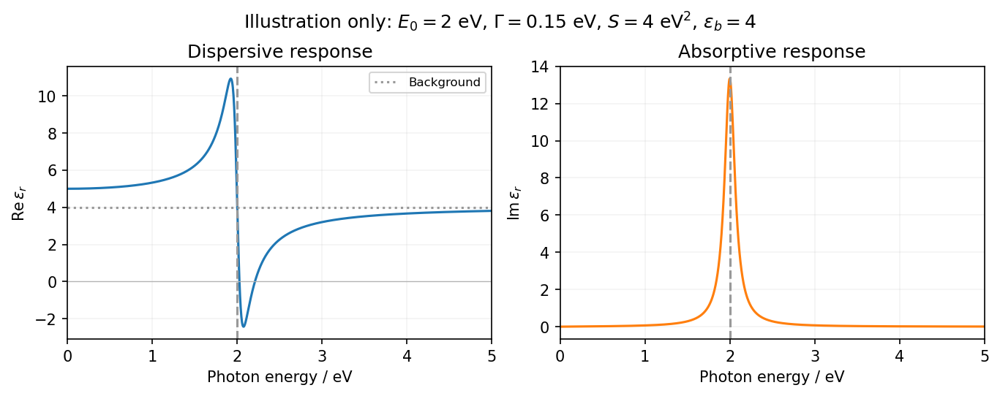

<h1 id="1/a/solution">Solution</h1>

↑ **Parent:** [A](../a.md)

Use the $e^{-i\omega t}$ convention, so passive [photon absorption](../../../../photon-absorption.md) has positive imaginary [permittivity](../../../../permittivity-split.md). For a single [Lorentz oscillator model](../../../../lorentz-oscillator-model.md) [resonance](../../../../resonance.md), write the [photon](../../../../photon.md) [energy](../../../../energy-split.md) as $E=\hbar\omega$ and

$$
\epsilon_r(E)=\epsilon_b+\frac{S}{E_0^2-E^2-i\Gamma E},\qquad E_0=2\,\mathrm{eV},\quad S>0,\quad\Gamma>0.
$$

Here $S$ has units of [energy](../../../../energy-split.md) squared, $\Gamma=\hbar\gamma$ is a [damping](../../../../damping.md) [energy](../../../../energy-split.md), and $\epsilon_b$ is an approximately constant background. The corresponding real and imaginary parts are

$$
\epsilon'_r(E)=\epsilon_b+\frac{S(E_0^2-E^2)}{(E_0^2-E^2)^2+\Gamma^2E^2},\qquad \epsilon''_r(E)=\frac{S\Gamma E}{(E_0^2-E^2)^2+\Gamma^2E^2}.
$$

Thus the [real part](../../../../real-part.md) starts above the background, rises on the low-energy side of the [resonance](../../../../resonance.md), drops rapidly through $\epsilon'_r=\epsilon_b$ at $2\,\mathrm{eV}$, and approaches the background from below at larger [energy](../../../../energy-split.md). The imaginary part starts at zero, has a positive [photon absorption](../../../../photon-absorption.md) peak near $2\,\mathrm{eV}$, and decays above it. For weak [damping](../../../../damping.md) its peak is close to the [resonance](../../../../resonance.md), but not exactly fixed there for arbitrary [damping](../../../../damping.md). At asymptotically large [energy](../../../../energy-split.md) the corrections scale as $\epsilon'_r-\epsilon_b\sim-S/E^2$ and $\epsilon''_r\sim S\Gamma/E^3$.

**[Figure 1](#1/a/image-illustrative-lorentz-dielectric-response-across-a-2-ev-resonance). Illustrative Lorentz dielectric response across a 2 eV resonance**.

**The [resonance](../../../../resonance.md) position is fixed at 2 eV; peak height, width and background are not specified.** The figure chooses an explicit finite [damping](../../../../damping.md) and oscillator strength only to illustrate the shape over 0–5 eV. In particular, a negative real [permittivity](../../../../permittivity-split.md) above [resonance](../../../../resonance.md) is possible for suitable strength and [damping](../../../../damping.md), but is not forced by the [resonance](../../../../resonance.md) [energy](../../../../energy-split.md) alone. Setting [damping](../../../../damping.md) exactly to zero would give a singular idealized response instead of a finite-width [photon absorption](../../../../photon-absorption.md) peak.

## ↑ Ancestors (13)

1. [A](../a.md)
2. [1](../../1.md)
3. [2013](../../../2013-split.md)
4. [Past exam of the quantum condensed matter course of the University of Cambridge](../../../split.md)
5. [Quantum Condensed Matter course of the University of Cambridge](../../../../quantum-condensed-matter-course-of-the-university-of-cambridge.md)
6. [Physics course of the year 3 of the natural sciences course of the University of Cambridge](../../../../physics-course-of-the-year-3-of-the-natural-sciences-course-of-the-university-of-cambridge.md)
7. [Year 3 of the natural sciences course of the University of Cambridge](../../../../year-3-of-the-natural-sciences-course-of-the-university-of-cambridge.md)
8. [Year of the natural sciences course of the University of Cambridge](../../../../year-of-the-natural-sciences-course-of-the-university-of-cambridge.md)
9. [Natural sciences course of the University of Cambridge](../../../../natural-sciences-course-of-the-university-of-cambridge.md)
10. [Course of the University of Cambridge](../../../../course-of-the-university-of-cambridge.md)
11. [University of Cambridge](../../../../university-of-cambridge-split.md)
12. [List of universities](../../../../list-of-universities.md)
13. [Codex Wiki](../../../../split.md)
