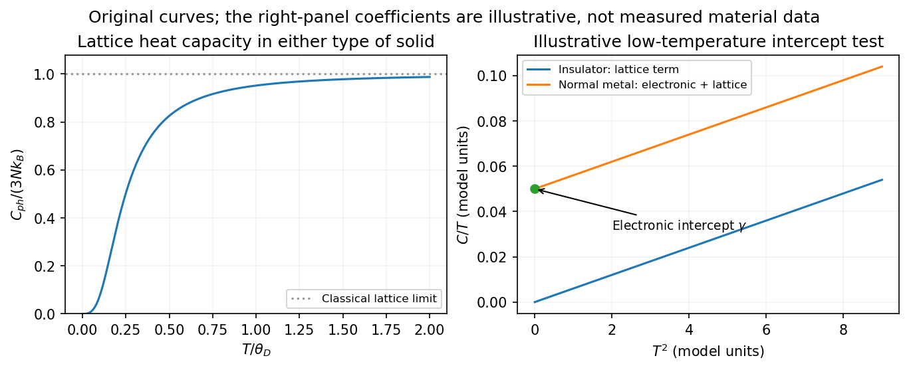

<h1 id="2/a/solution">Solution</h1>

↑ **Parent:** [A](../a.md)

A solid stores thermal [energy](../../../../energy-split.md) in [lattice](../../../../lattice.md) vibrations and, when available, electronic and other excitations. For a nonmagnetic insulating [crystal](../../../../crystal.md) at sufficiently low [temperature](../../../../temperature-split.md), the gap suppresses mobile electronic excitations and the leading bulk contribution normally comes from acoustic [phonons](../../../../phonon.md). The three-dimensional [Debye heat capacity](../../../../debye-heat-capacity.md) is

$$
C_{\rm ph}=9Nk_B\left(\frac{T}{\theta_D}\right)^3\int_0^{\theta_D/T}\frac{x^4e^x}{(e^x-1)^2}\,dx.
$$

The vibrational [density of states](../../../../density-of-states.md) scales as $\omega^2$, so only a fraction proportional to $T^3$ of the modes is thermally active at low [temperature](../../../../temperature-split.md). The two limiting forms are

$$
\boxed{C_{\rm ph}\simeq\beta T^3,\quad\beta=\frac{12\pi^4Nk_B}{5\theta_D^3}\quad(T\ll\theta_D),\qquad C_{\rm ph}\to3Nk_B\quad(T\gg\theta_D).}
$$

The high-temperature value is the [Dulong-Petit law](../../../../dulong-petit-law.md), or $3R$ per mole of atoms. Optical [phonons](../../../../phonon.md) add thermally activated contributions as their characteristic energies become accessible. A multiatom cell has more branches, but still three vibrational degrees of freedom per atom.

A normal [metal](../../../../metal.md) has an additional low-temperature [electronic heat capacity](../../../../electronic-heat-capacity.md). The [Pauli exclusion principle](../../../../pauli-exclusion-principle.md) restricts excitations to a shell of width about $k_BT$ around the [Fermi energy](../../../../fermi-energy.md). The number of thermally active [electrons](../../../../electron.md) is therefore proportional to $T$, rather than the total [electron](../../../../electron.md) number contributing a classical [heat capacity](../../../../heat-capacity.md). With spin-summed electronic [density of states](../../../../density-of-states.md) $g(E_F)$ for the whole specimen,

$$
\boxed{C_{\rm el}=\gamma T,\qquad \gamma=\frac{\pi^2}{3}k_B^2g(E_F),\qquad C_{\rm metal}\simeq\gamma T+\beta T^3.}
$$

For a three-dimensional free-electron gas, $g(E_F)=3N_e/(2E_F)$ and $C_{\rm el}=(\pi^2/2)N_ek_B(T/T_F)$. Only a small fraction of the classical electronic value is accessible when $T\ll T_F$, even though the electronic term dominates the [phonon](../../../../phonon.md) term as $T\to0$ in a normal gapless [metal](../../../../metal.md).

**[Figure 3](#2/a/image-debye-lattice-heat-capacity-and-the-low-temperature-electronic-intercept-in-a-normal-metal). Debye lattice heat capacity and the low-temperature electronic intercept in a normal metal**.

Plotting $C/T$ against $T^2$ gives a straight line with intercept $\gamma$ and slope $\beta$ in the appropriate low-temperature range. This separates the electronic density-of-states information from the acoustic-phonon scale. In a [Fermi liquid](../../../../fermi-liquid-split.md), the interacting [quasiparticle](../../../../quasiparticle.md) [density of states](../../../../density-of-states.md) replaces the free value, so an enhanced [effective mass](../../../../band-effective-mass.md) enhances $\gamma$.

The qualifications matter experimentally. Superconductivity can gap electronic excitations, magnetic order adds magnetic excitations, defects can generate additional low-temperature terms, and low-dimensional or very small specimens need not obey the bulk cubic law. The Debye expression is for constant-volume [heat capacity](../../../../heat-capacity.md); constant-pressure [heat capacity](../../../../heat-capacity.md) differs through thermal expansion, although the difference is often small at low [temperature](../../../../temperature-split.md). Thus the normal-metal and ordinary insulating limits are useful leading behaviors, not universal formulas for every solid in every phase.

## ↑ Ancestors (13)

1. [A](../a.md)
2. [2](../../2.md)
3. [2013](../../../2013-split.md)
4. [Past exam of the quantum condensed matter course of the University of Cambridge](../../../split.md)
5. [Quantum Condensed Matter course of the University of Cambridge](../../../../quantum-condensed-matter-course-of-the-university-of-cambridge.md)
6. [Physics course of the year 3 of the natural sciences course of the University of Cambridge](../../../../physics-course-of-the-year-3-of-the-natural-sciences-course-of-the-university-of-cambridge.md)
7. [Year 3 of the natural sciences course of the University of Cambridge](../../../../year-3-of-the-natural-sciences-course-of-the-university-of-cambridge.md)
8. [Year of the natural sciences course of the University of Cambridge](../../../../year-of-the-natural-sciences-course-of-the-university-of-cambridge.md)
9. [Natural sciences course of the University of Cambridge](../../../../natural-sciences-course-of-the-university-of-cambridge.md)
10. [Course of the University of Cambridge](../../../../course-of-the-university-of-cambridge.md)
11. [University of Cambridge](../../../../university-of-cambridge-split.md)
12. [List of universities](../../../../list-of-universities.md)
13. [Codex Wiki](../../../../split.md)
