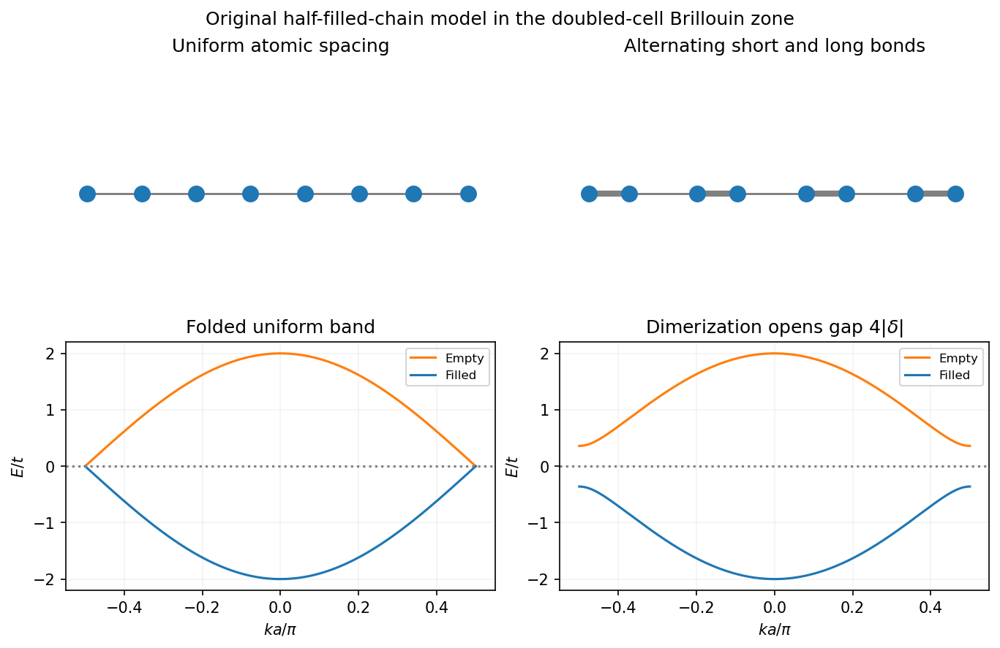

<h1 id="2/b/solution">Solution</h1>

↑ **Parent:** [B](../b.md)

A [Peierls distortion](../../../../peierls-distortion.md) is a spontaneous [lattice](../../../../lattice.md) modulation that can lower the [energy](../../../../energy-split.md) of a one-dimensional [metal](../../../../metal.md) by opening a gap at its Fermi points. The associated change from metallic to gapped electronic behavior is a [Peierls transition](../../../../peierls-transition.md). The key [wavevector](../../../../wavevector.md) is $2k_F$: it couples states near $+k_F$ and $-k_F$, which otherwise have the same [energy](../../../../energy-split.md).

Consider a spin-degenerate chain with one orbital per atom at spacing $a$ and one [electron](../../../../electron.md) per atom. The band is half filled and $k_F=\pi/(2a)$. A distortion of period $2a$ alternates short and long bonds, doubles the primitive cell, and folds the original Fermi points onto the new zone boundary. The distortion can therefore mix the degenerate states precisely where the occupied and empty states meet.

An explicit [dimerized tight-binding chain](../../../../dimerized-tight-binding-chain.md) has alternating hopping amplitudes $-(t+\delta)$ and $-(t-\delta)$, where $t>0$. In the reduced zone $|k|\leq\pi/(2a)$,

$$
\boxed{E_\pm(k)=\pm2\sqrt{t^2\cos^2(ka)+\delta^2\sin^2(ka)},\qquad E_{\rm gap}=4|\delta|.}
$$

There are two [electrons](../../../../electron.md) per doubled cell, including [spin](../../../../spin.md), so the lower band is filled and the upper one empty. Splitting the degenerate states pushes occupied levels downward and empty ones upward, giving an electronic [energy](../../../../energy-split.md) gain.

**[Figure 4](#2/b/image-period-doubling-and-the-opening-of-a-half-filled-chain-gap-in-an-original-dimerized-model). Period doubling and the opening of a half-filled-chain gap in an original dimerized model**.

In weak coupling the electronic gain per length has the characteristic form $-C\delta^2\ln(t/|\delta|)$, with $C>0$. The elastic cost of moving the [ions](../../../../ion.md) is proportional to $+K\delta^2$. The logarithm makes the undistorted ideal one-dimensional zero-temperature [metal](../../../../metal.md) unstable to a small distortion even when the electron-lattice coupling is weak. A self-consistent balance selects a finite distortion amplitude. Two opposite dimerization patterns have the same [energy](../../../../energy-split.md) for a translation-symmetric isolated chain.

The basic picture links structural modulation to electronic bond order or charge-density modulation, and can open an insulating gap. It does not assert that every real chain has exactly one [electron](../../../../electron.md) per atom or period doubling: away from half filling, a modulation at $2k_F$ need not be commensurate with two [lattice](../../../../lattice.md) spacings. [Temperature](../../../../temperature-split.md), finite chain length and fluctuations cut off the ideal logarithmic response. Interchain coupling and the real [lattice](../../../../lattice.md) dynamics determine whether a macroscopic finite-temperature ordered phase actually forms. The strictly one-dimensional zero-temperature instability alone is not a proof of finite-temperature long-range order.

## ↑ Ancestors (13)

1. [B](../b.md)
2. [2](../../2.md)
3. [2013](../../../2013-split.md)
4. [Past exam of the quantum condensed matter course of the University of Cambridge](../../../split.md)
5. [Quantum Condensed Matter course of the University of Cambridge](../../../../quantum-condensed-matter-course-of-the-university-of-cambridge.md)
6. [Physics course of the year 3 of the natural sciences course of the University of Cambridge](../../../../physics-course-of-the-year-3-of-the-natural-sciences-course-of-the-university-of-cambridge.md)
7. [Year 3 of the natural sciences course of the University of Cambridge](../../../../year-3-of-the-natural-sciences-course-of-the-university-of-cambridge.md)
8. [Year of the natural sciences course of the University of Cambridge](../../../../year-of-the-natural-sciences-course-of-the-university-of-cambridge.md)
9. [Natural sciences course of the University of Cambridge](../../../../natural-sciences-course-of-the-university-of-cambridge.md)
10. [Course of the University of Cambridge](../../../../course-of-the-university-of-cambridge.md)
11. [University of Cambridge](../../../../university-of-cambridge-split.md)
12. [List of universities](../../../../list-of-universities.md)
13. [Codex Wiki](../../../../split.md)
