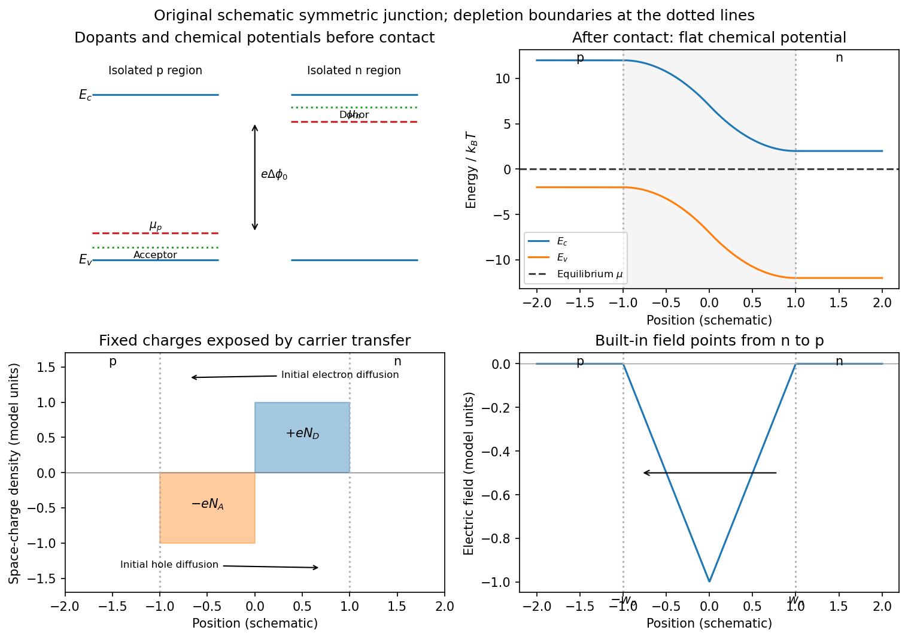
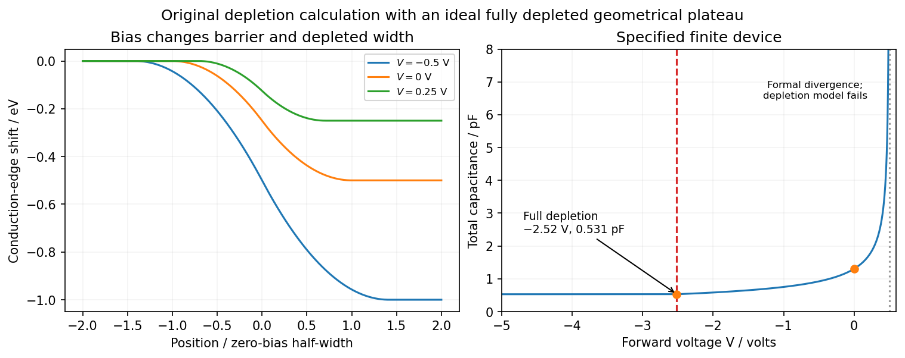

<h1 id="3/solution">Solution</h1>

↑ **Parent:** [3](../3.md)

**Dopant atoms and carrier type.** [Substitutional semiconductor doping](../../../substitutional-semiconductor-doping.md) places a small fraction of foreign atoms on host [lattice](../../../lattice.md) sites. In a tetrahedrally bonded group-IV [semiconductor](../../../semiconductor-split.md), a group-V substitution such as [phosphorus](../../../phosphorus.md) in [silicon](../../../silicon.md) has an extra valence [electron](../../../electron.md). A shallow donor level just below the conduction edge can release that [electron](../../../electron.md), leaving a positively charged donor. In an [n-type semiconductor](../../../n-type-semiconductor.md), mobile [electrons](../../../electron.md) are the majority carriers and the [chemical potential](../../../chemical-potential-split.md) shifts toward the [conduction band](../../../conduction-band.md).

A group-III substitution such as [boron](../../../boron.md) in [silicon](../../../silicon.md) has one fewer valence [electron](../../../electron.md). An acceptor level just above the valence edge captures an [electron](../../../electron.md) from the valence states, leaving a mobile [electron hole](../../../electron-hole.md) and a negatively charged acceptor. In a [p-type semiconductor](../../../p-type-semiconductor.md), [electron holes](../../../electron-hole.md) are the majority carriers and the [chemical potential](../../../chemical-potential-split.md) shifts toward the [valence band](../../../valence-band.md). The material can remain electrically neutral in both cases: mobile carrier [electric charge](../../../electric-charge-split.md) is compensated by fixed ionized impurity [electric charge](../../../electric-charge-split.md). [Dopant freeze-out](../../../dopant-freeze-out.md), compensation and degeneracy qualify the simplest one-carrier-per-dopant picture.

**Making the junction.** Choose p material at $x<0$ and n material at $x>0$. [Electrons](../../../electron.md) initially diffuse from n to p, and [electron holes](../../../electron-hole.md) from p to n, recombining near the interface. Negative ionized acceptors are exposed on the p side and positive ionized donors on the n side. They produce an [electric field](../../../electric-field-split.md) directed from n to p. The field opposes further majority-carrier [diffusion](../../../diffusion.md) until drift and [diffusion](../../../diffusion.md) balance and the equilibrium electrochemical potential is uniform.

The depletion regions are depleted of mobile majority carriers, not of the fixed dopant charges that create the [space charge](../../../space-charge.md). At equilibrium the conduction and valence edges bend together, while the [chemical potential](../../../chemical-potential-split.md) is flat. The specified $\Delta\phi_0$ is a [electric potential difference](../../../electric-potential-difference.md): the corresponding initial chemical-potential [energy](../../../energy-split.md) separation is $e\Delta\phi_0$. This convention is required by the quoted units and width formulas. Write $\varepsilon_s=\epsilon\epsilon_0$ for the absolute [permittivity](../../../permittivity-split.md); the paper's $\epsilon$ is [relative permittivity](../../../relative-permittivity.md).

**[Figure 5](#3/image-substitutional-donor-acceptor-levels-equilibrium-band-bending-fixed-space-charge-and-the-junction-electric-field). Substitutional donor/acceptor levels, equilibrium band bending, fixed space charge and the junction electric field**.

**[Poisson equation](../../../poisson-s-equation.md) and widths.** Let the depleted intervals be $-w_p<x<0$ and $0<x<w_n$. Fully ionized number densities $N_A,N_D$ correspond to [electric charge](../../../electric-charge-split.md) densities $-eN_A,+eN_D$, respectively. Thus

$$
\rho(x)=\begin{cases}-eN_A,&-w_p<x<0,\\eN_D,&0<x<w_n,\\0,&\text{in the neutral regions},\end{cases}\qquad \phi''(x)=-\frac{\rho(x)}{\varepsilon_s}.
$$

The factor $e$ converts a dopant concentration to a space-charge density. Requiring zero field in both neutral regions gives [charge neutrality](../../../charge-neutrality.md),

$$
N_Aw_p=N_Dw_n.
$$

With $\mathcal E=-\phi'$, direct integration gives the triangular field

$$
\mathcal E(x)=\begin{cases}-eN_A(x+w_p)/\varepsilon_s,&-w_p\leq x\leq0,\\eN_D(x-w_n)/\varepsilon_s,&0\leq x\leq w_n.\end{cases}
$$

Continuity at the interface is the same neutrality condition. The field is negative throughout the depleted interval. Set $\phi(-w_p)=0$. Its integral gives

$$
\phi(x)=\begin{cases}eN_A(x+w_p)^2/(2\varepsilon_s),&-w_p\leq x\leq0,\\\Delta\phi_0-eN_D(w_n-x)^2/(2\varepsilon_s),&0\leq x\leq w_n.\end{cases}
$$

Potential continuity therefore requires

$$
\Delta\phi_0=\frac{e}{2\varepsilon_s}(N_Aw_p^2+N_Dw_n^2).
$$

Combining it with neutrality yields the [abrupt-junction depletion width and capacitance](../../../abrupt-junction-depletion-width-and-capacitance.md) results

$$
\boxed{w_n=\sqrt{\frac{2\varepsilon_sN_A\Delta\phi_0}{eN_D(N_A+N_D)}},\qquad w_p=\sqrt{\frac{2\varepsilon_sN_D\Delta\phi_0}{eN_A(N_A+N_D)}}.}
$$

The more lightly doped side depletes farther, because equal and opposite space charges must be exposed.

**Applied bias.** Define positive $V$ as forward bias, raising the p-side terminal potential relative to the n-side terminal. It lowers the remaining barrier from $\Delta\phi_0$ to $\Delta\phi_0-V$. [Reverse bias](../../../reverse-bias.md) has $V<0$ and raises that barrier. The same Poisson integration applies, with this replacement:

$$
\boxed{w_n(V)=\sqrt{\frac{2\varepsilon_sN_A(\Delta\phi_0-V)}{eN_D(N_A+N_D)}},\quad w_p(V)=\sqrt{\frac{2\varepsilon_sN_D(\Delta\phi_0-V)}{eN_A(N_A+N_D)}}.}
$$

Forward bias narrows the depleted region; [reverse bias](../../../reverse-bias.md) widens it. Under bias there need not be one equilibrium [chemical potential](../../../chemical-potential-split.md) across the device, so the equilibrium flat-level argument must not be reapplied unchanged. The barrier/width change is illustrated in the next figure.

**Differential [capacitance](../../../capacitance.md) and [electric charge](../../../electric-charge-split.md) sign.** Put $B=\Delta\phi_0-V>0$ and $N_{\rm eff}=N_AN_D/(N_A+N_D)$. The signed p-side fixed [electric charge](../../../electric-charge-split.md) per unit area is

$$
Q_p=-eN_Aw_p=-\sqrt{2\varepsilon_seN_{\rm eff}B}.
$$

Differentiating with respect to forward [electric potential difference](../../../electric-potential-difference.md) gives the positive [capacitance](../../../capacitance.md) per unit area

$$
\boxed{C_A=\frac{dQ_p}{dV}=\sqrt{\frac{\varepsilon_seN_AN_D}{2(N_A+N_D)(\Delta\phi_0-V)}}=\frac{\varepsilon_s}{w_n+w_p}.}
$$

The n-side [electric charge](../../../electric-charge-split.md) is $Q_n=-Q_p$, so $dQ_n/dV=-C_A$ instead. If $Q$ denotes a positive space-charge magnitude, the positive [capacitance](../../../capacitance.md) is $-dQ/dV$ for this forward-voltage convention. This resolves the sign implicit in the paper's positive $dQ/dV$. The total device [capacitance](../../../capacitance.md) is $C=\mathcal A C_A$, where $\mathcal A$ is its cross-sectional area.

**Finite device and numerical sketch.** For the symmetric device, $N_A=N_D=N$ and each side has thickness $d$. Before full depletion,

$$
w_n=w_p=w=\sqrt{\frac{\varepsilon_s(\Delta\phi_0-V)}{eN}},\qquad C(V)=\frac{\mathcal A}{2}\sqrt{\frac{\varepsilon_seN}{\Delta\phi_0-V}}.
$$

Using $\varepsilon_s=12\epsilon_0=1.0625\times10^{-10}\,\mathrm{F\,m^{-1}}$, the zero-bias width on each side is $4.07\,\mathrm{\mu m}$, less than $d=10\,\mathrm{\mu m}$. The total zero-bias [capacitance](../../../capacitance.md) is $\boxed{C(0)\simeq1.30\,\mathrm{pF}}$.

Full depletion occurs when $w=d$, so

$$
\boxed{V_{\rm fd}=\Delta\phi_0-\frac{eNd^2}{\varepsilon_s}=0.5-3.016\simeq-2.52\,\mathrm V.}
$$

At larger [reverse bias](../../../reverse-bias.md) the depleted thickness cannot exceed $2d$. In the ideal fully depleted slab, incremental terminal [electric charge](../../../electric-charge-split.md) changes the field uniformly through that fixed thickness, giving the [full-depletion capacitance of a symmetric junction slab](../../../full-depletion-capacitance-of-a-symmetric-junction-slab.md)

$$
\boxed{C_{\rm fd}=\frac{\varepsilon_s\mathcal A}{2d}\simeq5.31\times10^{-13}\,\mathrm F=0.531\,\mathrm{pF}.}
$$

Thus the idealized piecewise sketch over the specified range is

$$
C(V)=\begin{cases}0.531\,\mathrm{pF},&-5.0\leq V\leq V_{\rm fd},\\\displaystyle\frac{\mathcal A}{2}\sqrt{\frac{\varepsilon_seN}{0.5\,\mathrm V-V}},&V_{\rm fd}<V<0.5\,\mathrm V.\end{cases}
$$

It is continuous at full depletion, rises through $1.30\,\mathrm{pF}$ at zero bias, and has a formal inverse-square-root divergence as $V\to0.5\,\mathrm V$ from below.

**[Figure 6](#3/image-bias-dependent-depletion-geometry-and-the-numerical-capacitance-curve-including-full-depletion). Bias-dependent depletion geometry and the numerical capacitance curve, including full depletion**.

There are two physical limits to this extension. Once all dopants are exposed, their fixed [space charge](../../../space-charge.md) no longer increases, but the terminal electrodes can still acquire incremental [electric charge](../../../electric-charge-split.md); differentiating only the fixed ionized [electric charge](../../../electric-charge-split.md) would incorrectly predict zero [capacitance](../../../capacitance.md). Near $V=\Delta\phi_0$, the [depletion approximation](../../../depletion-approximation.md) itself fails as mobile carriers and forward injection become important, so the formal infinite endpoint is not a prediction of an actual infinite measured [capacitance](../../../capacitance.md). The fully depleted plateau assumes ideal contacts and no breakdown, injection storage or extra series [capacitance](../../../capacitance.md).

## ↑ Ancestors (12)

1. [3](../3.md)
2. [2013](../../2013-split.md)
3. [Past exam of the quantum condensed matter course of the University of Cambridge](../../split.md)
4. [Quantum Condensed Matter course of the University of Cambridge](../../../quantum-condensed-matter-course-of-the-university-of-cambridge.md)
5. [Physics course of the year 3 of the natural sciences course of the University of Cambridge](../../../physics-course-of-the-year-3-of-the-natural-sciences-course-of-the-university-of-cambridge.md)
6. [Year 3 of the natural sciences course of the University of Cambridge](../../../year-3-of-the-natural-sciences-course-of-the-university-of-cambridge.md)
7. [Year of the natural sciences course of the University of Cambridge](../../../year-of-the-natural-sciences-course-of-the-university-of-cambridge.md)
8. [Natural sciences course of the University of Cambridge](../../../natural-sciences-course-of-the-university-of-cambridge.md)
9. [Course of the University of Cambridge](../../../course-of-the-university-of-cambridge.md)
10. [University of Cambridge](../../../university-of-cambridge-split.md)
11. [List of universities](../../../list-of-universities.md)
12. [Codex Wiki](../../../split.md)
