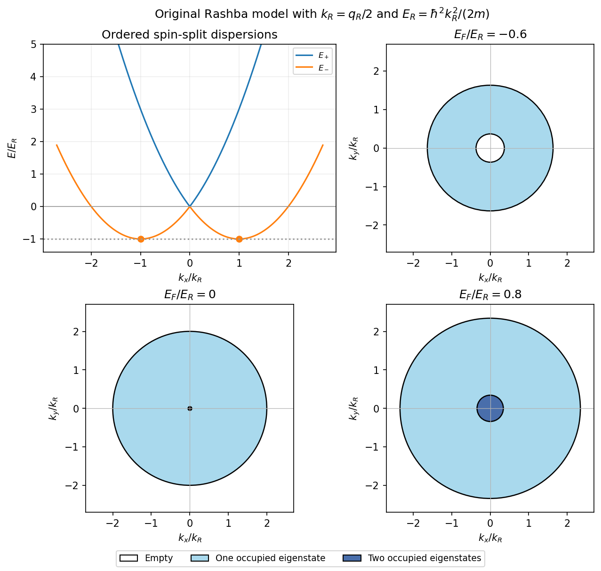
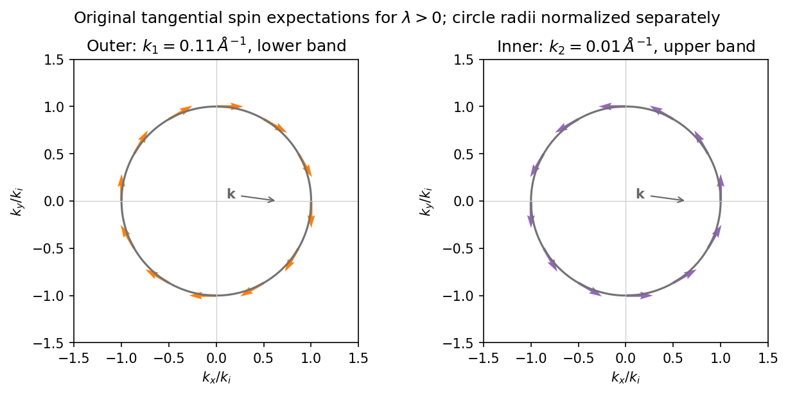

# 2014

↑ **Parent:** [Past exam of the quantum condensed matter course of the University of Cambridge](../past-exam-of-the-quantum-condensed-matter-course-of-the-university-of-cambridge.md)

Official past-paper archive: [https://www.sp.phy.cam.ac.uk/drp2/home.](https://www.sp.phy.cam.ac.uk/drp2/home.) The direct PDF link has not yet been verified.

**Table of contents**

- [1](#1)
  - [a](#1/a)
    - [Solution](#1/a/solution)
  - [b](#1/b)
    - [Solution](#1/b/solution)
  - [c](#1/c)
    - [Solution](#1/c/solution)
- [2](#2)
  - [a](#2/a)
    - [Solution](#2/a/solution)
  - [b](#2/b)
    - [Solution](#2/b/solution)
  - [c](#2/c)
    - [Solution](#2/c/solution)
- [3](#3)
  - [Solution](#3/solution)
- [4](#4)
  - [Solution](#4/solution)

## 1

↑ **Parent:** [2014](2014.md)

<h3 id="1/a">a</h3>

↑ **Parent:** [1](#1)

<h4 id="1/a/solution">Solution</h4>

↑ **Parent:** [A](#1/a)

Use a representative conduction-electron density $n\sim10^{29}\,\mathrm{m^{-3}}$, roughly one mobile [electron](../physics.md#electron) per atom in a dense [metal](../chemical-substance.md#metal), and the bare [electron](../physics.md#electron) [mass](../classical-mechanics.md#mass) for this estimate. The [plasma frequency](../physics.md#plasma-frequency) is then

$$
\boxed{\omega_p=\sqrt{\frac{ne^2}{m_e\epsilon_0}}\simeq\sqrt{\frac{(10^{29})(1.602\times10^{-19})^2}{(9.109\times10^{-31})(8.854\times10^{-12})}}\simeq1.8\times10^{16}\,\mathrm{rad\,s^{-1}}.}
$$

This is an order-of-magnitude answer because no particular [metal](../chemical-substance.md#metal) or [carrier density](../electric-charge.md#carrier-density) is specified. It corresponds to an ordinary [frequency](../wave.md#frequency) $f_p\simeq2.8\times10^{15}\,\mathrm{Hz}$, excitation [energy](../energy.md) $\hbar\omega_p\simeq12\,\mathrm{eV}$, and free-space wavelength near $1.1\times10^{-7}\,\mathrm m$.

The physical [oscillation](../wave.md#oscillation) is collective motion of the [electron gas](../physics.md#electron-gas) against the positive ionic background. Displacing the [electrons](../physics.md#electron) relative to the [ions](../chemistry.md#ion) produces a restoring [electric field](../electric-field.md). In the simplest uniform-displacement picture, $\ddot x+\omega_p^2x=0$: the [frequency](../wave.md#frequency) increases with the density of mobile [electric charge](../electric-charge.md) and decreases with carrier inertia. Quantizing this longitudinal collective [oscillation](../wave.md#oscillation) gives a [plasmon](../physics.md#plasmon).

The same scale controls the ideal collisionless [Drude model](../electric-charge.md#drude-model) optical response. Its [cold collisionless plasma dielectric response](../physics.md#cold-collisionless-plasma-dielectric-response) is $\epsilon_r(\omega)=1-\omega_p^2/\omega^2$. Below $\omega_p$, the negative [relative permittivity](../quantum-mechanics.md#relative-permittivity) makes a transverse [electromagnetic wave](../electromagnetic-wave.md) evanescent, producing strong [reflection](../linear-algebra.md#reflection-mathematics); above it, the ideal model admits propagation. Real-metal collisions, interband [photon absorption](../quantum-mechanics.md#photon-absorption) and background [polarization](../wave.md#polarization-waves) modify this simple optical edge. Thus $\omega_p$ is a collective charge-response scale, not a single-electron scattering rate or a sharp transparency threshold for every real [metal](../chemical-substance.md#metal).

<h3 id="1/b">b</h3>

↑ **Parent:** [1](#1)

<h4 id="1/b/solution">Solution</h4>

↑ **Parent:** [B](#1/b)

Adopt the usual [orthogonal tight-binding approximation](../bloch-s-theorem.md#orthogonal-tight-binding-approximation), so the three localized spatial states are orthonormal. Each site has two neighbors, with the same real hopping [matrix element](../vector-space.md#matrix-element). For coefficients $c_n$, the Schrödinger equation at site $n$ is

$$
(E-E_0)c_n=t(c_{n-1}+c_{n+1}),\qquad c_{n+3}=c_n.
$$

The constant-coefficient state has $c_1=c_2=c_3$, giving [energy](../energy.md) $E_0+2t$. Its normalization therefore yields

$$
\boxed{|\psi_g\rangle=\frac{|1\rangle+|2\rangle+|3\rangle}{\sqrt3},\qquad E_g=E_0+2t.}
$$

To verify that it is the [ground state](../quantum-mechanics.md#ground-state), the three discrete ring momenta are $\theta=0,\pm2\pi/3$, with $c_n\propto e^{i\theta(n-1)}$ and energies $E_0+2t\cos\theta$. The other two states both have [energy](../energy.md) $E_0-t$. Since $t<0$, $E_0+2t<E_0-t$ and the gap is $3|t|$. This is the [three-site tight-binding ring](../bloch-s-theorem.md#three-site-tight-binding-ring) spectrum.

The spatial [ground state](../quantum-mechanics.md#ground-state) is unique and has equal probability $1/3$ on every site; its common overall phase is arbitrary. [Spin](../angular-momentum-operator.md#spin) would supply a separate twofold degeneracy when no spin-dependent terms are included, but does not change the requested spatial state. If the localized functions were instead nonorthogonal raw atomic orbitals, their overlap matrix would be additional data needed for normalization and a [generalized eigenvalue problem](../linear-operator-theory.md#generalized-eigenvalue-problem).

<h3 id="1/c">c</h3>

↑ **Parent:** [1](#1)

<h4 id="1/c/solution">Solution</h4>

↑ **Parent:** [C](#1/c)

The [energy](../energy.md) favoring [spin polarization](../angular-momentum-operator.md#spin-polarization) must compete with the increase in Fermi [kinetic energy](../energy.md#kinetic-energy). Assume the usual three-dimensional zero-temperature parabolic [conduction band](../quantum-mechanics.md#conduction-band) at fixed $N$ and $V$. Write the [spin polarization](../angular-momentum-operator.md#spin-polarization) as $\zeta=(N_\uparrow-N_\downarrow)/N$, so $N_{\uparrow,\downarrow}=N(1\pm\zeta)/2$. The unpolarized [Fermi energy](../quantum-ideal-gas-statistics.md#fermi-energy) is

$$
E_F=\frac{\hbar^2}{2m}\left(\frac{3\pi^2N}{V}\right)^{2/3}.
$$

The two [spin](../angular-momentum-operator.md#spin) populations have [Fermi energies](../quantum-ideal-gas-statistics.md#fermi-energy) $E_F(1\pm\zeta)^{2/3}$. Summing their individual $3E_{F,\sigma}/5$ mean kinetic energies gives

$$
\frac{E_{\rm kin}}N=\frac{3E_F}{10}\left[(1+\zeta)^{5/3}+(1-\zeta)^{5/3}\right].
$$

The specified interaction is an [energy](../energy.md) **per [electron](../physics.md#electron)**, $U(1-\zeta^2)/4$. Thus the [energy](../energy.md) change per [electron](../physics.md#electron) near the unpolarized state is

$$
\Delta f=\left(\frac{E_F}{3}-\frac U4\right)\zeta^2+\frac{E_F}{81}\zeta^4+O(\zeta^6).
$$

The quadratic coefficient changes sign at the [Stoner threshold for an interaction normalized per electron](../statistical-physics.md#stoner-threshold-for-an-interaction-normalized-per-electron),

$$
\boxed{U_c=\frac43E_F=\frac{2\hbar^2}{3m}(3\pi^2)^{2/3}\frac{N^{2/3}}{V^{2/3}},\qquad U_c\propto N^{2/3}V^{-2/3}.}
$$

The positive quartic term gives a continuous onset in this model. More globally, $f''(\zeta)=(E_F/3)[(1+\zeta)^{-1/3}+(1-\zeta)^{-1/3}]-U/2$. [Convexity](../real-analysis.md#convex-function) of $x^{-1/3}$ makes this nonnegative for $U\leq4E_F/3$, so no lower polarized minimum appears before that threshold.

At fixed [number density](../statistical-physics.md#number-density) $N/V$, the critical $U$ is independent of the total sample size. A comparison restricted to a fully polarized state gives a different numerical coefficient, $U>\frac{12}{5}E_F(2^{2/3}-1)$, but the same requested density scaling; it misses the partially polarized onset. One must also distinguish this $U$, with units of [energy](../energy.md), from a contact coupling multiplying an interaction-energy density $g n_\uparrow n_\downarrow$: here $g=U/(N/V)$. Importing a differently normalized [Stoner criterion](../statistical-physics.md#stoner-criterion) would introduce an erroneous extra density factor.

## 2

↑ **Parent:** [2014](2014.md)

<h3 id="2/a">a</h3>

↑ **Parent:** [2](#2)

<h4 id="2/a/solution">Solution</h4>

↑ **Parent:** [A](#2/a)

A [covalent bond](../covalent-bond.md) is stabilized by shared electronic states extending across neighboring atomic nuclei. In a simple two-centre description, combining comparable atomic orbitals produces a bonding state with enhanced [electron density](../chemistry.md#electron-density) between the nuclei and an antibonding state with a node there. For equivalent normalized orbitals $\phi_A,\phi_B$ with real overlap $S$,

$$
\psi_b=\frac{\phi_A+\phi_B}{\sqrt{2(1+S)}},\qquad \psi_{ab}=\frac{\phi_A-\phi_B}{\sqrt{2(1-S)}}.
$$

Their [energy](../energy.md) ordering follows from the molecular [Hamiltonian](../hamiltonian-mechanics.md#hamiltonian); constructive [interference](../physical-optics.md#interference-wave-propagation) and reduced gradients help explain why the bonding combination can be lower. Opposite-spin [electrons](../physics.md#electron) can occupy the bonding orbital together. The familiar molecular-hydrogen bond is a basic example, while extended covalent networks form solids such as [diamond](../chemical-substance.md#diamond). Orbital shape and hybridization make covalent bonding strongly directional and constrain bond angles. Occupying antibonding states reduces the net bond strength.

[Ionic bonding](../ionic-bonding.md) instead emphasizes [electric charge](../electric-charge.md) transfer and the electrostatic attraction of the resulting oppositely charged [ions](../chemistry.md#ion). Removing an [electron](../physics.md#electron) from one atom costs [ionization energy](../mathematical-physics.md#ionization-energy) and adding it to another gains [electron affinity](../electronegativity.md#electron-affinity); these isolated-atom terms alone need not favor transfer. In a [crystal](../thermodynamics.md#crystal), the electrostatic [lattice energy](../ionic-bonding.md#lattice-energy) can stabilize the ionic arrangement. For a schematic [lattice](../mathematical-logic.md#lattice) of singly charged [ions](../chemistry.md#ion) at nearest-neighbor distance $r$,

$$
U(r)=-\frac{A_Me^2}{4\pi\epsilon_0r}+\frac{B}{r^s},\qquad B>0,\quad s>1,
$$

where the geometrical [Madelung constant](../ionic-bonding.md#madelung-constant) $A_M$ sums attractions and repulsions throughout the [lattice](../mathematical-logic.md#lattice). Short-range overlap repulsion prevents collapse and gives an equilibrium separation. [Sodium chloride](../chemical-substance.md#sodium-chloride) is an example of an extended [ionic crystal](../ionic-bonding.md#ionic-crystal), rather than isolated NaCl molecules in the solid.

**[Figure 1](#2/a/image-original-schematic-covalent-electron-sharing-and-the-extended-charge-arrangement-of-an-ionic-crystal). Original schematic covalent electron sharing and the extended charge arrangement of an ionic crystal**.

Ideal [ionic bonding](../ionic-bonding.md) is comparatively nondirectional, so packing, [ion](../chemistry.md#ion) sizes and [electric charge](../electric-charge.md) balance strongly influence coordination. [ions](../chemistry.md#ion) cannot freely migrate in the ordinary solid; melting or dissolution can make ionic [electric charge](../electric-charge.md) transport possible. Covalent materials do not obey one universal [electrical conductivity](../electric-charge.md#electrical-conductivity) rule: their electronic bands and filling determine whether mobile electronic carriers are available.

The two descriptions are limiting models, not a sharp classification of every bond. Unequal electronegativities can produce polar covalent bonds with partial [electric charge](../electric-charge.md) transfer, and a material may contain both covalent groups and ionic interactions between those groups. Chemical bonding reflects a balance of electronic [kinetic energy](../energy.md#kinetic-energy), electron-nucleus attraction, electron-electron repulsion and nuclear repulsion; it cannot be reduced to a [force](../force.md) between two assigned point charges in every material.

<h3 id="2/b">b</h3>

↑ **Parent:** [2](#2)

<h4 id="2/b/solution">Solution</h4>

↑ **Parent:** [B](#2/b)

The [Drude model](../electric-charge.md#drude-model) treats mobile [electric charge](../electric-charge.md) carriers as independent particles with density $n$, signed [electric charge](../electric-charge.md) $q$, isotropic [mass](../classical-mechanics.md#mass) $m$, and [momentum relaxation time](../electric-charge.md#momentum-relaxation-time) $\tau$. In uniform steady fields,

$$
0=q(\mathbf E+\mathbf v\times\mathbf B)-\frac{m\mathbf v}{\tau},\qquad \mathbf J=nq\mathbf v.
$$

At zero [magnetic field](../magnetic-field.md) the [drift velocity](../electric-charge.md#drift-velocity) is $q\tau\mathbf E/m$, giving [electrical conductivity](../electric-charge.md#electrical-conductivity) and [electrical resistivity](../electric-charge.md#electrical-resistivity)

$$
\boxed{\sigma_0=\frac{nq^2\tau}{m},\qquad \rho_0=\frac{m}{nq^2\tau}.}
$$

The [electrical conductivity](../electric-charge.md#electrical-conductivity) is positive for either carrier sign. Scattering dissipates directed drift [energy](../energy.md) into the environment; a finite steady [electric current](../electric-charge.md#electric-current) is compatible with a short-lived drift [momentum](../momentum.md). The independent-carrier relaxation-time approximation omits detailed band anisotropy, quantum [interference](../physical-optics.md#interference-wave-propagation) and microscopic collision correlations.

For [electric current](../electric-charge.md#electric-current) along $x$ and [magnetic field](../magnetic-field.md) $B\hat{\mathbf z}$, the magnetic [force](../force.md) deflects carriers toward one side of the sample. [electric charge](../electric-charge.md) accumulates until a transverse Hall field cancels that [force](../force.md) in an open transverse circuit. With $J_y=0$, $E_y=v_xB$, so

$$
\boxed{R_H=\frac{E_y}{J_xB}=\frac1{nq},\qquad \rho_{yx}=\frac{B}{nq}.}
$$

[Electrons](../physics.md#electron) have negative $R_H$ in this convention, whereas positive carriers have positive $R_H$. For a strip of thickness $d$ along $z$, the magnitude of the Hall [electric potential difference](../electric-field.md#electric-potential-difference) across its width is $|V_H|=|IB/(nqd)|$. Thus Hall measurements determine carrier sign and, within this one-carrier model, density, while combining $R_H$ with $\sigma_0$ determines [charge carrier mobility](../electric-charge.md#charge-carrier-mobility) $\mu=|q|\tau/m=\sigma_0|R_H|$.

Keeping both in-plane [electric current](../electric-charge.md#electric-current) components, the [resistivity tensor](../electric-charge.md#resistivity-tensor) is

$$
\boldsymbol\rho=\begin{pmatrix}\rho_0&-B/(nq)\\B/(nq)&\rho_0\end{pmatrix},\qquad \boldsymbol\sigma=\boldsymbol\rho^{-1}.
$$

This fixes the off-diagonal sign convention and shows that inversion is not componentwise reciprocation. Under the Hall boundary condition $J_y=0$, the ideal one-carrier isotropic model gives $E_x/J_x=\rho_0$, independent of [magnetic field](../magnetic-field.md): there is no ordinary longitudinal [magnetoresistance](../electric-charge.md#magnetoresistance) in this minimal model. Multiple carrier types or anisotropic bands can change both this conclusion and the simple $R_H=1/(nq)$ inference. Their [electrical conductivity](../electric-charge.md#electrical-conductivity) must be added before inverting to obtain the total [electrical resistivity](../electric-charge.md#electrical-resistivity).

<h3 id="2/c">c</h3>

↑ **Parent:** [2](#2)

<h4 id="2/c/solution">Solution</h4>

↑ **Parent:** [C](#2/c)

Both models respect [Bloch's theorem](../bloch-s-theorem.md) and describe [electrons](../physics.md#electron) in a periodic [lattice](../mathematical-logic.md#lattice), but they start from different useful limits.

In the [nearly-free electron model](../bloch-s-theorem.md#nearly-free-electron-model), start with extended plane waves and free-electron energies $\varepsilon^0_{\mathbf k}=\hbar^2k^2/(2m)$. A weak [periodic potential](../bloch-s-theorem.md#periodic-potential) has [Fourier coefficients](../fourier-series.md#fourier-coefficient) $V_{\mathbf G}$ at [reciprocal lattice](../quantum-scattering.md#reciprocal-lattice) vectors and couples $\mathbf k$ to $\mathbf k-\mathbf G$. Away from degeneracies its corrections are small. Near a [Bragg scattering](../quantum-scattering.md#bragg-scattering), retain the two resonant plane waves and diagonalize

$$
H_{\rm pair}=\begin{pmatrix}\varepsilon^0_{\mathbf k}+V_0&V_{\mathbf G}\\V_{\mathbf G}^*&\varepsilon^0_{\mathbf k-\mathbf G}+V_0\end{pmatrix}.
$$

The resulting [eigenvalues](../linear-operator-theory.md#eigenvalue) are

$$
E_\pm=V_0+\frac{\varepsilon^0_{\mathbf k}+\varepsilon^0_{\mathbf k-\mathbf G}}2\pm\sqrt{\left(\frac{\varepsilon^0_{\mathbf k}-\varepsilon^0_{\mathbf k-\mathbf G}}2\right)^2+|V_{\mathbf G}|^2}.
$$

At the crossing the gap is $\boxed{2|V_{\mathbf G}|}$. The two standing-wave combinations place electronic density differently relative to the [periodic potential](../bloch-s-theorem.md#periodic-potential) and therefore acquire different energies. Folding the many free parabolas into the first [Brillouin zone](../bloch-s-theorem.md#brillouin-zone) produces the repeated band labels; the nonzero potential opens avoided crossings between coupled states. A Fourier component forbidden by [symmetry](../physics.md#symmetry-physics) need not open its corresponding first-order gap.

In the [tight-binding model](../bloch-s-theorem.md#tight-binding), instead start with localized orbitals on well-separated atoms or sites, with discrete on-site energies. Their overlap permits tunneling represented by [hopping integrals](../bloch-s-theorem.md#hopping-integral). Bloch sums of these orbitals diagonalize the [lattice translation](../quantum-scattering.md#lattice-translation) [symmetry](../physics.md#symmetry-physics). For one orthonormal orbital per site in a one-dimensional nearest-neighbor chain,

$$
\boxed{E(k)=E_0+2t\cos(ka),\qquad \text{bandwidth}=4|t|.}
$$

The many initially degenerate copies of one [atomic orbital](../chemistry.md#atomic-orbital) broaden into a band. Other atomic orbitals or multiple sites per primitive cell produce additional bands; their hybridization creates bonding and antibonding combinations and may open gaps. For two orbitals per cell, one illustrative [Hamiltonian](../hamiltonian-mechanics.md#hamiltonian) is

$$
H(k)=\begin{pmatrix}E_A&t_1+t_2e^{-ika}\\t_1+t_2e^{ika}&E_B\end{pmatrix},
$$

with [eigenvalues](../linear-operator-theory.md#eigenvalue) $(E_A+E_B)/2\pm\sqrt{(E_A-E_B)^2/4+|t_1+t_2e^{-ika}|^2}$. This shows explicitly how two bands arise from the two cell degrees of freedom, even when the isolated sites have equal on-site energies.

**[Figure 2](#2/c/image-original-nearly-free-electron-and-two-orbital-tight-binding-band-examples). Original nearly-free-electron and two-orbital tight-binding band examples**.

For each orbital degree of freedom per primitive cell there is one band per [spin](../angular-momentum-operator.md#spin); [band filling](../bloch-s-theorem.md#band-filling) and the presence of a gap at the [Fermi level](../quantum-ideal-gas-statistics.md#fermi-level) determine metallic or insulating behavior. The nearly-free limit emphasizes weak [Bragg scattering](../quantum-scattering.md#bragg-scattering) of extended states, while [tight binding](../bloch-s-theorem.md#tight-binding) emphasizes hopping between localized states. They are complementary approximations to electronic band structure, rather than two incompatible explanations of why periodic solids have bands.

## 3

↑ **Parent:** [2014](2014.md)

<h3 id="3/solution">Solution</h3>

↑ **Parent:** [3](#3)

**Diagonalization and conventions.** The spin-dependent part is $\lambda(-k_y\sigma_x+k_x\sigma_y)$. For a Hermitian [Hamiltonian](../hamiltonian-mechanics.md#hamiltonian) $\lambda$ is real; the supplied lower-band [spinor](../algebra-over-a-field.md#spinor) uses the convention $\lambda>0$, which will be adopted below. The squared [spin](../angular-momentum-operator.md#spin) matrix is $\lambda^2(k_x^2+k_y^2)I$. Hence the two ordered energies are

$$
E_\pm(\mathbf k)=\frac{\hbar^2(k_x^2+k_y^2+k_z^2)}{2m}\pm|\lambda|\sqrt{k_x^2+k_y^2}.
$$

In the $k_z=0$ plane, let $k=\sqrt{k_x^2+k_y^2}$ and $q_R=2m\lambda/\hbar^2>0$. Then

$$
\boxed{E_\pm(k)=\frac{\hbar^2}{2m}(k^2\pm q_Rk),\qquad q_R=\frac{2m\lambda}{\hbar^2}.}
$$

If $\lambda<0$, use $q_R=2m|\lambda|/\hbar^2$ to retain the [energy](../energy.md) ordering, and interchange the [spin](../angular-momentum-operator.md#spin) directions assigned below. This is an isotropic [Rashba effect](../atomic-physics.md#rashba-effect); $q_R$ has units of inverse length, whereas $\lambda$ has units of [energy](../energy.md) times length.

**Band minima.** Define $k_R=q_R/2$ and $E_R=\hbar^2q_R^2/(8m)$. Completing the square gives

$$
E_-(k)=\frac{\hbar^2}{2m}(k-k_R)^2-E_R.
$$

Along $k_y=k_z=0$, the radial coordinate is $|k_x|$, so the lower branch has two minima:

$$
\boxed{k_x=\pm\frac{q_R}{2},\qquad E_{-,\min}=-\frac{\hbar^2q_R^2}{8m}=-E_R.}
$$

In the full plane these are points on a circle of minima $k=k_R$. Both branches meet at $k=0$, $E=0$. Their ordered [energy](../energy.md) curves contain $|k_x|$: the lower curve descends from the crossing on either side, while the upper rises. Treating them as globally labeled smooth [spin](../angular-momentum-operator.md#spin) branches without switching labels across $k_x=0$ would obscure the lower-band minima.

**Occupied regions and [Fermi contours](../fermi-liquid.md#fermi-contour).** At zero [temperature](../temperature.md) each spin-split [eigenstate](../energy-eigenvalue.md#eigenstate) with [energy](../energy.md) below $E_F$ is occupied. Put

$$
D=\sqrt{k_R^2+\frac{2mE_F}{\hbar^2}}.
$$

For $-E_R<E_F<0$, $0<D<k_R$. The lower-band roots are $k_R-D$ and $k_R+D$, while the upper band is entirely empty. Thus the central [disk](../topology.md#disk-mathematics) $k<k_R-D$ is **unoccupied**, the [annulus](../topology.md#annulus-mathematics) $k_R-D<k<k_R+D$ is **singly occupied**, and the exterior is **unoccupied**. Both Fermi circles belong to the lower band; there is no doubly occupied region.

At $E_F=0$, the lower band is occupied for $0<k<2k_R=q_R$, giving a **singly occupied [disk](../topology.md#disk-mathematics)** with outer Fermi circle at $q_R$. The two bands also meet the [Fermi energy](../quantum-ideal-gas-statistics.md#fermi-energy) at the origin. That isolated degenerate point is not a finite doubly occupied [disk](../topology.md#disk-mathematics), and occupation exactly at the [Fermi energy](../quantum-ideal-gas-statistics.md#fermi-energy) is a boundary convention of zero area. Outside the outer circle the states are empty.

For $E_F>0$, $D>k_R$. The lower branch has outer radius $k_-=D+k_R$, while the upper branch has inner radius $k_+=D-k_R$. The [disk](../topology.md#disk-mathematics) $k<k_+$ is **doubly occupied**, with one state in each band at every [momentum](../momentum.md). The [annulus](../topology.md#annulus-mathematics) $k_+<k<k_-$ is **singly occupied**, in the lower band only, and the exterior is **unoccupied**. These are the [Fermi contours of an isotropic Rashba band](../atomic-physics.md#fermi-contours-of-an-isotropic-rashba-band); double occupancy here refers to two orthogonal [spinor](../algebra-over-a-field.md#spinor) states at the same [momentum](../momentum.md), not two [electrons](../physics.md#electron) occupying one identical quantum state.

**[Figure 3](#3/image-rashba-dispersion-and-occupied-momentum-regions-below-at-and-above-the-band-crossing). Rashba dispersion and occupied momentum regions below, at and above the band crossing**.

**Inferring the splitting.** Above the crossing, the two positive radii differ by $2k_R=q_R$:

$$
\boxed{q_R=k_1-k_2=(0.11-0.01)\,\mathrm{\mathring A^{-1}}=0.10\,\mathrm{\mathring A^{-1}}=1.0\times10^9\,\mathrm{m^{-1}}.}
$$

The minimum radius is therefore $k_R=0.05\,\mathrm{\mathring A^{-1}}$. It is the difference of the measured radii that is required for $E_F>0$; below the crossing the two lower-band radii instead add to $q_R$.

**Spinors and [spin](../angular-momentum-operator.md#spin) direction.** Write $a=(k_y+ik_x)/k$, which has $|a|=1$ for $k>0$. An orthogonal normalized partner to the supplied lower-band state is

$$
\boxed{u_+(\mathbf k)=\frac1{\sqrt2}\begin{pmatrix}-a\\1\end{pmatrix}=\frac1{\sqrt2}\begin{pmatrix}-(k_y+ik_x)/k\\1\end{pmatrix}.}
$$

Indeed $u_-^\dagger u_+=(-|a|^2+1)/2=0$. Direct multiplication by the [spin](../angular-momentum-operator.md#spin) matrix gives [eigenvalues](../linear-operator-theory.md#eigenvalue) $-\lambda k$ and $+\lambda k$ for $u_-$ and $u_+$, respectively, so [orthogonality](../inner-product.md#orthogonal-vectors) has selected the other band rather than merely another arbitrary [spin](../angular-momentum-operator.md#spin) [basis](../vector-space.md#basis).

For a normalized [spinor](../algebra-over-a-field.md#spinor) $(\alpha,\beta)^T$, the Pauli expectation values are $(2\operatorname{Re}(\alpha^*\beta),2\operatorname{Im}(\alpha^*\beta),|\alpha|^2-|\beta|^2)$. Consequently the [Rashba spin texture](../atomic-physics.md#rashba-spin-texture) is

$$
\boxed{\langle\mathbf S\rangle_- =\frac\hbar2\left(\frac{k_y}{k},-\frac{k_x}{k},0\right),\qquad \langle\mathbf S\rangle_+ =\frac\hbar2\left(-\frac{k_y}{k},\frac{k_x}{k},0\right).}
$$

The [spin](../angular-momentum-operator.md#spin) lies in the plane and is perpendicular to [momentum](../momentum.md). On the outer circle $k_1$, which belongs to $E_-$, it points clockwise as viewed from $+z$; at $\mathbf k=(k_1,0)$ it points along $-y$. On the inner circle $k_2$, belonging to $E_+$, it points counterclockwise; at $\mathbf k=(k_2,0)$ it points along $+y$. Opposite momenta have opposite spins, consistent with [time-reversal symmetry](../quantum-field-theory.md#t-symmetry). At the origin the eigenstates are degenerate and no unique [spin](../angular-momentum-operator.md#spin) orientation is defined.

**[Figure 4](#3/image-opposite-tangential-spin-textures-on-the-outer-lower-band-and-inner-upper-band-fermi-circles). Opposite tangential spin textures on the outer lower-band and inner upper-band Fermi circles**.

## 4

↑ **Parent:** [2014](2014.md)

<h3 id="4/solution">Solution</h3>

↑ **Parent:** [4](#4)

**Nondegenerate carrier product.** Assume three-dimensional parabolic [energy bands](../bloch-s-theorem.md#energy-band) near their extrema, [spin](../angular-momentum-operator.md#spin) degeneracy two, and no additional uncounted valley multiplicity. Near the conduction edge, a Boltzmann approximation to the [Fermi-Dirac distribution](../quantum-ideal-gas-statistics.md#fermi-dirac-distribution) gives

$$
n=2\int\frac{d^3k}{(2\pi)^3}\exp\left[-\frac{E_c+\hbar^2k^2/(2m_e)-\mu}{k_BT}\right].
$$

Angular integration and the Gaussian radial integral yield

$$
\boxed{n=N_c e^{-(E_c-\mu)/(k_BT)},\qquad N_c=2\left(\frac{m_ek_BT}{2\pi\hbar^2}\right)^{3/2}.}
$$

For valence [electron holes](../quantum-mechanics.md#electron-hole), the empty-state probability is $1-f(E)\simeq e^{(E-\mu)/(k_BT)}$. Measuring [electron hole](../quantum-mechanics.md#electron-hole) [kinetic energy](../energy.md#kinetic-energy) downwards from $E_v$ similarly gives

$$
\boxed{p=N_v e^{-(\mu-E_v)/(k_BT)},\qquad N_v=2\left(\frac{m_hk_BT}{2\pi\hbar^2}\right)^{3/2}.}
$$

The factors two count [spin](../angular-momentum-operator.md#spin) once in each band. Multiplying cancels the [chemical potential](../chemical-potential.md) and proves the [semiconductor mass-action law](../semiconductor.md#semiconductor-mass-action-law):

$$
\boxed{np=N_cN_v e^{-E_g/(k_BT)}=\frac12(m_em_h)^{3/2}\left(\frac{k_BT}{\pi\hbar^2}\right)^3e^{-E_g/(k_BT)}=n_i^2.}
$$

In an intrinsic neutral [semiconductor](../semiconductor.md), $n=p=n_i$. In a doped equilibrium [semiconductor](../semiconductor.md) the same product holds under the stated nondegenerate assumptions, even when $n\ne p$. Extra valleys or several valence branches must be included in the effective density-of-states factors rather than counted inconsistently.

**Equilibrium junction.** Put the p region on the left and the n region on the right. Before contact their majority carriers are [electron holes](../quantum-mechanics.md#electron-hole) and [electrons](../physics.md#electron), respectively. [Diffusion](../thermodynamics.md#diffusion) initially sends [electrons](../physics.md#electron) from n to p and [electron holes](../quantum-mechanics.md#electron-hole) from p to n. This leaves negative ionized acceptors on the p side and positive ionized donors on the n side, creating a [depletion region](../semiconductor.md#depletion-region) and an [electric field](../electric-field.md) directed from n to p. At equilibrium this field balances [diffusion](../thermodynamics.md#diffusion), so the net [electric current](../electric-charge.md#electric-current) vanishes.

For a homojunction the gap remains constant while the [conduction band](../quantum-mechanics.md#conduction-band) and [valence band](../quantum-mechanics.md#valence-band) edges bend downwards from p to n by $eV_{\rm bi}$. The equilibrium [chemical potential](../chemical-potential.md) is flat. Since $E_{c,v}(x)=E_{c,v}^{\rm ref}-e\phi(x)$, the [electrostatic potential](../electric-field.md#electric-potential) rises from p to n. The carrier profiles satisfy

$$
n(x)=N_c e^{-[E_c(x)-\mu]/(k_BT)},\qquad p(x)=N_v e^{-[\mu-E_v(x)]/(k_BT)},\qquad n(x)p(x)=n_i^2.
$$

With fully ionized nondegenerate dopants, the neutral p side has $p_p\simeq N_A$, $n_p\simeq n_i^2/N_A$, while the neutral n side has $n_n\simeq N_D$, $p_n\simeq n_i^2/N_D$. Thus the [electron](../physics.md#electron) concentration rises across the junction and the [electron hole](../quantum-mechanics.md#electron-hole) concentration falls, with both small relative to the far-side majority densities in much of the depleted region. The ideal [depletion approximation](../semiconductor.md#depletion-approximation) neglects these mobile populations when calculating the fixed space [electric charge](../electric-charge.md), but the actual equilibrium profiles are smooth.

**[Figure 5](#4/image-equilibrium-band-bending-a-flat-chemical-potential-and-complementary-electron-hole-profiles-across-a-homojunction). Equilibrium band bending, a flat chemical potential and complementary electron/hole profiles across a homojunction**.

The [built-in potential](../semiconductor.md#built-in-potential) follows from these Boltzmann factors:

$$
\boxed{V_{\rm bi}=\frac{k_BT}{e}\ln\frac{N_AN_D}{n_i^2}.}
$$

There is no applied terminal bias; the internal [electrostatic potential](../electric-field.md#electric-potential) variation does not contradict a constant electrochemical potential.

**Opposing carrier fluxes under [reverse bias](../electrical-circuit.md#reverse-bias).** Use $V>0$ for the magnitude of [reverse bias](../electrical-circuit.md#reverse-bias) and $I>0$ for reverse [electric current](../electric-charge.md#electric-current), as in the PDF. The junction barrier increases by $eV$. The [Shockley diode equation](../electrical-circuit.md#shockley-diode-equation) in that orientation can be written

$$
I=\underbrace{I_{\rm sat}}_{\text{reverse-directed carrier supply}}-\underbrace{I_{\rm sat}e^{-eV/(k_BT)}}_{\text{opposing thermally activated flux}}.
$$

The reverse-directed contribution is supplied by minority [electrons](../physics.md#electron) on the p side and minority [electron holes](../quantum-mechanics.md#electron-hole) on the n side. They reach the depletion edge by [diffusion](../thermodynamics.md#diffusion) and are swept across by the built-in field. The opposing contribution is associated with majority carriers thermally crossing the barrier in the forward direction; [reverse bias](../electrical-circuit.md#reverse-bias) suppresses it by the [Boltzmann factor](../canonical-ensemble.md#boltzmann-factor). At zero bias detailed balance makes the two equal, while at large enough [reverse bias](../electrical-circuit.md#reverse-bias) the opposing flux becomes negligible.

In the ideal neutral-region [diffusion](../thermodynamics.md#diffusion) model,

$$
I_{\rm sat}=e\mathcal A n_i^2\left(\frac{D_n}{L_nN_A}+\frac{D_p}{L_pN_D}\right).
$$

Here $D_n,D_p$ are minority-carrier [diffusion](../thermodynamics.md#diffusion) coefficients, $L_n,L_p$ their [diffusion](../thermodynamics.md#diffusion) lengths, and $\mathcal A$ is junction area. The two terms inside this positive prefactor are the [electron](../physics.md#electron) and [electron hole](../quantum-mechanics.md#electron-hole) contributions; both flow in the same reverse-current direction. This separates the two carrier-species contributions from the two opposing fluxes in the [Shockley diode equation](../electrical-circuit.md#shockley-diode-equation). Calling the saturation term a [drift current](../electric-charge.md#drift-current) refers to its passage across the depleted region, and does not eliminate the minority-carrier [diffusion](../thermodynamics.md#diffusion) needed to supply it.

**Reading the measured curves.** At $eV\ll k_BT$, the ideal equation gives $I\simeq I_{\rm sat}eV/(k_BT)$, initially proportional to reverse [electric potential difference](../electric-field.md#electric-potential-difference). At $eV\gg k_BT$, it approaches a plateau $I\simeq I_{\rm sat}$. The thermal [electric potential differences](../electric-field.md#electric-potential-difference) at the three temperatures are about $21$–$26\,\mathrm{mV}$, consistent with a rise at small reverse biases and near saturation at larger ones. Higher [temperature](../temperature.md) produces a much larger plateau because thermal electron-hole excitation raises $n_i^2$ exponentially.

The lower-temperature curve has a noticeable residual [electric potential difference](../electric-field.md#electric-potential-difference) dependence rather than a perfectly flat plateau. Depletion-region generation, surface leakage or other departures from the ideal [diffusion](../thermodynamics.md#diffusion) model can contribute. The sharp upturn at the largest reverse [electric potential differences](../electric-field.md#electric-potential-difference) is reverse breakdown, outside the unextended [Shockley diode equation](../electrical-circuit.md#shockley-diode-equation); the plot alone does not identify a unique microscopic breakdown mechanism. The original horizontal axis duplicates the final decade label, so a precise breakdown [electric potential difference](../electric-field.md#electric-potential-difference) cannot be read reliably. Neither issue prevents estimating the gap from the intermediate-bias saturation region.

**Band-gap estimate.** Use plateau [electric currents](../electric-charge.md#electric-current) at a common intermediate [reverse bias](../electrical-circuit.md#reverse-bias), away from both the small-bias rise and the breakdown upturn. Approximate readings are $I_{\rm sat}(298\,\mathrm K)\sim2.5\times10^{-6}\,\mathrm A$, $I_{\rm sat}(273\,\mathrm K)\sim1.5$–$2\times10^{-7}\,\mathrm A$, and $I_{\rm sat}(248\,\mathrm K)\sim10^{-8}\,\mathrm A$. Kelvin temperatures are required in the activation law.

For fixed effective masses, $n_i^2\propto T^3e^{-E_g/(k_BT)}$. If the remaining transport prefactor is approximately constant, [extracting a semiconductor band gap from diode saturation current](../electrical-circuit.md#extracting-a-semiconductor-band-gap-from-diode-saturation-current) therefore uses

$$
\ln\frac{I_{\rm sat}}{T^3}=\text{constant}-\frac{E_g}{k_BT},\qquad E_g=\frac{k_B\left[\ln(I_h/I_l)-3\ln(T_h/T_l)\right]}{1/T_l-1/T_h}.
$$

Using the widest [temperature](../temperature.md) separation and the rounded readings gives

$$
E_g\simeq\frac{(8.6173\times10^{-5}\,\mathrm{eV\,K^{-1}})\left[\ln(250)-3\ln(298/248)\right]}{1/248-1/298}\simeq0.63\,\mathrm{eV}.
$$

Neglecting all algebraic prefactors and fitting $\ln I_{\rm sat}$ instead gives about $0.70\,\mathrm{eV}$. These differ by roughly $0.07\,\mathrm{eV}$, a material correction on the graph's precision scale. Thus an honest graph-based conclusion is

$$
\boxed{E_g\sim0.6\text{–}0.7\,\mathrm{eV}\quad\text{for germanium, approximately }0.65\,\mathrm{eV}.}
$$

The nonflat low-temperature plateau, rough [electric current](../electric-charge.md#electric-current) readings, unprovided [temperature](../temperature.md) dependence of $D/L$, and possible gap variation prevent a more precise extraction. If depletion-region generation dominated rather than the specified $I_{\rm sat}\propto n_i^2$ mechanism, its activation slope could involve a different [energy](../energy.md) scale; the displayed estimate explicitly uses the diffusion-dominated saturation model requested here.

## ↑ Ancestors (10)

1. [Past exam of the quantum condensed matter course of the University of Cambridge](../past-exam-of-the-quantum-condensed-matter-course-of-the-university-of-cambridge.md)
2. [Quantum Condensed Matter course of the University of Cambridge](../university-of-cambridge.md#quantum-condensed-matter-course-of-the-university-of-cambridge)
3. [Physics course of the year 3 of the natural sciences course of the University of Cambridge](../university-of-cambridge.md#physics-course-of-the-year-3-of-the-natural-sciences-course-of-the-university-of-cambridge)
4. [Year 3 of the natural sciences course of the University of Cambridge](../university-of-cambridge.md#year-3-of-the-natural-sciences-course-of-the-university-of-cambridge)
5. [Year of the natural sciences course of the University of Cambridge](../university-of-cambridge.md#year-of-the-natural-sciences-course-of-the-university-of-cambridge)
6. [Natural sciences course of the University of Cambridge](../university-of-cambridge.md#natural-sciences-course-of-the-university-of-cambridge)
7. [Course of the University of Cambridge](../university-of-cambridge.md#course-of-the-university-of-cambridge)
8. [University of Cambridge](../university-of-cambridge.md)
9. [List of universities](../README.md#list-of-universities)
10. [Codex Wiki](../README.md)
