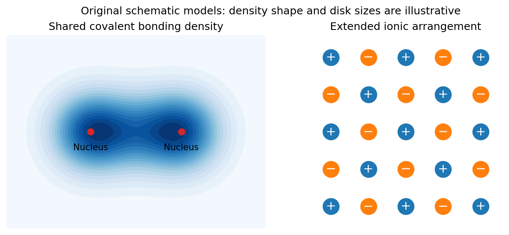

<h1 id="2/a/solution">Solution</h1>

↑ **Parent:** [A](../a.md)

A [covalent bond](../../../../covalent-bond-split.md) is stabilized by shared electronic states extending across neighboring atomic nuclei. In a simple two-centre description, combining comparable atomic orbitals produces a bonding state with enhanced [electron density](../../../../electron-density.md) between the nuclei and an antibonding state with a node there. For equivalent normalized orbitals $\phi_A,\phi_B$ with real overlap $S$,

$$
\psi_b=\frac{\phi_A+\phi_B}{\sqrt{2(1+S)}},\qquad \psi_{ab}=\frac{\phi_A-\phi_B}{\sqrt{2(1-S)}}.
$$

Their [energy](../../../../energy-split.md) ordering follows from the molecular [Hamiltonian](../../../../hamiltonian.md); constructive [interference](../../../../interference-wave-propagation.md) and reduced gradients help explain why the bonding combination can be lower. Opposite-spin [electrons](../../../../electron.md) can occupy the bonding orbital together. The familiar molecular-hydrogen bond is a basic example, while extended covalent networks form solids such as [diamond](../../../../diamond.md). Orbital shape and hybridization make covalent bonding strongly directional and constrain bond angles. Occupying antibonding states reduces the net bond strength.

[Ionic bonding](../../../../ionic-bonding-split.md) instead emphasizes [electric charge](../../../../electric-charge-split.md) transfer and the electrostatic attraction of the resulting oppositely charged [ions](../../../../ion.md). Removing an [electron](../../../../electron.md) from one atom costs [ionization energy](../../../../ionization-energy.md) and adding it to another gains [electron affinity](../../../../electron-affinity.md); these isolated-atom terms alone need not favor transfer. In a [crystal](../../../../crystal.md), the electrostatic [lattice energy](../../../../lattice-energy.md) can stabilize the ionic arrangement. For a schematic [lattice](../../../../lattice.md) of singly charged [ions](../../../../ion.md) at nearest-neighbor distance $r$,

$$
U(r)=-\frac{A_Me^2}{4\pi\epsilon_0r}+\frac{B}{r^s},\qquad B>0,\quad s>1,
$$

where the geometrical [Madelung constant](../../../../madelung-constant.md) $A_M$ sums attractions and repulsions throughout the [lattice](../../../../lattice.md). Short-range overlap repulsion prevents collapse and gives an equilibrium separation. [Sodium chloride](../../../../sodium-chloride.md) is an example of an extended [ionic crystal](../../../../ionic-crystal.md), rather than isolated NaCl molecules in the solid.

**[Figure 1](#2/a/image-original-schematic-covalent-electron-sharing-and-the-extended-charge-arrangement-of-an-ionic-crystal). Original schematic covalent electron sharing and the extended charge arrangement of an ionic crystal**.

Ideal [ionic bonding](../../../../ionic-bonding-split.md) is comparatively nondirectional, so packing, [ion](../../../../ion.md) sizes and [electric charge](../../../../electric-charge-split.md) balance strongly influence coordination. [ions](../../../../ion.md) cannot freely migrate in the ordinary solid; melting or dissolution can make ionic [electric charge](../../../../electric-charge-split.md) transport possible. Covalent materials do not obey one universal [electrical conductivity](../../../../electrical-conductivity.md) rule: their electronic bands and filling determine whether mobile electronic carriers are available.

The two descriptions are limiting models, not a sharp classification of every bond. Unequal electronegativities can produce polar covalent bonds with partial [electric charge](../../../../electric-charge-split.md) transfer, and a material may contain both covalent groups and ionic interactions between those groups. Chemical bonding reflects a balance of electronic [kinetic energy](../../../../kinetic-energy.md), electron-nucleus attraction, electron-electron repulsion and nuclear repulsion; it cannot be reduced to a [force](../../../../force-split.md) between two assigned point charges in every material.

## ↑ Ancestors (13)

1. [A](../a.md)
2. [2](../../2.md)
3. [2014](../../../2014-split.md)
4. [Past exam of the quantum condensed matter course of the University of Cambridge](../../../split.md)
5. [Quantum Condensed Matter course of the University of Cambridge](../../../../quantum-condensed-matter-course-of-the-university-of-cambridge.md)
6. [Physics course of the year 3 of the natural sciences course of the University of Cambridge](../../../../physics-course-of-the-year-3-of-the-natural-sciences-course-of-the-university-of-cambridge.md)
7. [Year 3 of the natural sciences course of the University of Cambridge](../../../../year-3-of-the-natural-sciences-course-of-the-university-of-cambridge.md)
8. [Year of the natural sciences course of the University of Cambridge](../../../../year-of-the-natural-sciences-course-of-the-university-of-cambridge.md)
9. [Natural sciences course of the University of Cambridge](../../../../natural-sciences-course-of-the-university-of-cambridge.md)
10. [Course of the University of Cambridge](../../../../course-of-the-university-of-cambridge.md)
11. [University of Cambridge](../../../../university-of-cambridge-split.md)
12. [List of universities](../../../../list-of-universities.md)
13. [Codex Wiki](../../../../split.md)
