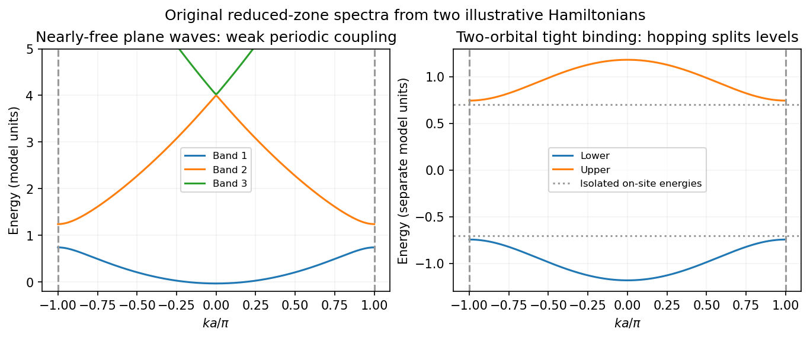

<h1 id="2/c/solution">Solution</h1>

↑ **Parent:** [C](../c.md)

Both models respect [Bloch's theorem](../../../../bloch-s-theorem-split.md) and describe [electrons](../../../../electron.md) in a periodic [lattice](../../../../lattice.md), but they start from different useful limits.

In the [nearly-free electron model](../../../../nearly-free-electron-model.md), start with extended plane waves and free-electron energies $\varepsilon^0_{\mathbf k}=\hbar^2k^2/(2m)$. A weak [periodic potential](../../../../periodic-potential.md) has [Fourier coefficients](../../../../fourier-coefficient.md) $V_{\mathbf G}$ at [reciprocal lattice](../../../../reciprocal-lattice.md) vectors and couples $\mathbf k$ to $\mathbf k-\mathbf G$. Away from degeneracies its corrections are small. Near a [Bragg scattering](../../../../bragg-scattering.md), retain the two resonant plane waves and diagonalize

$$
H_{\rm pair}=\begin{pmatrix}\varepsilon^0_{\mathbf k}+V_0&V_{\mathbf G}\\V_{\mathbf G}^*&\varepsilon^0_{\mathbf k-\mathbf G}+V_0\end{pmatrix}.
$$

The resulting [eigenvalues](../../../../eigenvalue.md) are

$$
E_\pm=V_0+\frac{\varepsilon^0_{\mathbf k}+\varepsilon^0_{\mathbf k-\mathbf G}}2\pm\sqrt{\left(\frac{\varepsilon^0_{\mathbf k}-\varepsilon^0_{\mathbf k-\mathbf G}}2\right)^2+|V_{\mathbf G}|^2}.
$$

At the crossing the gap is $\boxed{2|V_{\mathbf G}|}$. The two standing-wave combinations place electronic density differently relative to the [periodic potential](../../../../periodic-potential.md) and therefore acquire different energies. Folding the many free parabolas into the first [Brillouin zone](../../../../brillouin-zone.md) produces the repeated band labels; the nonzero potential opens avoided crossings between coupled states. A Fourier component forbidden by [symmetry](../../../../symmetry-physics.md) need not open its corresponding first-order gap.

In the [tight-binding model](../../../../tight-binding.md), instead start with localized orbitals on well-separated atoms or sites, with discrete on-site energies. Their overlap permits tunneling represented by [hopping integrals](../../../../hopping-integral.md). Bloch sums of these orbitals diagonalize the [lattice translation](../../../../lattice-translation.md) [symmetry](../../../../symmetry-physics.md). For one orthonormal orbital per site in a one-dimensional nearest-neighbor chain,

$$
\boxed{E(k)=E_0+2t\cos(ka),\qquad \text{bandwidth}=4|t|.}
$$

The many initially degenerate copies of one [atomic orbital](../../../../atomic-orbital.md) broaden into a band. Other atomic orbitals or multiple sites per primitive cell produce additional bands; their hybridization creates bonding and antibonding combinations and may open gaps. For two orbitals per cell, one illustrative [Hamiltonian](../../../../hamiltonian.md) is

$$
H(k)=\begin{pmatrix}E_A&t_1+t_2e^{-ika}\\t_1+t_2e^{ika}&E_B\end{pmatrix},
$$

with [eigenvalues](../../../../eigenvalue.md) $(E_A+E_B)/2\pm\sqrt{(E_A-E_B)^2/4+|t_1+t_2e^{-ika}|^2}$. This shows explicitly how two bands arise from the two cell degrees of freedom, even when the isolated sites have equal on-site energies.

**[Figure 2](#2/c/image-original-nearly-free-electron-and-two-orbital-tight-binding-band-examples). Original nearly-free-electron and two-orbital tight-binding band examples**.

For each orbital degree of freedom per primitive cell there is one band per [spin](../../../../spin.md); [band filling](../../../../band-filling.md) and the presence of a gap at the [Fermi level](../../../../fermi-level.md) determine metallic or insulating behavior. The nearly-free limit emphasizes weak [Bragg scattering](../../../../bragg-scattering.md) of extended states, while [tight binding](../../../../tight-binding.md) emphasizes hopping between localized states. They are complementary approximations to electronic band structure, rather than two incompatible explanations of why periodic solids have bands.

## ↑ Ancestors (13)

1. [C](../c.md)
2. [2](../../2.md)
3. [2014](../../../2014-split.md)
4. [Past exam of the quantum condensed matter course of the University of Cambridge](../../../split.md)
5. [Quantum Condensed Matter course of the University of Cambridge](../../../../quantum-condensed-matter-course-of-the-university-of-cambridge.md)
6. [Physics course of the year 3 of the natural sciences course of the University of Cambridge](../../../../physics-course-of-the-year-3-of-the-natural-sciences-course-of-the-university-of-cambridge.md)
7. [Year 3 of the natural sciences course of the University of Cambridge](../../../../year-3-of-the-natural-sciences-course-of-the-university-of-cambridge.md)
8. [Year of the natural sciences course of the University of Cambridge](../../../../year-of-the-natural-sciences-course-of-the-university-of-cambridge.md)
9. [Natural sciences course of the University of Cambridge](../../../../natural-sciences-course-of-the-university-of-cambridge.md)
10. [Course of the University of Cambridge](../../../../course-of-the-university-of-cambridge.md)
11. [University of Cambridge](../../../../university-of-cambridge-split.md)
12. [List of universities](../../../../list-of-universities.md)
13. [Codex Wiki](../../../../split.md)
