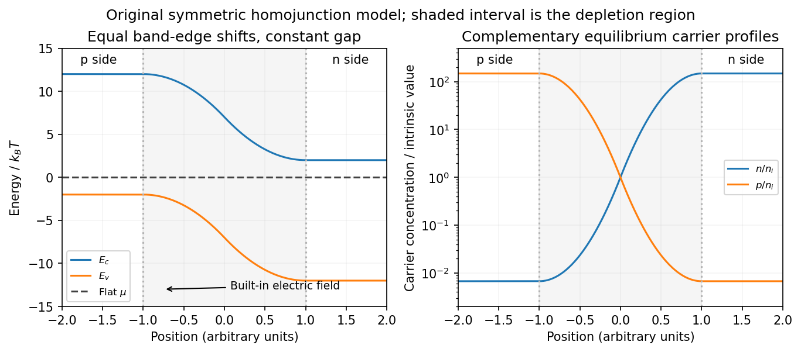

<h1 id="4/solution">Solution</h1>

↑ **Parent:** [4](../4.md)

**Nondegenerate carrier product.** Assume three-dimensional parabolic [energy bands](../../../energy-band.md) near their extrema, [spin](../../../spin.md) degeneracy two, and no additional uncounted valley multiplicity. Near the conduction edge, a Boltzmann approximation to the [Fermi-Dirac distribution](../../../fermi-dirac-distribution.md) gives

$$
n=2\int\frac{d^3k}{(2\pi)^3}\exp\left[-\frac{E_c+\hbar^2k^2/(2m_e)-\mu}{k_BT}\right].
$$

Angular integration and the Gaussian radial integral yield

$$
\boxed{n=N_c e^{-(E_c-\mu)/(k_BT)},\qquad N_c=2\left(\frac{m_ek_BT}{2\pi\hbar^2}\right)^{3/2}.}
$$

For valence [electron holes](../../../electron-hole.md), the empty-state probability is $1-f(E)\simeq e^{(E-\mu)/(k_BT)}$. Measuring [electron hole](../../../electron-hole.md) [kinetic energy](../../../kinetic-energy.md) downwards from $E_v$ similarly gives

$$
\boxed{p=N_v e^{-(\mu-E_v)/(k_BT)},\qquad N_v=2\left(\frac{m_hk_BT}{2\pi\hbar^2}\right)^{3/2}.}
$$

The factors two count [spin](../../../spin.md) once in each band. Multiplying cancels the [chemical potential](../../../chemical-potential-split.md) and proves the [semiconductor mass-action law](../../../semiconductor-mass-action-law.md):

$$
\boxed{np=N_cN_v e^{-E_g/(k_BT)}=\frac12(m_em_h)^{3/2}\left(\frac{k_BT}{\pi\hbar^2}\right)^3e^{-E_g/(k_BT)}=n_i^2.}
$$

In an intrinsic neutral [semiconductor](../../../semiconductor-split.md), $n=p=n_i$. In a doped equilibrium [semiconductor](../../../semiconductor-split.md) the same product holds under the stated nondegenerate assumptions, even when $n\ne p$. Extra valleys or several valence branches must be included in the effective density-of-states factors rather than counted inconsistently.

**Equilibrium junction.** Put the p region on the left and the n region on the right. Before contact their majority carriers are [electron holes](../../../electron-hole.md) and [electrons](../../../electron.md), respectively. [Diffusion](../../../diffusion.md) initially sends [electrons](../../../electron.md) from n to p and [electron holes](../../../electron-hole.md) from p to n. This leaves negative ionized acceptors on the p side and positive ionized donors on the n side, creating a [depletion region](../../../depletion-region.md) and an [electric field](../../../electric-field-split.md) directed from n to p. At equilibrium this field balances [diffusion](../../../diffusion.md), so the net [electric current](../../../electric-current.md) vanishes.

For a homojunction the gap remains constant while the [conduction band](../../../conduction-band.md) and [valence band](../../../valence-band.md) edges bend downwards from p to n by $eV_{\rm bi}$. The equilibrium [chemical potential](../../../chemical-potential-split.md) is flat. Since $E_{c,v}(x)=E_{c,v}^{\rm ref}-e\phi(x)$, the [electrostatic potential](../../../electric-potential.md) rises from p to n. The carrier profiles satisfy

$$
n(x)=N_c e^{-[E_c(x)-\mu]/(k_BT)},\qquad p(x)=N_v e^{-[\mu-E_v(x)]/(k_BT)},\qquad n(x)p(x)=n_i^2.
$$

With fully ionized nondegenerate dopants, the neutral p side has $p_p\simeq N_A$, $n_p\simeq n_i^2/N_A$, while the neutral n side has $n_n\simeq N_D$, $p_n\simeq n_i^2/N_D$. Thus the [electron](../../../electron.md) concentration rises across the junction and the [electron hole](../../../electron-hole.md) concentration falls, with both small relative to the far-side majority densities in much of the depleted region. The ideal [depletion approximation](../../../depletion-approximation.md) neglects these mobile populations when calculating the fixed space [electric charge](../../../electric-charge-split.md), but the actual equilibrium profiles are smooth.

**[Figure 5](#4/image-equilibrium-band-bending-a-flat-chemical-potential-and-complementary-electron-hole-profiles-across-a-homojunction). Equilibrium band bending, a flat chemical potential and complementary electron/hole profiles across a homojunction**.

The [built-in potential](../../../built-in-potential.md) follows from these Boltzmann factors:

$$
\boxed{V_{\rm bi}=\frac{k_BT}{e}\ln\frac{N_AN_D}{n_i^2}.}
$$

There is no applied terminal bias; the internal [electrostatic potential](../../../electric-potential.md) variation does not contradict a constant electrochemical potential.

**Opposing carrier fluxes under [reverse bias](../../../reverse-bias.md).** Use $V>0$ for the magnitude of [reverse bias](../../../reverse-bias.md) and $I>0$ for reverse [electric current](../../../electric-current.md), as in the PDF. The junction barrier increases by $eV$. The [Shockley diode equation](../../../shockley-diode-equation.md) in that orientation can be written

$$
I=\underbrace{I_{\rm sat}}_{\text{reverse-directed carrier supply}}-\underbrace{I_{\rm sat}e^{-eV/(k_BT)}}_{\text{opposing thermally activated flux}}.
$$

The reverse-directed contribution is supplied by minority [electrons](../../../electron.md) on the p side and minority [electron holes](../../../electron-hole.md) on the n side. They reach the depletion edge by [diffusion](../../../diffusion.md) and are swept across by the built-in field. The opposing contribution is associated with majority carriers thermally crossing the barrier in the forward direction; [reverse bias](../../../reverse-bias.md) suppresses it by the [Boltzmann factor](../../../boltzmann-factor.md). At zero bias detailed balance makes the two equal, while at large enough [reverse bias](../../../reverse-bias.md) the opposing flux becomes negligible.

In the ideal neutral-region [diffusion](../../../diffusion.md) model,

$$
I_{\rm sat}=e\mathcal A n_i^2\left(\frac{D_n}{L_nN_A}+\frac{D_p}{L_pN_D}\right).
$$

Here $D_n,D_p$ are minority-carrier [diffusion](../../../diffusion.md) coefficients, $L_n,L_p$ their [diffusion](../../../diffusion.md) lengths, and $\mathcal A$ is junction area. The two terms inside this positive prefactor are the [electron](../../../electron.md) and [electron hole](../../../electron-hole.md) contributions; both flow in the same reverse-current direction. This separates the two carrier-species contributions from the two opposing fluxes in the [Shockley diode equation](../../../shockley-diode-equation.md). Calling the saturation term a [drift current](../../../drift-current.md) refers to its passage across the depleted region, and does not eliminate the minority-carrier [diffusion](../../../diffusion.md) needed to supply it.

**Reading the measured curves.** At $eV\ll k_BT$, the ideal equation gives $I\simeq I_{\rm sat}eV/(k_BT)$, initially proportional to reverse [electric potential difference](../../../electric-potential-difference.md). At $eV\gg k_BT$, it approaches a plateau $I\simeq I_{\rm sat}$. The thermal [electric potential differences](../../../electric-potential-difference.md) at the three temperatures are about $21$–$26\,\mathrm{mV}$, consistent with a rise at small reverse biases and near saturation at larger ones. Higher [temperature](../../../temperature-split.md) produces a much larger plateau because thermal electron-hole excitation raises $n_i^2$ exponentially.

The lower-temperature curve has a noticeable residual [electric potential difference](../../../electric-potential-difference.md) dependence rather than a perfectly flat plateau. Depletion-region generation, surface leakage or other departures from the ideal [diffusion](../../../diffusion.md) model can contribute. The sharp upturn at the largest reverse [electric potential differences](../../../electric-potential-difference.md) is reverse breakdown, outside the unextended [Shockley diode equation](../../../shockley-diode-equation.md); the plot alone does not identify a unique microscopic breakdown mechanism. The original horizontal axis duplicates the final decade label, so a precise breakdown [electric potential difference](../../../electric-potential-difference.md) cannot be read reliably. Neither issue prevents estimating the gap from the intermediate-bias saturation region.

**Band-gap estimate.** Use plateau [electric currents](../../../electric-current.md) at a common intermediate [reverse bias](../../../reverse-bias.md), away from both the small-bias rise and the breakdown upturn. Approximate readings are $I_{\rm sat}(298\,\mathrm K)\sim2.5\times10^{-6}\,\mathrm A$, $I_{\rm sat}(273\,\mathrm K)\sim1.5$–$2\times10^{-7}\,\mathrm A$, and $I_{\rm sat}(248\,\mathrm K)\sim10^{-8}\,\mathrm A$. Kelvin temperatures are required in the activation law.

For fixed effective masses, $n_i^2\propto T^3e^{-E_g/(k_BT)}$. If the remaining transport prefactor is approximately constant, [extracting a semiconductor band gap from diode saturation current](../../../extracting-a-semiconductor-band-gap-from-diode-saturation-current.md) therefore uses

$$
\ln\frac{I_{\rm sat}}{T^3}=\text{constant}-\frac{E_g}{k_BT},\qquad E_g=\frac{k_B\left[\ln(I_h/I_l)-3\ln(T_h/T_l)\right]}{1/T_l-1/T_h}.
$$

Using the widest [temperature](../../../temperature-split.md) separation and the rounded readings gives

$$
E_g\simeq\frac{(8.6173\times10^{-5}\,\mathrm{eV\,K^{-1}})\left[\ln(250)-3\ln(298/248)\right]}{1/248-1/298}\simeq0.63\,\mathrm{eV}.
$$

Neglecting all algebraic prefactors and fitting $\ln I_{\rm sat}$ instead gives about $0.70\,\mathrm{eV}$. These differ by roughly $0.07\,\mathrm{eV}$, a material correction on the graph's precision scale. Thus an honest graph-based conclusion is

$$
\boxed{E_g\sim0.6\text{–}0.7\,\mathrm{eV}\quad\text{for germanium, approximately }0.65\,\mathrm{eV}.}
$$

The nonflat low-temperature plateau, rough [electric current](../../../electric-current.md) readings, unprovided [temperature](../../../temperature-split.md) dependence of $D/L$, and possible gap variation prevent a more precise extraction. If depletion-region generation dominated rather than the specified $I_{\rm sat}\propto n_i^2$ mechanism, its activation slope could involve a different [energy](../../../energy-split.md) scale; the displayed estimate explicitly uses the diffusion-dominated saturation model requested here.

## ↑ Ancestors (12)

1. [4](../4.md)
2. [2014](../../2014-split.md)
3. [Past exam of the quantum condensed matter course of the University of Cambridge](../../split.md)
4. [Quantum Condensed Matter course of the University of Cambridge](../../../quantum-condensed-matter-course-of-the-university-of-cambridge.md)
5. [Physics course of the year 3 of the natural sciences course of the University of Cambridge](../../../physics-course-of-the-year-3-of-the-natural-sciences-course-of-the-university-of-cambridge.md)
6. [Year 3 of the natural sciences course of the University of Cambridge](../../../year-3-of-the-natural-sciences-course-of-the-university-of-cambridge.md)
7. [Year of the natural sciences course of the University of Cambridge](../../../year-of-the-natural-sciences-course-of-the-university-of-cambridge.md)
8. [Natural sciences course of the University of Cambridge](../../../natural-sciences-course-of-the-university-of-cambridge.md)
9. [Course of the University of Cambridge](../../../course-of-the-university-of-cambridge.md)
10. [University of Cambridge](../../../university-of-cambridge-split.md)
11. [List of universities](../../../list-of-universities.md)
12. [Codex Wiki](../../../split.md)
