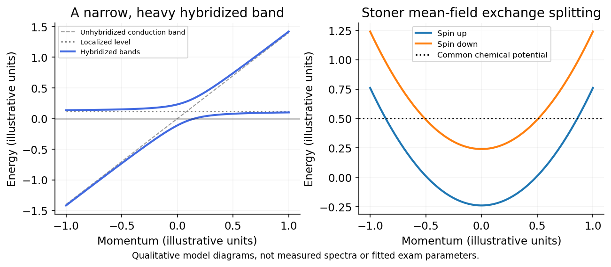

# Paper 1

↑ **Parent:** [2015](../2015.md)

[Original examination PDF,physical pages360–363](https://www.whatdotheyknow.com/request/natural_science_tripos_physics_e_2/response/2340776/attach/2/FOI%202023%20399%20Zahid%20materials.pdf?cookie_passthrough=1#page=360)

**Table of contents**

- [1](#1)
  - [a](#1/a)
    - [Solution](#1/a/solution)
  - [b](#1/b)
    - [Solution](#1/b/solution)
  - [c](#1/c)
    - [Solution](#1/c/solution)
- [2](#2)
  - [a](#2/a)
    - [Solution](#2/a/solution)
  - [b](#2/b)
    - [Solution](#2/b/solution)
  - [c](#2/c)
    - [Solution](#2/c/solution)
- [3](#3)
  - [Solution](#3/solution)
- [4](#4)
  - [Solution](#4/solution)

## 1

↑ **Parent:** [Paper 1](paper-1.md)

<h3 id="1/a">a</h3>

↑ **Parent:** [1](#1)

<h4 id="1/a/solution">Solution</h4>

↑ **Parent:** [A](#1/a)

In the isotropic parabolic-band approximation implied by the single supplied curvature, the [hole mass from a valence-band maximum](../../bloch-s-theorem.md#hole-mass-from-a-valence-band-maximum) is

$$
m_h^*=\frac{\hbar^2}{|E''(0)|}=4.56\times10^{-31}\,\mathrm{kg}\simeq0.500\,m_e.
$$

The [hole](../../quantum-mechanics.md#electron-hole) has charge $+e$, so its cyclotron angular frequency is

$$
\boxed{\omega_c=\frac{eB}{m_h^*}=3.52\times10^{11}\,\mathrm{rad\,s^{-1}}.}
$$

If “frequency” means cycles per second, **$f_c=\omega_c/(2\pi)=5.59\times10^{10}\,\mathrm{Hz}$**. The curvature unit is $\mathrm{J\,m^2}$, so $\hbar^2/E''$ has mass units. The external constants used are $\hbar=1.054571800\times10^{-34}\,\mathrm{J\,s}$, $e=1.6021766208\times10^{-19}\,\mathrm C$ and $m_e=9.10938356\times10^{-31}\,\mathrm{kg}$.[Reduced Planck constant, elementary charge and electron mass](../../physics-bibliography.md#codata-recommended-values-of-the-fundamental-physical-constants-2014-by-national-institute-of-standards-and-technology) A genuinely anisotropic band would require the cyclotron mass for the orbit plane, not a single arbitrary directional curvature.

<h3 id="1/b">b</h3>

↑ **Parent:** [1](#1)

<h4 id="1/b/solution">Solution</h4>

↑ **Parent:** [B](#1/b)

Let the atomic spacing be $a$ and define the nearest-neighbour matrix elements $t_\alpha=\langle j,p_\alpha|H|j+1,p_\alpha\rangle$, using the same translated orbital convention on every site. Then

$$
E_\alpha(k)=\epsilon_\alpha+2t_\alpha\cos(ka),\qquad-\pi/a\leq k\leq\pi/a.
$$

For the [opposite sigma and pi hopping signs in a p-orbital chain](../../bloch-s-theorem.md#opposite-sigma-and-pi-hopping-signs-in-a-p-orbital-chain), consider $p_z$ first: neighbouring lobes above the chain have the same sign, so the in-phase Bloch sum is bonding. Thus $t_\pi<0$ and

$$
\boxed{E_{p_z}=\epsilon_z-2|t_\pi|\cos(ka):\quad\text{minimum at }k=0.}
$$

For $p_x$, the lobes facing one another have opposite signs for equal site coefficients. Bonding therefore needs alternating coefficients, giving $t_\sigma>0$ and

$$
\boxed{E_{p_x}=\epsilon_x+2|t_\sigma|\cos(ka):\quad\text{minimum at }k=\pm\pi/a.}
$$

End-on $\sigma$ overlap is normally stronger than side-on $\pi$ overlap, so the $p_x$ band is wider, with [bandwidths](../../electrical-engineering.md#bandwidth-signal-processing) $4|t_\sigma|$ and $4|t_\pi|$. The curve orientations require a stated hopping-sign convention; a Hamiltonian written with an explicit minus sign in front of the hopping uses correspondingly opposite parameter signs.[Chapter 2: nearest-neighbour tight binding and Bloch sums](../../physics-bibliography.md#solid-state-physics-by-david-tong)

**[Figure 1](#1/b/image-end-on-and-side-on-p-orbital-hopping-give-opposite-tight-binding-band-orientations). End-on and side-on p-orbital hopping give opposite tight-binding band orientations**. [Source](paper-1-p-orbital-bands.py).

<h3 id="1/c">c</h3>

↑ **Parent:** [1](#1)

<h4 id="1/c/solution">Solution</h4>

↑ **Parent:** [C](#1/c)

A hydrogenic donor has the [effective Bohr radius of a hydrogenic donor](../../semiconductor.md#effective-bohr-radius-of-a-hydrogenic-donor)

$$
\boxed{a_B^*=\epsilon_r\frac{m_e}{m^*}a_0=80a_0=4.23\,\mathrm{nm},}
$$

using the external $a_0=0.52917721067\times10^{-10}\,\mathrm m$.[Bohr radius](../../physics-bibliography.md#codata-recommended-values-of-the-fundamental-physical-constants-2014-by-national-institute-of-standards-and-technology) Increasing donor density causes donor states to overlap and screens their binding, allowing a metallic impurity system rather than isolated frozen-out donors.

Using the standard approximate [Mott criterion](../../critical-phenomenon.md#mott-criterion), $n_D^{1/3}a_B^*\simeq0.25$, gives

$$
\boxed{n_{D,c}\sim\left(\frac{0.25}{a_B^*}\right)^3\simeq2.1\times10^{23}\,\mathrm{m^{-3}}=2.1\times10^{17}\,\mathrm{cm^{-3}}.}
$$

The factor 0.25 is an externally documented empirical criterion, not supplied exam data or an exact universal threshold.[Abstract and discussion of the effective-Bohr-radius criterion](../../physics-bibliography.md#the-mott-criterion-so-simple-and-yet-so-complex-by-alexander-pergament-and-others) An order-of-magnitude overlap argument without that prefactor would give $(a_B^*)^{-3}\simeq1.3\times10^{25}\,\mathrm{m^{-3}}$. Compensation, disorder and multivalley anisotropy affect a real material's transition; this estimate uses the scalar mass and permittivity actually supplied, without substituting other germanium parameters.

## 2

↑ **Parent:** [Paper 1](paper-1.md)

<h3 id="2/a">a</h3>

↑ **Parent:** [2](#2)

<h4 id="2/a/solution">Solution</h4>

↑ **Parent:** [A](#2/a)

[Heavy fermion materials](../../physics.md#heavy-fermion-material) are correlated metals whose low-energy [quasiparticles](../../quantum-mechanics.md#quasiparticle) have exceptionally large effective masses. Partly localized $f$-electron moments hybridize with broader conduction states. The [Kondo effect](../../physics.md#kondo-effect) and coherence below the [Kondo-lattice coherence temperature](../../physics.md#kondo-lattice-coherence-temperature) produce a narrow low-energy band, so a small energy change corresponds to a large momentum-space state density.

For the [electronic heat capacity of a heavy Fermi liquid](../../physics.md#electronic-heat-capacity-of-a-heavy-fermi-liquid), the resulting [density of states](../../quantum-ideal-gas-statistics.md#density-of-states) gives a large low-[temperature](../../temperature.md) electronic specific-heat coefficient,

$$
\boxed{C_{\rm el}=\gamma T,\qquad\gamma=\frac{\pi^2k_B^2}{3}g(E_F),}
$$

and often an enhanced [magnetic susceptibility](../../statistical-physics.md#magnetic-susceptibility). Here $g$ includes both spins and must be expressed per sample, mole or volume consistently with $\gamma$. A coherent Fermi-liquid regime often has $\rho=\rho_0+AT^2$ with an enhanced coefficient $A$. Above coherence, scattering by local moments can instead give a Kondo-like resistivity upturn.

The competition between moment screening and intersite magnetic interactions can yield a heavy paramagnetic metal, magnetic order, quantum-critical behaviour or unconventional [superconductivity](../../superconductivity.md). Ce- and U-based compounds supply familiar examples. “Heavy” describes the emergent electronic [quasiparticles](../../quantum-mechanics.md#quasiparticle), not the ionic mass; the simple heavy-band picture need not survive at a [quantum critical point](../../critical-phenomenon.md#quantum-critical-point).[Sections 1.1–1.3: heavy electrons, local moments and Kondo-lattice coherence](../../physics-bibliography.md#heavy-fermions-and-the-kondo-lattice-a-21st-century-perspective-by-piers-coleman)

**[Figure 2](#2/a/image-hybridization-flattens-a-conduction-band-near-a-localized-level-while-an-itinerant-exchange-field-splits-spin-bands). Hybridization flattens a conduction band near a localized level, while an itinerant exchange field splits spin bands**. [Source](paper-1-correlated-metal-bands.py).

<h3 id="2/b">b</h3>

↑ **Parent:** [2](#2)

<h4 id="2/b/solution">Solution</h4>

↑ **Parent:** [B](#2/b)

The [Hubbard model](../../statistical-physics.md#hubbard-model) combines hopping with a local repulsion,

$$
H=-t\sum_{\langle ij\rangle,\sigma}(c_{i\sigma}^\dagger c_{j\sigma}+\mathrm{h.c.})+U\sum_i n_{i\uparrow}n_{i\downarrow},\qquad U>0.
$$

Hopping favours a broad itinerant band; the interaction penalizes opposite-spin [double occupancy](../../statistical-physics.md#double-occupancy). For [uniform Stoner decoupling of the Hubbard interaction](../../statistical-physics.md#uniform-stoner-decoupling-of-the-hubbard-interaction), let $s=n_\uparrow-n_\downarrow$ be the spin imbalance per site. The interaction is $U(n^2-s^2)/4$, so polarization lowers it by $Us^2/4$, at the expense of kinetic energy.

If $D(E_F)$ is the noninteracting [density of states](../../quantum-ideal-gas-statistics.md#density-of-states) **per spin per site**, small polarization costs $s^2/[4D(E_F)]$. Therefore

$$
\boxed{\Delta E=\frac{s^2}{4}[D(E_F)^{-1}-U]+O(s^4),\qquad UD(E_F)>1}
$$

is the mean-field ferromagnetic instability criterion. The exchange splitting is $\Delta=Us$, and the paramagnetic response is enhanced as $\chi=\chi_0/[1-UD(E_F)]$. A [density of states](../../quantum-ideal-gas-statistics.md#density-of-states) including both spins changes the written factor in the criterion.

The model explains how itinerant bands can polarize without imposing pre-existing localized atomic spins. It is not a claim that every large-$U$ metal becomes ferromagnetic: near half filling the [Hubbard model](../../statistical-physics.md#hubbard-model) can instead form a [Mott insulator](../../bloch-s-theorem.md#mott-insulator) with antiferromagnetic [superexchange](../../electromagnetism.md#superexchange) of scale $4t^2/U$. [Band filling](../../bloch-s-theorem.md#band-filling), [bandwidth](../../electrical-engineering.md#bandwidth-signal-processing) and fluctuations matter.[Section 3.6.6: the free-electron magnetic response](../../physics-bibliography.md#quantum-gases-by-david-tong) The interaction-energy and kinetic-cost expansion above is the stated mean-field derivation of the enhancement.[Original local-repulsion model and the competition between atomic and itinerant limits](../../physics-bibliography.md#electron-correlations-in-narrow-energy-bands-by-john-hubbard)

<h3 id="2/c">c</h3>

↑ **Parent:** [2](#2)

<h4 id="2/c/solution">Solution</h4>

↑ **Parent:** [C](#2/c)

For an electron wavepacket in one isolated band under a uniform [electric field](../../electric-field.md),

$$
\hbar\dot k=-eE,\qquad v(k)=\frac1\hbar\frac{d\epsilon}{dk}.
$$

Because $\epsilon(k+2\pi/a)=\epsilon(k)$, acceleration through successive [Brillouin zones](../../bloch-s-theorem.md#brillouin-zone) makes the velocity periodic rather than increasing indefinitely. For $\epsilon=\epsilon_0-2J\cos(ka)$,

$$
\boxed{\omega_B=\frac{e|E|a}{\hbar},\qquad T_B=\frac{h}{e|E|a},\qquad v(t)=\frac{2Ja}{\hbar}\sin(k_0a-\omega_Bt)}
$$

for a positive field along the chosen axis. Integration gives

$$
x(t)-x(0)=\frac{2J}{eE}[\cos(k_0a-\omega_Bt)-\cos(k_0a)].
$$

The [excursion amplitude of a Bloch-oscillating wavepacket](../../bloch-s-theorem.md#excursion-amplitude-of-a-bloch-oscillating-wavepacket) is $2|J|/(e|E|)$ about its mean and peak-to-peak extent $4|J|/(e|E|)$. The turning of velocity corresponds semiclassically to Bragg reflection near a zone boundary.

Coherent [Bloch oscillations](../../bloch-s-theorem.md#bloch-oscillation) require scattering/[dephasing](../../quantum-information-theory.md#dephasing-channel) times long compared with $T_B$ and a field weak enough to avoid substantial interband tunnelling. Ordinary metals usually scatter too rapidly; [semiconductor](../../semiconductor.md) superlattices and cold atoms in periodic optical potentials provide cleaner realizations. A completely filled band has canceling velocities, so its net current does not oscillate simply because individual wavepackets can.[Chapter 3: semiclassical band dynamics and Bloch oscillations](../../physics-bibliography.md#solid-state-physics-by-david-tong)

**[Figure 3](#2/c/image-constant-force-sweeps-crystal-momentum-linearly-but-a-periodic-band-produces-oscillating-velocity-and-bounded-displacement). Constant force sweeps crystal momentum linearly, but a periodic band produces oscillating velocity and bounded displacement**. [Source](paper-1-bloch-oscillations.py).

## 3

↑ **Parent:** [Paper 1](paper-1.md)

<h3 id="3/solution">Solution</h3>

↑ **Parent:** [3](#3)

For a spin-degenerate band, each unit cell contributes two available states. An even electron count per cell can fill an integer number of bands; **a [band insulator](../../bloch-s-theorem.md#band-insulator) additionally needs a global gap between the highest occupied and lowest unoccupied bands**. Even filling alone is not sufficient when bands overlap.

For a free two-dimensional gas with [spin degeneracy](../../statistical-physics.md#spin-degeneracy) two,

$$
n=\frac{2\pi k_F^2}{(2\pi)^2},\qquad\boxed{k_F=\sqrt{2\pi n}.}
$$

The reciprocal vectors of the periodic potential are $Q\hat{\mathbf x}$ and $Q\hat{\mathbf y}$. Its [first Brillouin zone](../../bloch-s-theorem.md#first-brillouin-zone) is the square $-Q/2\leq k_x,k_y\leq Q/2$, of side $Q$ and area $Q^2$; the real-space cell has side $a=2\pi/Q$.

At zero potential, the extended-zone [Fermi surface](../../fermi-liquid.md#fermi-surface) is the circle of radius $k_F$. Since $\sqrt2<\alpha<2$, it crosses every square face but misses the corners. For [Fermi-surface reconstruction in a weak square potential](../../fermi-liquid.md#fermi-surface-reconstruction-in-a-weak-square-potential), weak positive potential opens gaps at the Bragg crossings: the second band has [electron pockets](../../fermi-liquid.md#electron-pocket) at the two inequivalent edge centres $X,Y$, while unfilled regions of the first band form a [hole pocket](../../fermi-liquid.md#hole-pocket) at the zone corner $M$. Opposite edges are identified: four edge half-pockets are two [electron pockets](../../fermi-liquid.md#electron-pocket), and four corner pieces are one [hole pocket](../../fermi-liquid.md#hole-pocket).

**[Figure 4](#3/image-a-square-brillouin-zone-reconstructs-the-free-fermi-circle-into-edge-centred-electron-pockets-and-a-corner-centred-hole-pocket). A square Brillouin zone reconstructs the free Fermi circle into edge-centred electron pockets and a corner-centred hole pocket**. [Source](paper-1-fermi-pockets.py).

For the [circular-cap carrier count in a square Brillouin zone](../../fermi-liquid.md#circular-cap-carrier-count-in-a-square-brillouin-zone), put $R=k_F$ and $s=Q/(2R)=\alpha/2$. Each circular cap outside a square face has area

$$
C=R^2[\arccos s-s\sqrt{1-s^2}].
$$

No two such caps overlap in the specified interval. The total second-band electron area is $A_e=4C$. The first-band [hole](../../quantum-mechanics.md#electron-hole) area is the square area minus the occupied central-circle area, $A_h=Q^2-\pi R^2+4C$. Including spin,

$$
\boxed{\frac{n_e}{n}=\frac4\pi[\arccos(\alpha/2)-(\alpha/2)\sqrt{1-\alpha^2/4}],\qquad\frac{n_h}{n}=\frac{\alpha^2}\pi-1+\frac{n_e}{n}.}
$$

Thus at $\alpha=\sqrt3$,

$$
\boxed{n_e=\left(\frac23-\frac{\sqrt3}\pi\right)n\simeq0.11534n,\qquad n_h=\left(\frac{3-\sqrt3}\pi-\frac13\right)n\simeq0.07027n.}
$$

The carrier densities are the electron- and [hole](../../quantum-mechanics.md#electron-hole)-pocket counts, not the total electron density. The [carrier compensation and even band filling in a square lattice](../../bloch-s-theorem.md#carrier-compensation-and-even-band-filling-in-a-square-lattice) follows because their difference obeys $n_e-n_h=n-Q^2/(2\pi^2)$, so **compensation occurs at $\alpha=\sqrt\pi$**. These area formulas are the $V_0\to0^+$ limit, before finite-gap reconstruction changes the pocket shapes.[Chapters 2–3: band-state counting, zone folding, nearly free electrons and holes](../../physics-bibliography.md#solid-state-physics-by-david-tong)

The filling per real-space cell is $\nu=na^2=2\pi/\alpha^2$. In the given interval, the only even integer filling is $\nu=2$, again requiring $\alpha=\sqrt\pi$. At any other fixed filling a full gap cannot yield an ordinary spin-degenerate [band insulator](../../bloch-s-theorem.md#band-insulator) in this unchanged periodicity. In particular, the $\alpha=\sqrt3$ system retains excess electron carriers even after its [holes](../../quantum-mechanics.md#electron-hole) disappear.

A rough gap threshold comes from comparing different symmetry directions, rather than only a direct zone-face gap. Define $E_Q=\hbar^2Q^2/(2m)$. The [zone-face two-plane-wave gap for a cosine potential](../../bloch-s-theorem.md#zone-face-two-plane-wave-gap-for-a-cosine-potential) follows because each cosine couples plane waves by $-V_0/2$, giving the one-dimensional zone-edge levels $E_Q/4\mp V_0/2$. The [four-plane-wave splitting at a square-zone corner](../../bloch-s-theorem.md#four-plane-wave-splitting-at-a-square-zone-corner) is the sum of two such pairs. The potential is separable in $x,y$, so to first order

$$
E_{1,\max}(M)\simeq E_Q/2-V_0,\qquad E_{2,\min}(X,Y)\simeq E_Q/4+V_0/2.
$$

The [indirect gap of a separable square cosine potential](../../bloch-s-theorem.md#indirect-gap-of-a-separable-square-cosine-potential) is consequently

$$
\boxed{\Delta_{\rm ind}\simeq\frac32V_0-\frac14E_Q,\qquad V_{0,\min}\sim\frac{E_Q}{6}=\frac{\hbar^2Q^2}{12m}.}
$$

At the compensated filling, this is $V_{0,\min}\sim(\pi/6)E_F^{(0)}$, with $E_F^{(0)}=\hbar^2k_F^2/(2m)$. **An insulator needs both the even filling and a positive indirect gap.** At the touching threshold the gap is zero; a positive direct gap at every Bragg crossing is not by itself sufficient. The estimate neglects higher-plane-wave corrections and is not an exact critical amplitude.

**[Figure 5](#3/image-a-local-bragg-gap-can-coexist-with-a-global-band-overlap-a-stronger-square-potential-separates-the-full-first-band-from-the-second). A local Bragg gap can coexist with a global band overlap; a stronger square potential separates the full first band from the second**. [Source](paper-1-indirect-band-gap.py).

## 4

↑ **Parent:** [Paper 1](paper-1.md)

<h3 id="4/solution">Solution</h3>

↑ **Parent:** [4](#4)

Assume three-dimensional parabolic band edges, with density-of-states masses $m_c,m_h$ and one valley per edge, each with [spin degeneracy](../../statistical-physics.md#spin-degeneracy) two. Their effective densities of states are

$$
N_c=2\left(\frac{m_ck_BT}{2\pi\hbar^2}\right)^{3/2},\qquad N_v=2\left(\frac{m_hk_BT}{2\pi\hbar^2}\right)^{3/2}.
$$

For the [semiconductor mass-action law](../../semiconductor.md#semiconductor-mass-action-law), integrating the square-root [density of states](../../quantum-ideal-gas-statistics.md#density-of-states) against the Boltzmann tail gives $n=N_c e^{(\mu-E_c)/(k_BT)}$ and $p=N_v e^{(E_v-\mu)/(k_BT)}$. Multiplication cancels the [chemical potential](../../chemical-potential.md), giving

$$
\boxed{np=A(k_BT)^3e^{-E_g/(k_BT)},\qquad A=\frac{4(m_cm_h)^{3/2}}{(2\pi\hbar^2)^3}.}
$$

If there are additional valley degeneracies, multiply by their product; anisotropic bands use the appropriate density-of-states masses. In the later equal-mass model, $A=4m^3/(2\pi\hbar^2)^3$. No numerical mass or valley multiplicity has been invented.

When $\mu=E_c=0$, the conduction-edge occupation is exactly $1/2$, so the nondegenerate approximation for electrons fails at every positive [temperature](../../temperature.md). Define the [Normalized complete Fermi-Dirac integral](../../tensor-product-of-quantum-systems.md#normalized-complete-fermi-dirac-integral)

$$
F_{1/2}(\eta)=\frac2{\sqrt\pi}\int_0^\infty\frac{\sqrt x}{1+e^{x-\eta}}\,dx,\qquad f_0=F_{1/2}(0)=(1-2^{-1/2})\zeta(3/2)\simeq0.765147.
$$

For the [carrier densities with chemical potential pinned to a band edge](../../tensor-product-of-quantum-systems.md#carrier-densities-with-chemical-potential-pinned-to-a-band-edge), with the two specified equal masses, put $N(T)=2[mk_BT/(2\pi\hbar^2)]^{3/2}$. Direct Fermi-Dirac integration then gives

$$
\boxed{n(T)=N(T)f_0,\qquad p(T)=N(T)F_{1/2}[-E_g/(k_BT)].}
$$

Thus $n\propto T^{3/2}$ exactly within the parabolic model. At low [temperature](../../temperature.md), $p\simeq N(T)e^{-E_g/(k_BT)}$ is thermally activated; at $k_BT\gg E_g$, $p/n\to1$ from below. Both vanish at zero [temperature](../../temperature.md) and increase at fixed [chemical potential](../../chemical-potential.md). The other states that pin $\mu$ can supply the compensating charge; one must not additionally impose $n=p$.

For the [Pauli reduction of the pinned-edge mass-action product](../../semiconductor.md#pauli-reduction-of-the-pinned-edge-mass-action-product), the exact product relative to the classical law is

$$
\frac{np}{N(T)^2e^{-E_g/(k_BT)}}=f_0e^{E_g/(k_BT)}F_{1/2}[-E_g/(k_BT)]<1.
$$

It approaches $f_0$ at low [temperature](../../temperature.md) and $f_0^2\simeq0.58545$ in the formal high-[temperature](../../temperature.md) limit. The low-[temperature](../../temperature.md) activation factor is unchanged but its prefactor is reduced; the classical mass-action formula overestimates the product. The high-[temperature](../../temperature.md) limit here refers to the given unbounded parabolic bands, not a claim that real [semiconductor](../../semiconductor.md) band structures remain unchanged at arbitrarily high [temperature](../../temperature.md).[Sections 3.1 and 3.6.1–3.6.4: density of states, Fermi occupation and Sommerfeld expansion](../../physics-bibliography.md#quantum-gases-by-david-tong)

Finally, for a fixed positive $\mu$, the zero-[temperature](../../temperature.md) Fermi sphere has radius $k_\mu=\sqrt{2m\mu}/\hbar$, so

$$
\boxed{n(0)=\frac{k_\mu^3}{3\pi^2}=\frac1{3\pi^2}\left(\frac{2m\mu}{\hbar^2}\right)^{3/2},\qquad n(T)=N(T)F_{1/2}[\mu/(k_BT)].}
$$

The low-[temperature](../../temperature.md) expansion at **fixed $\mu$** gives the [fixed-chemical-potential Sommerfeld density increase](../../quantum-ideal-gas-statistics.md#fixed-chemical-potential-sommerfeld-density-increase):

$$
\boxed{n(T)=n(0)\left[1+\frac{\pi^2}{8}\left(\frac{k_BT}{\mu}\right)^2+O\!\left(\frac{k_BT}{\mu}\right)^4\right].}
$$

The [monotonic density at fixed chemical potential in a square-root density of states](../../quantum-ideal-gas-statistics.md#monotonic-density-at-fixed-chemical-potential-in-a-square-root-density-of-states) initially rises quadratically from $n(0)$. For $k_BT\gg\mu$, its leading behaviour crosses to $f_0N(T)\propto T^{3/2}$. The fixed [chemical potential](../../chemical-potential.md) is what allows the particle number to change.

**[Figure 6](#4/image-pinning-the-chemical-potential-to-or-above-a-band-edge-changes-carrier-populations-and-the-mass-action-product). Pinning the chemical potential to or above a band edge changes carrier populations and the mass-action product**. [Source](paper-1-pinned-carrier-densities.py).

## ↑ Ancestors (11)

1. [2015](../2015.md)
2. [Past exam of the quantum condensed matter course of the University of Cambridge](../../past-exam-of-the-quantum-condensed-matter-course-of-the-university-of-cambridge.md)
3. [Quantum Condensed Matter course of the University of Cambridge](../../university-of-cambridge.md#quantum-condensed-matter-course-of-the-university-of-cambridge)
4. [Physics course of the year 3 of the natural sciences course of the University of Cambridge](../../university-of-cambridge.md#physics-course-of-the-year-3-of-the-natural-sciences-course-of-the-university-of-cambridge)
5. [Year 3 of the natural sciences course of the University of Cambridge](../../university-of-cambridge.md#year-3-of-the-natural-sciences-course-of-the-university-of-cambridge)
6. [Year of the natural sciences course of the University of Cambridge](../../university-of-cambridge.md#year-of-the-natural-sciences-course-of-the-university-of-cambridge)
7. [Natural sciences course of the University of Cambridge](../../university-of-cambridge.md#natural-sciences-course-of-the-university-of-cambridge)
8. [Course of the University of Cambridge](../../university-of-cambridge.md#course-of-the-university-of-cambridge)
9. [University of Cambridge](../../university-of-cambridge.md)
10. [List of universities](../../README.md#list-of-universities)
11. [Codex Wiki](../../README.md)
