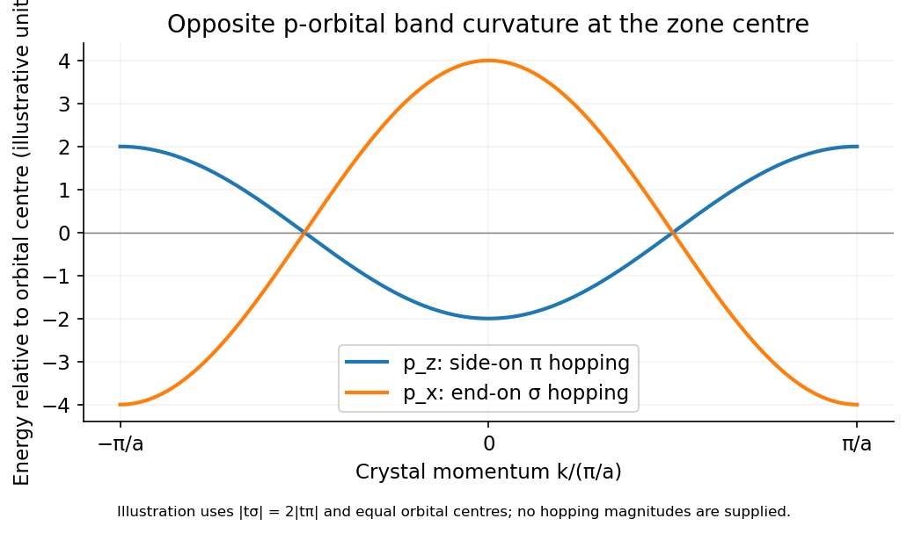

<h1 id="1/b/solution">Solution</h1>

↑ **Parent:** [B](../b.md)

Let the atomic spacing be $a$ and define the nearest-neighbour matrix elements $t_\alpha=\langle j,p_\alpha|H|j+1,p_\alpha\rangle$, using the same translated orbital convention on every site. Then

$$
E_\alpha(k)=\epsilon_\alpha+2t_\alpha\cos(ka),\qquad-\pi/a\leq k\leq\pi/a.
$$

For the [opposite sigma and pi hopping signs in a p-orbital chain](../../../../../opposite-sigma-and-pi-hopping-signs-in-a-p-orbital-chain.md), consider $p_z$ first: neighbouring lobes above the chain have the same sign, so the in-phase Bloch sum is bonding. Thus $t_\pi<0$ and

$$
\boxed{E_{p_z}=\epsilon_z-2|t_\pi|\cos(ka):\quad\text{minimum at }k=0.}
$$

For $p_x$, the lobes facing one another have opposite signs for equal site coefficients. Bonding therefore needs alternating coefficients, giving $t_\sigma>0$ and

$$
\boxed{E_{p_x}=\epsilon_x+2|t_\sigma|\cos(ka):\quad\text{minimum at }k=\pm\pi/a.}
$$

End-on $\sigma$ overlap is normally stronger than side-on $\pi$ overlap, so the $p_x$ band is wider, with [bandwidths](../../../../../bandwidth-signal-processing.md) $4|t_\sigma|$ and $4|t_\pi|$. The curve orientations require a stated hopping-sign convention; a Hamiltonian written with an explicit minus sign in front of the hopping uses correspondingly opposite parameter signs.[Chapter 2: nearest-neighbour tight binding and Bloch sums](../../../../../solid-state-physics-by-david-tong.md)

**[Figure 1](#1/b/image-end-on-and-side-on-p-orbital-hopping-give-opposite-tight-binding-band-orientations). End-on and side-on p-orbital hopping give opposite tight-binding band orientations**. [Source](paper-1-p-orbital-bands.py).

## ↑ Ancestors (14)

1. [B](../b.md)
2. [1](../../1.md)
3. [Paper 1](../../../paper-1-split.md)
4. [2015](../../../split.md)
5. [Past exam of the quantum condensed matter course of the University of Cambridge](../../../../split.md)
6. [Quantum Condensed Matter course of the University of Cambridge](../../../../../quantum-condensed-matter-course-of-the-university-of-cambridge.md)
7. [Physics course of the year 3 of the natural sciences course of the University of Cambridge](../../../../../physics-course-of-the-year-3-of-the-natural-sciences-course-of-the-university-of-cambridge.md)
8. [Year 3 of the natural sciences course of the University of Cambridge](../../../../../year-3-of-the-natural-sciences-course-of-the-university-of-cambridge.md)
9. [Year of the natural sciences course of the University of Cambridge](../../../../../year-of-the-natural-sciences-course-of-the-university-of-cambridge.md)
10. [Natural sciences course of the University of Cambridge](../../../../../natural-sciences-course-of-the-university-of-cambridge.md)
11. [Course of the University of Cambridge](../../../../../course-of-the-university-of-cambridge.md)
12. [University of Cambridge](../../../../../university-of-cambridge-split.md)
13. [List of universities](../../../../../list-of-universities.md)
14. [Codex Wiki](../../../../../split.md)
