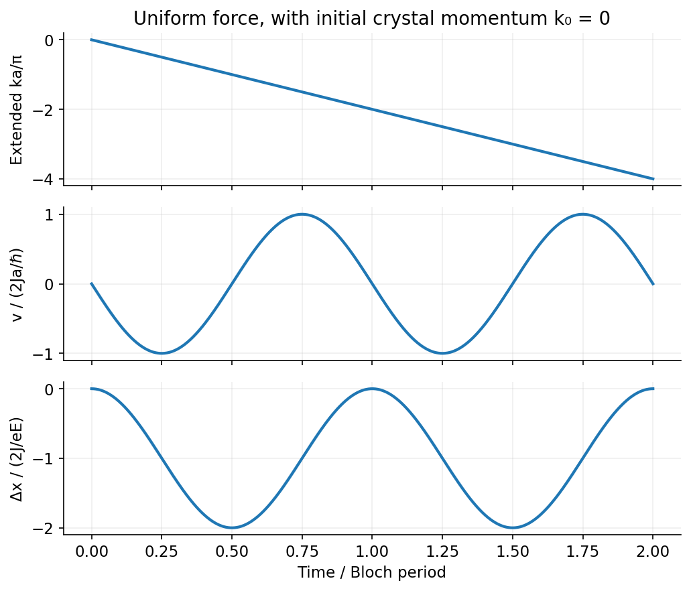

<h1 id="2/c/solution">Solution</h1>

↑ **Parent:** [C](../c.md)

For an electron wavepacket in one isolated band under a uniform [electric field](../../../../../electric-field-split.md),

$$
\hbar\dot k=-eE,\qquad v(k)=\frac1\hbar\frac{d\epsilon}{dk}.
$$

Because $\epsilon(k+2\pi/a)=\epsilon(k)$, acceleration through successive [Brillouin zones](../../../../../brillouin-zone.md) makes the velocity periodic rather than increasing indefinitely. For $\epsilon=\epsilon_0-2J\cos(ka)$,

$$
\boxed{\omega_B=\frac{e|E|a}{\hbar},\qquad T_B=\frac{h}{e|E|a},\qquad v(t)=\frac{2Ja}{\hbar}\sin(k_0a-\omega_Bt)}
$$

for a positive field along the chosen axis. Integration gives

$$
x(t)-x(0)=\frac{2J}{eE}[\cos(k_0a-\omega_Bt)-\cos(k_0a)].
$$

The [excursion amplitude of a Bloch-oscillating wavepacket](../../../../../excursion-amplitude-of-a-bloch-oscillating-wavepacket.md) is $2|J|/(e|E|)$ about its mean and peak-to-peak extent $4|J|/(e|E|)$. The turning of velocity corresponds semiclassically to Bragg reflection near a zone boundary.

Coherent [Bloch oscillations](../../../../../bloch-oscillation.md) require scattering/[dephasing](../../../../../dephasing-channel.md) times long compared with $T_B$ and a field weak enough to avoid substantial interband tunnelling. Ordinary metals usually scatter too rapidly; [semiconductor](../../../../../semiconductor-split.md) superlattices and cold atoms in periodic optical potentials provide cleaner realizations. A completely filled band has canceling velocities, so its net current does not oscillate simply because individual wavepackets can.[Chapter 3: semiclassical band dynamics and Bloch oscillations](../../../../../solid-state-physics-by-david-tong.md)

**[Figure 3](#2/c/image-constant-force-sweeps-crystal-momentum-linearly-but-a-periodic-band-produces-oscillating-velocity-and-bounded-displacement). Constant force sweeps crystal momentum linearly, but a periodic band produces oscillating velocity and bounded displacement**. [Source](paper-1-bloch-oscillations.py).

## ↑ Ancestors (14)

1. [C](../c.md)
2. [2](../../2.md)
3. [Paper 1](../../../paper-1-split.md)
4. [2015](../../../split.md)
5. [Past exam of the quantum condensed matter course of the University of Cambridge](../../../../split.md)
6. [Quantum Condensed Matter course of the University of Cambridge](../../../../../quantum-condensed-matter-course-of-the-university-of-cambridge.md)
7. [Physics course of the year 3 of the natural sciences course of the University of Cambridge](../../../../../physics-course-of-the-year-3-of-the-natural-sciences-course-of-the-university-of-cambridge.md)
8. [Year 3 of the natural sciences course of the University of Cambridge](../../../../../year-3-of-the-natural-sciences-course-of-the-university-of-cambridge.md)
9. [Year of the natural sciences course of the University of Cambridge](../../../../../year-of-the-natural-sciences-course-of-the-university-of-cambridge.md)
10. [Natural sciences course of the University of Cambridge](../../../../../natural-sciences-course-of-the-university-of-cambridge.md)
11. [Course of the University of Cambridge](../../../../../course-of-the-university-of-cambridge.md)
12. [University of Cambridge](../../../../../university-of-cambridge-split.md)
13. [List of universities](../../../../../list-of-universities.md)
14. [Codex Wiki](../../../../../split.md)
