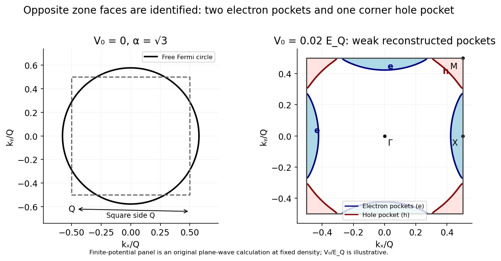
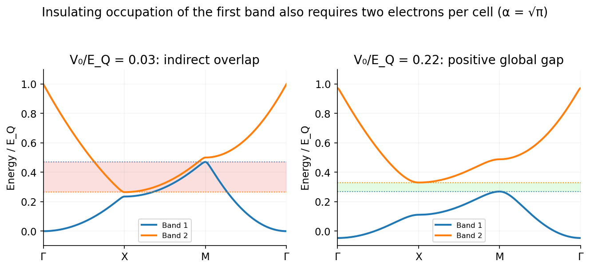

<h1 id="3/solution">Solution</h1>

↑ **Parent:** [3](../3.md)

For a spin-degenerate band, each unit cell contributes two available states. An even electron count per cell can fill an integer number of bands; **a [band insulator](../../../../band-insulator.md) additionally needs a global gap between the highest occupied and lowest unoccupied bands**. Even filling alone is not sufficient when bands overlap.

For a free two-dimensional gas with [spin degeneracy](../../../../spin-degeneracy.md) two,

$$
n=\frac{2\pi k_F^2}{(2\pi)^2},\qquad\boxed{k_F=\sqrt{2\pi n}.}
$$

The reciprocal vectors of the periodic potential are $Q\hat{\mathbf x}$ and $Q\hat{\mathbf y}$. Its [first Brillouin zone](../../../../first-brillouin-zone.md) is the square $-Q/2\leq k_x,k_y\leq Q/2$, of side $Q$ and area $Q^2$; the real-space cell has side $a=2\pi/Q$.

At zero potential, the extended-zone [Fermi surface](../../../../fermi-surface.md) is the circle of radius $k_F$. Since $\sqrt2<\alpha<2$, it crosses every square face but misses the corners. For [Fermi-surface reconstruction in a weak square potential](../../../../fermi-surface-reconstruction-in-a-weak-square-potential.md), weak positive potential opens gaps at the Bragg crossings: the second band has [electron pockets](../../../../electron-pocket.md) at the two inequivalent edge centres $X,Y$, while unfilled regions of the first band form a [hole pocket](../../../../hole-pocket.md) at the zone corner $M$. Opposite edges are identified: four edge half-pockets are two [electron pockets](../../../../electron-pocket.md), and four corner pieces are one [hole pocket](../../../../hole-pocket.md).

**[Figure 4](#3/image-a-square-brillouin-zone-reconstructs-the-free-fermi-circle-into-edge-centred-electron-pockets-and-a-corner-centred-hole-pocket). A square Brillouin zone reconstructs the free Fermi circle into edge-centred electron pockets and a corner-centred hole pocket**. [Source](paper-1-fermi-pockets.py).

For the [circular-cap carrier count in a square Brillouin zone](../../../../circular-cap-carrier-count-in-a-square-brillouin-zone.md), put $R=k_F$ and $s=Q/(2R)=\alpha/2$. Each circular cap outside a square face has area

$$
C=R^2[\arccos s-s\sqrt{1-s^2}].
$$

No two such caps overlap in the specified interval. The total second-band electron area is $A_e=4C$. The first-band [hole](../../../../electron-hole.md) area is the square area minus the occupied central-circle area, $A_h=Q^2-\pi R^2+4C$. Including spin,

$$
\boxed{\frac{n_e}{n}=\frac4\pi[\arccos(\alpha/2)-(\alpha/2)\sqrt{1-\alpha^2/4}],\qquad\frac{n_h}{n}=\frac{\alpha^2}\pi-1+\frac{n_e}{n}.}
$$

Thus at $\alpha=\sqrt3$,

$$
\boxed{n_e=\left(\frac23-\frac{\sqrt3}\pi\right)n\simeq0.11534n,\qquad n_h=\left(\frac{3-\sqrt3}\pi-\frac13\right)n\simeq0.07027n.}
$$

The carrier densities are the electron- and [hole](../../../../electron-hole.md)-pocket counts, not the total electron density. The [carrier compensation and even band filling in a square lattice](../../../../carrier-compensation-and-even-band-filling-in-a-square-lattice.md) follows because their difference obeys $n_e-n_h=n-Q^2/(2\pi^2)$, so **compensation occurs at $\alpha=\sqrt\pi$**. These area formulas are the $V_0\to0^+$ limit, before finite-gap reconstruction changes the pocket shapes.[Chapters 2–3: band-state counting, zone folding, nearly free electrons and holes](../../../../solid-state-physics-by-david-tong.md)

The filling per real-space cell is $\nu=na^2=2\pi/\alpha^2$. In the given interval, the only even integer filling is $\nu=2$, again requiring $\alpha=\sqrt\pi$. At any other fixed filling a full gap cannot yield an ordinary spin-degenerate [band insulator](../../../../band-insulator.md) in this unchanged periodicity. In particular, the $\alpha=\sqrt3$ system retains excess electron carriers even after its [holes](../../../../electron-hole.md) disappear.

A rough gap threshold comes from comparing different symmetry directions, rather than only a direct zone-face gap. Define $E_Q=\hbar^2Q^2/(2m)$. The [zone-face two-plane-wave gap for a cosine potential](../../../../zone-face-two-plane-wave-gap-for-a-cosine-potential.md) follows because each cosine couples plane waves by $-V_0/2$, giving the one-dimensional zone-edge levels $E_Q/4\mp V_0/2$. The [four-plane-wave splitting at a square-zone corner](../../../../four-plane-wave-splitting-at-a-square-zone-corner.md) is the sum of two such pairs. The potential is separable in $x,y$, so to first order

$$
E_{1,\max}(M)\simeq E_Q/2-V_0,\qquad E_{2,\min}(X,Y)\simeq E_Q/4+V_0/2.
$$

The [indirect gap of a separable square cosine potential](../../../../indirect-gap-of-a-separable-square-cosine-potential.md) is consequently

$$
\boxed{\Delta_{\rm ind}\simeq\frac32V_0-\frac14E_Q,\qquad V_{0,\min}\sim\frac{E_Q}{6}=\frac{\hbar^2Q^2}{12m}.}
$$

At the compensated filling, this is $V_{0,\min}\sim(\pi/6)E_F^{(0)}$, with $E_F^{(0)}=\hbar^2k_F^2/(2m)$. **An insulator needs both the even filling and a positive indirect gap.** At the touching threshold the gap is zero; a positive direct gap at every Bragg crossing is not by itself sufficient. The estimate neglects higher-plane-wave corrections and is not an exact critical amplitude.

**[Figure 5](#3/image-a-local-bragg-gap-can-coexist-with-a-global-band-overlap-a-stronger-square-potential-separates-the-full-first-band-from-the-second). A local Bragg gap can coexist with a global band overlap; a stronger square potential separates the full first band from the second**. [Source](paper-1-indirect-band-gap.py).

## ↑ Ancestors (13)

1. [3](../3.md)
2. [Paper 1](../../paper-1-split.md)
3. [2015](../../split.md)
4. [Past exam of the quantum condensed matter course of the University of Cambridge](../../../split.md)
5. [Quantum Condensed Matter course of the University of Cambridge](../../../../quantum-condensed-matter-course-of-the-university-of-cambridge.md)
6. [Physics course of the year 3 of the natural sciences course of the University of Cambridge](../../../../physics-course-of-the-year-3-of-the-natural-sciences-course-of-the-university-of-cambridge.md)
7. [Year 3 of the natural sciences course of the University of Cambridge](../../../../year-3-of-the-natural-sciences-course-of-the-university-of-cambridge.md)
8. [Year of the natural sciences course of the University of Cambridge](../../../../year-of-the-natural-sciences-course-of-the-university-of-cambridge.md)
9. [Natural sciences course of the University of Cambridge](../../../../natural-sciences-course-of-the-university-of-cambridge.md)
10. [Course of the University of Cambridge](../../../../course-of-the-university-of-cambridge.md)
11. [University of Cambridge](../../../../university-of-cambridge-split.md)
12. [List of universities](../../../../list-of-universities.md)
13. [Codex Wiki](../../../../split.md)
