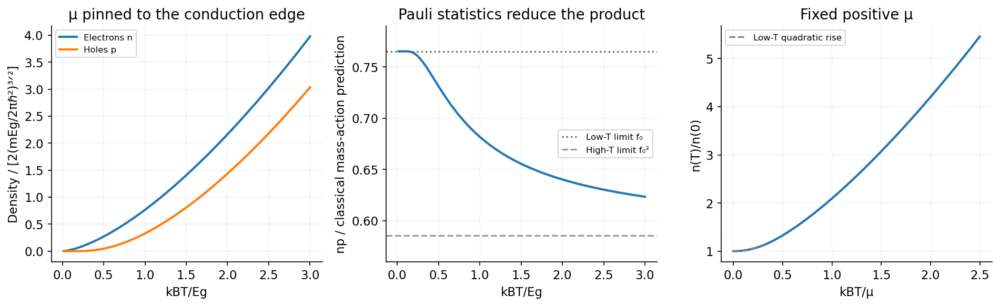

<h1 id="4/solution">Solution</h1>

↑ **Parent:** [4](../4.md)

Assume three-dimensional parabolic band edges, with density-of-states masses $m_c,m_h$ and one valley per edge, each with [spin degeneracy](../../../../spin-degeneracy.md) two. Their effective densities of states are

$$
N_c=2\left(\frac{m_ck_BT}{2\pi\hbar^2}\right)^{3/2},\qquad N_v=2\left(\frac{m_hk_BT}{2\pi\hbar^2}\right)^{3/2}.
$$

For the [semiconductor mass-action law](../../../../semiconductor-mass-action-law.md), integrating the square-root [density of states](../../../../density-of-states.md) against the Boltzmann tail gives $n=N_c e^{(\mu-E_c)/(k_BT)}$ and $p=N_v e^{(E_v-\mu)/(k_BT)}$. Multiplication cancels the [chemical potential](../../../../chemical-potential-split.md), giving

$$
\boxed{np=A(k_BT)^3e^{-E_g/(k_BT)},\qquad A=\frac{4(m_cm_h)^{3/2}}{(2\pi\hbar^2)^3}.}
$$

If there are additional valley degeneracies, multiply by their product; anisotropic bands use the appropriate density-of-states masses. In the later equal-mass model, $A=4m^3/(2\pi\hbar^2)^3$. No numerical mass or valley multiplicity has been invented.

When $\mu=E_c=0$, the conduction-edge occupation is exactly $1/2$, so the nondegenerate approximation for electrons fails at every positive [temperature](../../../../temperature-split.md). Define the [Normalized complete Fermi-Dirac integral](../../../../normalized-complete-fermi-dirac-integral.md)

$$
F_{1/2}(\eta)=\frac2{\sqrt\pi}\int_0^\infty\frac{\sqrt x}{1+e^{x-\eta}}\,dx,\qquad f_0=F_{1/2}(0)=(1-2^{-1/2})\zeta(3/2)\simeq0.765147.
$$

For the [carrier densities with chemical potential pinned to a band edge](../../../../carrier-densities-with-chemical-potential-pinned-to-a-band-edge.md), with the two specified equal masses, put $N(T)=2[mk_BT/(2\pi\hbar^2)]^{3/2}$. Direct Fermi-Dirac integration then gives

$$
\boxed{n(T)=N(T)f_0,\qquad p(T)=N(T)F_{1/2}[-E_g/(k_BT)].}
$$

Thus $n\propto T^{3/2}$ exactly within the parabolic model. At low [temperature](../../../../temperature-split.md), $p\simeq N(T)e^{-E_g/(k_BT)}$ is thermally activated; at $k_BT\gg E_g$, $p/n\to1$ from below. Both vanish at zero [temperature](../../../../temperature-split.md) and increase at fixed [chemical potential](../../../../chemical-potential-split.md). The other states that pin $\mu$ can supply the compensating charge; one must not additionally impose $n=p$.

For the [Pauli reduction of the pinned-edge mass-action product](../../../../pauli-reduction-of-the-pinned-edge-mass-action-product.md), the exact product relative to the classical law is

$$
\frac{np}{N(T)^2e^{-E_g/(k_BT)}}=f_0e^{E_g/(k_BT)}F_{1/2}[-E_g/(k_BT)]<1.
$$

It approaches $f_0$ at low [temperature](../../../../temperature-split.md) and $f_0^2\simeq0.58545$ in the formal high-[temperature](../../../../temperature-split.md) limit. The low-[temperature](../../../../temperature-split.md) activation factor is unchanged but its prefactor is reduced; the classical mass-action formula overestimates the product. The high-[temperature](../../../../temperature-split.md) limit here refers to the given unbounded parabolic bands, not a claim that real [semiconductor](../../../../semiconductor-split.md) band structures remain unchanged at arbitrarily high [temperature](../../../../temperature-split.md).[Sections 3.1 and 3.6.1–3.6.4: density of states, Fermi occupation and Sommerfeld expansion](../../../../quantum-gases-by-david-tong.md)

Finally, for a fixed positive $\mu$, the zero-[temperature](../../../../temperature-split.md) Fermi sphere has radius $k_\mu=\sqrt{2m\mu}/\hbar$, so

$$
\boxed{n(0)=\frac{k_\mu^3}{3\pi^2}=\frac1{3\pi^2}\left(\frac{2m\mu}{\hbar^2}\right)^{3/2},\qquad n(T)=N(T)F_{1/2}[\mu/(k_BT)].}
$$

The low-[temperature](../../../../temperature-split.md) expansion at **fixed $\mu$** gives the [fixed-chemical-potential Sommerfeld density increase](../../../../fixed-chemical-potential-sommerfeld-density-increase.md):

$$
\boxed{n(T)=n(0)\left[1+\frac{\pi^2}{8}\left(\frac{k_BT}{\mu}\right)^2+O\!\left(\frac{k_BT}{\mu}\right)^4\right].}
$$

The [monotonic density at fixed chemical potential in a square-root density of states](../../../../monotonic-density-at-fixed-chemical-potential-in-a-square-root-density-of-states.md) initially rises quadratically from $n(0)$. For $k_BT\gg\mu$, its leading behaviour crosses to $f_0N(T)\propto T^{3/2}$. The fixed [chemical potential](../../../../chemical-potential-split.md) is what allows the particle number to change.

**[Figure 6](#4/image-pinning-the-chemical-potential-to-or-above-a-band-edge-changes-carrier-populations-and-the-mass-action-product). Pinning the chemical potential to or above a band edge changes carrier populations and the mass-action product**. [Source](paper-1-pinned-carrier-densities.py).

## ↑ Ancestors (13)

1. [4](../4.md)
2. [Paper 1](../../paper-1-split.md)
3. [2015](../../split.md)
4. [Past exam of the quantum condensed matter course of the University of Cambridge](../../../split.md)
5. [Quantum Condensed Matter course of the University of Cambridge](../../../../quantum-condensed-matter-course-of-the-university-of-cambridge.md)
6. [Physics course of the year 3 of the natural sciences course of the University of Cambridge](../../../../physics-course-of-the-year-3-of-the-natural-sciences-course-of-the-university-of-cambridge.md)
7. [Year 3 of the natural sciences course of the University of Cambridge](../../../../year-3-of-the-natural-sciences-course-of-the-university-of-cambridge.md)
8. [Year of the natural sciences course of the University of Cambridge](../../../../year-of-the-natural-sciences-course-of-the-university-of-cambridge.md)
9. [Natural sciences course of the University of Cambridge](../../../../natural-sciences-course-of-the-university-of-cambridge.md)
10. [Course of the University of Cambridge](../../../../course-of-the-university-of-cambridge.md)
11. [University of Cambridge](../../../../university-of-cambridge-split.md)
12. [List of universities](../../../../list-of-universities.md)
13. [Codex Wiki](../../../../split.md)
