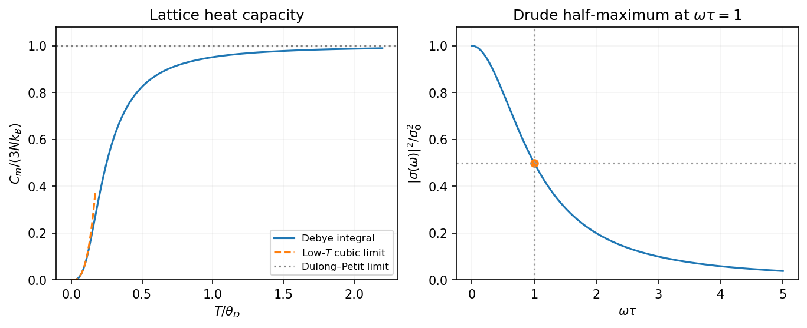
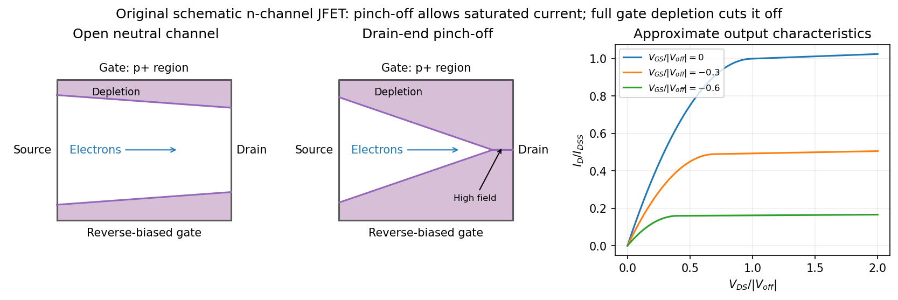
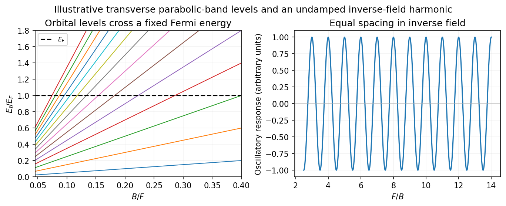
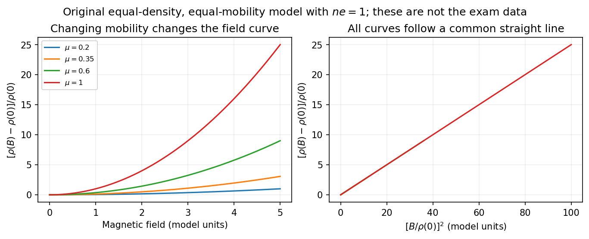

# 2016

↑ **Parent:** [Past exam of the quantum condensed matter course of the University of Cambridge](../past-exam-of-the-quantum-condensed-matter-course-of-the-university-of-cambridge.md)

Official past-paper archive: [https://www.sp.phy.cam.ac.uk/drp2/home.](https://www.sp.phy.cam.ac.uk/drp2/home.) The direct PDF link has not yet been verified.

**Table of contents**

- [1](#1)
  - [a](#1/a)
    - [Solution](#1/a/solution)
  - [b](#1/b)
    - [Solution](#1/b/solution)
  - [c](#1/c)
    - [Solution](#1/c/solution)
- [2](#2)
  - [a](#2/a)
    - [Solution](#2/a/solution)
  - [b](#2/b)
    - [Solution](#2/b/solution)
  - [c](#2/c)
    - [Solution](#2/c/solution)
- [3](#3)
  - [Solution](#3/solution)
- [4](#4)
  - [Solution](#4/solution)

## 1

↑ **Parent:** [2016](2016.md)

<h3 id="1/a">a</h3>

↑ **Parent:** [1](#1)

<h4 id="1/a/solution">Solution</h4>

↑ **Parent:** [A](#1/a)

In the three-dimensional [Debye model](../quantum-ideal-gas-statistics.md#debye-model), the [lattice](../mathematical-logic.md#lattice) has $3N$ [normal modes](../wave-equation.md#normal-mode) for $N$ atoms. Replacing their dispersion by a linear acoustic dispersion up to a cutoff gives the [Debye heat capacity](../quantum-ideal-gas-statistics.md#debye-heat-capacity)

$$
C_m(T)=9Nk_B\left(\frac{T}{\theta_D}\right)^3\int_0^{\theta_D/T}\frac{x^4e^x}{(e^x-1)^2}\,dx.
$$

At low [temperature](../temperature.md) the upper limit can be replaced by infinity. Since the integral then equals $4\pi^4/15$,

$$
\boxed{C_m(T)\sim\frac{12\pi^4}{5}Nk_B\left(\frac{T}{\theta_D}\right)^3\quad(T\ll\theta_D).}
$$

At high [temperature](../temperature.md) each harmonic mode contributes $k_B$ by the [equipartition theorem](../canonical-ensemble.md#equipartition-theorem), giving the [Dulong-Petit law](../heat.md#dulong-petit-law)

$$
\boxed{C_m(T)\longrightarrow3Nk_B\quad(T\gg\theta_D).}
$$

For one mole replace $Nk_B$ by $R$. The curve starts with zero slope, rises as $T^3$, and levels off toward the classical limit. This is the [lattice](../mathematical-logic.md#lattice) contribution; a metal's [electronic heat capacity](../heat.md#electronic-heat-capacity) is a separate low-temperature term.

The [Debye wavevector](../quantum-ideal-gas-statistics.md#debye-wavevector) follows by counting three polarizations inside the cutoff sphere:

$$
3\frac{\mathcal V}{(2\pi)^3}\frac{4\pi k_D^3}{3}=3N,\qquad k_D=(6\pi^2n)^{1/3}.
$$

With the supplied [speed of sound](../compressible-flow.md#speed-of-sound) treated as the effective Debye speed, $\omega_D=vk_D$ and

$$
\boxed{\theta_D=\frac{\hbar v}{k_B}(6\pi^2n)^{1/3}\simeq\frac{\hbar(3600)}{k_B}(6\pi^2\times5.9\times10^{28})^{1/3}\simeq4.17\times10^2\,\mathrm K.}
$$

Here $k_D\simeq1.52\times10^{10}\,\mathrm{m^{-1}}$. Real crystals have different longitudinal and transverse sound speeds; the one-speed estimate uses the stated value, rather than inferring those unprovided branches.

**[Figure 1](#1/a/image-debye-lattice-heat-capacity-and-the-squared-magnitude-of-the-drude-conductivity). Debye lattice heat capacity and the squared magnitude of the Drude conductivity**.

<h3 id="1/b">b</h3>

↑ **Parent:** [1](#1)

<h4 id="1/b/solution">Solution</h4>

↑ **Parent:** [B](#1/b)

Use physical fields proportional to the [real part](../complex-analysis.md#real-part) of $e^{-i\omega t}$. The [Drude frequency response](../electric-charge.md#drude-frequency-response) is

$$
\sigma(\omega)=\frac{\sigma_0}{1-i\omega\tau},\qquad \boxed{|\sigma(\omega)|^2=\frac{\sigma_0^2}{1+\omega^2\tau^2}.}
$$

Thus the sketch is an even [Lorentzian line shape](../stellar-astrophysics.md#lorentzian-line-shape), with maximum $\sigma_0^2$ at zero [frequency](../wave.md#frequency), half that value at $|\omega|=\tau^{-1}$, and an $\omega^{-2}$ tail. The positive-frequency half is shown in the preceding figure. Squaring the [modulus](../complex-analysis.md#modulus) differs from plotting either $|\sigma|$ or the [real part](../complex-analysis.md#real-part) of $\sigma$.

For a single carrier species, the [plasma frequency](../physics.md#plasma-frequency) and [electrical conductivity](../electric-charge.md#electrical-conductivity) satisfy

$$
\omega_p^2=\frac{nq^2}{m\epsilon_0},\qquad \sigma_0=\frac{nq^2\tau}{m}=\epsilon_0\omega_p^2\tau.
$$

Therefore

$$
\boxed{\omega_{1/2}=\frac1\tau=\frac{\epsilon_0\omega_p^2}{\sigma_0}=\frac{(8.854\times10^{-12})(5.6\times10^{15})^2}{9.9\times10^6}\simeq2.80\times10^{13}\,\mathrm{s^{-1}}.}
$$

The corresponding [relaxation time](../markov-chain.md#relaxation-time) is $\tau\simeq3.57\times10^{-14}\,\mathrm s$. This is an [angular frequency](../lagrangian-mechanics.md#angular-frequency); the ordinary [frequency](../wave.md#frequency) is $\boxed{f_{1/2}=\omega_{1/2}/(2\pi)\simeq4.46\times10^{12}\,\mathrm{Hz}}$. The units of [electrical conductivity](../electric-charge.md#electrical-conductivity) used in the calculation are $\mathrm{\Omega^{-1}m^{-1}}$, consistently with the SI plasma-frequency relation.

<h3 id="1/c">c</h3>

↑ **Parent:** [1](#1)

<h4 id="1/c/solution">Solution</h4>

↑ **Parent:** [C](#1/c)

For nondegenerate [electrons](../physics.md#electron) in a parabolic [conduction band](../quantum-mechanics.md#conduction-band),

$$
n(T)=N_c(T)\exp\left[-\frac{\Delta(T)}{k_BT}\right],\qquad \Delta(T)=E_c(T)-\mu(T),\qquad N_c(T)\propto T^{3/2}
$$

when the density-of-states [effective mass](../bloch-s-theorem.md#band-effective-mass) and valley multiplicity are fixed. The [intrinsic carrier extrapolation across a crossover](../semiconductor.md#intrinsic-carrier-extrapolation-across-a-crossover) must therefore specify how the activation [energy](../energy.md) changes with [temperature](../temperature.md).

The usual intended estimate treats the quoted $0.9\,\mathrm{eV}$ as a constant intrinsic activation [energy](../energy.md) between the two temperatures, and identifies the crossover by $n_i(T_c)\simeq n_{\rm ext}$. Then

$$
\frac{n_i(T_c)}{n_i(T_1)}=\left(\frac{T_c}{T_1}\right)^{3/2}\exp\left[-\frac{0.9\,\mathrm{eV}}{k_B}\left(\frac1{T_c}-\frac1{T_1}\right)\right].
$$

For $T_1=350\,\mathrm K$, $T_c=280\,\mathrm K$ and $k_B=8.6173\times10^{-5}\,\mathrm{eV\,K^{-1}}$, the exponent is $-7.46$ and the prefactor is $0.8^{3/2}=0.7155$. Hence

$$
\boxed{n_{\rm ext}\simeq(2.3\times10^{16})(0.7155)e^{-7.46}\simeq9.5\times10^{12}\,\mathrm{cm^{-3}}\quad\text{under the constant-activation approximation}.}
$$

Equivalently, a fixed-gap intrinsic model with $E_g/2=0.9\,\mathrm{eV}$ gives this result. A crossover is gradual: if $n_{\rm ext}$ denotes the net ionized donor density and $n_i(T_c)=n_{\rm ext}$, [charge neutrality](../electric-charge.md#charge-neutrality) gives the actual [electron](../physics.md#electron) population $n(T_c)=(1+\sqrt5)n_{\rm ext}/2$, rather than exactly $n_{\rm ext}$.

There are two limits to interpreting the numerical estimate literally. First, the printed data specify $E_c-\mu$ only at $350\,\mathrm K$, without specifying $E_g$ or the valence [density of states](../quantum-ideal-gas-statistics.md#density-of-states). They do not mathematically determine $\Delta(280\,\mathrm K)$: without the intended activation assumption the answer remains

$$
n_{\rm ext}\simeq n(350)\left(\frac{280}{350}\right)^{3/2}\exp\left[-\frac{\Delta(280)}{k_B(280)}+\frac{0.9\,\mathrm{eV}}{k_B(350)}\right].
$$

Second, using the original PDF's $0.9\,\mathrm{eV}$ and density implies $N_c(350)\simeq2.1\times10^{29}\,\mathrm{cm^{-3}}$, extraordinarily large for a conventional [semiconductor](../semiconductor.md). This confirms that the numerical data should not be treated as a realistic material determination. No unprinted decimal-point correction has been assumed.

## 2

↑ **Parent:** [2016](2016.md)

<h3 id="2/a">a</h3>

↑ **Parent:** [2](#2)

<h4 id="2/a/solution">Solution</h4>

↑ **Parent:** [A](#2/a)

A [junction field-effect transistor](../semiconductor.md#junction-field-effect-transistor) has a conducting channel between source and drain, with gate regions forming reverse-biased [p-n junctions](../semiconductor.md#p-n-junction) to that channel. In an n-channel device, a more negative gate-source [electric potential difference](../electric-field.md#electric-potential-difference) increases the [reverse bias](../electrical-circuit.md#reverse-bias) and widens the [depletion region](../semiconductor.md#depletion-region). The conducting cross-section shrinks, reducing the drain [electric current](../electric-charge.md#electric-current). The gate ideally draws only a small leakage [electric current](../electric-charge.md#electric-current), giving a high input resistance; the source-drain supply provides the controlled output [power](../energy.md#power). Carrier motion in a p-channel device reverses the relevant polarities.

At small positive $V_{DS}$, the channel conducts approximately as a resistor. As the potential rises from source to drain, the local gate-channel [reverse bias](../electrical-circuit.md#reverse-bias) increases toward the drain. The depletion layers are therefore thicker there. For a symmetric n channel of half-thickness $a$, uniformly doped at density $N_D$, the one-sided [depletion approximation](../semiconductor.md#depletion-approximation) gives

$$
w(y)\simeq\sqrt{\frac{2\varepsilon_s}{eN_D}\left[V_{\rm bi}+V(y)-V_{GS}\right]},
$$

where $w$ is the depletion width from each side and $V_{\rm bi}$ the built-in junction potential. The neutral channel closes locally when $w=a$. Define the positive geometrical depletion [electric potential difference](../electric-field.md#electric-potential-difference) $U_P=eN_Da^2/(2\varepsilon_s)$. The approximate drain-end pinch-off condition is

$$
\boxed{V_{DS,\rm sat}\simeq U_P-V_{\rm bi}+V_{GS}.}
$$

More negative gate bias makes this saturation occur at a smaller drain [electric potential difference](../electric-field.md#electric-potential-difference).

**[Figure 2](#2/a/image-gate-depletion-drain-end-pinch-off-and-approximate-current-saturation-in-an-n-channel-jfet). Gate depletion, drain-end pinch-off and approximate current saturation in an n-channel JFET**.

[Pinch-off in a junction field-effect transistor](../semiconductor.md#pinch-off-in-a-junction-field-effect-transistor) does **not** mean that the drain [electric current](../electric-charge.md#electric-current) vanishes. [Electrons](../physics.md#electron) arriving through the remaining neutral channel are swept across the high-field depleted region into the drain. Further increases in $V_{DS}$ mostly fall across that region, so the [electric current](../electric-charge.md#electric-current) changes only weakly: this is the saturation regime used for amplification. Channel shortening gives a finite output slope in real devices. Excessive reverse [electric potential difference](../electric-field.md#electric-potential-difference) eventually causes breakdown, beyond the normal saturation model.

A sufficiently negative gate [electric potential difference](../electric-field.md#electric-potential-difference) can instead deplete the entire channel from the source end and produce **cutoff**. In the simplified geometry its threshold is $V_{GS,\rm off}\simeq V_{\rm bi}-U_P<0$. A commonly used approximate transfer law in saturation is

$$
I_D\simeq I_{DSS}\left(1-\frac{V_{GS}}{V_{GS,\rm off}}\right)^2,\qquad V_{GS,\rm off}\leq V_{GS}\leq0.
$$

Here $I_{DSS}$ is the saturated drain [electric current](../electric-charge.md#electric-current) at zero gate-source bias. The square law is a useful device approximation, not an exact result for arbitrary channel profiles. It connects field control of depletion to a measurable transfer characteristic while keeping drain-end pinch-off distinct from complete gate cutoff.

<h3 id="2/b">b</h3>

↑ **Parent:** [2](#2)

<h4 id="2/b/solution">Solution</h4>

↑ **Parent:** [B](#2/b)

[Direct exchange](../electromagnetism.md#direct-exchange) is a quantum-mechanical spin-dependent [energy](../energy.md) arising from the [Coulomb interaction](../electrostatics.md#coulomb-interaction) and the required antisymmetry of a two-electron state. It requires spatial overlap of the relevant orbitals. It is not the classical magnetic dipole [force](../force.md) between two small magnets, and it can be much stronger than that [force](../force.md).

For an explicit fixed-orbital illustration, take orthonormal spatial orbitals $a,b$. [Orthonormality](../inner-product.md#orthonormal-set) means $\langle a|b\rangle=0$; it does not require their spatial densities to occupy disjoint regions. The normalized spatial states are

$$
\Psi_\pm(1,2)=\frac{a(1)b(2)\pm b(1)a(2)}{\sqrt2}.
$$

The symmetric spatial state combines with the antisymmetric [spin-one-half singlet state](../angular-momentum-operator.md#spin-one-half-singlet-state), and the antisymmetric spatial state combines with a symmetric [spin-one-half triplet state](../angular-momentum-operator.md#spin-one-half-triplet-state), so that the complete fermionic state is antisymmetric.

For [Coulomb potential](../electrostatics.md#coulomb-potential-energy) $V_{12}=e^2/(4\pi\varepsilon|\mathbf r_1-\mathbf r_2|)$, distinguish the direct electrostatic integral and exchange integral:

$$
D=\int d^3r_1d^3r_2\,|a(1)|^2V_{12}|b(2)|^2,
$$

$$
K=\int d^3r_1d^3r_2\,a^*(1)b(1)V_{12}b^*(2)a(2).
$$

The [Coulomb exchange splitting of two orbitals](../electromagnetism.md#coulomb-exchange-splitting-of-two-orbitals) gives

$$
E_S=\epsilon_a+\epsilon_b+D+K,\qquad E_T=\epsilon_a+\epsilon_b+D-K,\qquad \boxed{E_S-E_T=2K.}
$$

The repulsive [Coulomb potential](../electrostatics.md#coulomb-potential-energy) makes $K\geq0$ in this model. Thus the triplet is favored when the orbitals have nonzero exchange overlap. Its antisymmetric spatial [wavefunction](../wave-function.md) suppresses close [electron](../physics.md#electron) encounters and reduces their repulsion. Since the [Coulomb interaction](../electrostatics.md#coulomb-interaction) contains no explicit [spin](../angular-momentum-operator.md#spin) operator, the [spin](../angular-momentum-operator.md#spin) dependence enters through the allowed spatial [symmetry](../physics.md#symmetry-physics).

For dimensionless [spin](../angular-momentum-operator.md#spin) operators $\mathbf s_i=\boldsymbol\sigma_i/2$, whose pair [eigenvalues](../linear-operator-theory.md#eigenvalue) are $1/4$ in the triplet and $-3/4$ in the singlet, the same splitting is represented by

$$
\boxed{H_{\rm ex}=C-2K\,\mathbf s_1\cdot\mathbf s_2.}
$$

This explicitly states the sign convention: positive $K$ here favors parallel spins. A convention $H=J\mathbf s_1\cdot\mathbf s_2$ would instead have $J=-2K$.

In a [crystal](../thermodynamics.md#crystal), [direct exchange](../electromagnetism.md#direct-exchange) therefore depends sensitively on orbital extent, overlap and interatomic spacing. It often decreases rapidly as localized orbitals separate. The fixed-orbital example does not prove that every material must be ferromagnetic: orbital rearrangement and competing kinetic or virtual-hopping processes alter the singlet-triplet balance. In particular, [antiferromagnetic](../electromagnetism.md#antiferromagnetism) [superexchange](../electromagnetism.md#superexchange) through an intermediate ligand is a different mechanism and should not be confused with direct overlap exchange.

<h3 id="2/c">c</h3>

↑ **Parent:** [2](#2)

<h4 id="2/c/solution">Solution</h4>

↑ **Parent:** [C](#2/c)

A [magnetic field](../magnetic-field.md) quantizes a charged carrier's cyclotron motion into [Landau levels](../quantum-theory.md#landau-level). For an isotropic parabolic band, neglecting [spin](../angular-momentum-operator.md#spin) splitting,

$$
\varepsilon_{\ell,k_z}=\hbar\omega_c\left(\ell+\frac12\right)+\frac{\hbar^2k_z^2}{2m^*},\qquad \omega_c=\frac{eB}{m^*},\qquad \ell=0,1,2,\ldots.
$$

The degeneracy of each orbital level per unit perpendicular area is $eB/h$ per [spin](../angular-momentum-operator.md#spin). Increasing the field changes both the level spacing and the number of states in each level. Successive levels cross the [Fermi energy](../quantum-ideal-gas-statistics.md#fermi-energy), producing an oscillatory [density of states](../quantum-ideal-gas-statistics.md#density-of-states) and hence [quantum oscillations](../quantum-theory.md#quantum-oscillation) in thermodynamic and transport quantities.

For a general closed semiclassical orbit, [Onsager quantization](../quantum-theory.md#onsager-quantization) relates its wavevector-space area to field:

$$
A_k(\varepsilon_\ell)=\frac{2\pi eB}{\hbar}(\ell+\gamma).
$$

Setting this area to an extremal Fermi-surface cross-section gives successive inverse-field crossings separated by

$$
\boxed{\Delta\left(\frac1B\right)=\frac{2\pi e}{\hbar A_{\rm ext}},\qquad F=\frac{\hbar A_{\rm ext}}{2\pi e}.}
$$

A typical oscillatory contribution is proportional to $\cos(2\pi F/B+\varphi)$. The oscillations are periodic in $1/B$, not in $B$. In three dimensions, extremal cross-sections dominate because contributions from other longitudinal momenta cancel by phase averaging. Rotating the field therefore maps the shape of the [Fermi surface](../fermi-liquid.md#fermi-surface).

**[Figure 3](#2/c/image-quantized-orbital-crossings-and-their-periodicity-in-inverse-magnetic-field). Quantized orbital crossings and their periodicity in inverse magnetic field**.

Oscillations in [magnetization](../electromagnetism.md#magnetization) are the [de Haas-van Alphen effect](../quantum-theory.md#de-haas-van-alphen-effect); oscillations in longitudinal [electrical resistivity](../electric-charge.md#electrical-resistivity) are the [Shubnikov-de Haas effect](../bloch-s-theorem.md#shubnikov-de-haas-effect). They are most readily observed in clean samples at low [temperature](../temperature.md). The thermal [damping](../wave-equation.md#damping) factor is

$$
R_T=\frac{X}{\sinh X},\qquad X=\frac{2\pi^2k_BT}{\hbar\omega_c},
$$

and a common first-harmonic disorder factor is $R_D=\exp[-\pi/(\omega_c\tau_q)]$. Thus the Landau spacing must be sufficiently large compared with thermal broadening and disorder broadening, approximately $k_BT\lesssim\hbar\omega_c$ and $\omega_c\tau_q\gtrsim1$, with the displayed factors giving the quantitative suppression.

The [temperature](../temperature.md) dependence measures the [cyclotron effective mass](../bloch-s-theorem.md#cyclotron-effective-mass), and the field-dependent [damping](../wave-equation.md#damping) probes the [quantum lifetime](../physics.md#quantum-lifetime) $\tau_q$. That lifetime need not equal the [momentum relaxation time](../electric-charge.md#momentum-relaxation-time) controlling [electrical conductivity](../electric-charge.md#electrical-conductivity): small-angle scattering can broaden [Landau levels](../quantum-theory.md#landau-level) while relaxing [electric current](../electric-charge.md#electric-current) inefficiently. [Spin](../angular-momentum-operator.md#spin) splitting can generate further modulation or resolved [spin](../angular-momentum-operator.md#spin) structure. Oscillations are not the same as the ordinary smooth [magnetoresistance](../electric-charge.md#magnetoresistance) or [cyclotron resonance](../quantum-theory.md#cyclotron-resonance); they probe quantized orbital state counting near the [Fermi energy](../quantum-ideal-gas-statistics.md#fermi-energy).

## 3

↑ **Parent:** [2016](2016.md)

<h3 id="3/solution">Solution</h3>

↑ **Parent:** [3](#3)

**[mass](../classical-mechanics.md#mass) as [band curvature](../bloch-s-theorem.md#band-curvature).** In a periodic potential, a weakly forced [electron](../physics.md#electron) is usefully described by a [wave packet](../dispersion-relation.md#wave-packet) confined to one [energy band](../bloch-s-theorem.md#energy-band). Its [group velocity](../dispersion-relation.md#group-velocity) is

$$
v_i=\frac1\hbar\frac{\partial\varepsilon_n}{\partial k_i},\qquad \hbar\dot k_j=F_j.
$$

Differentiating the [velocity](../classical-mechanics.md#velocity) gives

$$
\dot v_i=\sum_j(m^{*-1})_{ij}F_j,\qquad \boxed{(m^{*-1})_{ij}=\frac1{\hbar^2}\frac{\partial^2\varepsilon_n}{\partial k_i\partial k_j}.}
$$

This [effective-mass tensor](../bloch-s-theorem.md#effective-mass-tensor) describes the band response, not a change of the [electron](../physics.md#electron)'s bare [rest mass](../special-relativity.md#invariant-mass). Along a principal direction, a steep upward curvature gives a small positive [mass](../classical-mechanics.md#mass) and a flatter curvature a larger one. Near a band maximum the [electron](../physics.md#electron) curvature and [effective mass](../bloch-s-theorem.md#band-effective-mass) are negative; the corresponding missing-electron description uses positive [electron hole](../quantum-mechanics.md#electron-hole) masses. Anisotropy produces distinct principal masses, and strong nonparabolicity makes them [momentum](../momentum.md) dependent. The single-band semiclassical description assumes fields weak and slowly varying enough to avoid substantial interband transitions.

**[Lattice](../mathematical-logic.md#lattice) [symmetry](../physics.md#symmetry-physics) and [Bloch's theorem](../bloch-s-theorem.md).** Use the active [spatial translation operator](../quantum-mechanics.md#spatial-translation-operator) $T_{\mathbf a}\psi(\mathbf r)=\psi(\mathbf r-\mathbf a)$. A lattice-periodic [scalar](../vector-space.md#scalar) potential satisfies $V(\mathbf r+\mathbf a)=V(\mathbf r)$, while the kinetic term is translation invariant. Therefore $[H,T_{\mathbf a}]=0$. The [lattice](../mathematical-logic.md#lattice) translations also commute with one another, so they can be diagonalized simultaneously with $H$, including within a degenerate [energy](../energy.md) subspace.

For a common [eigenstate](../energy-eigenvalue.md#eigenstate), write $T_{\mathbf a}\psi=t(\mathbf a)\psi$. [Unitarity](../vector-space.md#unitary-operator) gives $|t(\mathbf a)|=1$, and the group law gives $t(\mathbf a+\mathbf b)=t(\mathbf a)t(\mathbf b)$. On primitive Bravais vectors $\mathbf a_j$, choose $t(\mathbf a_j)=e^{-i\mathbf k\cdot\mathbf a_j}$. Every [lattice](../mathematical-logic.md#lattice) vector is an integer combination of these generators, hence

$$
T_{\mathbf a}\psi_{n\mathbf k}=e^{-i\mathbf k\cdot\mathbf a}\psi_{n\mathbf k},\qquad \psi_{n\mathbf k}(\mathbf r+\mathbf a)=e^{i\mathbf k\cdot\mathbf a}\psi_{n\mathbf k}(\mathbf r).
$$

The vector $\mathbf k$ is defined modulo a [reciprocal lattice](../quantum-scattering.md#reciprocal-lattice) vector. The band index labels the different [energy](../energy.md) eigenstates with the same translation character. Define $u_{n\mathbf k}(\mathbf r)=e^{-i\mathbf k\cdot\mathbf r}\psi_{n\mathbf k}(\mathbf r)$. The phase factors cancel under a [lattice translation](../quantum-scattering.md#lattice-translation), proving [Bloch's theorem](../bloch-s-theorem.md) in its usual form:

$$
\boxed{\psi_{n\mathbf k}(\mathbf r)=e^{i\mathbf k\cdot\mathbf r}u_{n\mathbf k}(\mathbf r),\qquad u_{n\mathbf k}(\mathbf r+\mathbf a)=u_{n\mathbf k}(\mathbf r).}
$$

This is the [Translation-character proof of Bloch theorem](../bloch-s-theorem.md#translation-character-proof-of-bloch-theorem); the [commutator](../lie-algebra.md#commutator) guarantees a [basis](../vector-space.md#basis) of such states, even when an arbitrary [superposition](../vector-space.md#superposition-principle) of different translation characters is not itself a translation [eigenstate](../energy-eigenvalue.md#eigenstate).

**Periodic [Hamiltonian](../hamiltonian-mechanics.md#hamiltonian).** Acting once with [momentum](../momentum.md) gives $\mathbf p(e^{i\mathbf k\cdot\mathbf r}u)=e^{i\mathbf k\cdot\mathbf r}(\mathbf p+\hbar\mathbf k)u$. Applying it again and cancelling the common plane-wave factor yields

$$
\boxed{H(\mathbf k)u_{n\mathbf k}=\left[\frac{(\mathbf p+\hbar\mathbf k)^2}{2m}+V(\mathbf r)\right]u_{n\mathbf k}=\varepsilon_n(\mathbf k)u_{n\mathbf k}.}
$$

The [Bloch Hamiltonian](../bloch-s-theorem.md#bloch-hamiltonian) acts on lattice-periodic functions in a [unit cell](../quantum-scattering.md#unit-cell). Expanding its square separates a zero-momentum [Hamiltonian](../hamiltonian-mechanics.md#hamiltonian), a term linear in $\mathbf k$ and an identity term quadratic in $\mathbf k$.

**Expansion about the zone centre.** Let $|n\rangle=u_{n0}$, $E_n=\varepsilon_n(0)$, and normalize all these states using a unit-cell [inner product](../inner-product.md). For the real [scalar](../vector-space.md#scalar) [Hamiltonian](../hamiltonian-mechanics.md#hamiltonian) in the question, a nondegenerate zone-centre eigenfunction can be chosen real. Then

$$
\langle n|\mathbf p|n\rangle=-\frac{i\hbar}{2}\int_{\rm cell}\nabla(u_{n0}^2)\,d^3r=0,
$$

because opposite unit-cell faces cancel. Equivalently, [time-reversal symmetry](../quantum-field-theory.md#t-symmetry) forbids a nonzero [electric current](../electric-charge.md#electric-current) in this nondegenerate spinless state. This explains why no linear [energy](../energy.md) term appears; it should not simply be omitted without a [symmetry](../physics.md#symmetry-physics) or extremum argument.

The first-order [energy](../energy.md) shift is therefore $\hbar^2k^2/(2m)$. In the second-order sum the quadratic term is proportional to the identity and has no off-diagonal [matrix elements](../vector-space.md#matrix-element). Only the linear [momentum](../momentum.md) vertex contributes. [Second-order nondegenerate perturbation theory](../quantum-mechanics.md#second-order-nondegenerate-perturbation-theory) gives the [momentum matrix-element expansion of band energy](../bloch-s-theorem.md#momentum-matrix-element-expansion-of-band-energy)

$$
\boxed{\varepsilon_n(\mathbf k)=E_n+\frac{\hbar^2k^2}{2m}+\frac{\hbar^2}{m^2}\sum_{l\ne n}\frac{|\langle n|\mathbf k\cdot\mathbf p|l\rangle|^2}{E_n-E_l}+O(|\mathbf k|^4).}
$$

[Hermitian operator](../hilbert-space.md#hermitian-operator) makes the two reciprocal [matrix elements](../vector-space.md#matrix-element) [complex conjugates](../complex-analysis.md#complex-conjugate). All other periodic eigenstates at $\mathbf k=0$ enter the sum. The remainder is even because [time-reversal symmetry](../quantum-field-theory.md#t-symmetry) gives $\varepsilon_n(\mathbf k)=\varepsilon_n(-\mathbf k)$ near this isolated state. At a degeneracy the denominators signal the need for [degenerate perturbation theory](../quantum-mechanics.md#degenerate-perturbation-theory) instead.

**[mass](../classical-mechanics.md#mass) ratio and the printed formula.** Write $p^i_{nl}=\langle n|p_i|l\rangle$. Differentiating the quadratic [energy](../energy.md) yields

$$
\boxed{(m^{*-1})_{ij}=\frac{\delta_{ij}}m+\frac2{m^2}\sum_{l\ne n}\frac{\operatorname{Re}(p^i_{nl}p^j_{ln})}{E_n-E_l}.}
$$

For a specified unit direction $\mathbf e$, the resulting [scalar](../vector-space.md#scalar) [mass](../classical-mechanics.md#mass) ratio is

$$
\boxed{\frac m{m^*_{\mathbf e}}=1+\frac2m\sum_{l\ne n}\frac{|\langle n|\mathbf e\cdot\mathbf p|l\rangle|^2}{E_n-E_l}.}
$$

In an isotropic three-dimensional band, averaging equivalent directions gives

$$
\boxed{\frac m{m^*}=1+\frac{2}{3m}\sum_{l\ne n}\frac{|\langle n|\mathbf p|l\rangle|^2}{E_n-E_l}.}
$$

Coupling to lower bands contributes positively to inverse [mass](../classical-mechanics.md#mass); coupling to higher bands contributes negatively. Their signs and [matrix elements](../vector-space.md#matrix-element) determine the actual curvature.

The original PDF prints $m^*=\hbar^2[\nabla_{\mathbf k}^2\varepsilon_n]^{-1}$. **Taken literally as a three-dimensional [Laplacian](../multivariable-calculus.md#laplacian), this misses a factor of three for an isotropic [scalar](../vector-space.md#scalar) [mass](../classical-mechanics.md#mass).** The correct identities are

$$
\frac{\nabla_{\mathbf k}^2\varepsilon_n}{\hbar^2}=\operatorname{tr}(m^{*-1}),\qquad m^*=\frac{3\hbar^2}{\nabla_{\mathbf k}^2\varepsilon_n}\quad\text{in three isotropic dimensions}.
$$

The printed expression would return $m/3$ even for the free dispersion $\hbar^2k^2/(2m)$. It is correct in one dimension, or if its [second derivative](../calculus.md#second-derivative) is interpreted directionally. For completeness, its literal three-dimensional trace ratio would instead be $3+(2/m)\sum_{l\ne n}|\langle n|\mathbf p|l\rangle|^2/(E_n-E_l)$; that is the trace of the dimensionless inverse-mass [tensor](../multilinear-algebra.md#tensor), not the usual [scalar](../vector-space.md#scalar) $m/m^*$.

## 4

↑ **Parent:** [2016](2016.md)

<h3 id="4/solution">Solution</h3>

↑ **Parent:** [4](#4)

**Relaxation-time model.** The [Drude model](../electric-charge.md#drude-model) treats mobile charge carriers as independent particles accelerated by the [Lorentz force](../relativistic-electromagnetism.md#lorentz-force) between scattering events. Collisions randomize the drift [momentum](../momentum.md) toward local equilibrium and are represented by a uniform, field-independent [momentum relaxation time](../electric-charge.md#momentum-relaxation-time). For the present calculation the [carrier density](../electric-charge.md#carrier-density), isotropic [mass](../classical-mechanics.md#mass) and [relaxation time](../markov-chain.md#relaxation-time) are fixed, the fields are uniform and stationary, and quantum orbital quantization and intercarrier correlations are neglected. The steady [drift velocity](../electric-charge.md#drift-velocity) obeys

$$
0=q(\mathbf E+\mathbf v\times\mathbf B)-\frac m\tau\mathbf v.
$$

Here $n$ is the number of carriers of that species per unit volume, $q$ their **signed** charge, $m>0$ their inertial or isotropic band [mass](../classical-mechanics.md#mass), $\tau$ the [momentum relaxation time](../electric-charge.md#momentum-relaxation-time), and $\sigma_0$ their single-species [electrical conductivity](../electric-charge.md#electrical-conductivity) at zero field.

**One-carrier [tensor](../multilinear-algebra.md#tensor).** With $\mathbf B=B\hat{\mathbf z}$ and $\mathbf J=nq\mathbf v$, solving for the [electric field](../electric-field.md) gives

$$
\mathbf E=\frac{m}{nq^2\tau}\mathbf J-\frac1{nq}\mathbf J\times\mathbf B.
$$

Since $(\mathbf J\times\mathbf B)_x=BJ_y$ and $(\mathbf J\times\mathbf B)_y=-BJ_x$,

$$
E_x=\frac{m}{nq^2\tau}J_x-\frac{B}{nq}J_y,\qquad E_y=\frac{B}{nq}J_x+\frac{m}{nq^2\tau}J_y.
$$

Thus the [resistivity tensor](../electric-charge.md#resistivity-tensor), defined by $\mathbf E=\boldsymbol\rho\mathbf J$, is

$$
\boxed{\boldsymbol\rho_q=\begin{pmatrix}\sigma_0^{-1}&-B/(nq)\\B/(nq)&\sigma_0^{-1}\end{pmatrix},\qquad \sigma_0=\frac{nq^2\tau}{m}.}
$$

Its off-diagonal signs follow from the stated axes and signed $q$. For zero transverse [electric current](../electric-charge.md#electric-current), $E_y/J_x=B/(nq)$ is the Hall [electrical resistivity](../electric-charge.md#electrical-resistivity); reversing charge reverses it. The single-species longitudinal [electrical resistivity](../electric-charge.md#electrical-resistivity) is independent of $B$ in this ideal isotropic model.

**Adding [electrons](../physics.md#electron) and [electron holes](../quantum-mechanics.md#electron-hole).** Let both species have density $n$ and charges $q=\pm e$, with $e>0$. The stipulated equal zero-field [electrical conductivity](../electric-charge.md#electrical-conductivity) means equal positive [charge carrier mobility](../electric-charge.md#charge-carrier-mobility) $\mu=\sigma_0/(ne)$, even if their masses and [momentum relaxation times](../electric-charge.md#momentum-relaxation-time) separately differ. Put $r=1/\sigma_0$ and $h=B/(ne)$. Inverting each [electrical resistivity](../electric-charge.md#electrical-resistivity) matrix gives

$$
\boldsymbol\sigma_+=\frac1{r^2+h^2}\begin{pmatrix}r&h\\-h&r\end{pmatrix},\qquad \boldsymbol\sigma_-=\frac1{r^2+h^2}\begin{pmatrix}r&-h\\h&r\end{pmatrix}.
$$

Both species experience the same [electric field](../electric-field.md), so their [electric current](../electric-charge.md#electric-current) densities add. Therefore it is their **[conductivity tensors](../electric-charge.md#conductivity-tensor)**, rather than their [resistivity tensors](../electric-charge.md#resistivity-tensor), that must be summed. The Hall parts cancel and

$$
\boldsymbol\sigma_{\rm tot}=\frac{2\sigma_0}{1+(\mu B)^2}\mathbf I_2,\qquad \boxed{\boldsymbol\rho_{\rm tot}=\frac{1+(\mu B)^2}{2\sigma_0}\mathbf I_2.}
$$

This is [compensated two-carrier magnetoresistance](../electric-charge.md#compensated-two-carrier-magnetoresistance). Although the net Hall field vanishes, each carrier species is bent in its own direction; maintaining the total longitudinal [electric current](../electric-charge.md#electric-current) requires an increasing longitudinal field. Equal carrier numbers alone do not ensure zero Hall response if [charge carrier mobilities](../electric-charge.md#charge-carrier-mobility) differ; both equalities given here are used.

**Large-field limit and quantum oscillations.** Expanding the exact diagonal entry,

$$
\rho_{xx}=\rho_{yy}=\frac1{2\sigma_0}+\frac{\sigma_0B^2}{2n^2e^2}.
$$

For $\mu B\gg1$,

$$
\boxed{\rho_{xx}\sim\rho_{yy}\sim\frac{\sigma_0B^2}{2n^2e^2},\qquad B\gg\frac{ne}{\sigma_0}=\frac{m}{e\tau_{\rm tr}}.}
$$

Here the last equality applies to either species with its own [mass](../classical-mechanics.md#mass) and transport time; the stipulated [charge carrier mobilities](../electric-charge.md#charge-carrier-mobility) give the same threshold. This is the classical strong-field condition $\omega_c\tau_{\rm tr}\gg1$: carriers turn substantially before their drift [momentum](../momentum.md) relaxes.

Observable [quantum oscillations](../quantum-theory.md#quantum-oscillation) additionally require sufficiently sharp [Landau levels](../quantum-theory.md#landau-level) and a sufficiently cold [Fermi-Dirac distribution](../quantum-ideal-gas-statistics.md#fermi-dirac-distribution), approximately

$$
\omega_c\tau_q\gtrsim1,\qquad \hbar\omega_c\gtrsim k_BT.
$$

When $\tau_q\simeq\tau_{\rm tr}$, the disorder field scale is comparable to the onset scale for large classical [magnetoresistance](../electric-charge.md#magnetoresistance). The thermal condition can demand a much larger field, and when $\tau_q\ll\tau_{\rm tr}$ even the disorder criterion is stronger. The quantitative [damping](../wave-equation.md#damping) factors in Q2(c) show that these are crossover scales rather than sharp visibility boundaries. A large smooth $B^2$ [magnetoresistance](../electric-charge.md#magnetoresistance) therefore does not itself demonstrate [Landau level](../quantum-theory.md#landau-level); it can exist while thermal smearing suppresses oscillations. Conversely, the asymptotic condition $\omega_c\tau_{\rm tr}\gg1$ is stronger than merely reaching unity, so there is no universal ordering of the two experimental onset fields without temperatures and lifetime information.

**Scaling function.** The material's actual zero-field longitudinal [electrical resistivity](../electric-charge.md#electrical-resistivity) is $\rho_{\rm tot}(0)=1/(2\sigma_0)$. Dividing the exact answer by this value gives

$$
\boxed{\frac{\rho_{xx}(B)}{\rho_{xx}(0)}=1+\left(\frac{B\sigma_0}{ne}\right)^2=F(B\sigma_0),\qquad F(x)=1+\frac{x^2}{n^2e^2}.}
$$

The assumption that $n$ stays constant is essential to eliminating further temperature-dependent parameters. $B\sigma_0$ is a dimensionful scaling variable; $B\sigma_0/(ne)=\mu B$ is its dimensionless version. The corresponding fractional increase is $[\rho(B)-\rho(0)]/\rho(0)=(\mu B)^2$.

**[Figure 4](#4/image-original-equal-mobility-two-carrier-curves-collapse-under-zero-field-resistivity-scaling). Original equal-mobility two-carrier curves collapse under zero-field resistivity scaling**.

**What the supplied data test.** In the original PDF's left panel, the field dependence is strongly [temperature](../temperature.md) dependent. In the right panel, plotting the fractional [magnetoresistance](../electric-charge.md#magnetoresistance) against the squared rescaled field makes the displayed **125, 150, 175, 200 and 225 K curves collapse approximately onto one straight line**, over the field intervals where they overlap. This supports the proposed one-parameter scaling and, on that range, the quadratic field law. The **100 K curve does not collapse**: it bends away and has a different slope in the rescaled plot. The indicated scaling is therefore supported for the displayed **125–225 K** data, not for the entire displayed [temperature](../temperature.md) range. The graph alone does not locate a sharp transition between 100 and 125 K or establish behavior above 225 K.

This empirical collapse is [Kohler's rule](../electric-charge.md#kohler-s-rule). It is consistent with a common temperature-dependent [charge carrier mobility](../electric-charge.md#charge-carrier-mobility) or relaxation scale and a fixed carrier population; it is not a unique proof of exact compensation or of one microscopic scattering mechanism. A change in relative scattering times, carrier population or Fermi-surface structure could spoil the collapse, and this figure alone does not select the cause of the 100 K departure.

There is a factor-of-two normalization convention in the printed text. The $\sigma_0$ introduced for **each** species gives $\rho_{\rm tot}(0)=1/(2\sigma_0)$, whereas the final paragraph calls $1/\sigma_0$ “$\rho_0$.” If $\rho_0$ denotes the experimentally measured zero-field [electrical resistivity](../electric-charge.md#electrical-resistivity), the consistent slope is

$$
\frac{\rho(B)-\rho_0}{\rho_0}=\frac1{4n^2e^2}\left(\frac B{\rho_0}\right)^2,\qquad \rho_0=\rho_{\rm tot}(0).
$$

If one instead keeps the literal single-species definition $\rho_s=1/\sigma_0$, the same model has $[\rho(B)-\rho_s]/\rho_s=-1/2+[B/\rho_s]^2/(2n^2e^2)$. The choice rescales and offsets the axes by temperature-independent constants, so it does not change which [temperature](../temperature.md) curves collapse, but it must be resolved before inferring a [carrier density](../electric-charge.md#carrier-density) from the slope.

## ↑ Ancestors (10)

1. [Past exam of the quantum condensed matter course of the University of Cambridge](../past-exam-of-the-quantum-condensed-matter-course-of-the-university-of-cambridge.md)
2. [Quantum Condensed Matter course of the University of Cambridge](../university-of-cambridge.md#quantum-condensed-matter-course-of-the-university-of-cambridge)
3. [Physics course of the year 3 of the natural sciences course of the University of Cambridge](../university-of-cambridge.md#physics-course-of-the-year-3-of-the-natural-sciences-course-of-the-university-of-cambridge)
4. [Year 3 of the natural sciences course of the University of Cambridge](../university-of-cambridge.md#year-3-of-the-natural-sciences-course-of-the-university-of-cambridge)
5. [Year of the natural sciences course of the University of Cambridge](../university-of-cambridge.md#year-of-the-natural-sciences-course-of-the-university-of-cambridge)
6. [Natural sciences course of the University of Cambridge](../university-of-cambridge.md#natural-sciences-course-of-the-university-of-cambridge)
7. [Course of the University of Cambridge](../university-of-cambridge.md#course-of-the-university-of-cambridge)
8. [University of Cambridge](../university-of-cambridge.md)
9. [List of universities](../README.md#list-of-universities)
10. [Codex Wiki](../README.md)
