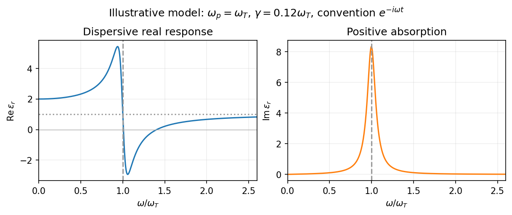
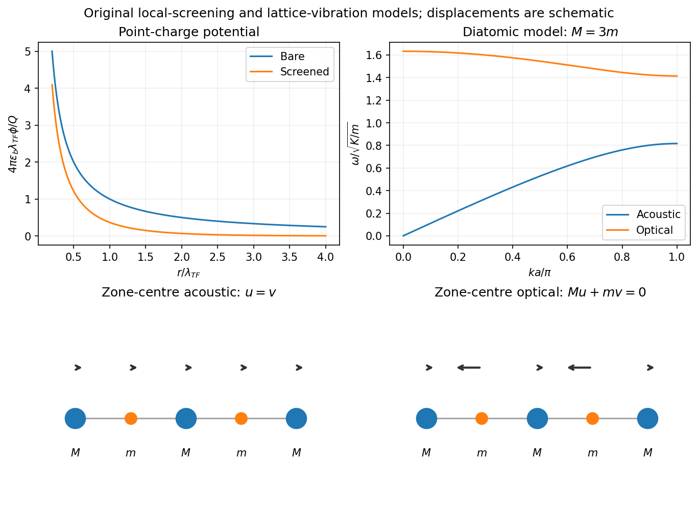
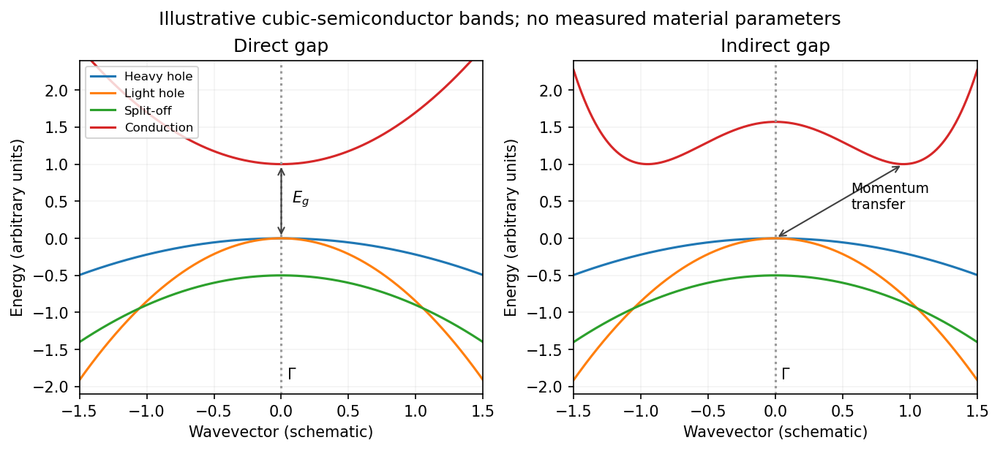
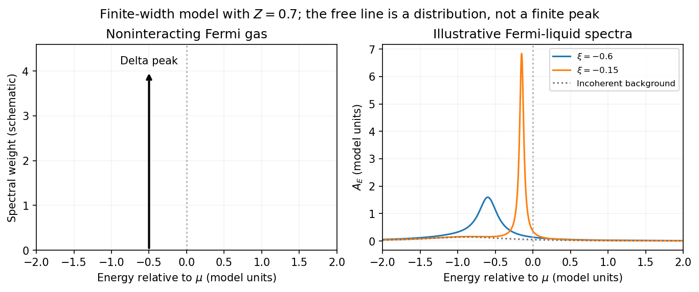

# 2017

↑ **Parent:** [Past exam of the quantum condensed matter course of the University of Cambridge](../past-exam-of-the-quantum-condensed-matter-course-of-the-university-of-cambridge.md)

[Original paper, released PDF pages 282–287](https://www.whatdotheyknow.com/request/natural_science_tripos_physics_e/response/2127325/attach/3/FOI%202022%20639%20Sullivan%20materials.pdf?cookie_passthrough=1#page=282)

**Table of contents**

- [1](#1)
  - [a](#1/a)
    - [Solution](#1/a/solution)
  - [b](#1/b)
    - [Solution](#1/b/solution)
  - [c](#1/c)
    - [Solution](#1/c/solution)
- [2](#2)
  - [a](#2/a)
    - [Solution](#2/a/solution)
  - [b](#2/b)
    - [Solution](#2/b/solution)
  - [c](#2/c)
    - [Solution](#2/c/solution)
- [3](#3)
  - [Solution](#3/solution)
- [4](#4)
  - [Solution](#4/solution)

## 1

↑ **Parent:** [2017](2017.md)

<h3 id="1/a">a</h3>

↑ **Parent:** [1](#1)

<h4 id="1/a/solution">Solution</h4>

↑ **Parent:** [A](#1/a)

Choose the $e^{-i\omega t}$ convention. The steady displacement in the [Lorentz oscillator model](../permittivity.md#lorentz-oscillator-model) has [complex amplitude](../wave.md#complex-amplitude)

$$
u_\omega=\frac{qE_\omega/m}{\omega_T^2-\omega^2-i\gamma\omega}.
$$

The induced [electric dipole moment](../electrostatics.md#electric-dipole-moment) is $p_\omega=qu_\omega$, so the microscopic [electric polarizability](../electrostatics.md#electric-polarizability) is $\alpha(\omega)=q^2/[m(\omega_T^2-\omega^2-i\gamma\omega)]$. For $N$ identical oscillators per unit volume, $P_\omega=Np_\omega=\epsilon_0\chi_\omega E_\omega$. Consequently

$$
\boxed{\chi_\omega=\frac{\omega_p^2}{\omega_T^2-\omega^2-i\gamma\omega},\qquad \epsilon_r(\omega)=1+\chi_\omega,\qquad \omega_p^2=\frac{Nq^2}{m\epsilon_0}.}
$$

Here the dimensionless quantity called polarizability in the paper is the [electric susceptibility](../permittivity.md#electric-susceptibility); the single-electron polarizability $\alpha$ has different units. The sign of the [electron](../physics.md#electron) charge disappears because both the driving force and dipole moment contain $q$.

Multiplying by the [complex conjugate](../complex-analysis.md#complex-conjugate) of the denominator gives

$$
\epsilon'_r=1+\frac{\omega_p^2(\omega_T^2-\omega^2)}{(\omega_T^2-\omega^2)^2+\gamma^2\omega^2},\qquad \epsilon''_r=\frac{\omega_p^2\gamma\omega}{(\omega_T^2-\omega^2)^2+\gamma^2\omega^2}.
$$

For positive [damping](../wave-equation.md#damping) and positive [frequency](../wave.md#frequency), $\epsilon''_r\geq0$, as required for passive [wave absorption](../wave.md#wave-absorption) in this Fourier convention. At zero [frequency](../wave.md#frequency), $\epsilon'_r=1+\omega_p^2/\omega_T^2$ and $\epsilon''_r=0$. Near a weakly damped [resonance](../dynamical-systems.md#resonance) the imaginary part has a narrow positive peak, while the real part rises on the low-frequency side and then falls steeply through $\epsilon'_r=1$ at $\omega_T$. It can become negative above [resonance](../dynamical-systems.md#resonance) for sufficiently strong oscillator strength and weak [damping](../wave-equation.md#damping). At large [frequency](../wave.md#frequency), $\epsilon'_r=1-\omega_p^2/\omega^2+O(\omega^{-4})$ and $\epsilon''_r\sim\omega_p^2\gamma/\omega^3$: both approach the vacuum values. The absorption maximum is close to, but need not be exactly at, $\omega_T$ for finite [damping](../wave-equation.md#damping).

**[Figure 1](#1/a/image-real-and-imaginary-permittivity-for-an-illustrative-damped-bound-charge-resonance). Real and imaginary permittivity for an illustrative damped bound-charge resonance**.

<h3 id="1/b">b</h3>

↑ **Parent:** [1](#1)

<h4 id="1/b/solution">Solution</h4>

↑ **Parent:** [B](#1/b)

A [self-assembled InAs quantum-dot single-photon source](../semiconductor.md#self-assembled-inas-quantum-dot-single-photon-source) uses small [indium arsenide](../semiconductor.md#indium-arsenide) islands inside a larger-gap [gallium arsenide](../chemical-substance.md#gallium-arsenide) host. Strain during epitaxial growth favors islands after a thin wetting layer has formed. Their characteristic diameter is of order $10$–$30\,\mathrm{nm}$ and their height a few nanometres, for example $2$–$5\,\mathrm{nm}$. Growth conditions determine the areal density: low-density samples suitable for isolating dots can be around $10^8$–$10^9\,\mathrm{cm^{-2}}$, while ordinary dense layers can be much denser. The particular electrically driven device underlying the supplied image had about $5\times10^8\,\mathrm{cm^{-2}}$. These are characteristic scales, not dimensions deducible from the emission image.[Device description and figure 1, printed p.103](https://doi.org/10.1126/science.1066790)

[Quantum confinement](../quantum-mechanics.md#quantum-confinement) in the dot traps both [electrons](../physics.md#electron) and [electron holes](../quantum-mechanics.md#electron-hole) in three directions, giving discrete [energy levels](../quantum-mechanics.md#energy-level). In a junction device, injected carriers relax into these levels. [Electron-hole recombination](../quantum-mechanics.md#electron-hole-recombination) then emits a [photon](../quantum-mechanics.md#photon), and the dot must be repopulated before emitting again on that same transition. Spatial selection of one dot, spectral selection of one line, and well-separated injection pulses make this a [single-photon source](../quantum-mechanics.md#single-photon-source). [Photon antibunching](../quantum-optics.md#photon-antibunching), rather than low average brightness alone, establishes suppression of simultaneous [photons](../quantum-mechanics.md#photon). In particular, collecting both [photons](../quantum-mechanics.md#photon) of a cascade without selecting a line would not produce exactly one collected [photon](../quantum-mechanics.md#photon) per excitation.

The lower-current feature $X$ is the transition from one confined [exciton](../quantum-mechanics.md#exciton) to the empty dot. The higher-current feature $X_2$ is the first step of the [biexciton](../quantum-mechanics.md#biexciton) cascade $XX\to X\to0$: it becomes strong when the dot can contain two electron-hole pairs. In the weak-pumping limit the probabilities of one and two pairs scale approximately as $I$ and $I^2$, respectively. Coulomb and confinement energies shift the two transitions relative to one another; $X_2$ is not a [photon](../quantum-mechanics.md#photon) of twice the $X$ [energy](../energy.md). In this particular image the $X_2$ [photon](../quantum-mechanics.md#photon) is about $4$–$5\,\mathrm{meV}$ higher in [energy](../energy.md). With $B_{XX}=2E_X-E_{XX}$, this is a negative [biexciton](../quantum-mechanics.md#biexciton) [binding energy](../energy.md#binding-energy), since $E_{XX}-E_X=E_X-B_{XX}$.

For the mass estimate, the original plot places the $X$ line at approximately $E_X=1.3945\,\mathrm{eV}$, with graph-reading precision of order $0.5\,\mathrm{meV}$. Under the prescribed identification of [photon](../quantum-mechanics.md#photon) [energy](../energy.md) with the full lowest [exciton](../quantum-mechanics.md#exciton) excitation [energy](../energy.md),

$$
E_B=E_g-E_X\simeq1.415-1.3945=0.0205\,\mathrm{eV}.
$$

The three-dimensional screened [Wannier-Mott exciton](../quantum-mechanics.md#wannier-mott-exciton) has the hydrogenic [exciton binding energy](../quantum-mechanics.md#exciton-binding-energy)

$$
E_B=\frac{\mu e^4}{2(4\pi\epsilon_0\varepsilon_r)^2\hbar^2}=13.6057\,\mathrm{eV}\,\frac{\mu/m_0}{\varepsilon_r^2},\qquad \frac1\mu=\frac1{m_e^*}+\frac1{m_h^*}.
$$

Therefore

$$
\boxed{\frac\mu{m_0}=\frac{(0.0205)(15)^2}{13.6057}\simeq0.339,\qquad \mu\simeq3.09\times10^{-31}\,\mathrm{kg}.}
$$

Reading the line as $1.395\,\mathrm{eV}$ instead gives $0.331m_0$; **about $0.33$–$0.34m_0$** is an appropriate precision. This inference uses the supplied pair-creation [energy](../energy.md) and a three-dimensional screened hydrogenic model. In a real dot, strain and confinement also alter transition energies, so it is an effective model estimate and does not independently determine either individual carrier mass.

<h3 id="1/c">c</h3>

↑ **Parent:** [1](#1)

<h4 id="1/c/solution">Solution</h4>

↑ **Parent:** [C](#1/c)

Specify the [spin](../angular-momentum-operator.md#spin) counting first. Let $g_s=g_s(E_F)$ denote the unpolarized [single-spin density of states](../quantum-ideal-gas-statistics.md#single-spin-density-of-states) per atom per [energy](../energy.md), and put $\delta n=n_\uparrow-n_\downarrow$. At fixed total occupation $n$, the two [Hubbard model](../statistical-physics.md#hubbard-model) mean-field energies can be written

$$
\varepsilon_{\mathbf k,\uparrow}=\varepsilon_{\mathbf k}+\frac{Un}{2}-\Delta,\qquad \varepsilon_{\mathbf k,\downarrow}=\varepsilon_{\mathbf k}+\frac{Un}{2}+\Delta,\qquad \Delta=\frac{U\delta n}{2}+\mu_0\mu_BH.
$$

The common shift $Un/2$ can be absorbed into the [chemical potential](../chemical-potential.md). Lowering the up-spin band by $\Delta$ adds $g_s\Delta$ carriers, while raising the down-spin band removes the same number. Thus

$$
\delta n=2g_s\Delta=Ug_s\delta n+2\mu_0\mu_Bg_sH,\qquad \delta n=\frac{2\mu_0\mu_Bg_s}{1-Ug_s}H.
$$

If $n_a$ is the atom [number density](../statistical-physics.md#number-density), the [magnetization](../electromagnetism.md#magnetization) is $M=n_a\mu_B\delta n$. The [Stoner-enhanced magnetic susceptibility](../statistical-physics.md#stoner-enhanced-magnetic-susceptibility) in SI volume units is therefore

$$
\boxed{\chi=\frac{\partial M}{\partial H}=\frac{2\mu_0n_a\mu_B^2g_s(E_F)}{1-Ug_s(E_F)}=\frac{\chi_P}{1-Ug_s(E_F)}.}
$$

Here $\chi_P$ is the noninteracting [Pauli paramagnetism](../quantum-ideal-gas-statistics.md#pauli-paramagnetism) result. If the paper's $g(E_F)$ counts both spins, $g=2g_s$ and the same result is

$$
\boxed{\chi=\frac{\mu_0n_a\mu_B^2g(E_F)}{1-Ug(E_F)/2}.}
$$

A susceptibility per atom omits $n_a$. Stating the [spin](../angular-momentum-operator.md#spin) and volume conventions avoids an otherwise spurious factor of two or a dimensional mismatch.

The [Stoner criterion](../statistical-physics.md#stoner-criterion) is $Ug_s(E_F)>1$, equivalently $Ug(E_F)>2$ with spin-summed $g$. To see the instability, transfer $\eta$ [electrons](../physics.md#electron) per atom from one [spin](../angular-momentum-operator.md#spin) band to the other. The band-filling cost is $\eta^2/g_s$, whereas the interaction [energy](../energy.md) changes by $-U\eta^2$. Their sum $(1/g_s-U)\eta^2$ becomes negative at the threshold. The unpolarized state then ceases to be a local minimum, and nonlinear band filling determines the spontaneous [ferromagnetism](../electromagnetism.md#ferromagnetism). The negative continuation of the displayed linear susceptibility beyond the threshold is not a stable paramagnetic response.

## 2

↑ **Parent:** [2017](2017.md)

<h3 id="2/a">a</h3>

↑ **Parent:** [2](#2)

<h4 id="2/a/solution">Solution</h4>

↑ **Parent:** [A](#2/a)

[Dielectric screening](../quantum-mechanics.md#dielectric-screening) is the rearrangement of a medium's charges in response to an applied charge. In a metal, mobile [electrons](../physics.md#electron) accumulate near a positive perturbation and reduce its long-range potential. [Thomas-Fermi screening](../quantum-mechanics.md#thomas-fermi-screening) treats the [electron gas](../physics.md#electron-gas) locally as an equilibrium gas whose density responds to the local [electrostatic potential](../electric-field.md#electric-potential), ignoring gradients of the density on the microscopic wavelength scale.

Take $e>0$, background [permittivity](../permittivity.md) $\varepsilon_b$, and [electrostatic potential](../electric-field.md#electric-potential) $\phi$. An [electron](../physics.md#electron)'s [potential energy](../energy.md#potential-energy) is $-e\phi$, so the local kinetic [Fermi energy](../quantum-ideal-gas-statistics.md#fermi-energy) becomes $\mu+e\phi$. For a three-dimensional spin-degenerate parabolic band at zero [temperature](../temperature.md),

$$
n(\phi)=\frac1{3\pi^2}\left[\frac{2m(\mu+e\phi)}{\hbar^2}\right]^{3/2},\qquad \delta n\simeq e\,g(E_F)\phi,
$$

where $g(E_F)=dn/d\mu$ is the **[spin-summed density of states](../quantum-ideal-gas-statistics.md#spin-summed-density-of-states) per volume per [energy](../energy.md)**. The induced charge is $\rho_{\mathrm{ind}}=-e\delta n=-e^2g(E_F)\phi$. Combining it with [Poisson equation](../partial-differential-equation.md#poisson-s-equation) gives

$$
\boxed{(\nabla^2-k_{\mathrm{TF}}^2)\phi=-\frac{\rho_{\mathrm{ext}}}{\varepsilon_b},\qquad k_{\mathrm{TF}}^2=\frac{e^2g(E_F)}{\varepsilon_b}.}
$$

For a point external charge $Q$, [spherical symmetry](../geometry-and-topology.md#spherical-symmetry) and decay at infinity select

$$
\boxed{\phi(r)=\frac{Q}{4\pi\varepsilon_b r}e^{-r/\lambda_{\mathrm{TF}}},\qquad \lambda_{\mathrm{TF}}=\sqrt{\frac{\varepsilon_b}{e^2g(E_F)}}.}
$$

Thus the bare $1/r$ potential is cut off exponentially. [Fourier transformation](../fourier-transform.md) makes the same result transparent: $\phi(\mathbf q)=\rho_{\mathrm{ext}}(\mathbf q)/[\varepsilon_b(q^2+k_{\mathrm{TF}}^2)]$, so the static longitudinal dielectric factor is $1+k_{\mathrm{TF}}^2/q^2$ relative to the background. For a free [electron](../physics.md#electron) band, $g(E_F)=3n/(2E_F)$ and $\lambda_{\mathrm{TF}}^2=2\varepsilon_bE_F/(3ne^2)$.

**[Figure 2](#2/a/image-local-thomas-fermi-screening-and-optical-acoustic-modes-of-an-illustrative-diatomic-chain). Local Thomas-Fermi screening and optical/acoustic modes of an illustrative diatomic chain**.

The local linear approximation requires a weak perturbation and slowly varying fields on the relevant microscopic scale. It omits nonlocal [Friedel oscillations](../quantum-mechanics.md#friedel-oscillations) and atom-scale structure; a nonlinear local-density treatment is needed near a sufficiently strong charge. Finite [temperature](../temperature.md) replaces $g(E_F)$ by the appropriate [compressibility](../thermodynamics.md#compressibility) derivative $\partial n/\partial\mu$. The nondegenerate limit gives classical screening rather than the degenerate Thomas-Fermi length. A larger [density of states](../quantum-ideal-gas-statistics.md#density-of-states) means that a smaller potential can move more carriers, hence stronger screening.

<h3 id="2/b">b</h3>

↑ **Parent:** [2](#2)

<h4 id="2/b/solution">Solution</h4>

↑ **Parent:** [B](#2/b)

A primitive cell containing two atoms has two independent displacement coordinates for each chosen polarization. Their coupled [normal modes](../wave-equation.md#normal-mode) split into an [acoustic phonon branch](../quantum-ideal-gas-statistics.md#acoustic-phonon-branch), which translates the cell at long wavelength, and an [optical phonon branch](../quantum-ideal-gas-statistics.md#optical-phonon-branch), which moves its constituents against one another. The nonzero restoring force for the relative displacement gives a nonzero optical [frequency](../wave.md#frequency) even at the zone centre.

For an explicit scalar model, take alternating masses $M,m$, equal nearest-neighbor [spring constant](../elasticity-physics.md#spring-constant) $K$, and cell length $a$. If $u_n,v_n$ are the displacements of the two atoms in cell $n$, [Newton's second law](../force.md#newton-s-second-law) gives

$$
M\ddot u_n=K(v_n+v_{n-1}-2u_n),\qquad m\ddot v_n=K(u_n+u_{n+1}-2v_n).
$$

A mode proportional to $e^{i(kna-\omega t)}$ has a nonzero amplitude only when the two-by-two dynamical determinant vanishes. The resulting [diatomic-chain dispersion relation with equal springs](../quantum-ideal-gas-statistics.md#diatomic-chain-dispersion-relation-with-equal-springs), in this cell-length convention, is

$$
\boxed{\omega_\pm^2(k)=K\left(\frac1M+\frac1m\right)\pm K\sqrt{\left(\frac1M+\frac1m\right)^2-\frac4{Mm}\sin^2\frac{ka}{2}},\qquad |k|\leq\frac\pi a.}
$$

The minus branch is acoustic, with $\omega_-(0)=0$ and a linear small-$|k|$ dispersion. The plus branch is optical, with

$$
\boxed{\omega_+^2(0)=2K\left(\frac1M+\frac1m\right).}
$$

At $k=0$, the acoustic eigenvector has $u=v$. The optical eigenvector instead satisfies $Mu+mv=0$: its cell [centre of mass](../classical-mechanics.md#center-of-mass) stays fixed while the atoms move oppositely. At the zone edge, for $M>m$, the frequencies are $\sqrt{2K/M}$ and $\sqrt{2K/m}$, giving a gap between branches. Both slopes vanish there. The dispersion and displacement patterns are shown in the preceding original figure.

If the two atoms carry opposite effective charges, the relative motion creates an oscillating [electric dipole moment](../electrostatics.md#electric-dipole-moment), enabling [infrared](../optics.md#infrared) absorption by long-wavelength [light](../optics.md#light). The [photon](../quantum-mechanics.md#photon) [momentum](../momentum.md) is tiny compared with the zone size, so ordinary optical absorption principally excites modes close to $k=0$. Raman activity instead depends on modulation of polarizability; the name optical does not imply that every such mode is [infrared](../optics.md#infrared) active. Three-dimensional crystals have separate longitudinal and transverse polarizations, and long-range Coulomb forces can split their optical frequencies. A monatomic primitive cell has no internal relative coordinate and therefore no optical branch of this type.

<h3 id="2/c">c</h3>

↑ **Parent:** [2](#2)

<h4 id="2/c/solution">Solution</h4>

↑ **Parent:** [C](#2/c)

A normal [Fermi liquid](../fermi-liquid.md) has interacting fermions whose low-energy excitations can be followed continuously from those of a [Fermi gas](../quantum-ideal-gas-statistics.md#fermi-gas), provided no phase transition destroys that correspondence. A [Landau quasiparticle](../fermi-liquid.md#landau-quasiparticle) is a particle together with the surrounding many-body response. It has the appropriate charge and [spin](../angular-momentum-operator.md#spin), a renormalized dispersion and a long lifetime close to the [Fermi surface](../fermi-liquid.md#fermi-surface). Interactions remain in both the [quasiparticle](../quantum-mechanics.md#quasiparticle) parameters and the interactions between [quasiparticles](../quantum-mechanics.md#quasiparticle); they have not been discarded.

Near an isotropic [Fermi surface](../fermi-liquid.md#fermi-surface),

$$
\xi_{\mathbf k}=\varepsilon^*_{\mathbf k}-\mu\simeq\hbar v_F(k-k_F),\qquad v_F=\frac1\hbar\left.\frac{\partial\varepsilon^*_{\mathbf k}}{\partial k}\right|_{k_F},\qquad m^*=\frac{\hbar k_F}{v_F}.
$$

The last relation defines the local isotropic [Fermi-liquid effective mass](../fermi-liquid.md#fermi-liquid-effective-mass). The [Landau quasiparticle energy functional](../fermi-liquid.md#landau-quasiparticle-energy-functional) expresses how changing occupations shifts other [quasiparticle](../quantum-mechanics.md#quasiparticle) energies:

$$
\delta\varepsilon^*_{\mathbf k\sigma}=\sum_{\mathbf k'\sigma'}f_{\mathbf k\sigma,\mathbf k'\sigma'}\delta n_{\mathbf k'\sigma'},
$$

with normalization of the sum absorbed into $f$. Its angular components give [Landau parameters](../fermi-liquid.md#landau-parameter) describing collective density and [spin](../angular-momentum-operator.md#spin) response.

The [Pauli exclusion principle](../tensor-product-of-quantum-systems.md#pauli-exclusion-principle) severely restricts the available final states for low-energy collisions. In an ordinary three-dimensional [Fermi liquid](../fermi-liquid.md) with regular interactions,

$$
\boxed{\tau^{-1}\propto\xi^2+(\pi k_BT)^2.}
$$

At zero [temperature](../temperature.md) the decay width decreases faster than $|\xi|$, making [quasiparticles](../quantum-mechanics.md#quasiparticle) increasingly sharp near the [Fermi surface](../fermi-liquid.md#fermi-surface). Their coherent spectral weight is the [quasiparticle residue](../fermi-liquid.md#quasiparticle-residue) $0<Z\leq1$, and the true [electron](../physics.md#electron) [momentum](../momentum.md) distribution has a discontinuity of height $Z$ at zero [temperature](../temperature.md). The rest of the spectral weight is incoherent. The [quasiparticle](../quantum-mechanics.md#quasiparticle) occupation itself still follows a [Fermi-Dirac distribution](../quantum-ideal-gas-statistics.md#fermi-dirac-distribution).

The low-temperature electronic [heat capacity](../heat.md#heat-capacity) is linear, $C_V/\mathcal V=(\pi^2/3)k_B^2N^*(0)T$, where $N^*(0)$ is the spin-summed [quasiparticle](../quantum-mechanics.md#quasiparticle) [density of states](../quantum-ideal-gas-statistics.md#density-of-states). In an isotropic spin-one-half model, the uniform [spin](../angular-momentum-operator.md#spin) susceptibility and [compressibility](../thermodynamics.md#compressibility) take the forms

$$
\chi=\frac{\mu_0\mu_B^2N^*(0)}{1+F_0^a},\qquad \kappa=\frac{N^*(0)}{n^2(1+F_0^s)}.
$$

Thus enhanced effective mass and residual interactions can separately change observable responses. The familiar $T^2$ [electrical resistivity](../electric-charge.md#electrical-resistivity) requires a mechanism relaxing electrical current, such as allowed Umklapp processes; collisions in a perfectly clean Galilean-invariant continuum conserve total [momentum](../momentum.md) and do not alone produce a finite dc resistivity.

[Zero sound](../fermi-liquid.md#zero-sound) is a collisionless collective density [oscillation](../wave.md#oscillation) sustained by the [quasiparticle](../quantum-mechanics.md#quasiparticle) interaction; ordinary first sound occurs when collisions establish local equilibrium during a cycle. Metals and normal liquid [helium-3](../chemical-substance.md#helium-3) supply important examples. The description fails in phases with no sufficiently sharp low-energy [quasiparticles](../quantum-mechanics.md#quasiparticle), such as generic interacting one-dimensional systems, and must be modified after pairing or another ordering transition.

## 3

↑ **Parent:** [2017](2017.md)

<h3 id="3/solution">Solution</h3>

↑ **Parent:** [3](#3)

**Band edges and optical transitions.** A [direct band gap](../bloch-s-theorem.md#direct-band-gap) has the conduction minimum and valence maximum at the same [crystal momentum](../bloch-s-theorem.md#crystal-momentum). A near-edge [photon](../quantum-mechanics.md#photon) then connects the two almost vertically on an energy-versus-wavevector plot, because its [momentum](../momentum.md) is small on the [Brillouin zone](../bloch-s-theorem.md#brillouin-zone) scale. An [indirect band gap](../bloch-s-theorem.md#indirect-band-gap) has the extrema at different momenta, so an additional [momentum](../momentum.md) transfer, commonly supplied by [phonon](../quantum-ideal-gas-statistics.md#phonon) absorption or emission, is required for a near-edge radiative transition. This reduces its probability relative to an allowed direct transition.

Near the zone centre, an isotropic direct-gap model has $E_c(k)=E_c+\hbar^2k^2/(2m_e^*)$ and downward valence dispersions $E_{v,j}(k)=E_v-\hbar^2k^2/(2m_{h,j}^*)$. The [heavy-hole and light-hole bands](../quantum-mechanics.md#heavy-hole-and-light-hole-bands) are the upper branches with large and small positive hole masses: the heavy branch is flatter. In common cubic [semiconductors](../semiconductor.md) these arise from the $j=3/2$ manifold, while [spin-orbit coupling](../atomic-physics.md#spin-orbit-interaction) places the $j=1/2$ [split-off valence band](../quantum-mechanics.md#split-off-valence-band) lower by $\Delta_{\mathrm{so}}$. Its thermally generated hole population is suppressed by approximately $e^{-\Delta_{\mathrm{so}}/(k_BT)}$ relative to upper-valence holes, apart from density-of-states factors. Neglect is justified when $\Delta_{\mathrm{so}}\gg k_BT$; it is not a universal exclusion of this band at arbitrary [temperature](../temperature.md).

**[Figure 3](#3/image-original-schematic-direct-and-indirect-band-edges-including-heavy-light-and-split-off-hole-branches). Original schematic direct and indirect band edges, including heavy, light and split-off hole branches**.

For an indirect material such as Si, the conduction minimum need not be at $\Gamma$. In applying the carrier-density formulae, $E_c$ must mean the actual minimum of the included conduction valley. The supplied scalar effective masses and densities of states constitute a simplified band-edge model; they do not specify Si's full valley anisotropy or multiplicity.

**Carrier populations.** Let $f(E)$ be the [Fermi-Dirac distribution](../quantum-ideal-gas-statistics.md#fermi-dirac-distribution). In the nondegenerate conduction tail, $f(E)\simeq e^{-(E-\mu)/(k_BT)}$. Set $x=E-E_c$ and integrate the given [density of states](../quantum-ideal-gas-statistics.md#density-of-states):

$$
n=\int_{E_c}^\infty g_e(E)f(E)\,dE=\frac1{2\pi^2}\left(\frac{2m_e^*}{\hbar^2}\right)^{3/2}e^{-(E_c-\mu)/(k_BT)}\int_0^\infty x^{1/2}e^{-x/(k_BT)}\,dx.
$$

The integral is $\Gamma(3/2)(k_BT)^{3/2}=\sqrt\pi(k_BT)^{3/2}/2$. Defining the [effective density of states](../semiconductor.md#effective-density-of-states) gives

$$
\boxed{n=N_c e^{-(E_c-\mu)/(k_BT)},\qquad N_c=2\left(\frac{m_e^*k_BT}{2\pi\hbar^2}\right)^{3/2}.}
$$

The factor two is already included in the supplied [density of states](../quantum-ideal-gas-statistics.md#density-of-states); it must not be added a second time.

A hole is an unoccupied valence state. For $E$ sufficiently below $\mu$, $1-f(E)\simeq e^{(E-\mu)/(k_BT)}$. Substitution of $x=E_v-E$ gives in exactly the same way

$$
\boxed{p=N_v e^{-(\mu-E_v)/(k_BT)},\qquad N_v=2\left(\frac{m_h^*k_BT}{2\pi\hbar^2}\right)^{3/2}.}
$$

Their product eliminates the [chemical potential](../chemical-potential.md):

$$
\boxed{np=N_cN_v e^{-E_g/(k_BT)}=n_i^2.}
$$

This is the [semiconductor mass-action law](../semiconductor.md#semiconductor-mass-action-law) at [thermal equilibrium](../thermal-equilibrium.md). In an [intrinsic semiconductor](../semiconductor.md#intrinsic-semiconductor), [charge neutrality](../electric-charge.md#charge-neutrality) additionally gives

$$
\boxed{n=p=n_i=\sqrt{N_cN_v}\,e^{-E_g/(2k_BT)}=2\left(\frac{k_BT}{2\pi\hbar^2}\right)^{3/2}(m_e^*m_h^*)^{3/4}e^{-E_g/(2k_BT)}.}
$$

In a doped [semiconductor](../semiconductor.md) the product still applies in this nondegenerate equilibrium model, but the two populations need not be equal.

**Intrinsic [chemical potential](../chemical-potential.md).** Taking logarithms of $n=p$ yields the [intrinsic-semiconductor chemical potential](../semiconductor.md#intrinsic-semiconductor-chemical-potential)

$$
\boxed{\mu_i=\frac{E_c+E_v}{2}+\frac{k_BT}{2}\ln\frac{N_v}{N_c}=E_v+\frac{E_g}{2}+\frac{3k_BT}{4}\ln\frac{m_h^*}{m_e^*}.}
$$

For unequal band degeneracies, use the first form with the full $N_c,N_v$. For the supplied mass ratio $m_h^*/m_e^*=1/2$, the shift from midgap at $300\,\mathrm K$ is approximately $-13.4\,\mathrm{meV}$, toward the valence edge.

**Three [temperature](../temperature.md) regimes.** The original plot runs from high [temperature](../temperature.md) on the left to low [temperature](../temperature.md) on the right. At high [temperature](../temperature.md), thermal excitation across the gap dominates and $n\simeq p\simeq n_i$ rises rapidly with [temperature](../temperature.md). In the middle, donors and acceptors are effectively ionized, the material is extrinsic, and $n\simeq N_D-N_A$ makes the plateau. At low [temperature](../temperature.md), [dopant freeze-out](../semiconductor.md#dopant-freeze-out) binds increasing numbers of [electrons](../physics.md#electron) to donor levels, reducing the mobile-electron population as the sample cools. Its activation scale is a donor [binding energy](../energy.md#binding-energy), not the full [band gap](../bloch-s-theorem.md#band-gap). Compensation and incomplete ionization affect that regime.

**Gap estimate from the original figure.** On the dashed intrinsic branch, $n_i=C T^{3/2}e^{-E_g/(2k_BT)}$. Hence [band-gap extraction from intrinsic carrier activation](../semiconductor.md#band-gap-extraction-from-intrinsic-carrier-activation) uses the slope of $\ln(n_i/T^{3/2})$ versus $1/T$. With $x=1000\,\mathrm K/T$ and $k_B$ expressed in eV/K, two points give

$$
E_g=\frac{2000\,k_B\mathrm K}{x_2-x_1}\left[\ln\frac{n_{i,1}}{n_{i,2}}-\frac32\ln\frac{x_2}{x_1}\right].
$$

The very compressed intrinsic branch is only approximately readable: $n_i\sim10^{15}\,\mathrm{cm^{-3}}$ near $x\sim1.8$ and $n_i\sim10^{13}\,\mathrm{cm^{-3}}$ near $x\sim2.5$. These give **$E_g\sim1.0\,\mathrm{eV}$**, rather than a precision determination. Neglecting the thermal prefactor gives about $1.13\,\mathrm{eV}$ from those same rough points. Thus **a gap of order $1$–$1.1\,\mathrm{eV}$** is justified by this schematic plot; its resolution does not support distinguishing a few hundredths of an electronvolt. The declining freeze-out branch must not be used to infer the full gap.

**Room-temperature densities.** At $300\,\mathrm K$, the supplied masses give

$$
N_c=2.43\times10^{19}\,\mathrm{cm^{-3}},\qquad N_v=8.61\times10^{18}\,\mathrm{cm^{-3}}.
$$

In the fully ionized extrinsic plateau, put $N=N_D-N_A=10^{15}\,\mathrm{cm^{-3}}$. [Charge neutrality](../electric-charge.md#charge-neutrality) and the mass-action law imply

$$
n-p=N,\qquad np=n_i^2,\qquad n=\frac{N+\sqrt{N^2+4n_i^2}}2,\qquad p=\frac{n_i^2}{n}.
$$

Since $n_i\ll N$, **$n\simeq10^{15}\,\mathrm{cm^{-3}}$** is insensitive to the imprecise gap. The minority density is much more sensitive:

$$
\boxed{p\simeq\frac{N_cN_v}{N}e^{-E_g/(k_BT)}=2.10\times10^{23}e^{-E_g/(0.02585\,\mathrm{eV})}\,\mathrm{cm^{-3}}.}
$$

Using $E_g=1.0\,\mathrm{eV}$ gives $n_i\simeq5.8\times10^{10}\,\mathrm{cm^{-3}}$ and $p\simeq3.3\times10^6\,\mathrm{cm^{-3}}$. Using $1.1\,\mathrm{eV}$ instead gives $n_i\simeq8.3\times10^9\,\mathrm{cm^{-3}}$ and $p\simeq7.0\times10^4\,\mathrm{cm^{-3}}$. These are explicitly conditional estimates within the stated mass model. The plot alone cannot fix a precise minority density because the uncertain gap occurs inside an exponential.

## 4

↑ **Parent:** [2017](2017.md)

<h3 id="4/solution">Solution</h3>

↑ **Parent:** [4](#4)

**Noninteracting [spectral line](../stellar-astrophysics.md#spectral-line).** Treat $\mathbf k$ as a [wavevector](../elasticity-physics.md#wavevector), so physical [crystal momentum](../bloch-s-theorem.md#crystal-momentum) is $\hbar\mathbf k$. Write $\Omega_{\mathbf k}=\varepsilon_{\mathbf k}/\hbar$; an [energy](../energy.md) zero at the [chemical potential](../chemical-potential.md) can be chosen throughout. The temporal factor of a noninteracting state is $e^{-i\Omega_{\mathbf k}t}$. With the [Fourier transform](../fourier-transform.md) convention $\widetilde\psi(\omega)=\int dt\,e^{i\omega t}\psi(t)$,

$$
\widetilde\psi_{\mathbf k}(\omega)=2\pi\psi_{\mathbf k}(0)\delta(\omega-\Omega_{\mathbf k}).
$$

Thus its normalized [frequency](../wave.md#frequency) [spectral function](../quantum-field-theory.md#spectral-function) is

$$
\boxed{A_0(\mathbf k,\omega)=\delta(\omega-\Omega_{\mathbf k}).}
$$

One should not square the delta distribution as if it were an ordinary finite-time transition amplitude. More precisely, the fermionic [retarded Green function](../quantum-field-theory.md#retarded-green-function) is $G_0^R(\mathbf k,t)=-i\Theta(t)e^{-i\Omega_{\mathbf k}t}$. Its [Fourier transform](../fourier-transform.md) is $(\omega-\Omega_{\mathbf k}+i0^+)^{-1}$, whose negative imaginary part divided by $\pi$ is the same delta peak.

**Interactions and lifetime.** Interactions change the dispersion through the real part of the [self-energy](../perturbative-quantum-field-theory.md#self-energy) and permit decay into other excitations through its imaginary part. In the simplest quasiparticle-pole model, [exponential decay](../analysis.md#exponential-decay) of the retarded amplitude gives

$$
G^R(\mathbf k,t)=-i\Theta(t)e^{-i\Omega_{\mathbf k}^*t-\Gamma_{\mathbf k}t},\qquad \Gamma_{\mathbf k}>0.
$$

Performing the causal integral,

$$
G^R(\mathbf k,\omega)=-i\int_0^\infty e^{[i(\omega-\Omega_{\mathbf k}^*)-\Gamma_{\mathbf k}]t}\,dt=\frac1{\omega-\Omega_{\mathbf k}^*+i\Gamma_{\mathbf k}}.
$$

The corresponding [Lorentzian quasiparticle spectral peak](../quantum-field-theory.md#lorentzian-quasiparticle-spectral-peak) is

$$
\boxed{A(\mathbf k,\omega)=-\frac1\pi\operatorname{Im}G^R=\frac1\pi\frac{\Gamma_{\mathbf k}}{(\omega-\varepsilon_{\mathbf k}^*/\hbar)^2+\Gamma_{\mathbf k}^2}.}
$$

Its total [frequency](../wave.md#frequency) integral is one. The exponential amplitude lifetime is $1/\Gamma_{\mathbf k}$; the probability lifetime is $1/(2\Gamma_{\mathbf k})$. Describing $\Gamma_{\mathbf k}$ as a scattering rate therefore requires the lifetime convention to be specified. The [energy](../energy.md) half-width is $\hbar\Gamma_{\mathbf k}$.

A general interacting [electron](../physics.md#electron) is more accurately described by $G^R=Z_{\mathbf k}/(\omega-\Omega^*_{\mathbf k}+i\Gamma_{\mathbf k})+G^R_{\mathrm{inc}}$ near the pole. The coherent peak then integrates to the [quasiparticle residue](../fermi-liquid.md#quasiparticle-residue) $Z_{\mathbf k}$ and an incoherent continuum carries the remaining weight. In an energy-unit [self-energy](../perturbative-quantum-field-theory.md#self-energy) convention,

$$
G^R=\frac1{\omega-\varepsilon^0_{\mathbf k}/\hbar-\Sigma^R(\mathbf k,\omega)/\hbar},\qquad \varepsilon^*_{\mathbf k}=\varepsilon^0_{\mathbf k}+\operatorname{Re}\Sigma^R(\mathbf k,\varepsilon^*_{\mathbf k}/\hbar).
$$

Linearizing the real denominator gives $Z=[1-\hbar^{-1}\partial_\omega\operatorname{Re}\Sigma^R]^{-1}$ and $\Gamma=-Z\operatorname{Im}\Sigma^R/\hbar$ at the pole. The requested unit-weight Lorentzian is the normalized [quasiparticle](../quantum-mechanics.md#quasiparticle) model, not the most general exact interacting spectrum.

**Peak position and width.** At fixed $\mathbf k$, put $\gamma=\gamma(\mathbf k)>0$ and $\Omega=\hbar k^2/(2m^*)$. Differentiation gives

$$
\frac{\partial A}{\partial\omega}=-\frac{2\gamma(\omega-\Omega)}{\pi[(\omega-\Omega)^2+\gamma^2]^2}.
$$

It is positive for $\omega<\Omega$ and negative for $\omega>\Omega$, so the only maximum is at $\Omega$, with height $1/(\pi\gamma)$. Setting $A$ to half this height gives $(\omega-\Omega)^2=\gamma^2$. Therefore

$$
\boxed{\omega_{\max}=\frac{\hbar k^2}{2m^*},\qquad \mathrm{HWHM}_\omega=\gamma(\mathbf k),\qquad \mathrm{FWHM}_\omega=2\gamma(\mathbf k).}
$$

In [energy](../energy.md) units the maximum is $\hbar^2k^2/(2m^*)$ and the half-width is $\hbar\gamma(\mathbf k)$. [Frequency](../wave.md#frequency) dependence of the [self-energy](../perturbative-quantum-field-theory.md#self-energy) would require reconsidering both the shape and peak position.

**[Fermi gas](../quantum-ideal-gas-statistics.md#fermi-gas) and [Fermi liquid](../fermi-liquid.md).** A noninteracting [Fermi gas](../quantum-ideal-gas-statistics.md#fermi-gas) has a delta-function [spectral line](../stellar-astrophysics.md#spectral-line) at its bare dispersion for every [momentum](../momentum.md). A normal three-dimensional [Fermi liquid](../fermi-liquid.md) has a shifted coherent peak plus incoherent spectral weight; close to the [Fermi surface](../fermi-liquid.md#fermi-surface) its width scales as $(\varepsilon-\mu)^2+(\pi k_BT)^2$. At zero [temperature](../temperature.md) the peak becomes arbitrarily sharp at the [Fermi surface](../fermi-liquid.md#fermi-surface), while it broadens farther away. [Spectral functions](../quantum-field-theory.md#spectral-function) include addition and removal weight; occupied-only photoemission contains an extra Fermi factor.

**[Figure 4](#4/image-a-free-spectral-line-and-broadened-quasiparticle-peaks-with-a-separate-incoherent-background). A free spectral line and broadened quasiparticle peaks, with a separate incoherent background**.

**Photoemission measurement.** A [photon](../quantum-mechanics.md#photon) of known [energy](../energy.md) $h\nu$ ejects an [electron](../physics.md#electron). Measure its [kinetic energy](../energy.md#kinetic-energy) $E_{\mathrm{kin}}$ and emission direction. For [binding energy](../energy.md#binding-energy) $E_B\geq0$ below the [Fermi level](../quantum-ideal-gas-statistics.md#fermi-level) and the appropriate calibrated [work function](../quantum-mechanics.md#work-function) $\Phi$, [conservation of energy](../mathematical-physics.md#conservation-of-energy) gives

$$
\boxed{E_{\mathrm{kin}}=h\nu-\Phi-E_B.}
$$

[Conservation of momentum](../momentum.md#momentum-conservation) parallel to a periodic surface gives

$$
\mathbf k_{i,\parallel}+\mathbf q_{\gamma,\parallel}=\mathbf k_{\mathrm{out},\parallel}+\mathbf G_\parallel,\qquad k_{\mathrm{out},\parallel}=\frac{\sqrt{2m_0E_{\mathrm{kin}}}}{\hbar}\sin\theta,
$$

where $\mathbf G_\parallel$ is a surface reciprocal-lattice vector. At suitable [photon](../quantum-mechanics.md#photon) energies the [photon](../quantum-mechanics.md#photon) [momentum](../momentum.md) can be neglected; at higher energies it must be retained. The surface breaks perpendicular translation symmetry, so the perpendicular [crystal momentum](../bloch-s-theorem.md#crystal-momentum) generally needs a final-state model. A two-dimensional band can be reconstructed directly from the parallel components.

Within the [sudden approximation](../quantum-mechanics.md#sudden-approximation) and [electric-dipole approximation](../quantum-mechanics.md#electric-dipole-approximation), [photoemission intensity and spectral function](../physical-chemistry.md#photoemission-intensity-and-spectral-function) are related by

$$
I(\mathbf k,E)\propto|\mathcal M(\mathbf k,h\nu,\text{polarization})|^2 f(E)A_E(\mathbf k,E),\qquad A_E(\mathbf k,E)=\frac1\hbar A(\mathbf k,E/\hbar).
$$

Here $E$ is measured relative to the [chemical potential](../chemical-potential.md). Instrumental resolution convolves the product and inelastic scattering adds background. Thus [ARPES](../physical-chemistry.md#angle-resolved-photoemission-spectroscopy) maps the occupied [electron removal spectral function](../quantum-field-theory.md#electron-removal-spectral-function), weighted by a [matrix element](../vector-space.md#matrix-element); it does not measure the full unoccupied spectrum or an unweighted [spectral function](../quantum-field-theory.md#spectral-function) automatically. Bright ridges give dispersions, and intrinsic widths give decay information after instrumental effects are removed.

**Reading the supplied image.** Its bright ridges form a graphene-like cone. The crossing near $k_y=0$ is the [Dirac point](../bloch-s-theorem.md#dirac-point), not in general the [Fermi level](../quantum-ideal-gas-statistics.md#fermi-level). In the paper's plotted [energy](../energy.md) coordinates its [energy](../energy.md) is roughly $E_D\sim1.4$–$1.5\,\mathrm{eV}$. A velocity follows from a branch slope independently of the [energy](../energy.md) zero:

$$
v=\frac1\hbar\left|\frac{dE}{dk_y}\right|,\qquad 1\,\mathrm{eV\,\mathring A}/\hbar=1.519\times10^5\,\mathrm{m\,s^{-1}}.
$$

For example, the lower branch moves by about $0.3\,\mathrm{eV}$ between $|k_y|\sim0.03$ and $0.11\,\mathrm{\mathring A^{-1}}$. This gives $dE/dk\sim3.8\,\mathrm{eV\,\mathring A}$ and

$$
\boxed{v_F\sim6\times10^5\,\mathrm{m\,s^{-1}}\quad\text{as a rough linear-cone estimate}.}
$$

Reading other points changes the estimate by tens of percent. The original exam image has unequal [energy](../energy.md) increments on nearly equally spaced labelled ticks, so it does not justify a precise fitted velocity. The value is an estimate of the cone slope extrapolated to the Fermi crossing, rather than a measured derivative exactly at a visibly identified Fermi cutoff.

To determine a [Fermi energy](../quantum-ideal-gas-statistics.md#fermi-energy), first calibrate the Fermi edge, then subtract the chosen reference [energy](../energy.md). Neither a Fermi-level marker nor an explicit energy-zero convention is supplied in this crop. If its upper termination near $1.9\,\mathrm{eV}$ is intended to represent the Fermi cutoff, the conditional graph answer is **$E_F\simeq1.9\,\mathrm{eV}$ on that axis**, or **$E_F-E_D\sim0.4\,\mathrm{eV}$** relative to the Dirac crossing. Identifying the crossing itself as the [Fermi energy](../quantum-ideal-gas-statistics.md#fermi-energy) would incorrectly assume undoped [graphene](../chemical-substance.md#graphene).

The research article cited by the exam identifies this as linearly polarized [graphene](../chemical-substance.md#graphene) [ARPES](../physical-chemistry.md#angle-resolved-photoemission-spectroscopy) and independently states $E_F-E_D\simeq0.4\,\mathrm{eV}$ for the substrate-doped sample. That resolves the relative [energy](../energy.md) when this external calibration is admitted.[Section 3, printed p.2 and figure 1(b): [Dirac point](../bloch-s-theorem.md#dirac-point) below the [Fermi energy](../quantum-ideal-gas-statistics.md#fermi-energy)](https://hrg.pusan.ac.kr/articles/JPCM_0953-8984_26_33_335501.pdf) **The crop alone does not uniquely fix an absolute [Fermi energy](../quantum-ideal-gas-statistics.md#fermi-energy)**; the source-supported relative value and the conditional $1.9\,\mathrm{eV}$ axis reading should be distinguished.

## ↑ Ancestors (10)

1. [Past exam of the quantum condensed matter course of the University of Cambridge](../past-exam-of-the-quantum-condensed-matter-course-of-the-university-of-cambridge.md)
2. [Quantum Condensed Matter course of the University of Cambridge](../university-of-cambridge.md#quantum-condensed-matter-course-of-the-university-of-cambridge)
3. [Physics course of the year 3 of the natural sciences course of the University of Cambridge](../university-of-cambridge.md#physics-course-of-the-year-3-of-the-natural-sciences-course-of-the-university-of-cambridge)
4. [Year 3 of the natural sciences course of the University of Cambridge](../university-of-cambridge.md#year-3-of-the-natural-sciences-course-of-the-university-of-cambridge)
5. [Year of the natural sciences course of the University of Cambridge](../university-of-cambridge.md#year-of-the-natural-sciences-course-of-the-university-of-cambridge)
6. [Natural sciences course of the University of Cambridge](../university-of-cambridge.md#natural-sciences-course-of-the-university-of-cambridge)
7. [Course of the University of Cambridge](../university-of-cambridge.md#course-of-the-university-of-cambridge)
8. [University of Cambridge](../university-of-cambridge.md)
9. [List of universities](../README.md#list-of-universities)
10. [Codex Wiki](../README.md)
