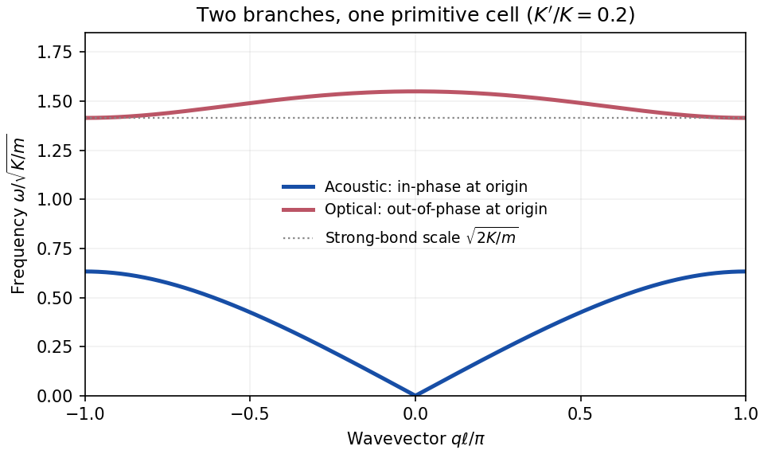

<h1 id="section-a/1/a/solution">Solution</h1>

↑ **Parent:** [A](../a.md)

Let the nearest-neighbour spacing be $d$, so the [primitive unit cell](../../../../../primitive-unit-cell.md) has length $\ell=2d$. Denote the two longitudinal displacements in cell $n$ by $u_n,v_n$, with spring $K$ within each cell and spring $K'$ between cells. [Hooke's law](../../../../../hooke-s-law.md) and [Newton's second law](../../../../../newton-s-second-law.md) give

$$
\boxed{m\ddot u_n=K(v_n-u_n)+K'(v_{n-1}-u_n),\qquad
m\ddot v_n=K(u_n-v_n)+K'(u_{n+1}-v_n).}
$$

For [normal modes](../../../../../normal-mode.md) $u_n=u e^{i(qn\ell-\omega t)}$ and $v_n=v e^{i(qn\ell-\omega t)}$, the two amplitudes satisfy

$$
\begin{pmatrix}
K+K'-m\omega^2&-(K+K'e^{-iq\ell})\\
-(K+K'e^{iq\ell})&K+K'-m\omega^2
\end{pmatrix}\begin{pmatrix}u\\v\end{pmatrix}=0.
$$

Its vanishing [determinant](../../../../../determinant.md) gives the [alternating-spring chain dispersion relation](../../../../../alternating-spring-chain-dispersion-relation.md)

$$
\boxed{\omega_\pm^2(q)=\frac{K+K'\pm\sqrt{K^2+K'^2+2KK'\cos(q\ell)}}m,\qquad |q|\leq\frac\pi\ell.}
$$

The minus sign is the [acoustic phonon branch](../../../../../acoustic-phonon-branch.md), with $\omega_-(0)=0$ and $u=v$ at the origin. The plus sign is the [optical phonon branch](../../../../../optical-phonon-branch.md), with $u=-v$ at the origin. For positive springs the [acoustic phonon branch](../../../../../acoustic-phonon-branch.md) rises from zero to $\sqrt{2\min(K,K')/m}$ at the [Brillouin zone](../../../../../brillouin-zone.md) edge; the [optical phonon branch](../../../../../optical-phonon-branch.md) falls from $\sqrt{2(K+K')/m}$ to $\sqrt{2\max(K,K')/m}$. Their long-wavelength limits are

$$
\omega_-(q)=\ell\sqrt{\frac{KK'}{2m(K+K')}}|q|+O(|q|^3),\qquad
\boxed{\omega_+(0)=\sqrt{\frac{2(K+K')}{m}}\simeq\sqrt{\frac{2K}{m}}\left(1+\frac{K'}{2K}\right).}
$$

Thus the leading frequency in the [strong-bond limit of the alternating-spring chain](../../../../../strong-bond-limit-of-the-alternating-spring-chain.md) is $\sqrt{2K/m}$, the internal stretching frequency of a pair with reduced mass $m/2$.

**[Figure 1](#section-a/1/a/image-acoustic-and-optical-branches-of-an-alternating-spring-chain). Acoustic and optical branches of an alternating-spring chain**. Original calculated dispersions for $K'/K=0.2$, using the two-atom primitive cell. Frequencies are in units of $\sqrt{K/m}$.

## ↑ Ancestors (14)

1. [A](../a.md)
2. [1](../../1.md)
3. [Section A](../../../section-a.md)
4. [2018](../../../../2018-split.md)
5. [Past exam of the quantum condensed matter course of the University of Cambridge](../../../../split.md)
6. [Quantum Condensed Matter course of the University of Cambridge](../../../../../quantum-condensed-matter-course-of-the-university-of-cambridge.md)
7. [Physics course of the year 3 of the natural sciences course of the University of Cambridge](../../../../../physics-course-of-the-year-3-of-the-natural-sciences-course-of-the-university-of-cambridge.md)
8. [Year 3 of the natural sciences course of the University of Cambridge](../../../../../year-3-of-the-natural-sciences-course-of-the-university-of-cambridge.md)
9. [Year of the natural sciences course of the University of Cambridge](../../../../../year-of-the-natural-sciences-course-of-the-university-of-cambridge.md)
10. [Natural sciences course of the University of Cambridge](../../../../../natural-sciences-course-of-the-university-of-cambridge.md)
11. [Course of the University of Cambridge](../../../../../course-of-the-university-of-cambridge.md)
12. [University of Cambridge](../../../../../university-of-cambridge-split.md)
13. [List of universities](../../../../../list-of-universities.md)
14. [Codex Wiki](../../../../../split.md)
