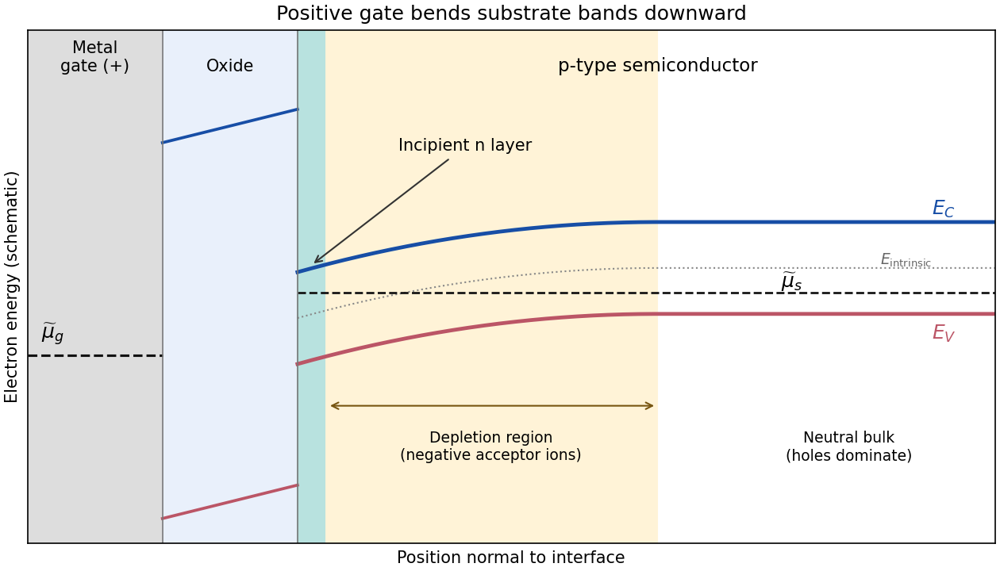

<h1 id="section-a/1/b/solution">Solution</h1>

↑ **Parent:** [B](../b.md)

A positive gate voltage attracts [electrons](../../../../../electron.md) towards the oxide interface of the [p-type semiconductor](../../../../../p-type-semiconductor.md) and repels mobile [electron holes](../../../../../electron-hole.md). The uncovered ionized acceptors form a negatively charged [depletion region](../../../../../depletion-region.md). Increasing the voltage further creates a thin electron-rich [semiconductor inversion layer](../../../../../semiconductor-inversion-layer.md) at the surface. The [conduction band](../../../../../conduction-band.md) and [valence band](../../../../../valence-band.md) both bend downwards towards the positively biased gate, because an electron's electrostatic energy is $-e\psi$.

In an ideal nondegenerate substrate with acceptor density $N_A$, write $\phi_F=(k_BT/e)\ln(N_A/n_i)>0$ and surface potential $\psi_s$ relative to the neutral bulk. The electron and hole surface densities are

$$
n_s=\frac{n_i^2}{N_A}e^{e\psi_s/(k_BT)},\qquad p_s=N_Ae^{-e\psi_s/(k_BT)}.
$$

The first change of majority-carrier type occurs at $\psi_s=\phi_F$, where $n_s=p_s=n_i$. The conventional [MOS inversion threshold](../../../../../mos-inversion-threshold.md) for appreciable strong inversion is

$$
\boxed{\psi_s\simeq2\phi_F,\qquad n_s\simeq N_A.}
$$

At threshold the inversion sheet is just developing, while a much thicker [depletion region](../../../../../depletion-region.md) lies between it and the neutral p-type bulk. Inversion does not require the [conduction band](../../../../../conduction-band.md) to cross the [Fermi level](../../../../../fermi-level.md): the surface can remain nondegenerate.

**[Figure 2](#section-a/1/b/image-downward-band-bending-and-an-incipient-electron-inversion-layer-in-a-mos-structure). Downward band bending and an incipient electron inversion layer in a MOS structure**. Original schematic with a positively biased metal gate, insulating oxide, a thin surface inversion region, and a deeper depletion region. The semiconductor band gap is constant. The separate gate and substrate Fermi levels illustrate applied bias; band offsets and widths are schematic.

**The metal and semiconductor Fermi levels need not be equal.** The ideal oxide blocks particle exchange, so the gate and substrate can maintain different [electrochemical potentials](../../../../../electrochemical-potential.md). In a biased [MOSFET](../../../../../mosfet.md), the [gate-to-substrate Fermi-level difference](../../../../../gate-to-substrate-fermi-level-difference.md) is $\widetilde\mu_g-\widetilde\mu_s=-eV_g$, when the applied voltage is defined in the electron-reservoir convention. Each region can separately be in internal equilibrium. If an external zero-voltage connection instead equilibrates the reservoirs, their Fermi levels coincide, but different [work functions](../../../../../work-function.md) can still cause [band bending](../../../../../band-bending.md). Here the chemical potential shown in a band diagram is the electron electrochemical potential; the purely chemical contribution alone is not the equilibrium criterion for charged particles.

## ↑ Ancestors (14)

1. [B](../b.md)
2. [1](../../1.md)
3. [Section A](../../../section-a.md)
4. [2018](../../../../2018-split.md)
5. [Past exam of the quantum condensed matter course of the University of Cambridge](../../../../split.md)
6. [Quantum Condensed Matter course of the University of Cambridge](../../../../../quantum-condensed-matter-course-of-the-university-of-cambridge.md)
7. [Physics course of the year 3 of the natural sciences course of the University of Cambridge](../../../../../physics-course-of-the-year-3-of-the-natural-sciences-course-of-the-university-of-cambridge.md)
8. [Year 3 of the natural sciences course of the University of Cambridge](../../../../../year-3-of-the-natural-sciences-course-of-the-university-of-cambridge.md)
9. [Year of the natural sciences course of the University of Cambridge](../../../../../year-of-the-natural-sciences-course-of-the-university-of-cambridge.md)
10. [Natural sciences course of the University of Cambridge](../../../../../natural-sciences-course-of-the-university-of-cambridge.md)
11. [Course of the University of Cambridge](../../../../../course-of-the-university-of-cambridge.md)
12. [University of Cambridge](../../../../../university-of-cambridge-split.md)
13. [List of universities](../../../../../list-of-universities.md)
14. [Codex Wiki](../../../../../split.md)
