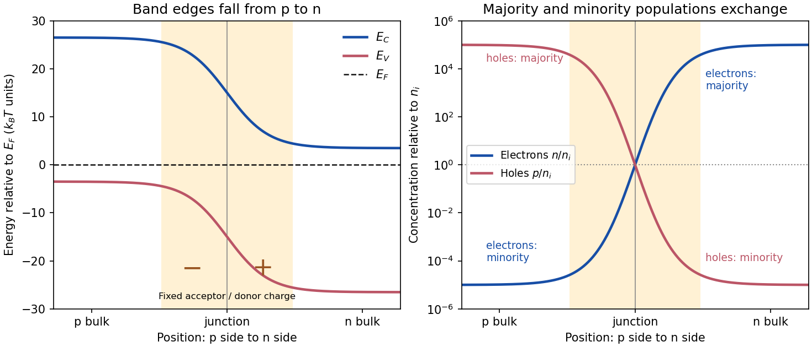

<h1 id="section-b/b2/solution">Solution</h1>

↑ **Parent:** [B2](../b2.md)

**Equilibrium junction.** Put the p-type side on the left and n-type side on the right. When they are joined, [electrons](../../../../electron.md) diffuse from n to p and [electron holes](../../../../electron-hole.md) diffuse from p to n. This leaves negative ionized acceptors on the p-side and positive ionized donors on the n-side of the [depletion region](../../../../depletion-region.md). The resulting built-in [electric field](../../../../electric-field-split.md) points from n to p, opposing further diffusion. At equilibrium there is one constant [Fermi level](../../../../fermi-level.md), and drift and [diffusion currents](../../../../diffusion-current.md) cancel for each carrier species.

In the nondegenerate, fully ionized limit, the neutral-region [carrier densities](../../../../carrier-density.md) are

$$
\begin{array}{c|cc}
&\text{p side}&\text{n side}\\ \hline
\text{holes }p&N_A\quad\text{majority}&n_i^2/N_D\quad\text{minority}\\
\text{electrons }n&n_i^2/N_A\quad\text{minority}&N_D\quad\text{majority}.
\end{array}
$$

The [conduction band](../../../../conduction-band.md) and [valence band](../../../../valence-band.md) lie higher on the p-side and bend down towards the n-side. The gap between them stays fixed for a homojunction. If $\psi$ increases towards the n-side, both edges shift by $-e\psi$, while

$$
n=N_Ce^{-(E_C-E_F)/(k_BT)},\qquad p=N_Ve^{-(E_F-E_V)/(k_BT)},\qquad np=n_i^2.
$$

Thus $n$ rises and $p$ falls continuously across the junction; neither mobile population is an exact step function. Their depletion exposes fixed dopant [charge density](../../../../charge-density.md), rather than an absence of every kind of charge. The built-in voltage is

$$
\boxed{V_{\rm bi}=\frac{k_BT}{e}\ln\frac{N_AN_D}{n_i^2}.}
$$

**[Figure 3](#section-b/b2/image-equilibrium-band-bending-and-carrier-concentrations-across-a-p-n-homojunction). Equilibrium band bending and carrier concentrations across a p-n homojunction**. Original symmetric illustrative model, with the p-region on the left. A constant Fermi level crosses neither band; log-scale carrier profiles satisfy $np=n_i^2$ and exchange majority and minority roles. The profile is schematic rather than a numerical Poisson solution.

**Light emission.** Forward bias lowers the barrier and injects [minority carriers](../../../../minority-carrier.md) across the [p-n junction](../../../../p-n-junction.md). In a [light-emitting diode](../../../../light-emitting-diode.md), [electron-hole recombination](../../../../electron-hole-recombination.md) converts some of their energy into [photons](../../../../photon.md). A [direct band gap](../../../../direct-band-gap.md) permits efficient radiative transitions with nearly conserved [crystal momentum](../../../../crystal-momentum.md); nonradiative channels compete. Near-edge emission has $\hbar\omega\simeq E_g$ and $\lambda\simeq hc/E_g$. Material composition and confinement select the emission colour. Reverse-bias saturation is not the ordinary LED operating mode.

**Reverse current.** Take $V=V_R>0$ and $I_R>0$ to mean reverse voltage and reverse current magnitudes. The [Shockley diode equation](../../../../shockley-diode-equation.md) in this convention is

$$
I_R=I_S\left(1-e^{-eV_R/(k_BT)}\right).
$$

The bias-independent $I_S$ term is the supply of thermally excited [minority carriers](../../../../minority-carrier.md) from the neutral regions, swept across the junction by its [electric field](../../../../electric-field-split.md). The opposing injection current is reduced by the extra barrier energy $eV_R$ and is $I_S e^{-eV_R/(k_BT)}$. Their equality gives zero net current at zero bias; for $eV_R\gg k_BT$, the reverse current approaches $I_S$ until leakage or breakdown invalidates this ideal law. The collecting field need not create the minority carriers; their thermal supply limits the diffusion-dominated current.

For an ideal long junction of area $\mathcal A$, steady diffusion with recombination gives the [diode minority-carrier diffusion current](../../../../diode-minority-carrier-diffusion-current.md)

$$
\boxed{I_S=e\mathcal A\left(\frac{D_nn_i^2}{L_nN_A}+\frac{D_pn_i^2}{L_pN_D}\right),\qquad L_n=\sqrt{D_n\tau_n},\quad L_p=\sqrt{D_p\tau_p}.}
$$

It depends on doping, geometry, carrier [diffusion coefficients](../../../../diffusion-coefficient.md) and lifetimes, and especially the [intrinsic carrier concentration](../../../../intrinsic-carrier-concentration.md). [Depletion-region generation current](../../../../depletion-region-generation-current.md) and surface leakage can add nonideal contributions to the measured reverse current.

**Band-gap estimate from the data.** Read a nearly flat region well above the small-bias knee and below the high-bias upturn, rather than estimating $I_S$ in the breakdown region. For a diffusion-dominated junction with nearly temperature-independent gap and effective masses,

$$
n_i^2=N_CN_Ve^{-E_g/(k_BT)},\qquad N_CN_V\propto T^3,
$$

so $I_S=C(T)T^3e^{-E_g/(k_BT)}$, where $C(T)$ includes transport and doping factors. [Extracting a semiconductor band gap from diode saturation current](../../../../extracting-a-semiconductor-band-gap-from-diode-saturation-current.md) amounts to measuring the slope of $\ln[I_S/(C(T)T^3)]$ against $1/T$: it is $-E_g/k_B$. If the prefactor is taken approximately constant over a short interval,

$$
E_g\simeq k_B\frac{\ln[I_S(T_h)/I_S(T_l)]}{1/T_l-1/T_h}.
$$

Approximate readings from the original PDF plateaus are

$$
\begin{array}{c|c|c}
T\ ({}^\circ\mathrm C)&T\ (\mathrm K)&I_S\ (\mathrm A)\\\hline
30&303.15&2.5\times10^{-6}\\
0&273.15&1.7\times10^{-7}\\
-45&228.15&\text{roughly }1.2\times10^{-8}.
\end{array}
$$

Using the two warmer curves and $k_B=8.6173\times10^{-5}\,\mathrm{eV/K}$ gives

$$
E_g^{\rm app}=k_B\frac{\ln(2.5\times10^{-6}/1.7\times10^{-7})}{1/273.15-1/303.15}
\simeq0.64\,\mathrm{eV}.
$$

Keeping the $T^3$ factor but taking the residual transport factor constant changes this estimate to approximately $0.57\,\mathrm{eV}$. The justified graphical estimate is therefore

$$
\boxed{E_g\ \text{of order }0.6\,\mathrm{eV}\quad\text{from the two warmer curves}.}
$$

The colder curve is a genuine limitation of the supplied data: the $0$ to $-45\,{}^\circ\mathrm C$ pair gives only about $0.32\,\mathrm{eV}$ with a constant prefactor, and the endpoint pair gives about $0.42\,\mathrm{eV}$. Thus all three cannot support one precise diffusion-only activation slope. A [depletion-region generation current](../../../../depletion-region-generation-current.md), approximately proportional to $n_i$ rather than $n_i^2$, can have a roughly half-gap activation energy; other leakage and temperature-dependent transport can also alter the slope. The PDF alone does not identify their relative contributions. A reliable precision gap measurement would use more temperatures and verify the transport regime instead of forcing one fit through these three readings.

## ↑ Ancestors (13)

1. [B2](../b2.md)
2. [Section B](../../section-b.md)
3. [2018](../../../2018-split.md)
4. [Past exam of the quantum condensed matter course of the University of Cambridge](../../../split.md)
5. [Quantum Condensed Matter course of the University of Cambridge](../../../../quantum-condensed-matter-course-of-the-university-of-cambridge.md)
6. [Physics course of the year 3 of the natural sciences course of the University of Cambridge](../../../../physics-course-of-the-year-3-of-the-natural-sciences-course-of-the-university-of-cambridge.md)
7. [Year 3 of the natural sciences course of the University of Cambridge](../../../../year-3-of-the-natural-sciences-course-of-the-university-of-cambridge.md)
8. [Year of the natural sciences course of the University of Cambridge](../../../../year-of-the-natural-sciences-course-of-the-university-of-cambridge.md)
9. [Natural sciences course of the University of Cambridge](../../../../natural-sciences-course-of-the-university-of-cambridge.md)
10. [Course of the University of Cambridge](../../../../course-of-the-university-of-cambridge.md)
11. [University of Cambridge](../../../../university-of-cambridge-split.md)
12. [List of universities](../../../../list-of-universities.md)
13. [Codex Wiki](../../../../split.md)
