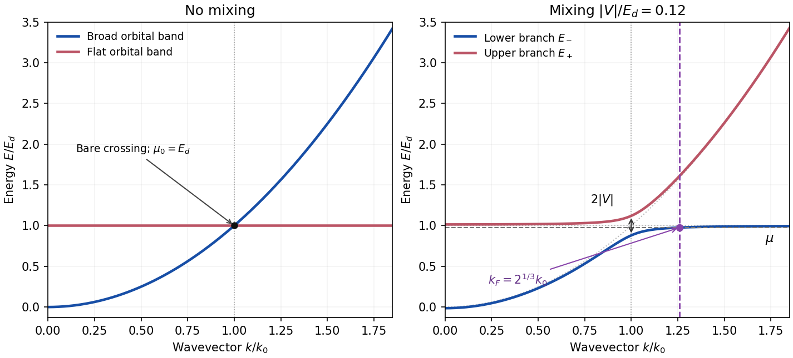

<h1 id="section-b/b3/solution">Solution</h1>

↑ **Parent:** [B3](../b3.md)

**Two atomic orbitals.** In the [linear combination of atomic orbitals](../../../../linear-combination-of-atomic-orbitals.md) approximation, use $|\psi\rangle=c_A|A\rangle+c_B|B\rangle$, where the two basis functions are localized [atomic orbitals](../../../../atomic-orbital.md). Projecting $\widehat H|\psi\rangle=E|\psi\rangle$ onto each orbital gives the [generalized eigenvalue problem](../../../../generalized-eigenvalue-problem.md)

$$
\boxed{\begin{pmatrix}H_{AA}&H_{AB}\\H_{BA}&H_{BB}\end{pmatrix}
\begin{pmatrix}c_A\\c_B\end{pmatrix}
=E\begin{pmatrix}1&S\\S^*&1\end{pmatrix}\begin{pmatrix}c_A\\c_B\end{pmatrix},\qquad
\det(H-ES)=0.}
$$

Here the scalar overlap in the matrix is $S=\langle A|B\rangle$, while $H_{ab}=\langle a|\widehat H|b\rangle$. Normalization requires $c^\dagger S c=1$, with $S$ now denoting the full overlap matrix. For equivalent real orbitals with diagonal energy $E_a$, real hopping $t$, and real overlap $s$, the eigenstates and energies are

$$
|\psi_\pm\rangle=\frac{|A\rangle\pm|B\rangle}{\sqrt{2(1\pm s)}},\qquad
E_\pm=\frac{E_a\pm t}{1\pm s}.
$$

For the usual negative hopping convention, the symmetric combination is the lower [bonding orbital](../../../../bonding-orbital.md) and the antisymmetric combination is the higher [antibonding orbital](../../../../antibonding-orbital.md). In an orthonormal approximation, $s=0$ and the result reduces to a two-by-two [Hermitian matrix](../../../../hermitian-operator.md) eigenproblem.

**Hybridized bands.** At each $\mathbf k$, take the two Bloch basis states to be orthonormal, as implicit in the stated band model, and write $\epsilon_k=\hbar^2k^2/(2m)$. The [Hamiltonian](../../../../hamiltonian.md) is

$$
H(\mathbf k)=\begin{pmatrix}\epsilon_k&V\\V^*&E_d\end{pmatrix}.
$$

For $|\psi_{\mathbf k}\rangle=a_{\mathbf k}|\phi_{\mathbf k}\rangle+b_{\mathbf k}|\chi_{\mathbf k}\rangle$, the [eigenvalue](../../../../eigenvalue.md) condition is

$$
(\epsilon_k-E)a+Vb=0,\qquad V^*a+(E_d-E)b=0,
$$

so $(E-\epsilon_k)(E-E_d)-|V|^2=0$. Thus [band hybridization](../../../../band-hybridization.md) gives

$$
\boxed{E_\pm(k)=\frac{\epsilon_k+E_d}{2}\pm\sqrt{\frac{(\epsilon_k-E_d)^2}{4}+|V|^2}.}
$$

For nonzero $V$, a convenient explicit normalized pair of [eigenstates](../../../../eigenstate.md) is

$$
\boxed{|\psi_{\mathbf k,\pm}\rangle=
\frac{V|\phi_{\mathbf k}\rangle+(E_\pm-\epsilon_k)|\chi_{\mathbf k}\rangle}
{\sqrt{|V|^2+(E_\pm-\epsilon_k)^2}}.}
$$

A phase convention can make $V$ real, but the eigenvalues depend only on its modulus. These are exact within the truncated two-band model, and approximate as a description of a material.

**Dispersions and limits.** For $V=0$, the parabola crosses the [flat band](../../../../flat-band.md) at

$$
k_0=\sqrt{2mE_d}/\hbar.
$$

For $V\ne0$ the crossing is avoided, with a direct [hybridization gap](../../../../hybridization-gap.md) $2|V|$ at $k_0$. The lower and upper branches exchange orbital character through this [avoided crossing](../../../../avoided-crossing.md). At the origin their energies are

$$
E_\pm(0)=\frac{E_d\pm\sqrt{E_d^2+4|V|^2}}2,
$$

so for $|V|\ll E_d$ the small-$k$ expansions are

$$
E_-(k)=-\frac{|V|^2}{E_d}+\left(1-\frac{|V|^2}{E_d^2}\right)\epsilon_k+O(|V|^4/E_d^3,|V|^2\epsilon_k^2/E_d^3),
$$

$$
E_+(k)=E_d+\frac{|V|^2}{E_d}+\frac{|V|^2}{E_d^2}\epsilon_k+O(|V|^4/E_d^3,|V|^2\epsilon_k^2/E_d^3).
$$

At large $k$, where $\epsilon_k-E_d\gg|V|$,

$$
\boxed{E_-(k)=E_d-\frac{|V|^2}{\epsilon_k-E_d}+O\!\left(\frac{|V|^4}{(\epsilon_k-E_d)^3}\right),\qquad
E_+(k)=\epsilon_k+\frac{|V|^2}{\epsilon_k-E_d}+O\!\left(\frac{|V|^4}{(\epsilon_k-E_d)^3}\right).}
$$

The lower branch approaches $E_d$ from below and becomes flat; the upper branch approaches the free-electron parabola from above. At zero coupling the unsorted orbital bands remain exactly flat and parabolic. Sorting them by energy instead gives $E_-=\min(\epsilon_k,E_d)$ and $E_+=\max(\epsilon_k,E_d)$, which cross at $k_0$ without mixing.

**[Figure 4](#section-b/b3/image-avoided-crossing-and-fermi-volume-redistribution-in-a-parabolic-flat-two-band-model). Avoided crossing and Fermi-volume redistribution in a parabolic-flat two-band model**. Original model curves for zero coupling and $|V|/E_d=0.12$. Wavevectors are in units of $k_0=\sqrt{2mE_d}/\hbar$. The lower-band Fermi radius $2^{1/3}k_0$ and its chemical potential follow fixed total density under the stated equal-population, zero-temperature assumption.

**Fermi wavevector and velocity.** A partially occupied perfectly [flat band](../../../../flat-band.md) has chemical potential $E_d$. Thus before mixing, the occupied broad band has radius $k_0$ defined above. For spin degeneracy two, its particle density is $n_1=k_0^3/(3\pi^2)$; equal population of the flat sector gives total density $n=2n_1$.

For any nonzero mixing, $E_-(k)<E_d$ at finite $k$, while $E_+(k)>E_d$. Moreover $E_-(k)$ increases monotonically. At zero temperature and this fixed density, a single occupied sphere in the lower branch therefore accommodates all particles, and the upper branch is empty. [Fermi-volume conservation in two hybridized electron bands](../../../../fermi-volume-conservation-in-two-hybridized-electron-bands.md) gives

$$
\frac{k_F^3}{3\pi^2}=\frac{2k_0^3}{3\pi^2},\qquad
\boxed{k_F=2^{1/3}k_0,\qquad \Delta k_F=(2^{1/3}-1)k_0\simeq0.260k_0.}
$$

The new radius is about $26\%$ larger than the old broad-band radius. The strictly flat uncoupled band has no uniquely determined Fermi radius of its own; its prescribed population is what enters the count.

The radial [group velocity](../../../../group-velocity.md) is $v_-(k)=\hbar^{-1}dE_-/dk$. Differentiating the exact dispersion gives

$$
\frac{dE_-}{d\epsilon_k}=\frac12\left[1-\frac{\epsilon_k-E_d}{\sqrt{(\epsilon_k-E_d)^2+4|V|^2}}\right].
$$

At $k_F$, put $\delta=2^{2/3}-1$, so $\epsilon_{k_F}-E_d=\delta E_d$. Relative to the original broad-band [Fermi velocity](../../../../fermi-velocity.md) $v_F^{(1)}=\hbar k_0/m$,

$$
\frac{v_F}{v_F^{(1)}}=\frac{2^{1/3}}2\left[1-\frac{\delta}{\sqrt{\delta^2+4|V|^2/E_d^2}}\right].
$$

Expanding for $|V|\ll E_d$ gives the [flat-band hybridization Fermi-velocity suppression](../../../../flat-band-hybridization-fermi-velocity-suppression.md)

$$
\boxed{\frac{v_F}{v_F^{(1)}}=\frac{2^{1/3}}{(2^{2/3}-1)^2}\frac{|V|^2}{E_d^2}+O\!\left(\frac{|V|^4}{E_d^4}\right).}
$$

The coefficient is about $3.65$. The enlarged occupied volume coexists with a small velocity because the new [Fermi surface](../../../../fermi-surface.md) lies on the almost-flat part of the lower branch. This result assumes fixed particle density, sufficient available states before any [Brillouin zone](../../../../brillouin-zone.md) boundary, and temperature low enough to resolve energy differences of order $|V|^2/E_d$. The limit $V\to0$ at a fixed nonzero temperature need not give this sharp redistribution. Giving the narrow band a finite dispersion can also leave both pockets occupied, so the result is specific to the ideal model.

## ↑ Ancestors (13)

1. [B3](../b3.md)
2. [Section B](../../section-b.md)
3. [2018](../../../2018-split.md)
4. [Past exam of the quantum condensed matter course of the University of Cambridge](../../../split.md)
5. [Quantum Condensed Matter course of the University of Cambridge](../../../../quantum-condensed-matter-course-of-the-university-of-cambridge.md)
6. [Physics course of the year 3 of the natural sciences course of the University of Cambridge](../../../../physics-course-of-the-year-3-of-the-natural-sciences-course-of-the-university-of-cambridge.md)
7. [Year 3 of the natural sciences course of the University of Cambridge](../../../../year-3-of-the-natural-sciences-course-of-the-university-of-cambridge.md)
8. [Year of the natural sciences course of the University of Cambridge](../../../../year-of-the-natural-sciences-course-of-the-university-of-cambridge.md)
9. [Natural sciences course of the University of Cambridge](../../../../natural-sciences-course-of-the-university-of-cambridge.md)
10. [Course of the University of Cambridge](../../../../course-of-the-university-of-cambridge.md)
11. [University of Cambridge](../../../../university-of-cambridge-split.md)
12. [List of universities](../../../../list-of-universities.md)
13. [Codex Wiki](../../../../split.md)
