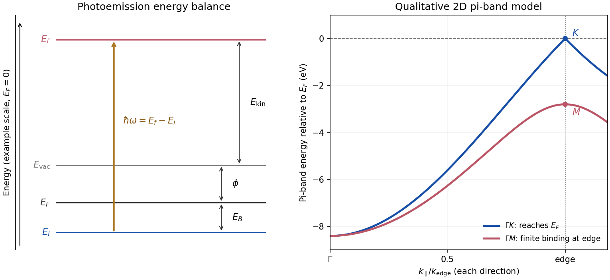

<h1 id="section-b/b4/solution">Solution</h1>

↑ **Parent:** [B4](../b4.md)

**Energy and momentum measurement.** In [angle-resolved photoemission spectroscopy](../../../../angle-resolved-photoemission-spectroscopy.md), monochromatic [photons](../../../../photon.md) illuminate a clean surface in vacuum, and an [electron energy analyzer](../../../../electron-energy-analyzer.md) measures the outgoing kinetic energies and emission directions. Measuring both gives the occupied [electronic band structure](../../../../electronic-band-structure.md), rather than only a momentum-integrated distribution of removal energies.

Choose a common energy reference for initial and final states. Let $E_i$ be the initial electron energy, $E_F$ the [Fermi energy](../../../../fermi-energy.md), and $E_{\rm vac}=E_F+\phi$ the vacuum level immediately outside the sample. The [binding energy](../../../../binding-energy.md) is $E_B=E_F-E_i\geq0$. For a direct emission event without additional losses, [conservation of energy](../../../../conservation-of-energy.md) gives

$$
E_f=E_i+\hbar\omega=E_{\rm vac}+E_{\rm kin},\qquad
\boxed{E_{\rm kin}=\hbar\omega-\phi-E_B.}
$$

Here the [work function](../../../../work-function.md) $\phi$ is the energy from the Fermi level to the local vacuum. The initial and final energies are total single-electron energies on the same scale, while $E_{\rm kin}$ is measured above vacuum. The diagram illustrates each interval independently.

Neglecting ultraviolet photon momentum, [photoemission momentum conversion](../../../../photoemission-momentum-conversion.md) gives

$$
\boxed{k_\parallel=\frac{\sqrt{2m_eE_{\rm kin}}}{\hbar}\sin\theta,}
$$

where $\theta$ is measured from the surface normal. Parallel [crystal momentum](../../../../crystal-momentum.md) is conserved modulo a surface [reciprocal lattice](../../../../reciprocal-lattice.md) vector; the surface breaks perpendicular translation symmetry. A three-dimensional sample therefore generally needs a final-state model to infer perpendicular momentum. The stated two-dimensional sheet avoids that ambiguity. The kinetic energy used in this formula is the sample-vacuum value; if the analyzer and sample have different work functions, their contact potential must be included when converting the analyzer's reading, as in [photoelectron binding energy reference](../../../../photoelectron-binding-energy-reference.md).

**Spectral information.** Define $\epsilon=E_i-E_F=-E_B$ and the electron [spectral function](../../../../spectral-function.md) by $A(\mathbf k,\epsilon)=-\operatorname{Im}G^R(\mathbf k,\epsilon)/\pi$. In the [sudden approximation](../../../../sudden-approximation.md), the basic [photoemission intensity and spectral function](../../../../photoemission-intensity-and-spectral-function.md) relation is

$$
\boxed{I(\mathbf k,\epsilon)=C|\mathcal M(\mathbf k,\hbar\omega,\text{polarization})|^2f(\epsilon)A(\mathbf k,\epsilon),}
$$

before instrumental broadening and background are included. Here $f$ is the [Fermi-Dirac distribution](../../../../fermi-dirac-distribution.md), and $\mathcal M$ is the transition [matrix element](../../../../matrix-element.md). The [electron removal spectral function](../../../../electron-removal-spectral-function.md) contains the occupied part of the spectrum. In a noninteracting band it has a delta peak at the band energy; interactions shift and broaden peaks and can add incoherent weight. Thus peak trajectories reveal dispersion, while line shapes can constrain lifetimes after resolution effects are accounted for. Dividing by known matrix and occupation factors can estimate $A$ where those factors are appreciable; intensity alone is not identical to $A$, and a missing peak can reflect a matrix-element suppression. States well above $E_F$ are not accessible to ordinary low-temperature photoemission.

**[Figure 5](#section-b/b4/image-photoemission-energy-accounting-and-qualitative-upper-valence-band-dispersion). Photoemission energy accounting and qualitative upper valence-band dispersion**. Original schematic energy diagram and illustrative nearest-neighbour graphene pi-band curves. The left panel labels every requested energy and energy interval. The right panel shows an ideal two-dimensional pi band with hopping $t=2.8\,\mathrm{eV}$, not a fit or reproduction of the measured graphite spectra; other occupied orbital bands are omitted.

**Two independent band-structure probes.** First, the [de Haas-van Alphen effect](../../../../de-haas-van-alphen-effect.md) measures oscillatory [magnetization](../../../../magnetization.md) as [Landau levels](../../../../landau-level.md) cross the [Fermi level](../../../../fermi-level.md) when a magnetic field changes. The inverse-field frequency is

$$
F=\frac{\hbar}{2\pi e}S_{\rm ext},\qquad \Delta(1/B)=\frac1F,
$$

where $S_{\rm ext}$ is an extremal [Fermi surface](../../../../fermi-surface.md) cross-sectional area perpendicular to the field. Changing field orientation maps its shape. This reveals the momentum-space geometry of occupied bands; the related [Shubnikov-de Haas effect](../../../../shubnikov-de-haas-effect.md) measures oscillatory resistance.

Second, absorption or reflectance spectroscopy detects interband transitions. Photon energies at absorption edges and peaks constrain the [band gap](../../../../band-gap.md) and interband energy differences. For a [direct band gap](../../../../direct-band-gap.md), negligible photon momentum selects approximately vertical transitions in the band diagram, weighted by the [joint density of states](../../../../joint-density-of-states.md) and transition [matrix elements](../../../../matrix-element.md). An indirect transition needs a [phonon](../../../../phonon.md) to carry the extra [crystal momentum](../../../../crystal-momentum.md). These measurements provide evidence beyond a free-electron parabola, although an optical spectrum alone does not reconstruct every band's dispersion.

**Reading the graphite spectra.** For each direction, follow a moving peak through successive angles and convert each peak's own kinetic energy to $k_\parallel$; angle is not itself proportional to momentum over this wide range. The prominent dispersing valence feature starts at roughly $7$–$9\,\mathrm{eV}$ binding energy near $\Gamma$ and moves towards lower binding energy as $k_\parallel$ increases. Along $\Gamma K$ it approaches the [Fermi level](../../../../fermi-level.md) at the corner, then turns back to larger binding energy on continuing beyond the corner. Along $\Gamma M$ it reaches a finite minimum binding energy of roughly $3$–$4\,\mathrm{eV}$ near the edge midpoint and turns back; it does not reach the Fermi level there. Additional deeper peaks describe other occupied valence branches, with visibility varying across the spectra.

A useful qualitative description is the upper occupied $\pi$ band of the [nearest-neighbour model of graphene](../../../../nearest-neighbour-model-of-graphene.md): $E_\pi=-t|f(\mathbf k)|$. It rises from $-3t$ at $\Gamma$ to zero at $K$, but only to $-t$ at $M$. The schematic curve in the figure captures those two different behaviours. It is not a full multi-orbital assignment or a quantitative fit to graphite, whose deeper valence features are also visible in the supplied spectra.

**Angle needed to reach the corner.** The corner's parallel wavevector is

$$
k_K=\frac{4\pi}{3a}=\frac{4\pi}{3(0.246\,\mathrm{nm})}=17.03\,\mathrm{nm^{-1}}=1.703\,\mathrm{\mathring A^{-1}}.
$$

Use the near-zero binding energy of the upper valence band at that point. With the sample [work function](../../../../work-function.md) interpreted as the stated $3.8\,\mathrm{eV}$ separation below vacuum,

$$
E_{\rm kin}(K)\simeq19.5-3.8=15.7\,\mathrm{eV},\qquad
\frac{\sqrt{2m_eE_{\rm kin}}}{\hbar}=20.30\,\mathrm{nm^{-1}}.
$$

Hence

$$
\boxed{\theta_K\simeq\sin^{-1}\!\left(\frac{17.03}{20.30}\right)=57.0^\circ.}
$$

The energy and angle readings in the PDF are approximate. If a peak at the corner were instead assigned a small binding energy $E_B$, the estimate becomes

$$
\sin\theta_K=\frac{\hbar k_K}{\sqrt{2m_e(15.7\,\mathrm{eV}-E_B)}}.
$$

For $E_B=0$–$1\,\mathrm{eV}$ this gives about $57$–$60^\circ$, consistent with the near-Fermi feature in that angular range. Substituting the full photon energy for the kinetic energy would omit the work-function cost and underestimate the required angle.

## ↑ Ancestors (13)

1. [B4](../b4.md)
2. [Section B](../../section-b.md)
3. [2018](../../../2018-split.md)
4. [Past exam of the quantum condensed matter course of the University of Cambridge](../../../split.md)
5. [Quantum Condensed Matter course of the University of Cambridge](../../../../quantum-condensed-matter-course-of-the-university-of-cambridge.md)
6. [Physics course of the year 3 of the natural sciences course of the University of Cambridge](../../../../physics-course-of-the-year-3-of-the-natural-sciences-course-of-the-university-of-cambridge.md)
7. [Year 3 of the natural sciences course of the University of Cambridge](../../../../year-3-of-the-natural-sciences-course-of-the-university-of-cambridge.md)
8. [Year of the natural sciences course of the University of Cambridge](../../../../year-of-the-natural-sciences-course-of-the-university-of-cambridge.md)
9. [Natural sciences course of the University of Cambridge](../../../../natural-sciences-course-of-the-university-of-cambridge.md)
10. [Course of the University of Cambridge](../../../../course-of-the-university-of-cambridge.md)
11. [University of Cambridge](../../../../university-of-cambridge-split.md)
12. [List of universities](../../../../list-of-universities.md)
13. [Codex Wiki](../../../../split.md)
