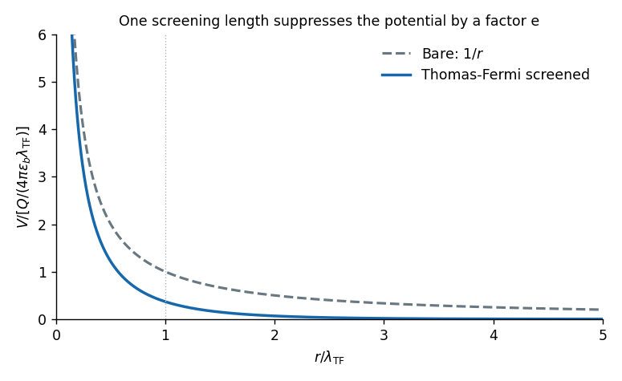

<h1 id="section-a/2/solution">Solution</h1>

↑ **Parent:** [2](../2.md)

Use [Thomas-Fermi screening](../../../../thomas-fermi-screening.md), treating a homogeneous three-dimensional conductor in static [linear response](../../../../linear-response-theory.md). For a positive test charge the screened [electric potential](../../../../electric-potential.md) and bare Coulomb potential are

$$
\boxed{V(r)=\frac{Q}{4\pi\varepsilon_b r}e^{-r/\lambda_{\rm TF}},\qquad
V_{\rm bare}(r)=\frac{Q}{4\pi\varepsilon_b r}.}
$$

Here $\varepsilon_b$ is the background [permittivity](../../../../permittivity-split.md) before the mobile carriers screen; it is $\epsilon_0$ in the simplest free-electron model. Both curves have the same leading $1/r$ divergence near the origin, while the screened curve lies below the bare one and decays much faster.

A positive potential attracts [electrons](../../../../electron.md). If $g(E_F)$ is their total [spin-summed density of states](../../../../spin-summed-density-of-states.md) per volume and energy, $\delta n=e g(E_F)V$ and $\rho_{\rm ind}=-e^2g(E_F)V$. Inserting this charge into [Poisson equation](../../../../poisson-s-equation.md) gives the [Thomas-Fermi screening length](../../../../thomas-fermi-screening-length.md)

$$
\boxed{\lambda_{\rm TF}=\sqrt{\frac{\varepsilon_b}{e^2g(E_F)}}.}
$$

A larger [density of states](../../../../density-of-states.md) lets the conductor rearrange more charge for the same potential change and shortens the screening length. For a parabolic [free electron model](../../../../free-electron-model.md), $g(E_F)=3n/(2E_F)$, hence $\lambda_{\rm TF}^2=2\varepsilon_bE_F/(3ne^2)$.

**[Figure 1](#section-a/2/image-bare-and-thomas-fermi-screened-potentials-of-a-positive-test-charge). Bare and Thomas-Fermi-screened potentials of a positive test charge**. Original dimensionless model curves on the same axes, normalized by $Q/(4\pi\varepsilon_b\lambda_{\rm TF})$. The near-origin divergence is clipped for display. The local screening approximation omits microscopic nonlocal effects.

The exponential form is the intended local screening model. A microscopic zero-temperature metal also has [Friedel oscillations](../../../../friedel-oscillations.md), so the exponential alone is not an exact description at every length scale.

## ↑ Ancestors (13)

1. [2](../2.md)
2. [Section A](../../section-a.md)
3. [2019](../../../2019-split.md)
4. [Past exam of the quantum condensed matter course of the University of Cambridge](../../../split.md)
5. [Quantum Condensed Matter course of the University of Cambridge](../../../../quantum-condensed-matter-course-of-the-university-of-cambridge.md)
6. [Physics course of the year 3 of the natural sciences course of the University of Cambridge](../../../../physics-course-of-the-year-3-of-the-natural-sciences-course-of-the-university-of-cambridge.md)
7. [Year 3 of the natural sciences course of the University of Cambridge](../../../../year-3-of-the-natural-sciences-course-of-the-university-of-cambridge.md)
8. [Year of the natural sciences course of the University of Cambridge](../../../../year-of-the-natural-sciences-course-of-the-university-of-cambridge.md)
9. [Natural sciences course of the University of Cambridge](../../../../natural-sciences-course-of-the-university-of-cambridge.md)
10. [Course of the University of Cambridge](../../../../course-of-the-university-of-cambridge.md)
11. [University of Cambridge](../../../../university-of-cambridge-split.md)
12. [List of universities](../../../../list-of-universities.md)
13. [Codex Wiki](../../../../split.md)
