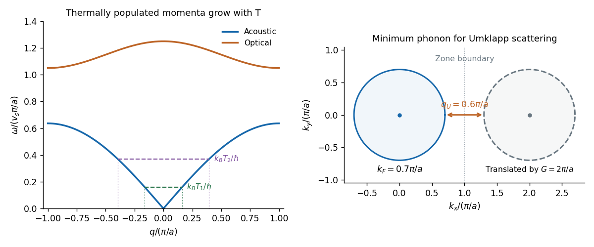

<h1 id="section-b/4/d/solution">Solution</h1>

↑ **Parent:** [D](../d.md)

An [acoustic phonon branch](../../../../../acoustic-phonon-branch.md) approaches zero frequency linearly, $\omega_{\rm ac}\simeq v_s|q|$, because a long-wavelength translation has no restoring force. An [optical phonon branch](../../../../../optical-phonon-branch.md) has nonzero frequency at $q=0$ and represents relative motion of atoms within a [primitive unit cell](../../../../../primitive-unit-cell.md). Such an optical branch requires more than one independent atom per primitive cell; a truly monatomic simple-cubic model has only the acoustic branches.

The Bose occupation is $N_q=[e^{\hbar\omega_q/(k_BT)}-1]^{-1}$. At low temperature, appreciably populated acoustic modes have

$$
\boxed{|q|\lesssim q_T\sim\frac{k_BT}{\hbar v_s}.}
$$

As temperature falls, the available phonon wavevectors concentrate near the zone centre and optical modes freeze out when $k_BT\ll\hbar\omega_{\rm op}(0)$. These are thermal-occupation restrictions, not a change in the allowed geometric [Brillouin zone](../../../../../brillouin-zone.md).

**[Figure 2](#section-b/4/d/image-thermally-available-phonons-and-the-minimum-momentum-for-electron-phonon-umklapp-scattering). Thermally available phonons and the minimum momentum for electron-phonon Umklapp scattering**. Original schematic acoustic and optical dispersions, alongside a repeated-zone Fermi-surface construction. In the right panel wavevectors are in units of $\pi/a$: two radius-0.7 Fermi circles have centres separated by 2, leaving a minimum phonon wavevector of 0.6 between them. The optical branch in the left panel illustrates a crystal with an atomic basis.

## ↑ Ancestors (14)

1. [D](../d.md)
2. [4](../../4.md)
3. [Section B](../../../section-b.md)
4. [2019](../../../../2019-split.md)
5. [Past exam of the quantum condensed matter course of the University of Cambridge](../../../../split.md)
6. [Quantum Condensed Matter course of the University of Cambridge](../../../../../quantum-condensed-matter-course-of-the-university-of-cambridge.md)
7. [Physics course of the year 3 of the natural sciences course of the University of Cambridge](../../../../../physics-course-of-the-year-3-of-the-natural-sciences-course-of-the-university-of-cambridge.md)
8. [Year 3 of the natural sciences course of the University of Cambridge](../../../../../year-3-of-the-natural-sciences-course-of-the-university-of-cambridge.md)
9. [Year of the natural sciences course of the University of Cambridge](../../../../../year-of-the-natural-sciences-course-of-the-university-of-cambridge.md)
10. [Natural sciences course of the University of Cambridge](../../../../../natural-sciences-course-of-the-university-of-cambridge.md)
11. [Course of the University of Cambridge](../../../../../course-of-the-university-of-cambridge.md)
12. [University of Cambridge](../../../../../university-of-cambridge-split.md)
13. [List of universities](../../../../../list-of-universities.md)
14. [Codex Wiki](../../../../../split.md)
