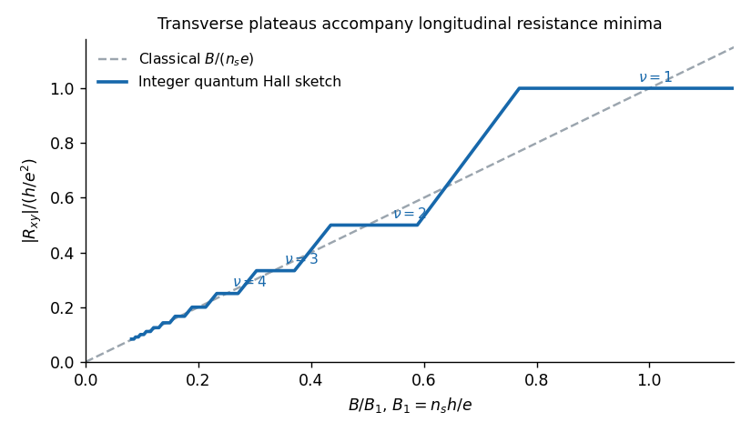

<h1 id="section-b/5/e/solution">Solution</h1>

↑ **Parent:** [E](../e.md)

At large inverse field, $B$ and the [cyclotron frequency](../../../../../cyclotron-frequency.md) are small, so the orbital spacing $\hbar\omega_c$ becomes comparable with both disorder broadening and the Fermi occupation's thermal width. Scattering of [quantum lifetime](../../../../../quantum-lifetime.md) $\tau_q$ gives a typical half-width $\Gamma=\hbar/(2\tau_q)$; overlapping levels lose their density-of-states contrast. The fundamental [Dingle factor](../../../../../dingle-factor.md) and [thermal damping of quantum oscillations](../../../../../thermal-damping-of-quantum-oscillations.md) are

$$
\boxed{R_D=e^{-\pi/(\omega_c\tau_q)},\qquad
R_T=\frac{X}{\sinh X},\qquad X=\frac{2\pi^2k_BT}{\hbar\omega_c}.}
$$

Both shrink rapidly as $B$ falls. Well-resolved oscillations require a sufficiently large $\omega_c\tau_q$ and a temperature small compared with the orbital spacing. The scattering time in this broadening argument is not automatically the transport time inferred from mobility; small-angle events affect the two differently.

The transverse Hall resistance is approximately $|R_{xy}|=B/(n_se)$ in the classical weak-field regime. At stronger fields the [integer quantum Hall effect](../../../../../integer-quantum-hall-effect.md) produces plateaus

$$
\boxed{|R_{xy}|=\frac{h}{\nu e^2},\qquad \nu\in\mathbb N,}
$$

accompanied by nearly vanishing longitudinal resistance. Localized bulk states between extended Landau states allow plateau intervals, while current can be carried by [quantum Hall edge states](../../../../../quantum-hall-edge-state.md). At still larger fields and sufficiently low temperature, the cleanest samples show the [fractional quantum Hall effect](../../../../../fractional-quantum-hall-effect.md), with interaction-generated incompressible states at fractional fillings such as $\nu=1/3$. The sign of $R_{xy}$ depends on the contact and magnetic-field orientation; the sketch shows its magnitude.

**[Figure 3](#section-b/5/e/image-classical-hall-slope-and-schematic-integer-quantum-hall-plateaus). Classical Hall slope and schematic integer quantum Hall plateaus**. Original schematic magnitude of transverse Hall resistance. The plateau transitions are chosen for illustration, not fitted to the supplied longitudinal-resistance trace. The vertical scale is $h/e^2$ and the field scale is $B_1=n_sh/e$, so the classical line has unit slope.

## ↑ Ancestors (14)

1. [E](../e.md)
2. [5](../../5.md)
3. [Section B](../../../section-b.md)
4. [2019](../../../../2019-split.md)
5. [Past exam of the quantum condensed matter course of the University of Cambridge](../../../../split.md)
6. [Quantum Condensed Matter course of the University of Cambridge](../../../../../quantum-condensed-matter-course-of-the-university-of-cambridge.md)
7. [Physics course of the year 3 of the natural sciences course of the University of Cambridge](../../../../../physics-course-of-the-year-3-of-the-natural-sciences-course-of-the-university-of-cambridge.md)
8. [Year 3 of the natural sciences course of the University of Cambridge](../../../../../year-3-of-the-natural-sciences-course-of-the-university-of-cambridge.md)
9. [Year of the natural sciences course of the University of Cambridge](../../../../../year-of-the-natural-sciences-course-of-the-university-of-cambridge.md)
10. [Natural sciences course of the University of Cambridge](../../../../../natural-sciences-course-of-the-university-of-cambridge.md)
11. [Course of the University of Cambridge](../../../../../course-of-the-university-of-cambridge.md)
12. [University of Cambridge](../../../../../university-of-cambridge-split.md)
13. [List of universities](../../../../../list-of-universities.md)
14. [Codex Wiki](../../../../../split.md)
