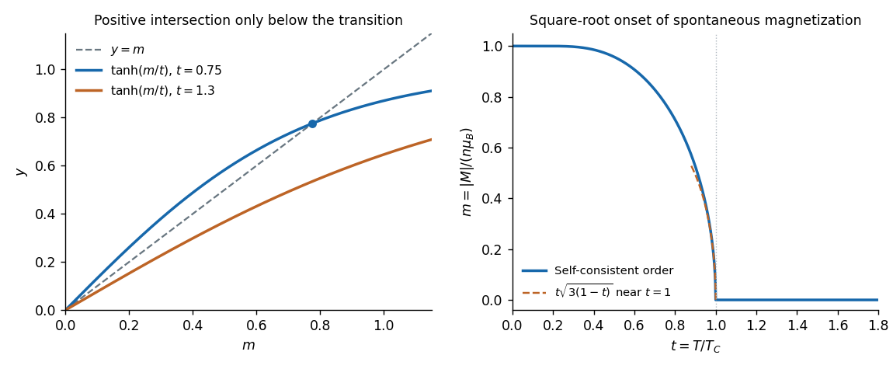

<h1 id="section-b/6/d/solution">Solution</h1>

↑ **Parent:** [D](../d.md)

Close to the critical temperature on the ordered side, both $m$ and $m/t$ are small. Expanding the [hyperbolic tangent](../../../../../hyperbolic-tangent.md) gives

$$
m=\frac mt-\frac{m^3}{3t^3}+O(m^5).
$$

For a nonzero solution, divide by $m$ and retain the cubic-order terms:

$$
1\simeq\frac1t-\frac{m^2}{3t^3},\qquad
\boxed{m\simeq t\sqrt{3(1-t)}\quad(0<1-t\ll1).}
$$

This [mean-field onset of two-state ferromagnetism](../../../../../mean-field-onset-of-two-state-ferromagnetism.md) has [mean-field critical exponent](../../../../../mean-field-critical-exponent.md) $1/2$: the curve reaches zero continuously with a square-root cusp below $t=1$, and remains exactly zero for all $t\geq1$. The factor $t$ is what the cubic truncation gives; higher orders also affect the coefficient at relative order $1-t$, so the robust leading asymptote is $m\sim\sqrt{3(1-t)}$.

**[Figure 4](#section-b/6/d/image-weiss-self-consistency-and-the-mean-field-ferromagnetic-onset). Weiss self-consistency and the mean-field ferromagnetic onset**. Original numerical solutions of $m=\tanh(m/t)$. The left panel shows a positive intersection below the critical temperature and none above it. The right panel plots the spontaneous magnitude and its near-critical cubic approximation; that approximation is shown only close to the transition.

## ↑ Ancestors (14)

1. [D](../d.md)
2. [6](../../6.md)
3. [Section B](../../../section-b.md)
4. [2019](../../../../2019-split.md)
5. [Past exam of the quantum condensed matter course of the University of Cambridge](../../../../split.md)
6. [Quantum Condensed Matter course of the University of Cambridge](../../../../../quantum-condensed-matter-course-of-the-university-of-cambridge.md)
7. [Physics course of the year 3 of the natural sciences course of the University of Cambridge](../../../../../physics-course-of-the-year-3-of-the-natural-sciences-course-of-the-university-of-cambridge.md)
8. [Year 3 of the natural sciences course of the University of Cambridge](../../../../../year-3-of-the-natural-sciences-course-of-the-university-of-cambridge.md)
9. [Year of the natural sciences course of the University of Cambridge](../../../../../year-of-the-natural-sciences-course-of-the-university-of-cambridge.md)
10. [Natural sciences course of the University of Cambridge](../../../../../natural-sciences-course-of-the-university-of-cambridge.md)
11. [Course of the University of Cambridge](../../../../../course-of-the-university-of-cambridge.md)
12. [University of Cambridge](../../../../../university-of-cambridge-split.md)
13. [List of universities](../../../../../list-of-universities.md)
14. [Codex Wiki](../../../../../split.md)
