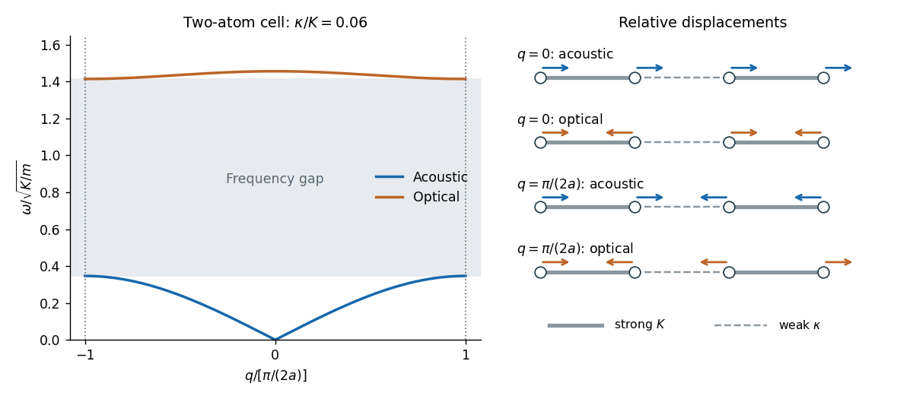
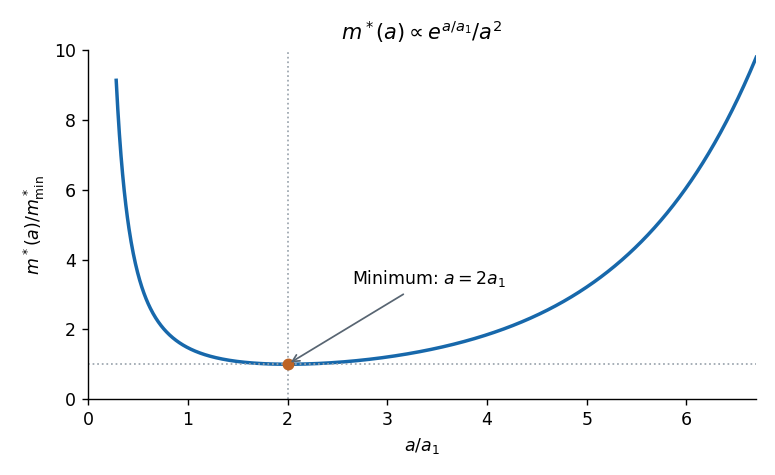

# 2021

↑ **Parent:** [Past exam of the quantum condensed matter course of the University of Cambridge](../past-exam-of-the-quantum-condensed-matter-course-of-the-university-of-cambridge.md)

[Original paper, released PDF pages 433–437](https://www.whatdotheyknow.com/request/natural_science_tripos_physics_e/response/2127325/attach/3/FOI%202022%20639%20Sullivan%20materials.pdf?cookie_passthrough=1#page=433)

**Table of contents**

- [Section A](#section-a)
  - [1](#section-a/1)
    - [Solution](#section-a/1/solution)
  - [2](#section-a/2)
    - [Solution](#section-a/2/solution)
  - [3](#section-a/3)
    - [Solution](#section-a/3/solution)
- [Section B](#section-b)
  - [4](#section-b/4)
    - [a](#section-b/4/a)
      - [Solution](#section-b/4/a/solution)
    - [b](#section-b/4/b)
      - [Solution](#section-b/4/b/solution)
    - [c](#section-b/4/c)
      - [Solution](#section-b/4/c/solution)
    - [d](#section-b/4/d)
      - [Solution](#section-b/4/d/solution)
    - [e](#section-b/4/e)
      - [Solution](#section-b/4/e/solution)
    - [f](#section-b/4/f)
      - [Solution](#section-b/4/f/solution)
  - [5](#section-b/5)
    - [a](#section-b/5/a)
      - [Solution](#section-b/5/a/solution)
    - [b](#section-b/5/b)
      - [Solution](#section-b/5/b/solution)
    - [c](#section-b/5/c)
      - [Solution](#section-b/5/c/solution)
    - [d](#section-b/5/d)
      - [Solution](#section-b/5/d/solution)
  - [6](#section-b/6)
    - [a](#section-b/6/a)
      - [Solution](#section-b/6/a/solution)
    - [b](#section-b/6/b)
      - [Solution](#section-b/6/b/solution)
    - [c](#section-b/6/c)
      - [Solution](#section-b/6/c/solution)
    - [d](#section-b/6/d)
      - [Solution](#section-b/6/d/solution)
    - [e](#section-b/6/e)
      - [Solution](#section-b/6/e/solution)
    - [f](#section-b/6/f)
      - [Solution](#section-b/6/f/solution)

## Section A

↑ **Parent:** [2021](2021.md)

<h3 id="section-a/1">1</h3>

↑ **Parent:** [Section A](#section-a)

<h4 id="section-a/1/solution">Solution</h4>

↑ **Parent:** [1](#section-a/1)

For [state counting in a Bloch band](../bloch-s-theorem.md#state-counting-in-a-bloch-band), take a [primitive cubic lattice](../quantum-scattering.md#primitive-cubic-lattice) of spacing $a$ and impose [periodic boundary conditions](../differential-equation.md#periodic-boundary-conditions) on lengths $L_i=N_i a$. The allowed [wavevectors](../elasticity-physics.md#wavevector) are $k_i=2\pi l_i/L_i$. The first [Brillouin zone](../bloch-s-theorem.md#brillouin-zone) has side $2\pi/a$, so it contains $N_i$ distinct values in each direction and hence $N_xN_yN_z=N$ wavevectors. Each orbital-derived [energy band](../bloch-s-theorem.md#energy-band) has one state per wavevector per [spin](../angular-momentum-operator.md#spin) orientation. Therefore

$$
\boxed{\text{states per band in the whole crystal}=2N,\qquad
\text{states per atom per band}=2.}
$$

The phrase “per atom” attached to $2N$ in the PDF is a counting error: $2N$ is the total, not the per-atom count.

By the [Pauli exclusion principle](../tensor-product-of-quantum-systems.md#pauli-exclusion-principle), a monovalent crystal supplies $N$ valence [electrons](../physics.md#electron) and half-fills a spin-degenerate band; its [Fermi level](../quantum-ideal-gas-statistics.md#fermi-level) lies within allowed states, giving a [metal](../chemical-substance.md#metal) in the independent-electron picture. Two electrons per atom can fill one band. If a [band gap](../bloch-s-theorem.md#band-gap) separates it from all empty bands, the crystal is a [band insulator](../bloch-s-theorem.md#band-insulator). An even valence count only permits insulation: overlapping bands can still produce a [metal](../chemical-substance.md#metal). Conversely, electron interactions can produce a [Mott insulator](../bloch-s-theorem.md#mott-insulator), and symmetry breaking can permit insulation outside this simple spin-degenerate [electronic band structure](../bloch-s-theorem.md#electronic-band-structure) criterion. The relevant count in a crystal with a basis is per [primitive unit cell](../quantum-scattering.md#primitive-unit-cell).

<h3 id="section-a/2">2</h3>

↑ **Parent:** [Section A](#section-a)

<h4 id="section-a/2/solution">Solution</h4>

↑ **Parent:** [2](#section-a/2)

In a simple [metal](../chemical-substance.md#metal), conduction [electrons](../physics.md#electron) can move collectively in response to an incident [electromagnetic wave](../electromagnetic-wave.md). The [Drude model](../electric-charge.md#drude-model) gives, with time dependence $e^{-i\omega t}$,

$$
\epsilon_r(\omega)=1-\frac{\omega_p^2}{\omega(\omega+i\gamma)},\qquad
\omega_p^2=\frac{ne^2}{\epsilon_0m^*}.
$$

In the low-loss range $\gamma\ll\omega<\omega_p$, the [relative permittivity](../quantum-mechanics.md#relative-permittivity) is approximately $1-\omega_p^2/\omega^2<0$. The wavevector inside is predominantly imaginary, so the field is evanescent and penetrates only a short distance. Surface currents reradiate the field; little energy enters a good conductor. The normal-incidence [Fresnel equations](../electromagnetic-wave.md#fresnel-equations) give

$$
\boxed{R=\left|\frac{\sqrt{\epsilon_r}-1}{\sqrt{\epsilon_r}+1}\right|^2\simeq1\quad(\omega<\omega_p,\ \gamma\text{ small}).}
$$

Many ordinary metals have their [plasma frequency](../physics.md#plasma-frequency) in the ultraviolet, placing visible light below this reflection edge. For $\omega>\omega_p$ the free-carrier contribution permits propagation; at $\omega\gg\omega_p$, $\epsilon_r\to1$ and $R\sim\omega_p^4/(16\omega^4)\to0$. The electrons' inertial response becomes too small to screen the rapidly oscillating field.

**Ultraviolet transparency is a simple-metal model prediction, not a universal property of real metals.** [Electronic transitions](../atomic-physics.md#electronic-transition) between bands and bound-electron absorption can remain strong, shift the plasma edge and prevent transparency; transmission also depends on thickness and attenuation. The robust explanation is the change from a reflective negative-permittivity range to a possible propagating range above the plasma edge.

<h3 id="section-a/3">3</h3>

↑ **Parent:** [Section A](#section-a)

<h4 id="section-a/3/solution">Solution</h4>

↑ **Parent:** [3](#section-a/3)

Let adjacent equal masses $m$ be separated by $a$, with alternating strong and weak spring constants $K$ and $\kappa$, $K\gg\kappa>0$. The pattern repeats after $2a$, even though the masses are identical. Thus the first [Brillouin zone](../bloch-s-theorem.md#brillouin-zone) is

$$
\boxed{-\frac{\pi}{2a}\leq q\leq\frac{\pi}{2a}.}
$$

Choose the strong bond inside each two-atom [primitive unit cell](../quantum-scattering.md#primitive-unit-cell). With displacement amplitudes $(u,v)e^{i(2naq-\omega t)}$, the [normal mode](../wave-equation.md#normal-mode) equations are

$$
m\omega^2\begin{pmatrix}u\\v\end{pmatrix}
=\begin{pmatrix}K+\kappa&-K-\kappa e^{-2iqa}\\-K-\kappa e^{2iqa}&K+\kappa\end{pmatrix}
\begin{pmatrix}u\\v\end{pmatrix}.
$$

The [alternating-spring chain dispersion relation](../quantum-ideal-gas-statistics.md#alternating-spring-chain-dispersion-relation) is consequently

$$
\boxed{\omega_\pm^2(q)=\frac{K+\kappa\pm\sqrt{(K-\kappa)^2+4K\kappa\cos^2(qa)}}m.}
$$

The lower [acoustic phonon branch](../quantum-ideal-gas-statistics.md#acoustic-phonon-branch) has in-phase motion within the strongly bound pair and $\omega_-(0)=0$. Its small-$q$ slope is the [speed of sound](../compressible-flow.md#speed-of-sound),

$$
c_s=a\sqrt{\frac{2K\kappa}{m(K+\kappa)}}\simeq a\sqrt{\frac{2\kappa}{m}}.
$$

The upper [optical phonon branch](../quantum-ideal-gas-statistics.md#optical-phonon-branch) has opposite motion within each pair, with $\omega_+(0)=\sqrt{2(K+\kappa)/m}$. Here “optical” names the gapped branch; equal neutral masses need not couple to light through an electric dipole.

In the [strong-bond limit of the alternating-spring chain](../quantum-ideal-gas-statistics.md#strong-bond-limit-of-the-alternating-spring-chain), the pairs act almost as rigid dimers in the low-frequency branch, while their internal stretch gives a high, nearly flat branch:

$$
\omega_-^2\simeq\frac{2\kappa}{m}\sin^2(qa),\qquad
\omega_+^2\simeq\frac{2K}{m}+\frac{2\kappa}{m}\cos^2(qa).
$$

At the zone edge the two frequencies are $\sqrt{2\kappa/m}$ and $\sqrt{2K/m}$, separated by a large forbidden frequency interval. Neighbouring cells are out of phase there. Both branches have horizontal tangents at the edge.

**[Figure 1](#section-a/3/image-phonon-branches-and-displacement-patterns-of-a-strongly-dimerized-equal-mass-chain). Phonon branches and displacement patterns of a strongly dimerized equal-mass chain**. Original calculation for $\kappa/K=0.06$. The horizontal coordinate uses the two-atom-cell Brillouin-zone boundary. Strong solid bonds and weak dashed bonds identify each dimer. Arrows show relative displacements at the zone centre and edge; their overall sign and amplitude are arbitrary.

## Section B

↑ **Parent:** [2021](2021.md)

<h3 id="section-b/4">4</h3>

↑ **Parent:** [Section B](#section-b)

<h4 id="section-b/4/a">a</h4>

↑ **Parent:** [4](#section-b/4)

<h5 id="section-b/4/a/solution">Solution</h5>

↑ **Parent:** [A](#section-b/4/a)

For a [Hamiltonian](../hamiltonian-mechanics.md#hamiltonian) with a lattice-periodic potential $V(\mathbf r+\mathbf R)=V(\mathbf r)$, its simultaneous [energy eigenstates](../energy-eigenvalue.md#energy-eigenstate) and lattice-translation eigenstates can be chosen in the [Bloch wave](../bloch-s-theorem.md#bloch-state) form

$$
\boxed{\psi_{n\mathbf k}(\mathbf r)=e^{i\mathbf k\cdot\mathbf r}u_{n\mathbf k}(\mathbf r),\qquad
u_{n\mathbf k}(\mathbf r+\mathbf R)=u_{n\mathbf k}(\mathbf r).}
$$

Equivalently, $\psi_{n\mathbf k}(\mathbf r+\mathbf R)=e^{i\mathbf k\cdot\mathbf R}\psi_{n\mathbf k}(\mathbf r)$. The index $n$ labels an [energy band](../bloch-s-theorem.md#energy-band); [crystal momentum](../bloch-s-theorem.md#crystal-momentum) $\hbar\mathbf k$ is defined modulo a [reciprocal lattice](../quantum-scattering.md#reciprocal-lattice) vector. These are the content of [Bloch's theorem](../bloch-s-theorem.md).

<h4 id="section-b/4/b">b</h4>

↑ **Parent:** [4](#section-b/4)

<h5 id="section-b/4/b/solution">Solution</h5>

↑ **Parent:** [B](#section-b/4/b)

Use one orthonormalized localized [atomic orbital](../chemistry.md#atomic-orbital) $|j\rangle$ at each position $ja$. In the nearest-neighbour [tight-binding model](../bloch-s-theorem.md#tight-binding), translation invariance gives the on-site energy and real [hopping integral](../bloch-s-theorem.md#hopping-integral)

$$
E_0=\langle j|H|j\rangle,\qquad
 t=\langle j|H|j+1\rangle=\langle j+1|H|j\rangle.
$$

The [Bloch state](../bloch-s-theorem.md#bloch-state) is

$$
|k\rangle=\frac1{\sqrt N}\sum_j e^{ikja}|j\rangle.
$$

Since $H|j\rangle=E_0|j\rangle+t|j-1\rangle+t|j+1\rangle$, shifting the two summation indices gives

$$
H|k\rangle=[E_0+te^{ika}+te^{-ika}]|k\rangle,
\qquad\boxed{E(k)=E_0+2t\cos(ka).}
$$

The [hopping integral](../bloch-s-theorem.md#hopping-integral) is an energy, and its sign sets whether $k=0$ is a minimum or maximum. $E_0$ is the diagonal matrix element in the crystal Hamiltonian, which can differ from an isolated-atom energy.

The [orthogonal tight-binding approximation](../bloch-s-theorem.md#orthogonal-tight-binding-approximation) matters. If raw neighbouring orbitals retain a nonzero [orbital overlap](../chemistry.md#orbital-overlap) $s$ in their normalization, projection instead gives a [generalized eigenvalue problem](../linear-operator-theory.md#generalized-eigenvalue-problem) and the [nonorthogonal nearest-neighbour tight-binding band](../bloch-s-theorem.md#nonorthogonal-nearest-neighbour-tight-binding-band) $E(k)=[E_0+2h\cos(ka)]/[1+2s\cos(ka)]$. The stated cosine band follows after orthonormalization and nearest-neighbour truncation, or after neglecting that overlap metric while retaining the hopping it motivates.

<h4 id="section-b/4/c">c</h4>

↑ **Parent:** [4](#section-b/4)

<h5 id="section-b/4/c/solution">Solution</h5>

↑ **Parent:** [C](#section-b/4/c)

A site in a [primitive cubic lattice](../quantum-scattering.md#primitive-cubic-lattice) has six nearest neighbours, at $\pm a\hat{\mathbf x}$, $\pm a\hat{\mathbf y}$ and $\pm a\hat{\mathbf z}$. Repeating the [Bloch state](../bloch-s-theorem.md#bloch-state) calculation with equal [hopping integrals](../bloch-s-theorem.md#hopping-integral) $t$ along all six bonds gives

$$
\boxed{E(\mathbf k)=E_0+2t[\cos(k_xa)+\cos(k_ya)+\cos(k_za)].}
$$

The cosine sum ranges from $-3$ to $3$ within the first [Brillouin zone](../bloch-s-theorem.md#brillouin-zone). Therefore

$$
E_{\min}=E_0-6|t|,\qquad E_{\max}=E_0+6|t|,\qquad
\boxed{W=E_{\max}-E_{\min}=12|t|.}
$$

For $t<0$ the minimum is at the zone centre; for $t>0$ the maximum is there.

<h4 id="section-b/4/d">d</h4>

↑ **Parent:** [4](#section-b/4)

<h5 id="section-b/4/d/solution">Solution</h5>

↑ **Parent:** [D](#section-b/4/d)

For $|k_i a|\ll1$, expand each cosine to second order:

$$
E(\mathbf k)=E_0+6t-ta^2(k_x^2+k_y^2+k_z^2)+O(ta^4k^4).
$$

To this order a fixed energy fixes $k_x^2+k_y^2+k_z^2$, so the constant-energy surfaces are [spheres](../euclidean-geometry.md#sphere). The [band effective mass](../bloch-s-theorem.md#band-effective-mass) tensor satisfies

$$
(m^{*-1})_{ij}=\frac1{\hbar^2}\frac{\partial^2E}{\partial k_i\partial k_j}
=-\frac{2ta^2}{\hbar^2}\delta_{ij},\qquad
\boxed{m^*=-\frac{\hbar^2}{2ta^2}.}
$$

For bonding hopping $t<0$ this is a positive electron mass at the band bottom. If $t>0$, $k=0$ is a maximum with negative electronic mass, or positive [electron hole](../quantum-mechanics.md#electron-hole) mass $\hbar^2/(2ta^2)$. The spherical shape is a quadratic approximation; cubic anisotropy appears in the fourth-order terms.

<h4 id="section-b/4/e">e</h4>

↑ **Parent:** [4](#section-b/4)

<h5 id="section-b/4/e/solution">Solution</h5>

↑ **Parent:** [E](#section-b/4/e)

Taking $E_1>0$ so that the zone centre is a minimum, the [effective mass for exponentially decaying tight-binding hopping](../bloch-s-theorem.md#effective-mass-for-exponentially-decaying-tight-binding-hopping) is

$$
\boxed{m^*(a)=\frac{\hbar^2}{4E_1a^2}e^{a/a_1}.}
$$

Its logarithmic derivative is

$$
\frac1{m^*}\frac{dm^*}{da}=\frac1{a_1}-\frac2a.
$$

The curve decreases for $a<2a_1$, has a unique minimum at $a=2a_1$, and increases for $a>2a_1$:

$$
\boxed{m^*_{\min}=\frac{\hbar^2\exp(2)}{16E_1a_1^2}.}
$$

The formal limits are an $a^{-2}$ divergence as $a\to0$ and an exponential divergence as $a\to\infty$. The small-separation extrapolation eventually invalidates the localized-orbital [tight-binding model](../bloch-s-theorem.md#tight-binding); the sketch describes the specified formula.

**[Figure 2](#section-b/4/e/image-effective-mass-versus-atomic-spacing-for-exponentially-decaying-nearest-neighbour-hopping). Effective mass versus atomic spacing for exponentially decaying nearest-neighbour hopping**. Original plot of the specified tight-binding model, normalized by its minimum. The minimum occurs at $a=2a_1$, where the logarithmic derivative of the hopping magnitude balances the explicit $a^2$ band-curvature factor.

<h4 id="section-b/4/f">f</h4>

↑ **Parent:** [4](#section-b/4)

<h5 id="section-b/4/f/solution">Solution</h5>

↑ **Parent:** [F](#section-b/4/f)

The [electronic bandwidth](../bloch-s-theorem.md#electronic-bandwidth) is $W(a)=24E_1e^{-a/a_1}$. With $a$ reduced from $a_1$ to $0.99a_1$,

$$
\boxed{\frac{\Delta W}{W}=\frac{W(0.99a_1)}{W(a_1)}-1
=e^{0.01}-1\simeq0.01005.}
$$

Thus the [energy band](../bloch-s-theorem.md#energy-band) widens by approximately **1.005 percent**, or **1 percent to first order**. Compression increases the orbital coupling.

<h3 id="section-b/5">5</h3>

↑ **Parent:** [Section B](#section-b)

<h4 id="section-b/5/a">a</h4>

↑ **Parent:** [5](#section-b/5)

<h5 id="section-b/5/a/solution">Solution</h5>

↑ **Parent:** [A](#section-b/5/a)

For a degenerate [Fermi gas](../quantum-ideal-gas-statistics.md#fermi-gas), the [Pauli exclusion principle](../tensor-product-of-quantum-systems.md#pauli-exclusion-principle) restricts thermally changed occupations to an energy shell of width $k_BT$ around the [Fermi energy](../quantum-ideal-gas-statistics.md#fermi-energy). The number of active [electrons](../physics.md#electron) is of order $g(E_F)k_BT\sim Nk_BT/E_F$; each carries an excitation energy of order $k_BT$. Thus the thermal energy grows as $N(k_BT)^2/E_F$ and the [electronic heat capacity](../heat.md#electronic-heat-capacity) is proportional to $T$.

More precisely, the fixed-particle-number [Sommerfeld expansion](../quantum-ideal-gas-statistics.md#sommerfeld-expansion) gives

$$
U(T)-U(0)=\frac{\pi^2}{6}g(E_F)(k_BT)^2+O(T^4),\qquad
C_e=\frac{\pi^2}{3}g(E_F)k_B^2T+O(T^3).
$$

Here $g$ is the total [spin-summed density of states](../quantum-ideal-gas-statistics.md#spin-summed-density-of-states) for the sample. For a three-dimensional parabolic band, $g(E_F)=3N/(2E_F)$, yielding

$$
\boxed{C_e=A\frac{Nk_B^2T}{E_F},\qquad A=\frac{\pi^2}{2},\qquad k_BT\ll E_F.}
$$

The linear law concerns the electronic contribution; the low-temperature lattice [heat capacity](../heat.md#heat-capacity) usually adds a $T^3$ term.

<h4 id="section-b/5/b">b</h4>

↑ **Parent:** [5](#section-b/5)

<h5 id="section-b/5/b/solution">Solution</h5>

↑ **Parent:** [B](#section-b/5/b)

Let $n=N/\mathcal V$ and $c_e=C_e/\mathcal V$ be the [carrier density](../electric-charge.md#carrier-density) and electronic [heat capacity](../heat.md#heat-capacity) per unit volume. In isotropic [kinetic theory](../kinetic-theory.md), the [angular average](../euclidean-geometry.md#angular-average) $\langle v_x^2\rangle=v_F^2/3$ gives the electronic [thermal conductivity](../heat.md#thermal-conductivity)

$$
K_e=\frac13c_ev_F\ell_Q=\frac13c_ev_F^2\tau_Q,
$$

where $\ell_Q=v_F\tau_Q$ is the [mean free path](../ideal-gas.md#mean-free-path) associated with the [heat-current relaxation time](../heat.md#heat-current-relaxation-time). With $v_F^2=2E_F/m^*$,

$$
K_e=\frac{2A}{3}\frac{nk_B^2T\tau_Q}{m^*}.
$$

The [Drude model](../electric-charge.md#drude-model) gives the [electrical conductivity](../electric-charge.md#electrical-conductivity) $\sigma=ne^2\tau_\sigma/m^*$, where $\tau_\sigma$ is the [momentum relaxation time](../electric-charge.md#momentum-relaxation-time). Therefore

$$
\frac{K_e}{\sigma T}=\frac{2A}{3}\left(\frac{k_B}{e}\right)^2\frac{\tau_Q}{\tau_\sigma}.
$$

When the same approximately elastic collisions relax heat and charge currents, $\tau_Q=\tau_\sigma$. Using $A=\pi^2/2$ gives the [Wiedemann-Franz law](../heat.md#wiedemann-franz-law)

$$
\boxed{K_e=L_0\sigma T,\qquad L_0=\frac{\pi^2}{3}\left(\frac{k_B}{e}\right)^2
\simeq2.44\times10^{-8}\,\mathrm{W\,\Omega\,K^{-2}}.}
$$

$L_0$ is the [Lorenz number](../heat.md#lorenz-number). Degenerate electrons move at the [Fermi velocity](../quantum-ideal-gas-statistics.md#fermi-velocity), not the classical thermal velocity; using classical equipartition would give the wrong coefficient.

<h4 id="section-b/5/c">c</h4>

↑ **Parent:** [5](#section-b/5)

<h5 id="section-b/5/c/solution">Solution</h5>

↑ **Parent:** [C](#section-b/5/c)

The [Wiedemann-Franz law](../heat.md#wiedemann-franz-law) applies to a normal degenerate [metal](../chemical-substance.md#metal) when the same itinerant [electrons](../physics.md#electron) carry heat and charge, scattering is approximately elastic over the thermal shell, and the transport probability varies slowly across the energy interval $k_BT$ around the [Fermi level](../quantum-ideal-gas-statistics.md#fermi-level). The comparison uses the electronic [thermal conductivity](../heat.md#thermal-conductivity) $K_e$, with any lattice contribution removed.

It works particularly well as $T\to0$ when elastic impurity or defect scattering dominates. It also often holds approximately for $\Theta_D\ll T\ll T_F$, where thermally populated [phonons](../quantum-ideal-gas-statistics.md#phonon) act as a nearly elastic classical scattering field. Room temperature need not lie above the [Debye temperature](../quantum-ideal-gas-statistics.md#debye-temperature) for every metal.

At intermediate temperatures, inelastic small-angle [electron-phonon scattering](../quantum-ideal-gas-statistics.md#electron-phonon-scattering) can relax heat much more efficiently than charge. Then $\tau_Q\ne\tau_\sigma$ and $K_e/(\sigma T)$ can be smaller than $L_0$. Strong energy dependence of scattering, additional neutral heat carriers, or a transition out of the normal metallic state also invalidates the simple derivation. An observed deviation alone does not identify which assumption failed.

<h4 id="section-b/5/d">d</h4>

↑ **Parent:** [5](#section-b/5)

<h5 id="section-b/5/d/solution">Solution</h5>

↑ **Parent:** [D](#section-b/5/d)

For one conduction electron per atom, let $n_a$ be the atom density. [State counting in a Bloch band](../bloch-s-theorem.md#state-counting-in-a-bloch-band) gives the [Fermi wavevector](../quantum-ideal-gas-statistics.md#fermi-wavevector) $k_F=(3\pi^2n_a)^{1/3}$. The [Debye model](../quantum-ideal-gas-statistics.md#debye-model) preserves the three vibrational modes per atom by a spherical [Debye wavevector](../quantum-ideal-gas-statistics.md#debye-wavevector) cutoff $q_D=(6\pi^2n_a)^{1/3}$, so

$$
\boxed{q_D=2^{1/3}k_F\simeq1.26k_F.}
$$

Both wavevectors are of order the inverse atomic spacing. The numerical factor uses the spherical Debye approximation; a real zone boundary and the largest-frequency mode depend on direction and branch. Because $q_D<2k_F$, short-wavelength acoustic [phonons](../quantum-ideal-gas-statistics.md#phonon) can scatter [Fermi surface](../fermi-liquid.md#fermi-surface) electrons through substantial angles. For nearly elastic scattering within a spherical Fermi surface,

$$
q=2k_F\sin(\theta/2),\qquad1-\cos\theta=\frac{q^2}{2k_F^2}.
$$

Near room temperature, when a substantial fraction of the phonon spectrum is occupied, [electron-phonon scattering](../quantum-ideal-gas-statistics.md#electron-phonon-scattering) is often the main source of [electrical resistance](../electric-charge.md#electrical-resistance). For $T\gg\Theta_D$, the phonon population and scattering rate are approximately proportional to $T$, giving $\rho\propto T$, $\sigma\propto T^{-1}$ and roughly constant $K_e$ when the [Wiedemann-Franz law](../heat.md#wiedemann-franz-law) holds.

For [small-angle electron-phonon transport at low temperature](../quantum-ideal-gas-statistics.md#small-angle-electron-phonon-transport-at-low-temperature), thermally active acoustic modes instead have

$$
q_T\sim\frac{k_BT}{\hbar c_s}=q_D\frac{T}{\Theta_D}\ll k_F.
$$

They predominantly scatter forward. The factor $1-\cos\theta$ makes such collisions inefficient at relaxing an electrical current, while a phonon energy of order $k_BT$ can still substantially change an electron's thermal excitation. Heat-current relaxation therefore need not share the charge-current relaxation time. In the clean three-dimensional acoustic-phonon model this gives $\tau_Q^{-1}\propto T^3$ but $\tau_\sigma^{-1}\propto T^5$, so the phonon-limited electrical resistivity scales as $T^5$ and $K_e\propto T^{-2}$. These laws describe the regime before residual elastic scattering takes over; at sufficiently low temperature impurities give nearly constant residual resistivity and $K_e\propto T$, restoring the usual [Lorenz number](../heat.md#lorenz-number).[Electron-phonon scattering: distinct low-temperature thermal and electrical transport relaxation rates](https://home.itp.ac.ru/~grigorev/LectureSlides/MetalsLecture2.pdf)

[Phonons](../quantum-ideal-gas-statistics.md#phonon) also transport heat themselves, with $K_{\rm ph}\simeq c_{\rm ph}c_s\ell_{\rm ph}/3$. At low temperature their population decreases and their [phonon mean free path](../quantum-ideal-gas-statistics.md#phonon-mean-free-path) can become boundary- or defect-limited. At higher temperature [Umklapp scattering](../quantum-ideal-gas-statistics.md#umklapp-scattering) can relax the phonon heat current. Such lattice conduction is an additional contribution, not the quantity constrained by the electronic [Wiedemann-Franz law](../heat.md#wiedemann-franz-law).

<h3 id="section-b/6">6</h3>

↑ **Parent:** [Section B](#section-b)

<h4 id="section-b/6/a">a</h4>

↑ **Parent:** [6](#section-b/6)

<h5 id="section-b/6/a/solution">Solution</h5>

↑ **Parent:** [A](#section-b/6/a)

Write $\varepsilon_s=\epsilon_0\epsilon$ and take $e>0$, $\alpha>0$, so the p side is $x<0$. In the [depletion approximation](../semiconductor.md#depletion-approximation), mobile [electrons](../physics.md#electron) and [electron holes](../quantum-mechanics.md#electron-hole) are negligible compared with the fixed ionized dopants. Their [charge density](../electric-charge.md#charge-density) is

$$
\rho(x)=e[n_D^+(x)-n_A^-(x)]\simeq e\alpha x.
$$

Applying [Poisson equation](../partial-differential-equation.md#poisson-s-equation) gives

$$
\boxed{\frac{d^2V}{dx^2}=-\frac{\rho(x)}{\varepsilon_s}=-\frac{e\alpha x}{\epsilon_0\epsilon}.}
$$

Outside the [depletion region](../semiconductor.md#depletion-region), mobile carriers approximately neutralize the dopants, so $\rho\simeq0$ and $V''\simeq0$. Full dopant ionization alone does not remove the mobile-carrier charge: the result also requires the [depletion approximation](../semiconductor.md#depletion-approximation).

<h4 id="section-b/6/b">b</h4>

↑ **Parent:** [6](#section-b/6)

<h5 id="section-b/6/b/solution">Solution</h5>

↑ **Parent:** [B](#section-b/6/b)

At equilibrium, majority [electrons](../physics.md#electron) undergo [diffusion](../thermodynamics.md#diffusion) from n to p, while majority [electron holes](../quantum-mechanics.md#electron-hole) diffuse from p to n. Their departure exposes positive donors on the n side and negative acceptors on the p side. The resulting [electric field](../electric-field.md) points from n to p and opposes further diffusion. Equilibrium is reached when the [chemical potential](../chemical-potential.md) is constant across the junction. The [built-in potential](../semiconductor.md#built-in-potential) is this electrostatic adjustment, not a discontinuity of the material's [band gap](../bloch-s-theorem.md#band-gap).

Since electronic band energies shift by $-eV(x)$, both the [conduction band](../quantum-mechanics.md#conduction-band) and [valence band](../quantum-mechanics.md#valence-band) undergo [band bending](../semiconductor.md#band-bending) down from p to n by $eV_b$ at zero applied bias. Their separation remains the same gap. In the nondegenerate [thermal equilibrium](../thermal-equilibrium.md) limit the built-in voltage can also be expressed using neutral-edge densities as $eV_b=k_BT\log(n_n/n_p)=k_BT\log(n_np_p/n_i^2)$.

Take the n-contact potential and its [electrochemical potential](../chemical-potential.md#electrochemical-potential) as reference. Applying $V_{\rm ext}$ to the p side changes the total depletion-layer drop to

$$
\boxed{U=V_b-V_{\rm ext},\qquad
E_{c,p}-E_{c,n}=E_{v,p}-E_{v,n}=eU.}
$$

Thus $V_{\rm ext}<0$ is [reverse bias](../electrical-circuit.md#reverse-bias): it increases the barrier and widens the [depletion region](../semiconductor.md#depletion-region). The bands have horizontal tangents at the neutral edges in this approximation and a smooth cubic bend within the linearly graded layer.

A biased junction is not in global thermal equilibrium. Its contact electron [electrochemical potentials](../chemical-potential.md#electrochemical-potential) obey

$$
\boxed{\mu_p-\mu_n=-eV_{\rm ext}.}
$$

Under reverse bias the p-contact level is higher by $e|V_{\rm ext}|$. A single horizontal equilibrium [chemical potential](../chemical-potential.md) cannot describe this state; electron and hole [quasi-Fermi levels](../chemical-potential.md#quasi-fermi-level) describe the nonequilibrium populations. The sketch marks the contact levels. Detailed spatial quasi-Fermi profiles require transport and recombination information beyond the electrostatic doping profile.

**[Figure 3](#section-b/6/b/image-band-bending-electric-field-and-capacitance-of-a-linearly-graded-junction). Band bending, electric field and capacitance of a linearly graded junction**. Original depletion-model sketches with the p region on the left. The top panels compare equilibrium with reverse bias; under bias only the contact electrochemical levels are specified. The bottom panels show the negative electric field and the normalized positive differential capacitance. Energy and length scales are illustrative.

<h4 id="section-b/6/c">c</h4>

↑ **Parent:** [6](#section-b/6)

<h5 id="section-b/6/c/solution">Solution</h5>

↑ **Parent:** [C](#section-b/6/c)

At equilibrium the [diffusion currents](../electric-charge.md#diffusion-current) and [drift currents](../electric-charge.md#drift-current) cancel separately for each carrier species. Electron diffusion is from n to p, while the [electric field](../electric-field.md) drives electrons from p to n; hole diffusion is from p to n, while hole drift is from n to p. The net current is zero, although these opposing microscopic fluxes are present. In conventional-current signs, both majority diffusion contributions point p to n and the balancing drift contributions point n to p.

[Forward bias](../electrical-circuit.md#forward-bias), $V_{\rm ext}>0$, reduces the barrier and enhances majority-carrier diffusion and [minority carrier](../semiconductor.md#minority-carrier) injection. The ideal low-injection [Shockley diode equation](../electrical-circuit.md#shockley-diode-equation) gives

$$
\boxed{J=J_s\left[e^{eV_{\rm ext}/(k_BT)}-1\right],}
$$

where positive current is p to n. For [reverse bias](../electrical-circuit.md#reverse-bias), majority diffusion is suppressed and the field sweeps thermally supplied minority carriers across the junction, giving approximately $J=-J_s$. This saturation is limited by carrier supply rather than a current proportional to the field. Depletion-layer generation, recombination and eventual [diode reverse breakdown](../electrical-circuit.md#diode-reverse-breakdown) modify the ideal result.

<h4 id="section-b/6/d">d</h4>

↑ **Parent:** [6](#section-b/6)

<h5 id="section-b/6/d/solution">Solution</h5>

↑ **Parent:** [D](#section-b/6/d)

Let the neutral edges be $-x_p$ and $x_n$ and take the exterior [electric field](../electric-field.md) to vanish. Integrating $dE_x/dx=\rho/\varepsilon_s=e\alpha x/\varepsilon_s$ between the edges gives $x_n^2=x_p^2$, so $x_n=x_p=w/2$. This is also the condition of equal and opposite integrated depletion charges.

A second integration with $E_x(w/2)=0$ yields

$$
\boxed{E_x(x)=\frac{e\alpha}{2\varepsilon_s}\left(x^2-\frac{w^2}{4}\right),\qquad |x|\leq\frac w2.}
$$

It is negative inside the layer, pointing from n to p, and zero at both edges. Its largest magnitude occurs at the metallurgical junction:

$$
\boxed{x=0,\qquad |E_x|_{\max}=\frac{e\alpha w^2}{8\varepsilon_s}.}
$$

For reference, choosing $V(-w/2)=0$ gives the cubic [electric potential](../electric-field.md#electric-potential)

$$
V(x)=\frac{e\alpha}{2\varepsilon_s}\left(\frac{w^2x}{4}-\frac{x^3}{3}+\frac{w^3}{12}\right).
$$

<h4 id="section-b/6/e">e</h4>

↑ **Parent:** [6](#section-b/6)

<h5 id="section-b/6/e/solution">Solution</h5>

↑ **Parent:** [E](#section-b/6/e)

The [electric potential difference](../electric-field.md#electric-potential-difference) is the negative integral of the field:

$$
V_b-V_{\rm ext}=-\int_{-w/2}^{w/2}E_x(x)\,dx
=\frac{e\alpha}{2\varepsilon_s}\int_{-w/2}^{w/2}\left(\frac{w^2}{4}-x^2\right)dx
=\frac{e\alpha w^3}{12\varepsilon_s}.
$$

Consequently

$$
\boxed{w(V_{\rm ext})=\left[\frac{12\epsilon_0\epsilon(V_b-V_{\rm ext})}{e\alpha}\right]^{1/3},\qquad
w(0)=\left(\frac{12\epsilon_0\epsilon V_b}{e\alpha}\right)^{1/3}.}
$$

The [linearly graded junction depletion width](../semiconductor.md#linearly-graded-junction-depletion-width) has this cube-root dependence because of the linearly growing space charge: the charge on one side scales as $w^2$, the field as $w^2$, and its potential integral as $w^3$. The formula assumes $V_b-V_{\rm ext}>0$ and that the [depletion approximation](../semiconductor.md#depletion-approximation) remains applicable.

<h4 id="section-b/6/f">f</h4>

↑ **Parent:** [6](#section-b/6)

<h5 id="section-b/6/f/solution">Solution</h5>

↑ **Parent:** [F](#section-b/6/f)

The positive charge per unit interface area on the n side and negative charge on the p side are

$$
Q_n=\int_0^{w/2}e\alpha x\,dx=\frac{e\alpha w^2}{8},\qquad
Q_p=-Q_n.
$$

Use the signed p-side charge $Q=Q_p$ because $V_{\rm ext}$ is the p-side voltage relative to n. Differentiating the width relation gives

$$
\frac{dw}{dV_{\rm ext}}=-\frac{w}{3(V_b-V_{\rm ext})},\qquad
C=\frac{dQ_p}{dV_{\rm ext}}
=\frac{e\alpha w^2}{12(V_b-V_{\rm ext})}.
$$

Using part (e), the positive [junction capacitance](../semiconductor.md#junction-capacitance) per unit area is

$$
\boxed{C=\frac{\varepsilon_s}{w}
=\left[\frac{e\alpha\varepsilon_s^2}{12(V_b-V_{\rm ext})}\right]^{1/3}.}
$$

It decreases with increasing reverse-bias magnitude as $(V_b+|V_{\rm ext}|)^{-1/3}$. Equivalently,

$$
\boxed{C^{-3}=\frac{12(V_b-V_{\rm ext})}{e\alpha\varepsilon_s^2},}
$$

so a linear $C^{-3}$ versus voltage plot diagnoses this ideal linear grading and can determine $\alpha$.

For this [linearly graded junction capacitance](../semiconductor.md#linearly-graded-junction-capacitance), the charge convention matters: if “stored charge” means the positive magnitude $Q_n$, then $dQ_n/dV_{\rm ext}=-\varepsilon_s/w$; the positive measured capacitance is $-dQ_n/dV_{\rm ext}=dQ_n/dV_R$ for $V_R=-V_{\rm ext}$. The total net depletion charge is zero and is not the stored terminal charge. At substantial forward bias, [minority carrier](../semiconductor.md#minority-carrier) storage and the failure of the sharp [depletion approximation](../semiconductor.md#depletion-approximation) prevent extrapolation of the apparent divergence at $V_{\rm ext}=V_b$.

## ↑ Ancestors (10)

1. [Past exam of the quantum condensed matter course of the University of Cambridge](../past-exam-of-the-quantum-condensed-matter-course-of-the-university-of-cambridge.md)
2. [Quantum Condensed Matter course of the University of Cambridge](../university-of-cambridge.md#quantum-condensed-matter-course-of-the-university-of-cambridge)
3. [Physics course of the year 3 of the natural sciences course of the University of Cambridge](../university-of-cambridge.md#physics-course-of-the-year-3-of-the-natural-sciences-course-of-the-university-of-cambridge)
4. [Year 3 of the natural sciences course of the University of Cambridge](../university-of-cambridge.md#year-3-of-the-natural-sciences-course-of-the-university-of-cambridge)
5. [Year of the natural sciences course of the University of Cambridge](../university-of-cambridge.md#year-of-the-natural-sciences-course-of-the-university-of-cambridge)
6. [Natural sciences course of the University of Cambridge](../university-of-cambridge.md#natural-sciences-course-of-the-university-of-cambridge)
7. [Course of the University of Cambridge](../university-of-cambridge.md#course-of-the-university-of-cambridge)
8. [University of Cambridge](../university-of-cambridge.md)
9. [List of universities](../README.md#list-of-universities)
10. [Codex Wiki](../README.md)
