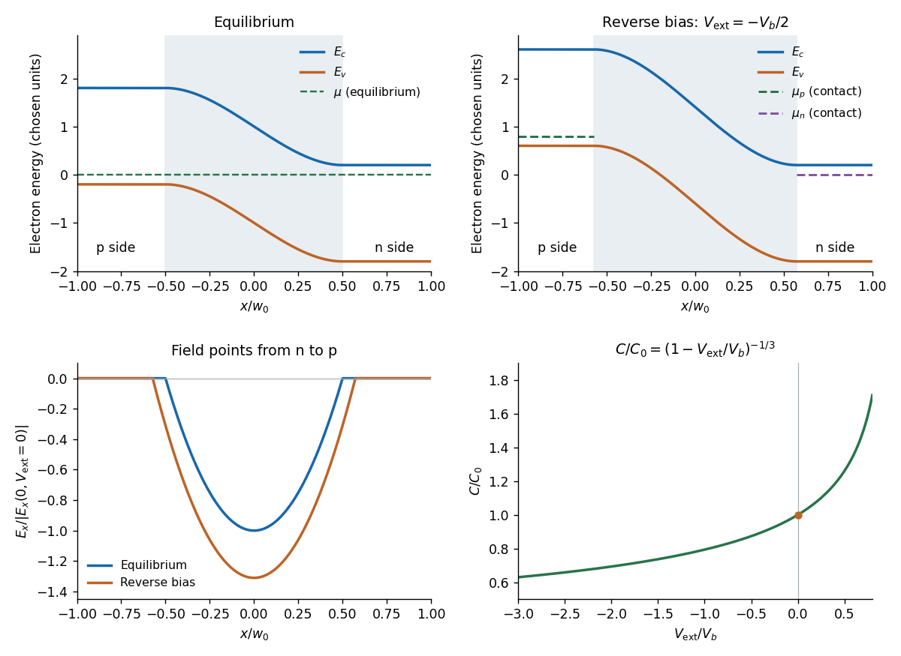

<h1 id="section-b/6/b/solution">Solution</h1>

↑ **Parent:** [B](../b.md)

At equilibrium, majority [electrons](../../../../../electron.md) undergo [diffusion](../../../../../diffusion.md) from n to p, while majority [electron holes](../../../../../electron-hole.md) diffuse from p to n. Their departure exposes positive donors on the n side and negative acceptors on the p side. The resulting [electric field](../../../../../electric-field-split.md) points from n to p and opposes further diffusion. Equilibrium is reached when the [chemical potential](../../../../../chemical-potential-split.md) is constant across the junction. The [built-in potential](../../../../../built-in-potential.md) is this electrostatic adjustment, not a discontinuity of the material's [band gap](../../../../../band-gap.md).

Since electronic band energies shift by $-eV(x)$, both the [conduction band](../../../../../conduction-band.md) and [valence band](../../../../../valence-band.md) undergo [band bending](../../../../../band-bending.md) down from p to n by $eV_b$ at zero applied bias. Their separation remains the same gap. In the nondegenerate [thermal equilibrium](../../../../../thermal-equilibrium-split.md) limit the built-in voltage can also be expressed using neutral-edge densities as $eV_b=k_BT\log(n_n/n_p)=k_BT\log(n_np_p/n_i^2)$.

Take the n-contact potential and its [electrochemical potential](../../../../../electrochemical-potential.md) as reference. Applying $V_{\rm ext}$ to the p side changes the total depletion-layer drop to

$$
\boxed{U=V_b-V_{\rm ext},\qquad
E_{c,p}-E_{c,n}=E_{v,p}-E_{v,n}=eU.}
$$

Thus $V_{\rm ext}<0$ is [reverse bias](../../../../../reverse-bias.md): it increases the barrier and widens the [depletion region](../../../../../depletion-region.md). The bands have horizontal tangents at the neutral edges in this approximation and a smooth cubic bend within the linearly graded layer.

A biased junction is not in global thermal equilibrium. Its contact electron [electrochemical potentials](../../../../../electrochemical-potential.md) obey

$$
\boxed{\mu_p-\mu_n=-eV_{\rm ext}.}
$$

Under reverse bias the p-contact level is higher by $e|V_{\rm ext}|$. A single horizontal equilibrium [chemical potential](../../../../../chemical-potential-split.md) cannot describe this state; electron and hole [quasi-Fermi levels](../../../../../quasi-fermi-level.md) describe the nonequilibrium populations. The sketch marks the contact levels. Detailed spatial quasi-Fermi profiles require transport and recombination information beyond the electrostatic doping profile.

**[Figure 3](#section-b/6/b/image-band-bending-electric-field-and-capacitance-of-a-linearly-graded-junction). Band bending, electric field and capacitance of a linearly graded junction**. Original depletion-model sketches with the p region on the left. The top panels compare equilibrium with reverse bias; under bias only the contact electrochemical levels are specified. The bottom panels show the negative electric field and the normalized positive differential capacitance. Energy and length scales are illustrative.

## ↑ Ancestors (14)

1. [B](../b.md)
2. [6](../../6.md)
3. [Section B](../../../section-b.md)
4. [2021](../../../../2021-split.md)
5. [Past exam of the quantum condensed matter course of the University of Cambridge](../../../../split.md)
6. [Quantum Condensed Matter course of the University of Cambridge](../../../../../quantum-condensed-matter-course-of-the-university-of-cambridge.md)
7. [Physics course of the year 3 of the natural sciences course of the University of Cambridge](../../../../../physics-course-of-the-year-3-of-the-natural-sciences-course-of-the-university-of-cambridge.md)
8. [Year 3 of the natural sciences course of the University of Cambridge](../../../../../year-3-of-the-natural-sciences-course-of-the-university-of-cambridge.md)
9. [Year of the natural sciences course of the University of Cambridge](../../../../../year-of-the-natural-sciences-course-of-the-university-of-cambridge.md)
10. [Natural sciences course of the University of Cambridge](../../../../../natural-sciences-course-of-the-university-of-cambridge.md)
11. [Course of the University of Cambridge](../../../../../course-of-the-university-of-cambridge.md)
12. [University of Cambridge](../../../../../university-of-cambridge-split.md)
13. [List of universities](../../../../../list-of-universities.md)
14. [Codex Wiki](../../../../../split.md)
