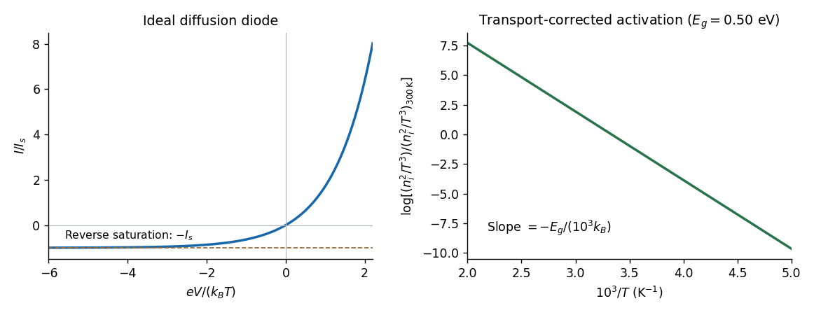

# 2022

↑ **Parent:** [Past exam of the quantum condensed matter course of the University of Cambridge](../past-exam-of-the-quantum-condensed-matter-course-of-the-university-of-cambridge.md)

[Original paper, released PDF pages 493–498](https://www.whatdotheyknow.com/request/natural_science_tripos_physics_e/response/2127325/attach/3/FOI%202022%20639%20Sullivan%20materials.pdf?cookie_passthrough=1#page=493)

**Table of contents**

- [Section A](#section-a)
  - [1](#section-a/1)
    - [Solution](#section-a/1/solution)
  - [2](#section-a/2)
    - [Solution](#section-a/2/solution)
  - [3](#section-a/3)
    - [Solution](#section-a/3/solution)
- [Section B](#section-b)
  - [4](#section-b/4)
    - [a](#section-b/4/a)
      - [Solution](#section-b/4/a/solution)
    - [b](#section-b/4/b)
      - [Solution](#section-b/4/b/solution)
    - [c](#section-b/4/c)
      - [Solution](#section-b/4/c/solution)
    - [d](#section-b/4/d)
      - [Solution](#section-b/4/d/solution)
    - [e](#section-b/4/e)
      - [Solution](#section-b/4/e/solution)
    - [f](#section-b/4/f)
      - [Solution](#section-b/4/f/solution)
  - [5](#section-b/5)
    - [a](#section-b/5/a)
      - [Solution](#section-b/5/a/solution)
    - [b](#section-b/5/b)
      - [Solution](#section-b/5/b/solution)
    - [c](#section-b/5/c)
      - [Solution](#section-b/5/c/solution)
    - [d](#section-b/5/d)
      - [Solution](#section-b/5/d/solution)
    - [e](#section-b/5/e)
      - [Solution](#section-b/5/e/solution)
    - [f](#section-b/5/f)
      - [Solution](#section-b/5/f/solution)
  - [6](#section-b/6)
    - [a](#section-b/6/a)
      - [Solution](#section-b/6/a/solution)
    - [b](#section-b/6/b)
      - [Solution](#section-b/6/b/solution)
    - [c](#section-b/6/c)
      - [Solution](#section-b/6/c/solution)
    - [d](#section-b/6/d)
      - [Solution](#section-b/6/d/solution)
    - [e](#section-b/6/e)
      - [Solution](#section-b/6/e/solution)

## Section A

↑ **Parent:** [2022](2022.md)

<h3 id="section-a/1">1</h3>

↑ **Parent:** [Section A](#section-a)

<h4 id="section-a/1/solution">Solution</h4>

↑ **Parent:** [1](#section-a/1)

The [drift velocity](../electric-charge.md#drift-velocity) is the small ensemble-average velocity acquired by [charge carriers](../electric-charge.md#charge-carrier) in an applied [electric field](../electric-field.md). It is distinct from their much larger random thermal or [Fermi velocity](../quantum-ideal-gas-statistics.md#fermi-velocity). For conduction [electrons](../physics.md#electron) of charge $-e$, the isotropic [Drude model](../electric-charge.md#drude-model) gives

$$
\boxed{\mathbf v_d=-\frac{e\tau}{m^*}\mathbf E=-\mu_e\mathbf E,}
$$

where $\tau$ is the [momentum relaxation time](../electric-charge.md#momentum-relaxation-time).

The positive [electron mobility](../electric-charge.md#electron-mobility) $\mu_e=|\mathbf v_d|/|\mathbf E|$ measures the ease of this drift in [linear response](../statistical-physics.md#linear-response-theory). In the same approximation,

$$
\boxed{\mu_e=\frac{e\tau}{m^*},\qquad\sigma=ne\mu_e.}
$$

Its units are $\mathrm{m^2\,V^{-1}\,s^{-1}}$; in an anisotropic crystal the mobility is a [tensor](../multilinear-algebra.md#tensor).

The [band effective mass](../bloch-s-theorem.md#band-effective-mass) describes the acceleration implied by the curvature of the [dispersion relation](../dispersion-relation.md). The [group velocity](../dispersion-relation.md#group-velocity) is $\mathbf v=\hbar^{-1}\nabla_{\mathbf k}E$, while $\hbar\dot{\mathbf k}=-e\mathbf E$. Thus

$$
\boxed{(m^{*-1})_{ij}=\frac1{\hbar^2}\frac{\partial^2E}{\partial k_i\partial k_j}.}
$$

For an isotropic parabolic minimum this reduces to $E=E_c+\hbar^2k^2/(2m^*)$ and $m^*\dot{\mathbf v}=-e\mathbf E$. It incorporates the periodic crystal potential and need not equal the bare [electron mass](../physics.md#electron-mass). Negative electronic curvature near a band maximum is conveniently described by positive-mass [electron holes](../quantum-mechanics.md#electron-hole).

<h3 id="section-a/2">2</h3>

↑ **Parent:** [Section A](#section-a)

<h4 id="section-a/2/solution">Solution</h4>

↑ **Parent:** [2](#section-a/2)

Work at zero [temperature](../temperature.md) and fixed total [carrier density](../electric-charge.md#carrier-density). Write $n_\uparrow=n/2+\delta$ and $n_\downarrow=n/2-\delta$. Let $g_s(E_F)$ be the [single-spin density of states](../quantum-ideal-gas-statistics.md#single-spin-density-of-states) per unit volume in the unpolarised state. Since $d\mathcal E_s/dn_s=E_{Fs}$ and $dE_{Fs}/dn_s=1/g_s$, the linear kinetic-energy shifts cancel and the quadratic cost is

$$
\Delta\mathcal E_{\rm kin}=\frac{\delta^2}{g_s(E_F)}+O(\delta^4).
$$

The repulsive interaction instead decreases under [spin polarization](../angular-momentum-operator.md#spin-polarization):

$$
\mathcal E_{\rm int}=U\left(\frac{n^2}{4}-\delta^2\right),\qquad
\Delta\mathcal E=\left[\frac1{g_s(E_F)}-U\right]\delta^2+O(\delta^4).
$$

Hence the [Stoner criterion for an opposite-spin contact repulsion](../statistical-physics.md#stoner-criterion-for-an-opposite-spin-contact-repulsion) is

$$
\boxed{U_c=\frac1{g_s(E_F)}=\frac2{g_{\rm tot}(E_F)},\qquad U>U_c\text{ destabilises the unpolarised state}.}
$$

The two forms differ only in whether the stated [density of states](../quantum-ideal-gas-statistics.md#density-of-states) counts one spin or both. For the three-dimensional [free electron model](../physics.md#free-electron-model), $g_{\rm tot}(E_F)=3n/(2E_F)$, so

$$
\boxed{U_c=\frac{4E_F}{3n}.}
$$

Equivalently, for fractional polarisation $\zeta=(n_\uparrow-n_\downarrow)/n$, the kinetic-energy density is $\tfrac3{10}nE_F[(1+\zeta)^{5/3}+(1-\zeta)^{5/3}]$; its quadratic coefficient is $nE_F/3$, while the interaction contributes $-Un^2/4$. With number densities, $U$ has units of energy times volume and the displayed interaction is an energy density; multiplying by the sample volume does not change the threshold.

<h3 id="section-a/3">3</h3>

↑ **Parent:** [Section A](#section-a)

<h4 id="section-a/3/solution">Solution</h4>

↑ **Parent:** [3](#section-a/3)

An [angle-resolved photoemission spectroscopy](../physical-chemistry.md#angle-resolved-photoemission-spectroscopy) intensity map locates occupied [electronic band structure](../bloch-s-theorem.md#electronic-band-structure) through its bright dispersing ridges. For a nearly isotropic [graphene](../chemical-substance.md#graphene) cone,

$$
E_\pm(\mathbf q)=E_D\pm\hbar v_F|\mathbf q|,\qquad
\boxed{v_F=\frac1\hbar\left|\frac{dE}{dk}\right|.}
$$

Fit straight lines to the reasonably linear portions of the ridges, avoiding the broad central crossing, and extrapolate them to locate the [Dirac point](../bloch-s-theorem.md#dirac-point) energy $E_D$. The PDF places the crossing near $k_y=0$ and plotted energy roughly $1.4$–$1.5\,\mathrm{eV}$. On a lower branch, a representative change from approximately $(|k_y|,E)=(0.10\,\mathrm{\mathring A}^{-1},0.9\,\mathrm{eV})$ towards $(0,1.5\,\mathrm{eV})$ gives a slope near $6\,\mathrm{eV\,\mathring A}$. Allowing for the ridge width gives about $5$–$7\,\mathrm{eV\,\mathring A}$, hence

$$
\boxed{v_F\simeq(0.8\text{--}1.1)\times10^6\,\mathrm{m\,s^{-1}},\quad\text{approximately }10^6\,\mathrm{m\,s^{-1}}.}
$$

Here $1\,\mathrm{eV\,\mathring A}/\hbar=1.52\times10^5\,\mathrm{m\,s^{-1}}$.

To determine the carrier [Fermi energy](../quantum-ideal-gas-statistics.md#fermi-energy), identify the [Fermi level](../quantum-ideal-gas-statistics.md#fermi-level) from a calibrated photoemission cutoff, then measure its separation from the Dirac point:

$$
\boxed{E_F^{\rm cone}=|E_{\rm F,plot}-E_D|=\hbar v_F k_F,\qquad p_F=\hbar k_F.}
$$

The separation of the two Fermi crossings gives $2k_F$ for a cut through the cone centre. This determines the doping energy relative to the Dirac point; the absolute plotted energy origin is not itself a Fermi energy.

**The reproduced panel has no marked Fermi level or stated energy-zero calibration.** Its upper ridges end near $1.9\,\mathrm{eV}$, but that alone does not prove that the endpoint is a Fermi cutoff. If it is the intended cutoff, the estimate is $E_F^{\rm cone}\simeq0.4$–$0.5\,\mathrm{eV}$ and $k_F\sim0.06$–$0.08\,\mathrm{\mathring A}^{-1}$. If instead the plotted numbers are binding energies measured from an unstated Fermi zero, the inferred separation would be roughly $1.4$–$1.5\,\mathrm{eV}$. The supplied figure securely supports the slope estimate, but it does not distinguish these energy-reference conventions; an unconditional numerical Fermi energy requires the missing calibration.

## Section B

↑ **Parent:** [2022](2022.md)

<h3 id="section-b/4">4</h3>

↑ **Parent:** [Section B](#section-b)

<h4 id="section-b/4/a">a</h4>

↑ **Parent:** [4](#section-b/4)

<h5 id="section-b/4/a/solution">Solution</h5>

↑ **Parent:** [A](#section-b/4/a)

Take $q=-e$ as the signed electron charge. The [Lorentz oscillator model](../permittivity.md#lorentz-oscillator-model) is a driven damped bound charge:

$$
\boxed{m\ddot{\mathbf u}+m\gamma\dot{\mathbf u}+m\omega_0^2\mathbf u=q\mathbf E(t).}
$$

The first term is inertia, the second is a phenomenological frictional loss of coherent motion to other degrees of freedom, and the third is the linear restoring force from binding to the atom. The driving term is the [electric force](../electric-field.md#electric-force). The natural [angular frequency](../lagrangian-mechanics.md#angular-frequency) $\omega_0$ represents the [electronic transition](../atomic-physics.md#electronic-transition); this classical oscillator describes its near-resonant [linear response](../statistical-physics.md#linear-response-theory). The friction convention is $m\gamma\dot u$, so no factor two is hidden in $\gamma$.

<h4 id="section-b/4/b">b</h4>

↑ **Parent:** [4](#section-b/4)

<h5 id="section-b/4/b/solution">Solution</h5>

↑ **Parent:** [B](#section-b/4/b)

Substitute harmonic amplitudes with the specified $e^{-i\omega t}$ convention:

$$
m(\omega_0^2-\omega^2-i\gamma\omega)\mathbf u_0=q\mathbf E_0.
$$

One electron contributes a dipole moment $\mathbf p=q\mathbf u_0$, so the [electric polarization](../electromagnetism.md#polarization-density) of a density $n$ is

$$
\mathbf P_0=nq\mathbf u_0
=\frac{nq^2}{m(\omega_0^2-\omega^2-i\gamma\omega)}\mathbf E_0.
$$

Using $\mathbf D=\epsilon_0\mathbf E+\mathbf P=\epsilon_0\epsilon_r\mathbf E$ gives

$$
\boxed{\epsilon_r(\omega)=1+\frac{\omega_p^2}{\omega_0^2-\omega^2-i\gamma\omega},\qquad
\omega_p^2=\frac{nq^2}{m\epsilon_0}.}
$$

Thus the paper's dimensionless $\epsilon_\omega$ is the [relative permittivity](../quantum-mechanics.md#relative-permittivity), rather than the absolute [permittivity](../permittivity.md) $\epsilon_0\epsilon_r$. The electron's negative charge disappears from the [electric susceptibility](../permittivity.md#electric-susceptibility) because both the force and dipole moment contain $q$.

<h4 id="section-b/4/c">c</h4>

↑ **Parent:** [4](#section-b/4)

<h5 id="section-b/4/c/solution">Solution</h5>

↑ **Parent:** [C](#section-b/4/c)

Set $D=(\omega_0^2-\omega^2)^2+\gamma^2\omega^2$. The [real part](../complex-analysis.md#real-part) and [imaginary part](../complex-analysis.md#imaginary-part) of the [complex permittivity](../permittivity.md#complex-permittivity) are

$$
\boxed{\epsilon_r'=1+\frac{\omega_p^2(\omega_0^2-\omega^2)}D,\qquad
\epsilon_r''=\frac{\omega_p^2\gamma\omega}D.}
$$

For positive frequency the loss part is nonnegative. The real part starts at $1+\omega_p^2/\omega_0^2$, rises below resonance, falls steeply through the resonance region, and approaches one from below at high frequency. The imaginary part is a positive absorption peak near $\omega_0$, tending to zero on both sides.

For a nonmagnetic medium write its [complex refractive index](../electromagnetic-wave.md#complex-refractive-index) as $N=n_r+i\kappa$, with $N^2=\epsilon_r$ and [optical extinction coefficient](../electromagnetic-wave.md#optical-extinction-coefficient) $\kappa$. In a transparent region with $\kappa\ll n_r$ and $\epsilon_r'>0$,

$$
\boxed{n_r\simeq\sqrt{\epsilon_r'},\qquad
\kappa\simeq\frac{\epsilon_r''}{2\sqrt{\epsilon_r'}},\qquad
\alpha_{\rm abs}=\frac{2\omega\kappa}{c}.}
$$

The real part controls [phase velocity](../dispersion-relation.md#phase-velocity) and [optical dispersion](../geometrical-optics.md#dispersion-optics); the loss part controls [wave absorption](../wave.md#wave-absorption) and the cycle-averaged dissipated power density $\omega\epsilon_0\epsilon_r''|E_0|^2/2$. Weak damping gives a narrow line but does not make [wave absorption](../wave.md#wave-absorption) weak at its centre. The transparent-medium approximation applies away from the line.

**[Figure 1](#section-b/4/c/image-single-resonance-multiple-resonance-and-free-electron-optical-responses). Single-resonance, multiple-resonance and free-electron optical responses**. Original dimensionless model plots. The first row shows one bound-electron resonance, the second shows three, and the third shows the Drude permittivity and its normal-incidence reflectance. Finite damping is retained; these are illustrative calculations, not material measurements.

<h4 id="section-b/4/d">d</h4>

↑ **Parent:** [4](#section-b/4)

<h5 id="section-b/4/d/solution">Solution</h5>

↑ **Parent:** [D](#section-b/4/d)

For independent [electronic transitions](../atomic-physics.md#electronic-transition), add the [electric dipole moment](../electrostatics.md#electric-dipole-moment) responses:

$$
\boxed{\epsilon_r(\omega)=1+\sum_j\frac{S_j}{\omega_j^2-\omega^2-i\gamma_j\omega},\qquad S_j>0.}
$$

The positive constants $S_j$ include electron density and transition [atomic oscillator strength](../atomic-physics.md#atomic-oscillator-strength). Each term adds an absorption peak to $\epsilon_r''$ and a dispersive positive-to-negative contribution to $\epsilon_r'-1$, as in the middle row of the figure.

Between well-separated absorption lines, where the medium is transparent, the [refractive index](../electromagnetic-wave.md#refractive-index) generally increases with frequency: $dn_r/d\omega>0$, or $dn_r/d\lambda<0$. This is [normal dispersion](../geometrical-optics.md#normal-dispersion). Near a resonance the real response turns down with increasing frequency, producing an interval of [anomalous dispersion](../geometrical-optics.md#anomalous-dispersion), $dn_r/d\omega<0$, accompanied by appreciable absorption. The absorptive and dispersive parts are linked by the [Kramers-Kronig relations](../statistical-physics.md#kramers-kronig-relations); the steep variation is not independent of the loss spectrum.

<h4 id="section-b/4/e">e</h4>

↑ **Parent:** [4](#section-b/4)

<h5 id="section-b/4/e/solution">Solution</h5>

↑ **Parent:** [E](#section-b/4/e)

An unbound conduction [electron](../physics.md#electron) has no local restoring force, so set $\omega_0=0$ while retaining inertia and [momentum relaxation time](../electric-charge.md#momentum-relaxation-time) $\tau=1/\gamma$. This is the [Drude model](../electric-charge.md#drude-model):

$$
\boxed{\epsilon_r(\omega)=1-\frac{\omega_p^2}{\omega(\omega+i\gamma)}.}
$$

Separating the response gives

$$
\boxed{\epsilon_r'=1-\frac{\omega_p^2}{\omega^2+\gamma^2},\qquad
\epsilon_r''=\frac{\omega_p^2\gamma}{\omega(\omega^2+\gamma^2)}.}
$$

For a good [metal](../chemical-substance.md#metal), $\gamma\ll\omega_p$. The real part is strongly negative at low frequency, crosses zero at $\sqrt{\omega_p^2-\gamma^2}\simeq\omega_p$, and approaches one from below. The imaginary part diverges as $\omega_p^2/(\gamma\omega)$ at low frequency, reflecting the finite dc [electrical conductivity](../electric-charge.md#electrical-conductivity) $\sigma_0=\epsilon_0\omega_p^2/\gamma$, then decays as $\omega^{-3}$. The low-frequency imaginary response describes conduction loss, not a finite-frequency bound-electron absorption line. Core-electron and interband responses can add a background in a real metal.

<h4 id="section-b/4/f">f</h4>

↑ **Parent:** [4](#section-b/4)

<h5 id="section-b/4/f/solution">Solution</h5>

↑ **Parent:** [F](#section-b/4/f)

At normal incidence from vacuum, the [Fresnel equations](../electromagnetic-wave.md#fresnel-equations) give the [reflectance](../radiometry.md#reflectance)

$$
\boxed{R(\omega)=\left|\frac{N(\omega)-1}{N(\omega)+1}\right|^2,\qquad N^2=\epsilon_r.}
$$

A good metal has $R$ close to one below its [plasma frequency](../physics.md#plasma-frequency). At very low frequency the electromagnetic field penetrates only a [skin depth](../electric-charge.md#skin-depth); the local Drude limit gives $1-R\simeq\sqrt{8\epsilon_0\omega/\sigma_0}$. In the collisionless negative-permittivity range the transmitted field is evanescent and reflection remains strong. Near the plasma edge the reflectance drops sharply; above it $\epsilon_r'>0$ and propagating waves become possible. In the ideal free-electron high-frequency limit,

$$
\boxed{R\sim\frac{\omega_p^4}{16\omega^4}\longrightarrow0.}
$$

Finite damping rounds the plasma edge, and interband absorption changes the detailed response of actual metals.

<h3 id="section-b/5">5</h3>

↑ **Parent:** [Section B](#section-b)

<h4 id="section-b/5/a">a</h4>

↑ **Parent:** [5](#section-b/5)

<h5 id="section-b/5/a/solution">Solution</h5>

↑ **Parent:** [A](#section-b/5/a)

Choose one [atomic orbital](../chemistry.md#atomic-orbital) $\phi_A$ and $\phi_B$ on the two atoms and approximate a [molecular orbital](../chemistry.md#molecular-orbital) by the [linear combination of atomic orbitals](../chemistry.md#linear-combination-of-atomic-orbitals)

$$
\psi=c_A\phi_A+c_B\phi_B.
$$

Projecting the [Schrödinger equation](../mathematical-physics.md#schrodinger-equation) onto the two orbitals gives a [generalized eigenvalue problem](../linear-operator-theory.md#generalized-eigenvalue-problem) $H\mathbf c=ES\mathbf c$, where $H_{ij}=\langle\phi_i|\hat H|\phi_j\rangle$ and $S_{ij}=\langle\phi_i|\phi_j\rangle$. In an orthonormal basis the matrix is

$$
H=\begin{pmatrix}\epsilon_A&t\\t^*&\epsilon_B\end{pmatrix},
\qquad
E_\pm=\frac{\epsilon_A+\epsilon_B}{2}\pm\sqrt{\frac{(\epsilon_A-\epsilon_B)^2}{4}+|t|^2}.
$$

The coupling mixes the atomic states and produces a lower [bonding molecular orbital](../chemistry.md#bonding-orbital) and upper [antibonding molecular orbital](../chemistry.md#antibonding-orbital). For equivalent real orbitals with overlap $s$ the normalized combinations are $(\phi_A\pm\phi_B)/\sqrt{2(1\pm s)}$; the precise energy ordering follows from the Hamiltonian matrix elements. This restricted orbital basis is an approximation to the molecule's wavefunction, rather than a claim that exact isolated-atom orbitals remain unchanged in the molecule.

<h4 id="section-b/5/b">b</h4>

↑ **Parent:** [5](#section-b/5)

<h5 id="section-b/5/b/solution">Solution</h5>

↑ **Parent:** [B](#section-b/5/b)

A concrete example is **[samarium hexaboride](../chemical-substance.md#samarium-hexaboride)**, $\mathrm{SmB}_6$: narrow, nearly localized $4f$-derived states mix with a much more dispersive $5d$-derived [conduction band](../quantum-mechanics.md#conduction-band). Such [band hybridization](../bloch-s-theorem.md#band-hybridization) is the low-energy mechanism behind a bulk [Kondo insulator](../bloch-s-theorem.md#kondo-insulator) gap. The two-band [Hamiltonian](../hamiltonian-mechanics.md#hamiltonian) is an effective illustration; correlations help set its narrow-band energy and renormalized mixing.[Introduction: nearly localized flat f bands hybridize with a dispersive d-derived conduction band in SmB6](https://www.nature.com/articles/ncomms3991)

<h4 id="section-b/5/c">c</h4>

↑ **Parent:** [5](#section-b/5)

<h5 id="section-b/5/c/solution">Solution</h5>

↑ **Parent:** [C](#section-b/5/c)

Write the dispersive band as $E_p=Ak^2$ with $A>0$ and define $k_c=\sqrt{E_{\rm fl}/A}$. The uncoupled sketch is an upward-opening parabola and a horizontal [flat band](../bloch-s-theorem.md#flat-band) at positive energy. They cross on the sphere $k=k_c$ in three dimensions, or at $\pm k_c$ in a one-dimensional cut:

$$
\boxed{E_p(k_c)=E_{\rm fl},\qquad \alpha=0.}
$$

Without mixing the crossing is allowed. The left panel of the figure shows this case.

**[Figure 2](#section-b/5/c/image-avoided-crossings-and-fermi-volume-redistribution-in-a-two-band-model). Avoided crossings and Fermi-volume redistribution in a two-band model**. Original model calculations. The first three panels use an exactly flat second band and show zero, weak and strong hybridisation in units of its energy. The fourth uses a finite heavy-band curvature and fixed total electron density; two Fermi radii separate before the inner pocket vanishes. It distinguishes the general two-surface result from the eventual single-surface limit.

For dimensional clarity $A=\hbar^2/(2m_\ell)$ in the usual [band effective mass](../bloch-s-theorem.md#band-effective-mass) convention. The printed product $m_p\hbar^2k^2$ is consistent only if $m_p$ is a curvature coefficient with inverse-mass units; it cannot simultaneously denote the effective mass itself. Using $A$ avoids relying on that notation.

<h4 id="section-b/5/d">d</h4>

↑ **Parent:** [5](#section-b/5)

<h5 id="section-b/5/d/solution">Solution</h5>

↑ **Parent:** [D](#section-b/5/d)

At nonzero [band hybridization](../bloch-s-theorem.md#band-hybridization), the crossing becomes an [avoided crossing](../bloch-s-theorem.md#avoided-crossing). The separation at $k_c$ is $2\alpha$. If $\alpha\ll E_{\rm fl}$, appreciable mixing occurs only where $|Ak^2-E_{\rm fl}|\lesssim\alpha$; away from that region each branch retains nearly its original orbital character. For $\alpha\sim E_{\rm fl}$, the avoided crossing is broad and both branches are substantially reshaped, as shown in the figure.

Use $E_-$ for the lower branch and $E_+$ for the upper one. For $\alpha>0$,

$$
E_-(k)<E_{\rm fl}<E_+(k),\qquad
\min_k E_+(k)=E_+(0)=\frac{E_{\rm fl}+\sqrt{E_{\rm fl}^2+4\alpha^2}}2.
$$

The lower branch increases towards $E_{\rm fl}$ from below. Thus an indirect gap exists in the exactly flat-band model. In the unbounded-parabola limit its lower bound is

$$
\boxed{\Delta_{\rm ind}=\frac{\sqrt{E_{\rm fl}^2+4\alpha^2}-E_{\rm fl}}2
\simeq\frac{\alpha^2}{E_{\rm fl}}\quad(\alpha\ll E_{\rm fl}).}
$$

A finite [Brillouin zone](../bloch-s-theorem.md#brillouin-zone) gives a finite maximum of $E_-$ below $E_{\rm fl}$ and hence a slightly larger indirect gap. This [hybridization gap](../bloch-s-theorem.md#hybridization-gap) differs from the local direct gap $2\alpha$.

The material can therefore be a [band insulator](../bloch-s-theorem.md#band-insulator) when the lower band is full and the upper band empty. With two [spin](../angular-momentum-operator.md#spin)-degenerate orbitals per [unit cell](../quantum-scattering.md#unit-cell), the required filling is

$$
\boxed{2\text{ electrons per unit cell, i.e. half of the combined four-state capacity}.}
$$

With spin degeneracy removed, replace two by one for each independent spin sector. Other fillings are metallic in this noninteracting model.

<h4 id="section-b/5/e">e</h4>

↑ **Parent:** [5](#section-b/5)

<h5 id="section-b/5/e/solution">Solution</h5>

↑ **Parent:** [E](#section-b/5/e)

At each wavevector the orbital-basis [Hamiltonian](../hamiltonian-mechanics.md#hamiltonian) is

$$
H(\mathbf k)=\begin{pmatrix}E_p(k)&\alpha\\\alpha&E_{\rm fl}\end{pmatrix}.
$$

A phase choice makes the momentum-independent mixing real and nonnegative. The [characteristic equation](../linear-ordinary-differential-equation.md#characteristic-equation-of-a-constant-coefficient-differential-equation) is

$$
(E_p-E)(E_{\rm fl}-E)-\alpha^2=0,
$$

so

$$
\boxed{E_\pm(k)=\frac12\left[E_p+E_{\rm fl}\pm\sqrt{(E_p-E_{\rm fl})^2+4\alpha^2}\right].}
$$

For $\alpha>0$, an eigenvector obeys $c_{\rm fl}/c_p=(E_\pm-E_p)/\alpha$. At the bare crossing, the normalized states are $(|p\rangle\pm|{\rm fl}\rangle)/\sqrt2$ with energies $E_{\rm fl}\pm\alpha$. The lower state's parabolic-orbital weight is

$$
|c_{p,-}|^2=\frac12\left[1-\frac{E_p-E_{\rm fl}}{\sqrt{(E_p-E_{\rm fl})^2+4\alpha^2}}\right],
$$

which tends to one below the crossing and zero above it. This makes the exchange of band character in the sketches explicit.

<h4 id="section-b/5/f">f</h4>

↑ **Parent:** [5](#section-b/5)

<h5 id="section-b/5/f/solution">Solution</h5>

↑ **Parent:** [F](#section-b/5/f)

Let the common uncoupled [Fermi wavevector](../quantum-ideal-gas-statistics.md#fermi-wavevector) be $k_0$. Equal [carrier densities](../electric-charge.md#carrier-density) imply equal [Fermi surface](../fermi-liquid.md#fermi-surface) volumes, and hence equal radii for the spherical spin-degenerate electron pockets. The conserved total density is

$$
n_{\rm tot}=\frac{2k_0^3}{3\pi^2}.
$$

If hybridisation leaves only one occupied electron-like band, state counting gives

$$
\boxed{k_F=2^{1/3}k_0,\qquad p_F=2^{1/3}p_0,\qquad
\frac{\Delta p_F}{p_0}=2^{1/3}-1\simeq0.260.}
$$

This is the familiar single-large-Fermi-surface answer. It requires the other hybridised band to be empty.

**For finite heavy-band mass, that conclusion does not follow from an arbitrary nonzero coupling.** At sufficiently small $\alpha$, the upper band still has an occupied pocket, so there are two Fermi momenta, not one. The exact fixed-density statement is [Fermi-volume conservation in two hybridized electron bands](../bloch-s-theorem.md#fermi-volume-conservation-in-two-hybridized-electron-bands):

$$
\boxed{k_{F,-}^3+k_{F,+}^3=2k_0^3.}
$$

For an explicit weak-coupling check, write $E_p=Ak^2$, $E_h=C+Bk^2$, with $0<B\ll A$, and enforce the uncoupled equality at $k_0$: $C=(A-B)k_0^2$, $\mu_0=Ak_0^2$. Put $\mu=\mu_0+\delta\mu$ and $y=k_F^2-k_0^2$. The Fermi-surface equation is

$$
(\delta\mu-Ay)(\delta\mu-By)-\alpha^2=0.
$$

At fixed density $\delta\mu=O(\alpha^2)$, giving

$$
\boxed{k_{F,\mp}=k_0\pm\frac{\alpha}{2k_0\sqrt{AB}}+O(\alpha^2).}
$$

For arbitrary coupling, put $q_\pm=k_{F,\mp}^2$. The roots of the same [characteristic equation](../linear-ordinary-differential-equation.md#characteristic-equation-of-a-constant-coefficient-differential-equation), before discarding unoccupied pockets, are

$$
q_\pm=\frac{(A+B)\mu-AC\pm\sqrt{[(A-B)\mu-AC]^2+4AB\alpha^2}}{2AB}.
$$

Choose the [chemical potential](../chemical-potential.md) so that $[\max(q_+,0)]^{3/2}+[\max(q_-,0)]^{3/2}=2k_0^3$. This specifies the [Fermi momentum](../quantum-ideal-gas-statistics.md#fermi-momentum) of each pocket for any supplied curvatures and coupling.

The transition to one occupied pocket occurs at $\mu=E_+(0)$. Set $q_*=2^{2/3}k_0^2$; at the transition the two squared radii are $q_*$ and zero. Their sum and product give

$$
\mu_c=\frac{A(C+Bq_*)}{A+B},\qquad
\boxed{\alpha_c^2=\mu_c(\mu_c-C)
=\frac{AB(C+Bq_*)(Aq_*-C)}{(A+B)^2}.}
$$

For $0<\alpha<\alpha_c$ there are two pockets; for $\alpha\geq\alpha_c$ the only nonzero radius is $2^{1/3}k_0$. The outer radius grows continuously and the inner one shrinks. The nearly [flat band](../bloch-s-theorem.md#flat-band) limit can make depopulation occur at a small coupling, but the mass ratio or a single-surface assumption is needed to turn the question into a unique finite-coupling numerical change.

<h3 id="section-b/6">6</h3>

↑ **Parent:** [Section B](#section-b)

<h4 id="section-b/6/a">a</h4>

↑ **Parent:** [6](#section-b/6)

<h5 id="section-b/6/a/solution">Solution</h5>

↑ **Parent:** [A](#section-b/6/a)

Count wavevectors in a large volume with [periodic boundary conditions](../differential-equation.md#periodic-boundary-conditions). One spin-degenerate spherical band supplies

$$
\frac{N(k)}{\mathcal V}=\frac{2}{(2\pi)^3}\frac{4\pi k^3}{3}=\frac{k^3}{3\pi^2},\qquad
\frac1{\mathcal V}\frac{dN}{dk}=\frac{k^2}{\pi^2}.
$$

For the [conduction band](../quantum-mechanics.md#conduction-band), $k=\sqrt{2m_e^*(\epsilon-\epsilon_c)}/\hbar$ and $dk/d\epsilon=m_e^*/(\hbar^2k)$. Transforming the state count to energy gives

$$
\boxed{g_e(\epsilon)=\frac1{2\pi^2}\left(\frac{2m_e^*}{\hbar^2}\right)^{3/2}\sqrt{\epsilon-\epsilon_c},\qquad\epsilon\geq\epsilon_c.}
$$

For the [valence band](../quantum-mechanics.md#valence-band) use $|dk/d\epsilon|=m_h^*/(\hbar^2k)$ and $k=\sqrt{2m_h^*(\epsilon_v-\epsilon)}/\hbar$, obtaining

$$
\boxed{g_h(\epsilon)=\frac1{2\pi^2}\left(\frac{2m_h^*}{\hbar^2}\right)^{3/2}\sqrt{\epsilon_v-\epsilon},\qquad\epsilon\leq\epsilon_v.}
$$

Each [density of states](../quantum-ideal-gas-statistics.md#density-of-states) is zero beyond its indicated band edge. The factor two counts spin; an extra valley degeneracy was not assumed in these stipulated isotropic bands.

<h4 id="section-b/6/b">b</h4>

↑ **Parent:** [6](#section-b/6)

<h5 id="section-b/6/b/solution">Solution</h5>

↑ **Parent:** [B](#section-b/6/b)

In the nondegenerate [conduction band](../quantum-mechanics.md#conduction-band), the [Fermi-Dirac distribution](../quantum-ideal-gas-statistics.md#fermi-dirac-distribution) reduces to its [Boltzmann distribution](../thermodynamics.md#boltzmann-distribution) tail. Thus

$$
\begin{aligned}
n&=\int_{\epsilon_c}^\infty g_e(\epsilon)e^{-(\epsilon-\mu)/(k_BT)}d\epsilon\\
&=N_c e^{-(\epsilon_c-\mu)/(k_BT)},\qquad
\boxed{N_c=2\left(\frac{m_e^*k_BT}{2\pi\hbar^2}\right)^{3/2}}.
\end{aligned}
$$

Here the substitution $x=(\epsilon-\epsilon_c)/(k_BT)$ leaves $\int_0^\infty x^{1/2}e^{-x}dx=\sqrt\pi/2$. For [electron holes](../quantum-mechanics.md#electron-hole) use the empty-state probability $1-f(\epsilon)\simeq e^{(\epsilon-\mu)/(k_BT)}$, not the conduction-band Boltzmann factor. This gives

$$
p=N_v e^{-(\mu-\epsilon_v)/(k_BT)},\qquad
\boxed{N_v=2\left(\frac{m_h^*k_BT}{2\pi\hbar^2}\right)^{3/2}}.
$$

The [chemical potential](../chemical-potential.md) cancels in the product. With $E_g=\epsilon_c-\epsilon_v$,

$$
\boxed{np=N_cN_v e^{-E_g/(k_BT)}
=\frac12(m_e^*m_h^*)^{3/2}\left(\frac{k_BT}{\pi\hbar^2}\right)^3e^{-E_g/(k_BT)}=n_i^2.}
$$

This [semiconductor mass-action law](../semiconductor.md#semiconductor-mass-action-law) holds in thermal equilibrium for nondegenerate carriers, including a doped [semiconductor](../semiconductor.md). Only in an [intrinsic semiconductor](../semiconductor.md#intrinsic-semiconductor) must $n=p=n_i$. The factors $N_c,N_v$ are the [effective density of states](../semiconductor.md#effective-density-of-states); the factor $1/2$ in the final expression follows from the two spin factors already included in (a).

<h4 id="section-b/6/c">c</h4>

↑ **Parent:** [6](#section-b/6)

<h5 id="section-b/6/c/solution">Solution</h5>

↑ **Parent:** [C](#section-b/6/c)

Ordinary doped [semiconductor devices](../semiconductor.md#semiconductor-device) need a regime where their [donor impurities](../semiconductor.md#donor-impurity) or [acceptor impurities](../semiconductor.md#acceptor-impurity) supply mobile [charge carriers](../electric-charge.md#charge-carrier) while intrinsic thermal excitation remains sufficiently small.

At low [temperature](../temperature.md), [donor impurities](../semiconductor.md#donor-impurity) or [acceptor impurities](../semiconductor.md#acceptor-impurity) may no longer be ionized. [Dopant freeze-out](../semiconductor.md#dopant-freeze-out) reduces the [carrier density](../electric-charge.md#carrier-density), raises [electrical resistance](../electric-charge.md#electrical-resistance) and changes the intended [carrier injection](../semiconductor.md#carrier-injection) and [p-n junction](../semiconductor.md#p-n-junction) response. At high [temperature](../temperature.md) the [intrinsic carrier concentration](../semiconductor.md#intrinsic-carrier-concentration) grows as

$$
\boxed{n_i\propto T^{3/2}e^{-E_g/(2k_BT)}}
$$

when [band effective masses](../bloch-s-theorem.md#band-effective-mass) and [band gap](../bloch-s-theorem.md#band-gap) are treated as constant. Once it becomes comparable with the net doping density, it overwhelms the intended electron-hole imbalance; reverse leakage and dissipation increase and useful p/n control is lost.

The usual operating window lies between freeze-out and intrinsic conduction, with mobility and thermal management placing further practical limits. This is a statement about conventional doped-device operation, not a fundamental prohibition on engineered cryogenic or wide-bandgap devices.

<h4 id="section-b/6/d">d</h4>

↑ **Parent:** [6](#section-b/6)

<h5 id="section-b/6/d/solution">Solution</h5>

↑ **Parent:** [D](#section-b/6/d)

An ideal diffusion-dominated [p-n junction](../semiconductor.md#p-n-junction) obeys the [Shockley diode equation](../electrical-circuit.md#shockley-diode-equation)

$$
\boxed{I(V,T)=I_s(T)\left[e^{eV/(\eta k_BT)}-1\right],}
$$

with [diode ideality factor](../electrical-circuit.md#diode-ideality-factor) $\eta=1$ in the simplest model. Forward bias gives exponential current growth; reverse bias gives a nearly constant $-I_s$ until [diode reverse breakdown](../electrical-circuit.md#diode-reverse-breakdown), outside this ideal expression.

For a long abrupt [p-n junction](../semiconductor.md#p-n-junction) in low [carrier injection](../semiconductor.md#carrier-injection), the [diode saturation current](../electrical-circuit.md#diode-saturation-current) is

$$
\boxed{I_s=e\mathcal A n_i^2\left(\frac{D_p}{L_pN_D}+\frac{D_n}{L_nN_A}\right)=C(T)n_i^2.}
$$

Here $\mathcal A$ is area, $N_D,N_A$ are ionized dopant densities, and $D,L$ are minority-carrier diffusion coefficients and diffusion lengths in the appropriate regions. At each temperature, extract $I_s$ either from the reverse-saturation plateau below breakdown or from a forward exponential fit using its measured [diode ideality factor](../electrical-circuit.md#diode-ideality-factor).

[Extracting a semiconductor band gap from diode saturation current](../electrical-circuit.md#extracting-a-semiconductor-band-gap-from-diode-saturation-current) requires correcting for the transport prefactor:

$$
\boxed{\log\frac{I_s(T)}{C(T)T^3}=\text{constant}-\frac{E_g}{k_BT}.}
$$

A plot against $1/T$ has slope $-E_g/k_B$ when the gap and effective masses are nearly temperature-independent. Alternatively divide the measured $I_s$ by a known $C(T)$ to recover the full $n_i^2(T)$. The prefactor cannot generally be assumed constant over an arbitrarily broad range. Junction-generation or recombination-dominated current can scale as $n_i$ instead, so the diffusion regime should be identified from the current-voltage behaviour.

**[Figure 3](#section-b/6/d/image-ideal-diode-characteristic-and-extraction-of-a-semiconductor-activation-energy). Ideal diode characteristic and extraction of a semiconductor activation energy**. Original model sketches. The normalized current-voltage curve shows forward exponential growth and reverse saturation. The activation panel plots a model proportional to $n_i^2/T^3$ for a fixed illustrative gap; it shows the slope to infer after correcting transport prefactors, not measured device data.

<h4 id="section-b/6/e">e</h4>

↑ **Parent:** [6](#section-b/6)

<h5 id="section-b/6/e/solution">Solution</h5>

↑ **Parent:** [E](#section-b/6/e)

A current-carrying sample in a transverse [magnetic field](../magnetic-field.md) develops a transverse electric field because the [Lorentz force](../relativistic-electromagnetism.md#lorentz-force) deflects its [charge carriers](../electric-charge.md#charge-carrier). In steady state this [Hall voltage](../relativistic-electromagnetism.md#hall-voltage) balances the transverse deflection. With [Hall coefficient](../relativistic-electromagnetism.md#hall-coefficient) $R_H=E_y/(j_xB_z)$, one isotropic electron band gives $R_H=-1/(ne)$ and one hole band gives $R_H=+1/(pe)$.

When [electrons](../physics.md#electron) and [electron holes](../quantum-mechanics.md#electron-hole) both conduct, the weak-field two-carrier result is

$$
\boxed{R_H=\frac{p\mu_h^2-n\mu_e^2}{e(p\mu_h+n\mu_e)^2},\qquad
\sigma=e(n\mu_e+p\mu_h).}
$$

The [two-carrier Hall coefficient](../relativistic-electromagnetism.md#two-carrier-hall-coefficient) weights each species by mobility squared. Its sign changes when

$$
\boxed{p\mu_h^2=n\mu_e^2.}
$$

[Temperature](../temperature.md) changes dopant ionization, intrinsic electron-hole generation, and the two [charge carrier mobilities](../electric-charge.md#charge-carrier-mobility), so it can move the system across this condition. For example, a [p-type semiconductor](../semiconductor.md#p-type-semiconductor) can be hole-dominated in its extrinsic regime but become negative in its intrinsic regime if $n\simeq p$ and $\mu_e>\mu_h$. A sign change is possible, not mandatory: in many [n-type semiconductors](../semiconductor.md#n-type-semiconductor) [electrons](../physics.md#electron) dominate at both temperatures. The density majority alone does not determine the Hall sign in a two-carrier material.

## ↑ Ancestors (10)

1. [Past exam of the quantum condensed matter course of the University of Cambridge](../past-exam-of-the-quantum-condensed-matter-course-of-the-university-of-cambridge.md)
2. [Quantum Condensed Matter course of the University of Cambridge](../university-of-cambridge.md#quantum-condensed-matter-course-of-the-university-of-cambridge)
3. [Physics course of the year 3 of the natural sciences course of the University of Cambridge](../university-of-cambridge.md#physics-course-of-the-year-3-of-the-natural-sciences-course-of-the-university-of-cambridge)
4. [Year 3 of the natural sciences course of the University of Cambridge](../university-of-cambridge.md#year-3-of-the-natural-sciences-course-of-the-university-of-cambridge)
5. [Year of the natural sciences course of the University of Cambridge](../university-of-cambridge.md#year-of-the-natural-sciences-course-of-the-university-of-cambridge)
6. [Natural sciences course of the University of Cambridge](../university-of-cambridge.md#natural-sciences-course-of-the-university-of-cambridge)
7. [Course of the University of Cambridge](../university-of-cambridge.md#course-of-the-university-of-cambridge)
8. [University of Cambridge](../university-of-cambridge.md)
9. [List of universities](../README.md#list-of-universities)
10. [Codex Wiki](../README.md)
