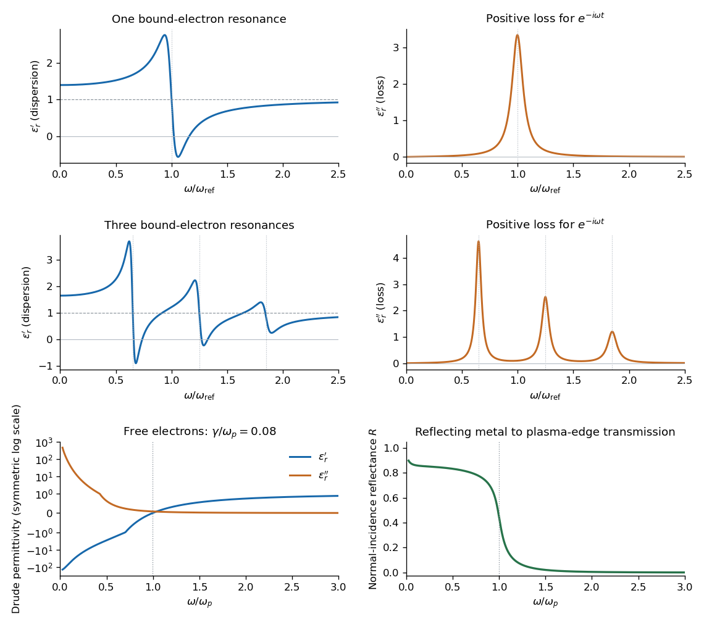

<h1 id="section-b/4/c/solution">Solution</h1>

↑ **Parent:** [C](../c.md)

Set $D=(\omega_0^2-\omega^2)^2+\gamma^2\omega^2$. The [real part](../../../../../real-part.md) and [imaginary part](../../../../../imaginary-part.md) of the [complex permittivity](../../../../../complex-permittivity.md) are

$$
\boxed{\epsilon_r'=1+\frac{\omega_p^2(\omega_0^2-\omega^2)}D,\qquad
\epsilon_r''=\frac{\omega_p^2\gamma\omega}D.}
$$

For positive frequency the loss part is nonnegative. The real part starts at $1+\omega_p^2/\omega_0^2$, rises below resonance, falls steeply through the resonance region, and approaches one from below at high frequency. The imaginary part is a positive absorption peak near $\omega_0$, tending to zero on both sides.

For a nonmagnetic medium write its [complex refractive index](../../../../../complex-refractive-index.md) as $N=n_r+i\kappa$, with $N^2=\epsilon_r$ and [optical extinction coefficient](../../../../../optical-extinction-coefficient.md) $\kappa$. In a transparent region with $\kappa\ll n_r$ and $\epsilon_r'>0$,

$$
\boxed{n_r\simeq\sqrt{\epsilon_r'},\qquad
\kappa\simeq\frac{\epsilon_r''}{2\sqrt{\epsilon_r'}},\qquad
\alpha_{\rm abs}=\frac{2\omega\kappa}{c}.}
$$

The real part controls [phase velocity](../../../../../phase-velocity.md) and [optical dispersion](../../../../../dispersion-optics.md); the loss part controls [wave absorption](../../../../../wave-absorption.md) and the cycle-averaged dissipated power density $\omega\epsilon_0\epsilon_r''|E_0|^2/2$. Weak damping gives a narrow line but does not make [wave absorption](../../../../../wave-absorption.md) weak at its centre. The transparent-medium approximation applies away from the line.

**[Figure 1](#section-b/4/c/image-single-resonance-multiple-resonance-and-free-electron-optical-responses). Single-resonance, multiple-resonance and free-electron optical responses**. Original dimensionless model plots. The first row shows one bound-electron resonance, the second shows three, and the third shows the Drude permittivity and its normal-incidence reflectance. Finite damping is retained; these are illustrative calculations, not material measurements.

## ↑ Ancestors (14)

1. [C](../c.md)
2. [4](../../4.md)
3. [Section B](../../../section-b.md)
4. [2022](../../../../2022-split.md)
5. [Past exam of the quantum condensed matter course of the University of Cambridge](../../../../split.md)
6. [Quantum Condensed Matter course of the University of Cambridge](../../../../../quantum-condensed-matter-course-of-the-university-of-cambridge.md)
7. [Physics course of the year 3 of the natural sciences course of the University of Cambridge](../../../../../physics-course-of-the-year-3-of-the-natural-sciences-course-of-the-university-of-cambridge.md)
8. [Year 3 of the natural sciences course of the University of Cambridge](../../../../../year-3-of-the-natural-sciences-course-of-the-university-of-cambridge.md)
9. [Year of the natural sciences course of the University of Cambridge](../../../../../year-of-the-natural-sciences-course-of-the-university-of-cambridge.md)
10. [Natural sciences course of the University of Cambridge](../../../../../natural-sciences-course-of-the-university-of-cambridge.md)
11. [Course of the University of Cambridge](../../../../../course-of-the-university-of-cambridge.md)
12. [University of Cambridge](../../../../../university-of-cambridge-split.md)
13. [List of universities](../../../../../list-of-universities.md)
14. [Codex Wiki](../../../../../split.md)
