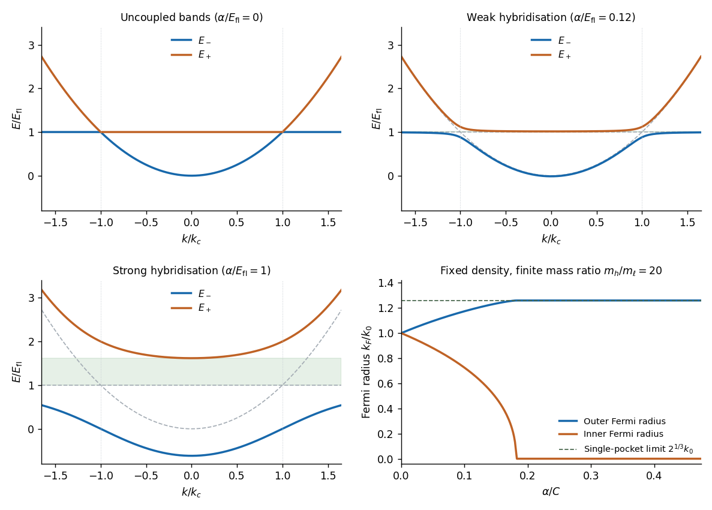

<h1 id="section-b/5/c/solution">Solution</h1>

↑ **Parent:** [C](../c.md)

Write the dispersive band as $E_p=Ak^2$ with $A>0$ and define $k_c=\sqrt{E_{\rm fl}/A}$. The uncoupled sketch is an upward-opening parabola and a horizontal [flat band](../../../../../flat-band.md) at positive energy. They cross on the sphere $k=k_c$ in three dimensions, or at $\pm k_c$ in a one-dimensional cut:

$$
\boxed{E_p(k_c)=E_{\rm fl},\qquad \alpha=0.}
$$

Without mixing the crossing is allowed. The left panel of the figure shows this case.

**[Figure 2](#section-b/5/c/image-avoided-crossings-and-fermi-volume-redistribution-in-a-two-band-model). Avoided crossings and Fermi-volume redistribution in a two-band model**. Original model calculations. The first three panels use an exactly flat second band and show zero, weak and strong hybridisation in units of its energy. The fourth uses a finite heavy-band curvature and fixed total electron density; two Fermi radii separate before the inner pocket vanishes. It distinguishes the general two-surface result from the eventual single-surface limit.

For dimensional clarity $A=\hbar^2/(2m_\ell)$ in the usual [band effective mass](../../../../../band-effective-mass.md) convention. The printed product $m_p\hbar^2k^2$ is consistent only if $m_p$ is a curvature coefficient with inverse-mass units; it cannot simultaneously denote the effective mass itself. Using $A$ avoids relying on that notation.

## ↑ Ancestors (14)

1. [C](../c.md)
2. [5](../../5.md)
3. [Section B](../../../section-b.md)
4. [2022](../../../../2022-split.md)
5. [Past exam of the quantum condensed matter course of the University of Cambridge](../../../../split.md)
6. [Quantum Condensed Matter course of the University of Cambridge](../../../../../quantum-condensed-matter-course-of-the-university-of-cambridge.md)
7. [Physics course of the year 3 of the natural sciences course of the University of Cambridge](../../../../../physics-course-of-the-year-3-of-the-natural-sciences-course-of-the-university-of-cambridge.md)
8. [Year 3 of the natural sciences course of the University of Cambridge](../../../../../year-3-of-the-natural-sciences-course-of-the-university-of-cambridge.md)
9. [Year of the natural sciences course of the University of Cambridge](../../../../../year-of-the-natural-sciences-course-of-the-university-of-cambridge.md)
10. [Natural sciences course of the University of Cambridge](../../../../../natural-sciences-course-of-the-university-of-cambridge.md)
11. [Course of the University of Cambridge](../../../../../course-of-the-university-of-cambridge.md)
12. [University of Cambridge](../../../../../university-of-cambridge-split.md)
13. [List of universities](../../../../../list-of-universities.md)
14. [Codex Wiki](../../../../../split.md)
