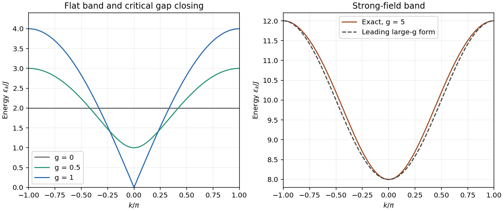

<h1 id="1/d/solution">Solution</h1>

↑ **Parent:** [D](../d.md)

Put $d_k=\sqrt{(g-\cos k)^2+\sin^2k}$. The matrix in the [Ising-chain Nambu spinor](../../../../../ising-chain-nambu-spinor.md) has eigenvalues $\pm d_k$. A canonical [Bogoliubov transformation](../../../../../bogoliubov-transformation.md), with paired angles satisfying $\cos\vartheta_k=(g-\cos k)/d_k$ and $\sin\vartheta_k=-\sin k/d_k$, diagonalizes it. Accounting for [full-zone fermionic Nambu energy counting](../../../../../full-zone-fermionic-nambu-energy-counting.md) gives

$$
\boxed{H=\sum_k\epsilon_k\left(\gamma_k^\dagger\gamma_k-\frac12\right),\qquad
\epsilon_k=2Jd_k.}
$$

Thus the bulk [Ising-chain ground-state energy](../../../../../ising-chain-ground-state-energy.md) is

$$
\boxed{E_0=-\frac12\sum_k\epsilon_k,\qquad
\frac{E_0}{N}\longrightarrow-\frac{J}{2\pi}\int_{-\pi}^{\pi}\sqrt{1+g^2-2g\cos k}\,dk.}
$$

Exact finite-chain states additionally obey their [fermion parity](../../../../../fermion-parity.md) sector.

The [Ising-chain quasiparticle dispersion](../../../../../ising-chain-quasiparticle-dispersion.md) has bulk gap $2J|1-g|$, closing at the [Ising-chain quantum critical point](../../../../../ising-chain-quantum-critical-point.md). Finite-system parity splittings and the bulk gap are distinct scales. The three requested limits are illustrated below.

**[Figure 1](#1/d/image-ising-quasiparticle-bands). Ising quasiparticle bands**. [Source](paper-1-qcm2012-ising-bands.py).

## ↑ Ancestors (14)

1. [D](../d.md)
2. [1](../../1.md)
3. [Paper 1](../../../paper-1-split.md)
4. [2012](../../../split.md)
5. [Past exam of the quantum Condensed Matter Field Theory course of the University of Cambridge](../../../../split.md)
6. [Quantum Condensed Matter Field Theory course of the University of Cambridge](../../../../../quantum-condensed-matter-field-theory-course-of-the-university-of-cambridge.md)
7. [Physics course of the year 4 of the natural sciences course of the University of Cambridge](../../../../../physics-course-of-the-year-4-of-the-natural-sciences-course-of-the-university-of-cambridge.md)
8. [Year 4 of the natural sciences course of the University of Cambridge](../../../../../year-4-of-the-natural-sciences-course-of-the-university-of-cambridge.md)
9. [Year of the natural sciences course of the University of Cambridge](../../../../../year-of-the-natural-sciences-course-of-the-university-of-cambridge.md)
10. [Natural sciences course of the University of Cambridge](../../../../../natural-sciences-course-of-the-university-of-cambridge.md)
11. [Course of the University of Cambridge](../../../../../course-of-the-university-of-cambridge.md)
12. [University of Cambridge](../../../../../university-of-cambridge-split.md)
13. [List of universities](../../../../../list-of-universities.md)
14. [Codex Wiki](../../../../../split.md)
