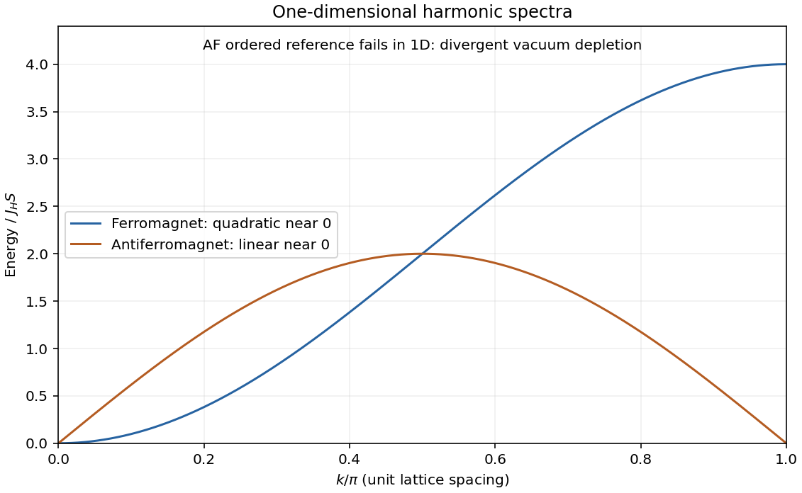

<h1 id="2/a/solution">Solution</h1>

↑ **Parent:** [A](../a.md)

Use dimensionless [spin](../../../../../spin.md) operators and nearest-neighbour exchange $J_H>0$ on a regular [bipartite graph](../../../../../bipartite-graph-split.md) with N sites and [coordination number of a lattice](../../../../../coordination-number-of-a-lattice.md) z. Count each bond once and define $\gamma_{\mathbf k}=z^{-1}\sum_\delta e^{i\mathbf k\cdot\delta}$, real for the inversion-symmetric examples considered here.

For the ferromagnetic [Heisenberg model](../../../../../heisenberg-model.md), $H_F=-J_H\sum_{\langle ij\rangle}\mathbf S_i\cdot\mathbf S_j$. Expanding the [Holstein–Primakoff transformation](../../../../../holstein-primakoff-transformation.md) about all spins along +z gives

$$
S_i^z=S-a_i^\dagger a_i,\qquad S_i^+\simeq\sqrt{2S}\,a_i,\qquad
H_F=E_{\rm cl}+J_HS\sum_{\langle ij\rangle}(a_i^\dagger-a_j^\dagger)(a_i-a_j),
$$

up to interactions of higher order in boson density, with $E_{\rm cl}=-NzJ_HS^2/2$. The [isotropic spin-wave vacuum energy comparison](../../../../../isotropic-spin-wave-vacuum-energy-comparison.md) starts with this normal ordering. The [linear spin-wave approximation](../../../../../linear-spin-wave-approximation.md) then gives

$$
\boxed{E_F(\mathbf k)=zJ_HS(1-\gamma_{\mathbf k}),\qquad
H_F=E_{\rm cl}+\sum_{\mathbf k}E_F(\mathbf k)a_{\mathbf k}^\dagger a_{\mathbf k}.}
$$

Each [ferromagnetic magnon](../../../../../ferromagnetic-magnon.md) lowers total $S^z$ by one. The fully aligned state is an exact eigenstate and ground state; there is no harmonic vacuum depletion or added zero-point energy in this normal-ordered Hamiltonian. The global spin-rotation multiplet remains degenerate. On a hypercubic lattice of spacing a, $z=2d$ and $\gamma_{\mathbf k}=d^{-1}\sum_j\cos k_ja$, so $E_F\simeq J_HSa^2k^2$. The exact one-magnon sector agrees with this result even at finite S; interactions enter for multiple magnons.

For the [Heisenberg antiferromagnet](../../../../../heisenberg-antiferromagnet.md), take $H_A=+J_H\sum_{\langle ij\rangle}\mathbf S_i\cdot\mathbf S_j$ and expand around a [Néel state](../../../../../neel-state.md). On A, $S^z=S-a^\dagger a$ and $S^+\simeq\sqrt{2S}a$; on B, $S^z=-S+b^\dagger b$ and $S^+\simeq\sqrt{2S}b^\dagger$. A bond becomes

$$
\mathbf S_i\cdot\mathbf S_j\simeq-S^2+S(a_i^\dagger a_i+b_j^\dagger b_j+a_ib_j+a_i^\dagger b_j^\dagger).
$$

With N/2 momenta in the magnetic [Brillouin zone](../../../../../brillouin-zone.md),

$$
H_A=E_{\rm cl}+zJ_HS\sum_{\mathbf k\in{\rm MBZ}}\left[a_{\mathbf k}^\dagger a_{\mathbf k}+b_{\mathbf k}^\dagger b_{\mathbf k}+\gamma_{\mathbf k}(a_{\mathbf k}b_{-\mathbf k}+a_{\mathbf k}^\dagger b_{-\mathbf k}^\dagger)\right].
$$

The bosonic [Bogoliubov transformation](../../../../../bogoliubov-transformation.md) has $u_k^2-v_k^2=1$ and $\tanh2\theta_k=\gamma_k$. For example $a_k=u_k\alpha_k-v_k\beta_{-k}^\dagger$ and $b_{-k}=u_k\beta_{-k}-v_k\alpha_k^\dagger$. It gives two branches in this reduced zone,

$$
\boxed{E_A(\mathbf k)=zJ_HS\sqrt{1-\gamma_{\mathbf k}^2},\quad
E_{A,0}=E_{\rm cl}+\sum_{{\rm MBZ}}[E_A(\mathbf k)-zJ_HS],\quad
v_k^2=\frac12\left[\frac1{\sqrt{1-\gamma_k^2}}-1\right].}
$$

The [reduced-zone counting of bipartite spin waves](../../../../../reduced-zone-counting-of-bipartite-spin-waves.md) gives N oscillators in total, not 2N. The negative vacuum correction and [quantum depletion of Néel order](../../../../../quantum-depletion-of-neel-order.md), $\delta S=(2/N)\sum_{{\rm MBZ}}v_k^2$, distinguish the antiferromagnet from the ferromagnet. At nonzero temperature replace $v_k^2$ by $v_k^2+(u_k^2+v_k^2)n_B(E_k)$. Hypercubic small-momentum modes have $E_A\simeq2J_HSa\sqrt d\,|k|$, hence linear physical frequency $E_A/\hbar$.

Self-consistency requires depletion much smaller than S and respects the [Holstein–Primakoff occupation constraint](../../../../../holstein-primakoff-occupation-constraint.md). In one dimension the antiferromagnetic vacuum depletion diverges logarithmically, invalidating ordered spin-wave theory; it does not alone prove an exact gap or its absence. At positive temperature, isotropic short-range models in d≤2 cannot sustain such magnetic order by the [Mermin-Wagner theorem](../../../../../mermin-wagner-theorem.md). In three dimensions the quadratic ferromagnetic modes give the low-temperature magnetization reduction proportional to $T^{3/2}$, whereas the antiferromagnetic thermal reduction scales as $T^2$. Anisotropy, fields, frustration and magnon interactions alter these conclusions. [§4.1, contrasting ferromagnetic and antiferromagnetic low-energy dynamics](../../../../../physics-215c-quantum-field-theory-part-3-by-john-mcgreevy.md)

**[Figure 2](#2/a/image-spin-wave-comparison). Spin-wave comparison**. [Source](paper-1-qcm2012-spin-waves.py).

## ↑ Ancestors (14)

1. [A](../a.md)
2. [2](../../2.md)
3. [Paper 1](../../../paper-1-split.md)
4. [2012](../../../split.md)
5. [Past exam of the quantum Condensed Matter Field Theory course of the University of Cambridge](../../../../split.md)
6. [Quantum Condensed Matter Field Theory course of the University of Cambridge](../../../../../quantum-condensed-matter-field-theory-course-of-the-university-of-cambridge.md)
7. [Physics course of the year 4 of the natural sciences course of the University of Cambridge](../../../../../physics-course-of-the-year-4-of-the-natural-sciences-course-of-the-university-of-cambridge.md)
8. [Year 4 of the natural sciences course of the University of Cambridge](../../../../../year-4-of-the-natural-sciences-course-of-the-university-of-cambridge.md)
9. [Year of the natural sciences course of the University of Cambridge](../../../../../year-of-the-natural-sciences-course-of-the-university-of-cambridge.md)
10. [Natural sciences course of the University of Cambridge](../../../../../natural-sciences-course-of-the-university-of-cambridge.md)
11. [Course of the University of Cambridge](../../../../../course-of-the-university-of-cambridge.md)
12. [University of Cambridge](../../../../../university-of-cambridge-split.md)
13. [List of universities](../../../../../list-of-universities.md)
14. [Codex Wiki](../../../../../split.md)
