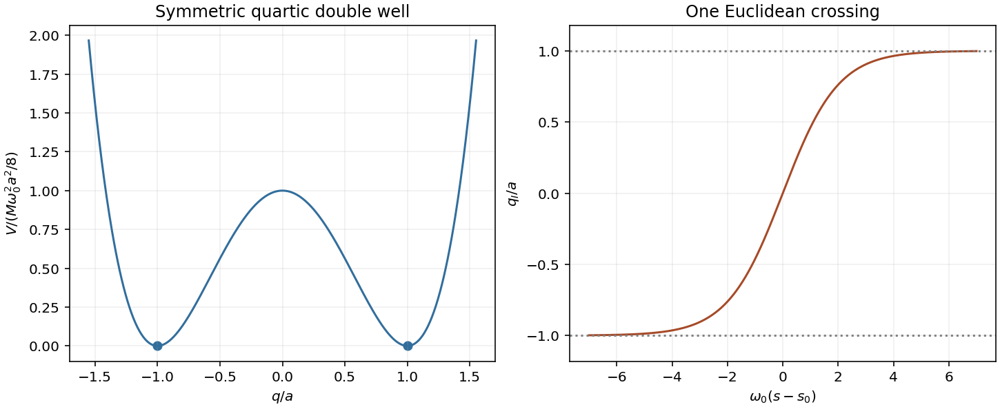

<h1 id="2/b/solution">Solution</h1>

↑ **Parent:** [B](../b.md)

Insert position resolutions between short-time evolution factors for $H=p^2/(2M)+V(q)$. Integrating the momenta gives the [path integral](../../../../../path-integral.md), with real-time slice factor $[M/(2\pi i\hbar\Delta t)]^{1/2}$ and weight $e^{iS[q]/\hbar}$. A real classical trajectory cannot pass through a barrier with insufficient energy, but the path integral includes nonclassical paths.

Continue $t=-is$, with s physical [imaginary time](../../../../../imaginary-time.md). The damped kernel is

$$
K_E(q_f,q_i;\mathcal T)=\langle q_f|e^{-H\mathcal T/\hbar}|q_i\rangle
=\int\mathcal Dq\,e^{-S_E[q]/\hbar},\qquad
S_E=\int_0^{\mathcal T}ds\left[\frac M2\dot q^2+V(q)\right].
$$

The [Euclidean action](../../../../../euclidean-action.md) saddle obeys $M\ddot q=V'(q)$: motion in the inverted potential. For degenerate minima at $\pm a$, subtract their common potential energy. A trajectory joining them with zero Euclidean energy satisfies

$$
\frac M2\dot q^2=V(q),\qquad
\boxed{S_I=\int_{-a}^{a}dq\,\sqrt{2MV(q)}.}
$$

It is an [instanton](../../../../../instanton.md); reversing its direction gives an [anti-instanton](../../../../../anti-instanton.md). Thus a crossing amplitude is nonperturbative, proportional to $e^{-S_I/\hbar}$. For the representative quartic well $V=M\omega_0^2(q^2-a^2)^2/(8a^2)$, direct integration gives

$$
q_I(s)=a\tanh\frac{\omega_0(s-s_0)}2,\qquad S_I=\frac23M\omega_0a^2.
$$

The arbitrary center $s_0$ is an [instanton translation zero mode](../../../../../instanton-translation-zero-mode.md). Expanding $q=q_I+\eta$ gives a [Gaussian path integral](../../../../../gaussian-path-integral.md) involving $L_I=-\partial_s^2+V''(q_I)/M$. Treating the zero mode as a collective coordinate rather than a zero Gaussian denominator produces the [instanton fluctuation prefactor](../../../../../instanton-fluctuation-prefactor.md)

$$
K=\sqrt{\frac{S_I}{2\pi\hbar}}\left[\frac{\det L_0}{\det' L_I}\right]^{1/2},\qquad
L_0=-\partial_s^2+\omega_0^2,\qquad \kappa=K e^{-S_I/\hbar}.
$$

Common endpoint regularization defines the [functional determinant](../../../../../functional-determinant.md) ratio; K and kappa have inverse-time units. The prime removes only the zero eigenvalue, while integrating the center supplies the total available time. Large $S_I/\hbar$ and $\kappa\ll\omega_0$ justify a [dilute instanton gas](../../../../../dilute-instanton-gas.md).

Multiple crossings alternate direction. Integrating n ordered centers gives $\mathcal T^n/n!$. Return paths contain even n, and transfer paths contain odd n, so their common local-well factor multiplies $\cosh(\kappa\mathcal T)$ and $\sinh(\kappa\mathcal T)$ respectively. The two lowest levels are consequently

$$
\boxed{E_\pm=E_{\rm well}\mp\hbar\kappa,\qquad
\Delta E=2\hbar K e^{-S_I/\hbar}.}
$$

The lower state is the even combination of the two localized states. Local anharmonic corrections modify $E_{\rm well}\simeq\hbar\omega_0/2$ and higher semiclassical corrections modify K. The [thermal trace as a closed Euclidean path integral](../../../../../thermal-trace-as-a-closed-euclidean-path-integral.md) gives $Z\simeq2e^{-\beta E_{\rm well}}\cosh(\beta\hbar\kappa)$ when higher local levels are negligible. This describes coherent level splitting in a stable well, not irreversible decay.

For a scattering barrier at energy E, the leading [WKB tunnelling exponent](../../../../../wkb-tunnelling-exponent.md) gives an amplitude $\exp[-\int_{q_1}^{q_2}\sqrt{2M(V-E)}\,dq/\hbar]$ and a transmission probability with twice that exponent. Endpoint matching fixes prefactors. Metastable escape instead uses a [Euclidean bounce](../../../../../euclidean-bounce.md), with a negative fluctuation mode and a decay rate. Neither its negative mode nor the probability/amplitude factor should be transplanted into the stable double-well splitting. [Chapter2, §§2.3.2–2.3.3, printedpp.56–60: quantum-mechanical tunnelling, fluctuation determinants and repeated instanton events](../../../../../gauge-theory-by-david-tong.md)

**[Figure 3](#2/b/image-double-well-instanton). Double-well instanton**. [Source](paper-1-qcm2012-instanton.py).

## ↑ Ancestors (14)

1. [B](../b.md)
2. [2](../../2.md)
3. [Paper 1](../../../paper-1-split.md)
4. [2012](../../../split.md)
5. [Past exam of the quantum Condensed Matter Field Theory course of the University of Cambridge](../../../../split.md)
6. [Quantum Condensed Matter Field Theory course of the University of Cambridge](../../../../../quantum-condensed-matter-field-theory-course-of-the-university-of-cambridge.md)
7. [Physics course of the year 4 of the natural sciences course of the University of Cambridge](../../../../../physics-course-of-the-year-4-of-the-natural-sciences-course-of-the-university-of-cambridge.md)
8. [Year 4 of the natural sciences course of the University of Cambridge](../../../../../year-4-of-the-natural-sciences-course-of-the-university-of-cambridge.md)
9. [Year of the natural sciences course of the University of Cambridge](../../../../../year-of-the-natural-sciences-course-of-the-university-of-cambridge.md)
10. [Natural sciences course of the University of Cambridge](../../../../../natural-sciences-course-of-the-university-of-cambridge.md)
11. [Course of the University of Cambridge](../../../../../course-of-the-university-of-cambridge.md)
12. [University of Cambridge](../../../../../university-of-cambridge-split.md)
13. [List of universities](../../../../../list-of-universities.md)
14. [Codex Wiki](../../../../../split.md)
