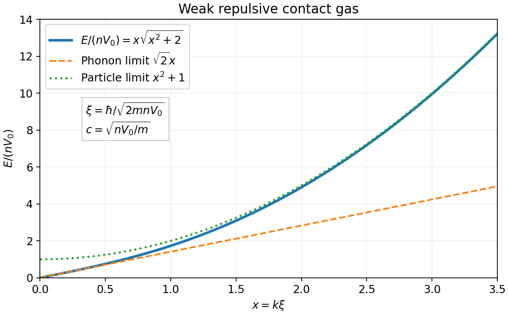

<h1 id="1/b/solution">Solution</h1>

↑ **Parent:** [B](../b.md)

For each opposite-[momentum](../../../../../momentum-split.md) pair use the [Bogoliubov transformation](../../../../../bogoliubov-transformation.md)

$$
b_{\mathbf k}=u_k\alpha_{\mathbf k}-v_k\alpha^\dagger_{-\mathbf k},\qquad
u_k^2-v_k^2=1,\qquad u_k^2+v_k^2=\frac{A_k}{E_k},\qquad 2u_kv_k=\frac{B_k}{E_k}.
$$

Equivalently $u_k=\cosh\theta_k$, $v_k=\sinh\theta_k$, with $\tanh(2\theta_k)=B_k/A_k$. The identity $u_k^2-v_k^2=1$ preserves the [canonical commutation relation](../../../../../canonical-commutation-relation.md). Vanishing anomalous terms require $B_k(u_k^2+v_k^2)-2A_ku_kv_k=0$, and hence the [Bogoliubov quasiparticle dispersion](../../../../../bogoliubov-quasiparticle-dispersion.md) is

$$
\boxed{E_k=\sqrt{A_k^2-B_k^2}=\sqrt{\epsilon_k(\epsilon_k+2nV_k)}.}
$$

Substitution and [normal ordering](../../../../../normal-ordering.md) give

$$
\boxed{H_2=E_{\rm mf}+\frac12\sum_{\mathbf k\ne0}(E_k-A_k)+\sum_{\mathbf k\ne0}E_k\alpha^\dagger_{\mathbf k}\alpha_{\mathbf k}.}
$$

This is the requested form after putting each $E_k/2$ inside the oscillator term. By [momentum-pair counting in bosonic diagonalization](../../../../../momentum-pair-counting-in-bosonic-diagonalization.md), all sums cover the full nonzero-[momentum](../../../../../momentum-split.md) set; no further factor of two is needed. The [bosonic Bogoliubov zero-point shift](../../../../../bosonic-bogoliubov-zero-point-shift.md) combines the two vacuum sums before taking a continuum limit.

If $V_k\to V_0>0$ smoothly, the low-energy excitations are gapless [phonons](../../../../../phonon.md):

$$
\boxed{E_k\simeq\hbar c|k|,\qquad c=\sqrt{nV_0/m}.}
$$

For contact repulsion, the [healing length](../../../../../healing-length.md) $\xi=\hbar/\sqrt{2mnV_0}$ separates this regime from the particle-like regime $E_k\simeq\epsilon_k+nV_0$. Stability requires $\epsilon_k+2nV_k>0$ for every nonzero mode. A general momentum-dependent interaction need not share the contact model's entire curve. An unregularized contact model also makes the vacuum-energy shift ultraviolet divergent; a physical finite-range interaction or scattering-length renormalization is needed for that absolute [ground-state energy](../../../../../ground-state-energy.md).

**[Figure 1](#1/b/image-contact-repulsion-bogoliubov-dispersion-crosses-from-sound-to-particle-like-excitations). Contact-repulsion Bogoliubov dispersion crosses from sound to particle-like excitations**. [Source](paper-1-qcm2013-bogoliubov-dispersion.py).

## ↑ Ancestors (14)

1. [B](../b.md)
2. [1](../../1.md)
3. [Paper 1](../../../paper-1-split.md)
4. [2013](../../../split.md)
5. [Past exam of the quantum Condensed Matter Field Theory course of the University of Cambridge](../../../../split.md)
6. [Quantum Condensed Matter Field Theory course of the University of Cambridge](../../../../../quantum-condensed-matter-field-theory-course-of-the-university-of-cambridge.md)
7. [Physics course of the year 4 of the natural sciences course of the University of Cambridge](../../../../../physics-course-of-the-year-4-of-the-natural-sciences-course-of-the-university-of-cambridge.md)
8. [Year 4 of the natural sciences course of the University of Cambridge](../../../../../year-4-of-the-natural-sciences-course-of-the-university-of-cambridge.md)
9. [Year of the natural sciences course of the University of Cambridge](../../../../../year-of-the-natural-sciences-course-of-the-university-of-cambridge.md)
10. [Natural sciences course of the University of Cambridge](../../../../../natural-sciences-course-of-the-university-of-cambridge.md)
11. [Course of the University of Cambridge](../../../../../course-of-the-university-of-cambridge.md)
12. [University of Cambridge](../../../../../university-of-cambridge-split.md)
13. [List of universities](../../../../../list-of-universities.md)
14. [Codex Wiki](../../../../../split.md)
