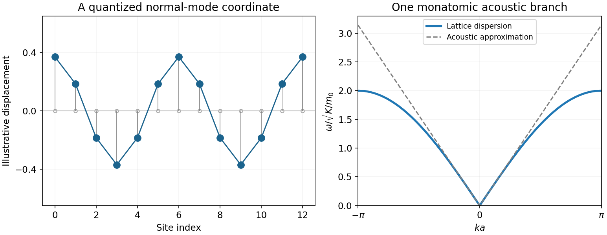

<h1 id="2/a/solution">Solution</h1>

↑ **Parent:** [A](../a.md)

A periodic [harmonic chain](../../../../../harmonic-chain.md) with $N$ masses $m_0$, spacing $a$ and nearest-neighbour spring constant $K$ has

$$
H=\sum_{j=0}^{N-1}\left[\frac{p_j^2}{2m_0}+\frac K2(u_{j+1}-u_j)^2\right],\qquad u_N=u_0.
$$

Hamilton's equations give $m_0\ddot u_j=K(u_{j+1}+u_{j-1}-2u_j)$. The [discrete Fourier transform](../../../../../discrete-fourier-transform-split.md) $u_j=N^{-1/2}\sum_k Q_ke^{ikja}$, $p_j=N^{-1/2}\sum_k P_ke^{ikja}$, with $k=2\pi l/(Na)$ in one [Brillouin zone](../../../../../brillouin-zone.md), diagonalizes the quadratic form:

$$
\boxed{\omega_k=2\sqrt{K/m_0}\,|\sin(ka/2)|,\qquad H=\sum_k\left[\frac{P_kP_{-k}}{2m_0}+\frac{m_0\omega_k^2}{2}Q_kQ_{-k}\right].}
$$

The [harmonic-chain normal-mode reality condition](../../../../../harmonic-chain-normal-mode-reality-condition.md) means $Q_k^\dagger=Q_{-k}$, not that $Q_k$ and $Q_{-k}$ are independent real coordinates. For [canonical quantization](../../../../../canonical-quantization.md), impose $[u_j,p_l]=i\hbar\delta_{jl}$, equivalently $[Q_k,P_{k'}]=i\hbar\delta_{k,-k'}$. For $k\ne0$ set

$$
Q_k=\sqrt{\frac{\hbar}{2m_0\omega_k}}(a_k+a^\dagger_{-k}),\quad
P_k=-i\sqrt{\frac{m_0\hbar\omega_k}{2}}(a_k-a^\dagger_{-k}),\quad
[a_k,a^\dagger_{k'}]=\delta_{kk'}.
$$

Then the [quantum harmonic chain](../../../../../quantum-harmonic-chain.md) is a set of independent [phonon](../../../../../phonon.md) oscillators:

$$
\boxed{H=\frac{P_{\rm tot}^2}{2Nm_0}+\sum_{k\ne0}\hbar\omega_k(a_k^\dagger a_k+1/2).}
$$

The [centre-of-mass zero mode of a harmonic chain](../../../../../centre-of-mass-zero-mode-of-a-harmonic-chain.md) is the free coordinate $X=N^{-1}\sum_ju_j$, with $[X,P_{\rm tot}]=i\hbar$; it cannot be normalized by dividing by $\sqrt{\omega_0}$. Retaining it gives

$$
u_j=X+\frac1{\sqrt N}\sum_{k\ne0}\sqrt{\frac{\hbar}{2m_0\omega_k}}(a_ke^{ikja}+a_k^\dagger e^{-ikja}),
$$

with the corresponding momentum expansion and uniform term $P_{\rm tot}/N$. The nonzero modes alone give the site [commutator](../../../../../commutator.md) $i\hbar(\delta_{jl}-1/N)$; the uniform term supplies the missing $1/N$. Each oscillator occupation is a nonnegative integer, and adding one [phonon](../../../../../phonon.md) costs $\hbar\omega_k$ and crystal [momentum](../../../../../momentum-split.md) $\hbar k$ modulo a reciprocal-lattice vector. [§4.1.1, printed pp.103–105, monatomic-chain normal modes and quantization](../../../../../applications-of-quantum-mechanics-by-david-tong.md)

In the [continuum limit of a harmonic chain](../../../../../continuum-limit-of-a-harmonic-chain.md), $\rho=m_0/a$, $Y=Ka$ and

$$
L=\frac12\int dx\,[\rho\dot u^2-Y(\partial_xu)^2],\qquad
\Pi=\rho\dot u,\quad [u(x),\Pi(x')]=i\hbar\delta(x-x'),\qquad
\boxed{c=\sqrt{Y/\rho}=a\sqrt{K/m_0}.}
$$

The [wave equation](../../../../../wave-equation-split.md) and linear low-$k$ [dispersion relation](../../../../../dispersion-relation-split.md) follow. The lattice gives an ultraviolet cutoff; the acoustic approximation does not reproduce the zone-edge flattening.

With the centre of mass fixed, the oscillator [partition function](../../../../../canonical-partition-function.md) and [Bose-Einstein distribution](../../../../../bose-einstein-distribution.md) are

$$
Z_{\rm osc}=\prod_{k\ne0}\frac1{2\sinh(\beta\hbar\omega_k/2)},\qquad
\langle a_k^\dagger a_k\rangle=\frac1{e^{\beta\hbar\omega_k}-1}.
$$

For a long chain, above its finite-size level spacing and below the zone-edge scale, integrating the two acoustic propagation directions gives $C/(Na)=\pi k_{\rm B}^2T/(3\hbar c)$. At high [temperature](../../../../../temperature-split.md) each retained oscillator instead contributes $k_{\rm B}$ to the [heat capacity](../../../../../heat-capacity.md).

**[Figure 2](#2/a/image-original-monatomic-chain-mode-sketch-and-its-acoustic-lattice-dispersion). Original monatomic-chain mode sketch and its acoustic lattice dispersion**. [Source](paper-1-qcm2013-harmonic-chain.py).

## ↑ Ancestors (14)

1. [A](../a.md)
2. [2](../../2.md)
3. [Paper 1](../../../paper-1-split.md)
4. [2013](../../../split.md)
5. [Past exam of the quantum Condensed Matter Field Theory course of the University of Cambridge](../../../../split.md)
6. [Quantum Condensed Matter Field Theory course of the University of Cambridge](../../../../../quantum-condensed-matter-field-theory-course-of-the-university-of-cambridge.md)
7. [Physics course of the year 4 of the natural sciences course of the University of Cambridge](../../../../../physics-course-of-the-year-4-of-the-natural-sciences-course-of-the-university-of-cambridge.md)
8. [Year 4 of the natural sciences course of the University of Cambridge](../../../../../year-4-of-the-natural-sciences-course-of-the-university-of-cambridge.md)
9. [Year of the natural sciences course of the University of Cambridge](../../../../../year-of-the-natural-sciences-course-of-the-university-of-cambridge.md)
10. [Natural sciences course of the University of Cambridge](../../../../../natural-sciences-course-of-the-university-of-cambridge.md)
11. [Course of the University of Cambridge](../../../../../course-of-the-university-of-cambridge.md)
12. [University of Cambridge](../../../../../university-of-cambridge-split.md)
13. [List of universities](../../../../../list-of-universities.md)
14. [Codex Wiki](../../../../../split.md)
