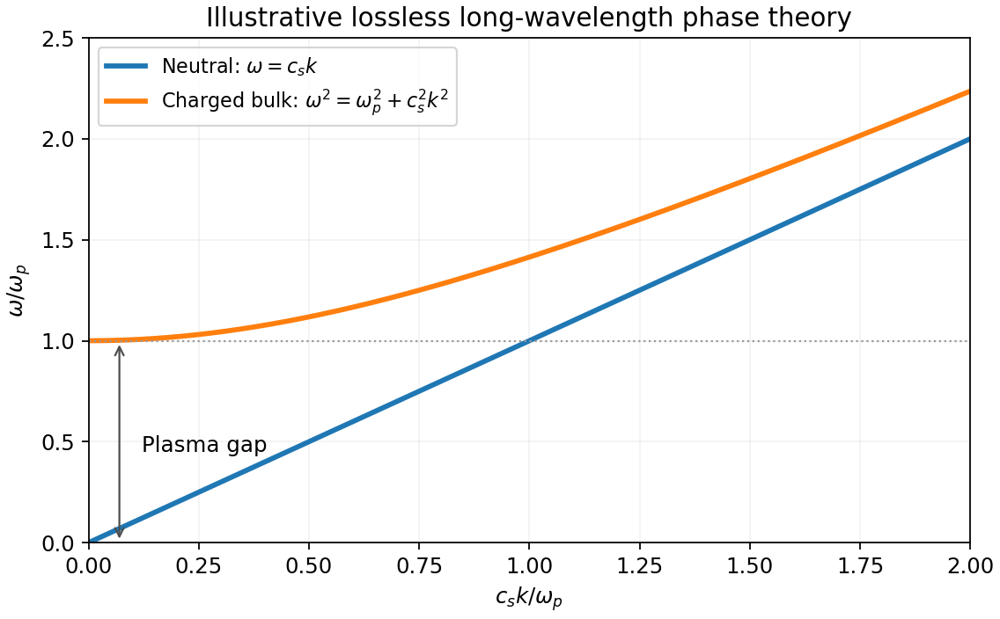

<h1 id="2/c/solution">Solution</h1>

↑ **Parent:** [C](../c.md)

For conventional [superconductivity](../../../../../superconductivity-split.md), an attractive interaction pairs opposite-spin [fermions](../../../../../fermion.md). A complex pairing [Hubbard–Stratonovich transformation](../../../../../hubbard-stratonovich-transformation.md) introduces a [Cooper pair](../../../../../cooper-pair.md) field $\Delta$. The fermionic fields then appear quadratically, giving the [pair-field effective action of a superconductor](../../../../../pair-field-effective-action-of-a-superconductor.md)

$$
S_{\rm eff}[\Delta,A]=\int\frac{|\Delta|^2}{g}-\operatorname{Tr}\ln G^{-1}[\Delta,A]+S_{\rm EM},\qquad g>0.
$$

The trace convention counts each independent spin-pair block once. The uniform saddle is the [BCS gap equation](../../../../../bcs-gap-equation.md); the fermionic excitations have $E_k=\sqrt{\xi_k^2+|\Delta|^2}$ in the fully gapped case. A slow-field expansion near the transition yields [Ginzburg-Landau theory of superconductivity](../../../../../ginzburg-landau-theory-of-superconductivity.md). Normalize its pair field $\Psi$ so $|\Psi|^2$ is an effective pair density, with pair mass $m_*$ and signed charge $q=-2e$:

$$
F=\int d^3x\left[a|\Psi|^2+\frac b2|\Psi|^4+\frac1{2m_*}|(-i\hbar\nabla-q\mathbf A)\Psi|^2+\frac{\mathbf B^2}{2\mu_0}\right],\qquad b>0.
$$

For $a<0$, the uniform minimum has $\rho_0=|\Psi|^2=-a/b$, with arbitrary constant phase. Writing $\Psi=(\sqrt{\rho_0}+h)e^{i\theta}$ separates the [amplitude mode](../../../../../higgs-mode.md) $h$ from the phase. The local potential has curvature term $2|a|h^2$ and coherence scale $\xi=\hbar/\sqrt{2m_*|a|}$. A neutral condensate has a gapless phase [Goldstone mode](../../../../../goldstone-boson.md) when suitable dynamics is included.

The charged theory is invariant under

$$
\theta\mapsto\theta+q\chi/\hbar,\quad\mathbf A\mapsto\mathbf A+\nabla\chi,\quad\phi\mapsto\phi-\partial_t\chi.
$$

The [gauge-invariant condensate momentum](../../../../../gauge-invariant-condensate-momentum.md) is $\hbar\nabla\theta-q\mathbf A$. Only $\hbar\nabla\theta-q\mathbf A$ and $\hbar\dot\theta+q\phi$ enter physical phase dynamics. At nearly constant amplitude, varying $F$ gives

$$
\boxed{\mathbf j=\frac{q\rho_0}{m_*}(\hbar\nabla\theta-q\mathbf A),\qquad
\lambda^{-2}=\frac{\mu_0q^2\rho_0}{m_*}.}
$$

For a smooth phase, taking the curl and using [Ampère's law](../../../../../ampere-s-circuital-law.md) gives $\nabla^2\mathbf B=\mathbf B/\lambda^2$: the [Meissner effect](../../../../../meissner-effect.md) screens a static bulk [magnetic field](../../../../../magnetic-field-split.md) over the [London penetration depth](../../../../../london-penetration-depth.md) $\lambda$. In a gauge with $\theta=0$, the phase stiffness is a quadratic term in $\mathbf A$, the superconducting version of the [Higgs mechanism](../../../../../higgs-mechanism.md).

To identify the dynamical mode, a simple lossless long-wave [superconducting phase-density action](../../../../../superconducting-phase-density-action.md) is

$$
\mathcal L=\frac{\chi_p}{2}(\hbar\dot\theta+q\phi)^2-\frac{\rho_0}{2m_*}(\hbar\nabla\theta-q\mathbf A)^2+\frac{\epsilon_0\mathbf E^2}{2}-\frac{\mathbf B^2}{2\mu_0},\qquad \chi_p>0.
$$

Here $\chi_p$ is the pair compressibility coefficient. Eliminating the longitudinal electric potential gives

$$
\boxed{\omega^2=\omega_p^2+c_s^2k^2,\qquad \omega_p^2=\frac{q^2\rho_0}{\epsilon_0m_*},\qquad c_s^2=\frac{\rho_0}{m_*\chi_p}.}
$$

Thus the neutral sound mode becomes a gapped longitudinal [plasma oscillation](../../../../../plasma-oscillation.md); transverse electromagnetic waves acquire $\omega^2=c_{\rm vac}^2k^2+c_{\rm vac}^2/\lambda^2$ in this simple bulk model. This redistribution of the phase degree of freedom into electromagnetic collective modes is the [Anderson-Higgs mechanism in a superconductor](../../../../../anderson-higgs-mechanism-in-a-superconductor.md). Local [gauge symmetry](../../../../../gauge-invariance.md) is a redundancy, not an independently observable symmetry whose breaking creates another massless particle. [§2.3, superconductors, superfluids and gauged phase dynamics](../../../../../physics-215c-quantum-field-theory-part-3-by-john-mcgreevy.md)

The static functional alone does not determine a frequency or damping rate. The displayed mode dispersions require the added dynamical assumptions; real screening, normal carriers, boundaries and dissipation modify them. The amplitude fluctuation is distinct from the phase mode and is not removed by the gauge choice.

**[Figure 3](#2/c/image-illustrative-long-wave-phase-modes-neutral-sound-and-the-charged-condensate-plasma-gap). Illustrative long-wave phase modes: neutral sound and the charged condensate plasma gap**. [Source](paper-1-qcm2013-phase-modes.py).

## ↑ Ancestors (14)

1. [C](../c.md)
2. [2](../../2.md)
3. [Paper 1](../../../paper-1-split.md)
4. [2013](../../../split.md)
5. [Past exam of the quantum Condensed Matter Field Theory course of the University of Cambridge](../../../../split.md)
6. [Quantum Condensed Matter Field Theory course of the University of Cambridge](../../../../../quantum-condensed-matter-field-theory-course-of-the-university-of-cambridge.md)
7. [Physics course of the year 4 of the natural sciences course of the University of Cambridge](../../../../../physics-course-of-the-year-4-of-the-natural-sciences-course-of-the-university-of-cambridge.md)
8. [Year 4 of the natural sciences course of the University of Cambridge](../../../../../year-4-of-the-natural-sciences-course-of-the-university-of-cambridge.md)
9. [Year of the natural sciences course of the University of Cambridge](../../../../../year-of-the-natural-sciences-course-of-the-university-of-cambridge.md)
10. [Natural sciences course of the University of Cambridge](../../../../../natural-sciences-course-of-the-university-of-cambridge.md)
11. [Course of the University of Cambridge](../../../../../course-of-the-university-of-cambridge.md)
12. [University of Cambridge](../../../../../university-of-cambridge-split.md)
13. [List of universities](../../../../../list-of-universities.md)
14. [Codex Wiki](../../../../../split.md)
