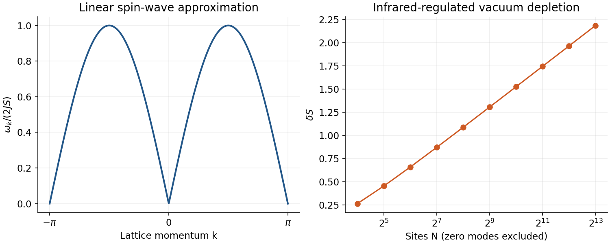
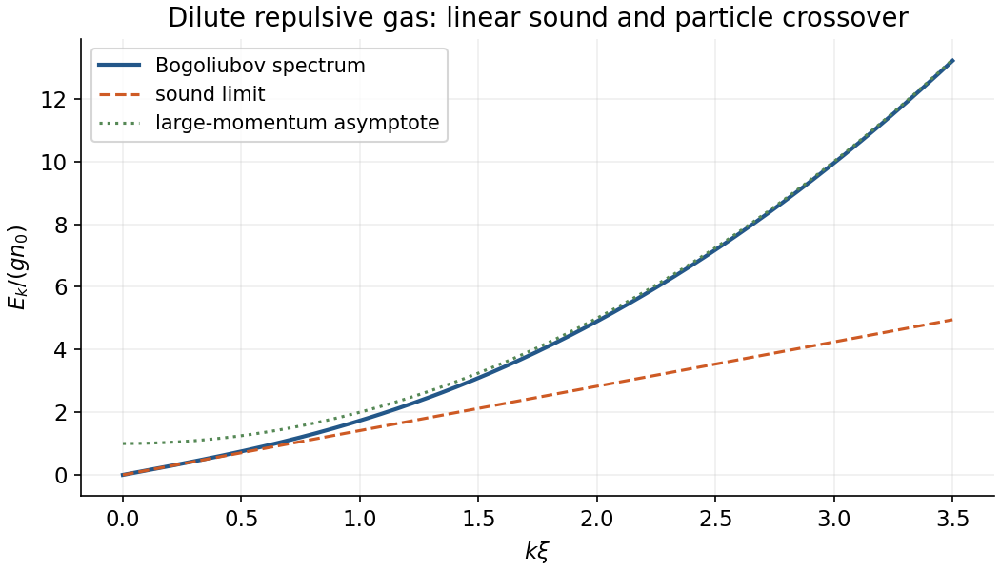

# Paper 1

↑ **Parent:** [2014](../2014.md)

[Original examination PDF, physical pages 651–653](https://www.whatdotheyknow.com/request/natural_science_tripos_physics_e_2/response/2340776/attach/2/FOI%202023%20399%20Zahid%20materials.pdf?cookie_passthrough=1#page=651)

**Table of contents**

- [1](#1)
  - [Solution](#1/solution)
  - [a](#1/a)
    - [Solution](#1/a/solution)
  - [b](#1/b)
    - [Solution](#1/b/solution)
  - [c](#1/c)
    - [Solution](#1/c/solution)
  - [d](#1/d)
    - [Solution](#1/d/solution)
  - [e](#1/e)
    - [Solution](#1/e/solution)
- [2](#2)
  - [Solution](#2/solution)
  - [a](#2/a)
    - [Solution](#2/a/solution)
  - [b](#2/b)
    - [Solution](#2/b/solution)
  - [c](#2/c)
    - [Solution](#2/c/solution)
  - [d](#2/d)
    - [Solution](#2/d/solution)
- [3](#3)
  - [a](#3/a)
    - [Solution](#3/a/solution)
  - [b](#3/b)
    - [Solution](#3/b/solution)
  - [c](#3/c)
    - [Solution](#3/c/solution)

## 1

↑ **Parent:** [Paper 1](paper-1.md)

<h3 id="1/solution">Solution</h3>

↑ **Parent:** [1](#1)

Use the [Holstein–Primakoff transformation](../../angular-momentum-operator.md#holstein-primakoff-transformation) only on the physical occupation sector $0\le n\le2S$, with $n=a^\dagger a$ and $S^-=a^\dagger\sqrt{2S-n}$. Acting on number states gives

$$
S^+|n\rangle=\sqrt{n(2S-n+1)}|n-1\rangle,\quad S^-|n\rangle=\sqrt{(n+1)(2S-n)}|n+1\rangle.
$$

Consequently $S^+S^-=(n+1)(2S-n)$ and $S^-S^+=n(2S-n+1)$, so

$$
\boxed{[S^+,S^-]=2(S-n)=2S^z,\qquad[S^z,S^\pm]=\pm S^\pm.}
$$

The endpoint factors keep the spin operators inside the physical sector. The square-root ordering matters; replacing it by an unrestricted linear oscillator would not give the exact finite-spin algebra.

<h3 id="1/a">a</h3>

↑ **Parent:** [1](#1)

<h4 id="1/a/solution">Solution</h4>

↑ **Parent:** [A](#1/a)

For the even periodic chain, every classical [Néel state](../../statistical-physics.md#neel-state) $\mathbf S_m=(-1)^mS\mathbf n$ has energy $-JNS^2$, with arbitrary unit vector $\mathbf n$. Thus there is a **continuous sphere of classical orientations**, not merely two Ising-like states. Opposite staggered directions are connected by a global spin rotation.

A quantum Néel product is not an eigenstate: transverse exchange flips opposite neighbouring spins. The ground state therefore contains quantum superpositions and zero-point [spin waves](../../critical-phenomenon.md#spin-wave), reducing the classical staggered moment. A finite isotropic balanced chain has a symmetry-invariant ground state; a symmetry-broken reference is an approximation for analysing fluctuations, not its exact finite-system eigenstate.

<h3 id="1/b">b</h3>

↑ **Parent:** [1](#1)

<h4 id="1/b/solution">Solution</h4>

↑ **Parent:** [B](#1/b)

Rotate alternate sites by $\pi$ about a transverse axis so all local reference spins point up. Choosing the transverse axes to give positive anomalous coupling, the [linear spin-wave approximation](../../critical-phenomenon.md#linear-spin-wave-approximation) yields

$$
H=-JNS^2+JS\sum_m[2a_m^\dagger a_m+a_ma_{m+1}+a_m^\dagger a_{m+1}^\dagger]+O(S^0).
$$

Use lattice spacing one and $a_m=N^{-1/2}\sum_ke^{ikm}a_k$, with **all $N$ momenta** $k=2\pi j/N$, $j=-N/2,\ldots,N/2-1$, in $[-\pi,\pi)$. Then $\gamma_k=\cos k$ and

$$
H=-JNS^2+JS\sum_k[2a_k^\dagger a_k+\gamma_k(a_ka_{-k}+a_k^\dagger a_{-k}^\dagger)].
$$

Reordering $a_{-k}a_{-k}^\dagger=a_{-k}^\dagger a_{-k}+1$ gives the requested Nambu form with constant $-JNS(S+1)$. Its extra $JSN$ restores $-JNS^2$ before diagonalization. This full-zone convention has no additional sublattice or half-zone factor.

<h3 id="1/c">c</h3>

↑ **Parent:** [1](#1)

<h4 id="1/c/solution">Solution</h4>

↑ **Parent:** [C](#1/c)

For real even $\theta_k$, the [Bogoliubov transformation](../../quantum-field-theory.md#bogoliubov-transformation) gives

$$
[\alpha_k,\alpha_q^\dagger]=(\cosh^2\theta_k-\sinh^2\theta_k)\delta_{kq}=\delta_{kq},\qquad[\alpha_k,\alpha_q]=0.
$$

Equivalently, its Nambu matrix obeys **$T_k\sigma_zT_k^\dagger=\sigma_z$**. The bosonic canonical metric is preserved; $T$ need not be unitary in the ordinary positive-definite metric.

<h3 id="1/d">d</h3>

↑ **Parent:** [1](#1)

<h4 id="1/d/solution">Solution</h4>

↑ **Parent:** [D](#1/d)

The inverse transformation has negative off-diagonal entries. Choosing $\tanh2\theta_k=\gamma_k$ removes anomalous terms and gives

$$
\boxed{\omega_k=2JS\sqrt{1-\gamma_k^2}=2JS|\sin k|,\qquad H=-JNS(S+1)+\sum_k\omega_k(\alpha_k^\dagger\alpha_k+1/2)+O(S^0).}
$$

There are gapless points at $k=0$ and the zone boundary; near zero, $\omega_k\simeq2JS|k|$, a linear [antiferromagnetic spin wave](../../statistical-physics.md#antiferromagnetic-spin-wave) with velocity $2JS$ in the stated units. The zero modes are collective rotations: their divergent squeezing cannot be treated as ordinary normalized independent oscillator vacua. A finite-size cutoff or infinitesimal symmetry-breaking field regulates them.

As a constant-term check, the continuum spin-wave vacuum energy per site is $-JS(S+1)+(2/\pi)JS$. This is a spin-wave prediction, not an exact spectrum for every finite-$S$ one-dimensional chain.

**[Figure 1](#1/d/image-linear-antiferromagnetic-spin-wave-dispersion-and-logarithmically-growing-one-dimensional-vacuum-depletion). Linear antiferromagnetic spin-wave dispersion and logarithmically growing one-dimensional vacuum depletion**. [Source](paper-1-qcm2014-spin-waves.py).

<h3 id="1/e">e</h3>

↑ **Parent:** [1](#1)

<h4 id="1/e/solution">Solution</h4>

↑ **Parent:** [E](#1/e)

Choose the reference staggered direction so its classical moment is positive. The Bogoliubov vacuum has $\langle a_k^\dagger a_k\rangle=\sinh^2\theta_k$, hence

$$
\frac{M_s}{N}=S-\delta S,\qquad\boxed{\delta S=\frac1{2N}\sum_k\left[\frac1{\sqrt{1-\gamma_k^2}}-1\right].}
$$

Near each soft point the integrand is proportional to $1/|k|$, so the one-dimensional thermodynamic integral diverges logarithmically. **The ordered-reference expansion fails; it does not predict a physical negative magnetization.** Long-range Néel order is destroyed in this isotropic one-dimensional setting. The exact finite symmetric ground state also has zero staggered expectation without selecting a direction.

For linearly dispersing modes in $d$ dimensions, zero-temperature depletion behaves as $\int_0dk\,k^{d-2}$ and is infrared finite for $d>1$, allowing order in suitable two- and three-dimensional antiferromagnets. Finite depletion is not a guarantee for every frustrated quantum magnet. At nonzero temperature, the extra Bose occupation changes the singularity to $\int dk\,k^{d-3}$: short-range isotropic systems cannot sustain continuous-symmetry long-range order for $d\le2$. This thermal conclusion is distinct from the one-dimensional zero-point argument.

## 2

↑ **Parent:** [Paper 1](paper-1.md)

<h3 id="2/solution">Solution</h3>

↑ **Parent:** [2](#2)

A [Wick rotation](../../perturbative-quantum-field-theory.md#wick-rotation) $t=-i\tau_E$ changes real-time evolution into $e^{-H\tau_E/\hbar}$. At $\tau_E=\beta\hbar$, taking the trace integrates equal endpoints:

$$
\boxed{Z=\int dq\,K_E(q,q;\beta\hbar)=\int_{q(0)=q(\beta\hbar)}\mathcal Dq\,e^{-S_E[q]/\hbar},\quad S_E=\int_0^{\beta\hbar}\left[\frac m2\dot q^2+V(q)\right]d\tau_E.}
$$

Thus temperature sets the imaginary-time circumference, and bosonic coordinate paths are periodic. The measure is fixed by the short-time propagator. The trace sums paths, not just a single stationary trajectory; a quadratic action is special because the saddle plus Gaussian fluctuations is exact.

<h3 id="2/a">a</h3>

↑ **Parent:** [2](#2)

<h4 id="2/a/solution">Solution</h4>

↑ **Parent:** [A](#2/a)

Put $\mathcal T=\beta\hbar$ and $x=\omega\mathcal T$. With equal endpoints $q$, the Euclidean classical path and its action are

$$
q_{\rm cl}(\tau_E)=q\frac{\cosh[\omega(\tau_E-\mathcal T/2)]}{\cosh(x/2)},\qquad S_{\rm cl}=m\omega q^2\tanh(x/2).
$$

Write $q(\tau_E)=q_{\rm cl}+\eta$, where $\eta(0)=\eta(\mathcal T)=0$. Sine modes have fluctuation eigenvalues $(n\pi/\mathcal T)^2+\omega^2$. Relative to the free-particle determinant, their Gaussian integral contributes

$$
\prod_{n=1}^\infty\left[1+\left(\frac{x}{n\pi}\right)^2\right]^{-1/2}=\sqrt{\frac{x}{\sinh x}}.
$$

Multiplying the free prefactor $\sqrt{m/(2\pi\hbar\mathcal T)}$ gives the [Euclidean oscillator diagonal kernel](../../quantum-harmonic-oscillator.md#euclidean-oscillator-diagonal-kernel)

$$
\boxed{K_E(q,q;\beta\hbar)=\sqrt{\frac{m\omega}{2\pi\hbar\sinh x}}\exp\!\left[-\frac{m\omega q^2}{\hbar}\tanh(x/2)\right].}
$$

Integrating this over the common endpoint is precisely the trace. All fluctuations here are Dirichlet fluctuations about a fixed-endpoint path; periodicity is imposed on the full trace after endpoint integration.

<h3 id="2/b">b</h3>

↑ **Parent:** [2](#2)

<h4 id="2/b/solution">Solution</h4>

↑ **Parent:** [B](#2/b)

The endpoint integral is a Gaussian with coefficient $A=(m\omega/\hbar)\tanh(x/2)$. Therefore

$$
Z=\sqrt{\frac{m\omega}{2\pi\hbar\sinh x}}\sqrt{\frac\pi A}=\frac1{\sqrt{2\sinh x\tanh(x/2)}}=\boxed{\frac1{2\sinh(x/2)}}.
$$

It agrees with $\sum_{n\ge0}e^{-x(n+1/2)}$, tends to $1/x$ at high temperature, and to $e^{-x/2}$ at low temperature. The last limit retains the oscillator zero-point energy.

<h3 id="2/c">c</h3>

↑ **Parent:** [2](#2)

<h4 id="2/c/solution">Solution</h4>

↑ **Parent:** [C](#2/c)

For unnormalized [coherent states](../../quantum-theory.md#coherent-state), $|z\rangle=e^{za^\dagger}|0\rangle$, $\langle w|z\rangle=e^{\bar wz}$ and $1=\int d^2z\,e^{-|z|^2}|z\rangle\langle z|/\pi$. Insert this identity between short imaginary-time evolutions. The overlaps generate $\bar\phi\partial_\tau\phi$, while the normal-ordered symbol of $H=\hbar\omega(a^\dagger a+1/2)$ gives

$$
\boxed{Z=e^{-\beta\hbar\omega/2}\int_{\phi(\beta)=\phi(0)}\mathcal D\phi\,\exp\!\left[-\int_0^\beta\bar\phi(\partial_\tau+\hbar\omega)\phi\,d\tau\right]_{\rm normal}.}
$$

Here $\tau=\tau_E/\hbar$ runs from zero to $\beta$; the exponent is dimensionless. The bosonic trace makes the complex fields **periodic**, not antiperiodic.

The printed expression omits the explicit vacuum factor. It represents the full oscillator only if a symmetric/Weyl determinant prescription implicitly includes that factor. With the ordinary normal-ordered time-sliced coherent-state measure, it instead represents $H=\hbar\omega a^\dagger a$. The continuum formula alone does not specify the energy-zero convention.

<h3 id="2/d">d</h3>

↑ **Parent:** [2](#2)

<h4 id="2/d/solution">Solution</h4>

↑ **Parent:** [D](#2/d)

Let $\varepsilon=\hbar\omega$, use $M$ time slices and $q=e^{-\beta\varepsilon/M}$. The exact normal-ordered coherent Gaussian has cyclic matrix $A=1-qP$, where $P$ shifts one slice. Its eigenvalues are $1-qe^{2\pi in/M}$ and

$$
\det A=1-q^M=1-e^{-\beta\varepsilon},\qquad Z_{\rm normal}=\frac1{1-e^{-\beta\varepsilon}}.
$$

Restoring the constant energy gives

$$
\boxed{Z=e^{-\beta\varepsilon/2}Z_{\rm normal}=\frac1{2\sinh(\beta\varepsilon/2)},}
$$

consistent with the coordinate path integral. Alternatively, pairing positive and negative [Matsubara frequencies](../../quantum-field-theory.md#matsubara-frequency) symmetrically yields a determinant proportional to $x\prod_{n\ge1}[1+(x/2\pi n)^2]=2\sinh(x/2)$. This symmetric prescription already incorporates the zero-point convention and must not receive the vacuum factor twice. A naive unregulated frequency product can hide this difference.

## 3

↑ **Parent:** [Paper 1](paper-1.md)

<h3 id="3/a">a</h3>

↑ **Parent:** [3](#3)

<h4 id="3/a/solution">Solution</h4>

↑ **Parent:** [A](#3/a)

The real-time [path integral](../../quantum-field-theory.md#path-integral) sums $e^{iS/\hbar}$ over paths. In a classically forbidden region, the dominant semiclassical contribution is clearer after [Wick rotation](../../perturbative-quantum-field-theory.md#wick-rotation): the weight becomes $e^{-S_E/\hbar}$ and stationary paths obey $m\ddot q=V'(q)$, equivalent to motion in the inverted potential. A finite-action path joining degenerate minima is an [instanton](../../quantum-field-theory.md#instanton).

For $V(q)=\lambda(q^2-a^2)^2$, $\lambda>0$, zero Euclidean mechanical energy gives $m\dot q^2/2=V$. Thus

$$
q_I(\tau_E)=a\tanh\!\left[\frac{\omega_0(\tau_E-\tau_0)}2\right],\quad\omega_0^2=8\lambda a^2/m,\quad\boxed{S_0=\int_{-a}^a\sqrt{2mV(q)}\,dq=\frac43a^3\sqrt{2m\lambda}.}
$$

The reversed trajectory is an anti-instanton.[§2.3.2, printed pp56–58: Euclidean double-well saddle](../../physics-bibliography.md#yang-mills-theory-by-david-tong) Expanding $q=q_I+\eta$ produces the fluctuation operator $-\partial_{\tau_E}^2+V''(q_I)/m$. Its translation zero mode is handled by integrating the collective centre $\tau_0$, not by dividing by a zero determinant. The remaining determinant and Jacobian form an attempt-frequency prefactor $A$.

When $S_0/\hbar\gg1$, well-separated events form a dilute gas with rate scale $\kappa=Ae^{-S_0/\hbar}$. Paths returning to the same well have an even number of events, while paths ending in the other well have an odd number. The sums yield $\cosh(\kappa\mathcal T)$ and $\sinh(\kappa\mathcal T)$, giving

$$
\boxed{E_{\rm odd}-E_{\rm even}\simeq2\hbar\kappa.}
$$

The ground state is the lower symmetric combination of localized well states: tunnelling lifts the apparent classical degeneracy. This splitting is nonperturbative in $\hbar$, beyond a power series about either minimum. In a metastable well a bounce, with a negative fluctuation mode, describes decay rather than the stable doublet splitting. Finite temperature, overlapping events or a low barrier require improvements beyond the dilute approximation.

**[Figure 2](#3/a/image-an-original-quartic-double-well-and-its-euclidean-instanton-trajectory). An original quartic double well and its Euclidean instanton trajectory**. [Source](paper-1-qcm2014-instanton.py).

<h3 id="3/b">b</h3>

↑ **Parent:** [3](#3)

<h4 id="3/b/solution">Solution</h4>

↑ **Parent:** [B](#3/b)

A [coherent state](../../quantum-theory.md#coherent-state) is an eigenstate of an annihilation operator. Bosonic unnormalized states have exponential overlap and the Gaussian resolution of identity used above; their overcompleteness supplies a phase-space integration measure, not an orthonormal state count. For a normal-ordered many-body Hamiltonian, coherent-state insertion gives the [bosonic coherent-state path integral](../../quantum-field-theory.md#bosonic-coherent-state-path-integral)

$$
Z=\int_{\rm periodic}\mathcal D(\bar\phi,\phi)\exp\!\left[-\int_0^\beta d\tau\left(\sum_i\bar\phi_i\partial_\tau\phi_i+H_N(\bar\phi,\phi)-\mu\sum_i\bar\phi_i\phi_i\right)\right].
$$

Constants in $H_N$ must be retained. The exact time-sliced prescription places creation and annihilation symbols on adjacent slices; discarding that prescription can change ordering corrections, as the oscillator example demonstrates. The derivative term is first order because the fields describe phase space.

Fermionic coherent states instead use [Grassmann variables](../../multilinear-algebra.md#grassmann-variable). Their Gaussian identity is $\int d\bar\psi\,d\psi\,e^{-\bar\psi A\psi}=\det A$, whereas complex bosons give $(\det A)^{-1}$. Anticommutation in the trace produces **antiperiodic** fields. Accordingly bosons have $\nu_n=2\pi n/\beta$, fermions $\nu_n=(2n+1)\pi/\beta$, in these inverse-energy time units.

For one mode of grand-canonical energy $\xi$, the products give $Z_B=(1-e^{-\beta\xi})^{-1}$ and $Z_F=1+e^{-\beta\xi}$; convergence requires $\xi>0$ for the bosonic Gaussian. Correlation functions follow by source differentiation. Quartic interactions can be treated perturbatively or decoupled with a [Hubbard–Stratonovich transformation](../../quantum-field-theory.md#hubbard-stratonovich-transformation); a saddle then describes an order parameter and quadratic fluctuations its collective modes. Such saddles require stability and an appropriate control parameter; the functional notation alone is not an exact solution of an interacting problem.

<h3 id="3/c">c</h3>

↑ **Parent:** [3](#3)

<h4 id="3/c/solution">Solution</h4>

↑ **Parent:** [C](#3/c)

For a dilute three-dimensional [weakly interacting Bose gas](../../quantum-ideal-gas-statistics.md#weakly-interacting-bose-gas) with repulsive short-range scattering, use a contact coupling $g=4\pi\hbar^2a_s/m>0$ and $na_s^3\ll1$. In imaginary time $\tau_E$, the grand-canonical action is

$$
S_E=\int_0^{\beta\hbar}d\tau_E\int d^3x\left[\bar\psi\hbar\partial_{\tau_E}\psi+\frac{\hbar^2}{2m}|\nabla\psi|^2-\mu|\psi|^2+\frac g2|\psi|^4\right],\qquad Z=\int\mathcal D\psi\,e^{-S_E/\hbar}.
$$

The uniform saddle has $n_0=\mu/g$. Its real-time equation is the [Gross–Pitaevskii equation](../../quantum-ideal-gas-statistics.md#gross-pitaevskii-equation); quantum depletion means condensate and total density need not coincide exactly.

Writing $\psi=\sqrt{n_0}+\delta\psi$ and retaining quadratic fluctuations gives a Nambu kernel with diagonal $\epsilon_k+gn_0$, anomalous coupling $gn_0$ and $\epsilon_k=\hbar^2k^2/(2m)$. The [Bogoliubov quasiparticle dispersion](../../quantum-ideal-gas-statistics.md#bogoliubov-quasiparticle-dispersion) is

$$
\boxed{E_k=\sqrt{\epsilon_k(\epsilon_k+2gn_0)},\qquad E_k\simeq\hbar c_s|k|,\quad c_s=\sqrt{gn_0/m}.}
$$

Phase and density fluctuations form the gapless sound mode associated with broken global $U(1)$ symmetry. At large momentum the spectrum crosses towards particle behaviour; the [healing length](../../quantum-ideal-gas-statistics.md#healing-length) is $\xi=\hbar/\sqrt{2mgn_0}$. The depletion integral $\int d^3k\,v_k^2/(2\pi)^3$ is finite in three dimensions and gives $(n-n_0)/n\simeq8\sqrt{na_s^3}/(3\sqrt\pi)$ to leading order. The contact coupling denotes a scattering-length-renormalized interaction; naive ultraviolet zero-point integrals require renormalization.

The condensate phase gives [superfluid velocity](../../statistical-physics.md#superfluid-velocity) $\mathbf v_s=(\hbar/m)\nabla\theta$ and quantized circulation $\oint\mathbf v_s\cdot d\mathbf l=2\pi\hbar\ell/m$. The [Landau criterion](../../statistical-physics.md#landau-criterion), $v_c=\min_kE_k/(\hbar k)$, gives $c_s$ for this homogeneous Bogoliubov spectrum. Boundaries and vortex nucleation can cause dissipation below that value, so it is not a universal measured critical speed. Condensation and superfluid stiffness are related but distinct; dimensional fluctuations can remove true condensate order while retaining superfluid responses.

**[Figure 3](#3/c/image-the-dilute-gas-bogoliubov-spectrum-crosses-from-sound-to-particle-like-excitations). The dilute-gas Bogoliubov spectrum crosses from sound to particle-like excitations**. [Source](paper-1-qcm2014-bose-dispersion.py).

## ↑ Ancestors (11)

1. [2014](../2014.md)
2. [Past exam of the quantum Condensed Matter Field Theory course of the University of Cambridge](../../past-exam-of-the-quantum-condensed-matter-field-theory-course-of-the-university-of-cambridge.md)
3. [Quantum Condensed Matter Field Theory course of the University of Cambridge](../../university-of-cambridge.md#quantum-condensed-matter-field-theory-course-of-the-university-of-cambridge)
4. [Physics course of the year 4 of the natural sciences course of the University of Cambridge](../../university-of-cambridge.md#physics-course-of-the-year-4-of-the-natural-sciences-course-of-the-university-of-cambridge)
5. [Year 4 of the natural sciences course of the University of Cambridge](../../university-of-cambridge.md#year-4-of-the-natural-sciences-course-of-the-university-of-cambridge)
6. [Year of the natural sciences course of the University of Cambridge](../../university-of-cambridge.md#year-of-the-natural-sciences-course-of-the-university-of-cambridge)
7. [Natural sciences course of the University of Cambridge](../../university-of-cambridge.md#natural-sciences-course-of-the-university-of-cambridge)
8. [Course of the University of Cambridge](../../university-of-cambridge.md#course-of-the-university-of-cambridge)
9. [University of Cambridge](../../university-of-cambridge.md)
10. [List of universities](../../README.md#list-of-universities)
11. [Codex Wiki](../../README.md)
