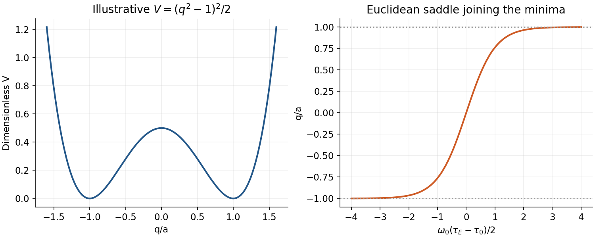

<h1 id="3/a/solution">Solution</h1>

↑ **Parent:** [A](../a.md)

The real-time [path integral](../../../../../path-integral.md) sums $e^{iS/\hbar}$ over paths. In a classically forbidden region, the dominant semiclassical contribution is clearer after [Wick rotation](../../../../../wick-rotation.md): the weight becomes $e^{-S_E/\hbar}$ and stationary paths obey $m\ddot q=V'(q)$, equivalent to motion in the inverted potential. A finite-action path joining degenerate minima is an [instanton](../../../../../instanton.md).

For $V(q)=\lambda(q^2-a^2)^2$, $\lambda>0$, zero Euclidean mechanical energy gives $m\dot q^2/2=V$. Thus

$$
q_I(\tau_E)=a\tanh\!\left[\frac{\omega_0(\tau_E-\tau_0)}2\right],\quad\omega_0^2=8\lambda a^2/m,\quad\boxed{S_0=\int_{-a}^a\sqrt{2mV(q)}\,dq=\frac43a^3\sqrt{2m\lambda}.}
$$

The reversed trajectory is an anti-instanton.[§2.3.2, printed pp56–58: Euclidean double-well saddle](../../../../../yang-mills-theory-by-david-tong.md) Expanding $q=q_I+\eta$ produces the fluctuation operator $-\partial_{\tau_E}^2+V''(q_I)/m$. Its translation zero mode is handled by integrating the collective centre $\tau_0$, not by dividing by a zero determinant. The remaining determinant and Jacobian form an attempt-frequency prefactor $A$.

When $S_0/\hbar\gg1$, well-separated events form a dilute gas with rate scale $\kappa=Ae^{-S_0/\hbar}$. Paths returning to the same well have an even number of events, while paths ending in the other well have an odd number. The sums yield $\cosh(\kappa\mathcal T)$ and $\sinh(\kappa\mathcal T)$, giving

$$
\boxed{E_{\rm odd}-E_{\rm even}\simeq2\hbar\kappa.}
$$

The ground state is the lower symmetric combination of localized well states: tunnelling lifts the apparent classical degeneracy. This splitting is nonperturbative in $\hbar$, beyond a power series about either minimum. In a metastable well a bounce, with a negative fluctuation mode, describes decay rather than the stable doublet splitting. Finite temperature, overlapping events or a low barrier require improvements beyond the dilute approximation.

**[Figure 2](#3/a/image-an-original-quartic-double-well-and-its-euclidean-instanton-trajectory). An original quartic double well and its Euclidean instanton trajectory**. [Source](paper-1-qcm2014-instanton.py).

## ↑ Ancestors (14)

1. [A](../a.md)
2. [3](../../3.md)
3. [Paper 1](../../../paper-1-split.md)
4. [2014](../../../split.md)
5. [Past exam of the quantum Condensed Matter Field Theory course of the University of Cambridge](../../../../split.md)
6. [Quantum Condensed Matter Field Theory course of the University of Cambridge](../../../../../quantum-condensed-matter-field-theory-course-of-the-university-of-cambridge.md)
7. [Physics course of the year 4 of the natural sciences course of the University of Cambridge](../../../../../physics-course-of-the-year-4-of-the-natural-sciences-course-of-the-university-of-cambridge.md)
8. [Year 4 of the natural sciences course of the University of Cambridge](../../../../../year-4-of-the-natural-sciences-course-of-the-university-of-cambridge.md)
9. [Year of the natural sciences course of the University of Cambridge](../../../../../year-of-the-natural-sciences-course-of-the-university-of-cambridge.md)
10. [Natural sciences course of the University of Cambridge](../../../../../natural-sciences-course-of-the-university-of-cambridge.md)
11. [Course of the University of Cambridge](../../../../../course-of-the-university-of-cambridge.md)
12. [University of Cambridge](../../../../../university-of-cambridge-split.md)
13. [List of universities](../../../../../list-of-universities.md)
14. [Codex Wiki](../../../../../split.md)
