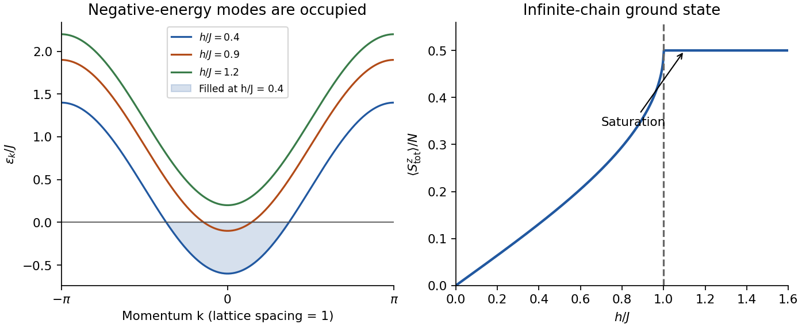

<h1 id="1/e/solution">Solution</h1>

↑ **Parent:** [E](../e.md)

In a fixed fermion-parity sector use lattice spacing one and the unitary [discrete Fourier transform](../../../../../discrete-fourier-transform-split.md)

$$
c_n=\frac1{\sqrt N}\sum_k e^{ikn}c_k,\qquad
c_k=\frac1{\sqrt N}\sum_n e^{-ikn}c_n.
$$

The allowed momenta satisfy $e^{ikN}=-P$: they are $k=2\pi(\ell+1/2)/N$ for $P=+1$ and $k=2\pi\ell/N$ for $P=-1$, with $N$ distinct values modulo $2\pi$. The hopping and number sums become $\sum_k2\cos k\,c_k^\dagger c_k$ and $\sum_kc_k^\dagger c_k$. Thus

$$
\boxed{H=E+\sum_k\epsilon_k c_k^\dagger c_k,\qquad
E=-hN/2,\qquad\epsilon_k=h-J\cos k.}
$$

Here $E$ is the [energy](../../../../../energy-split.md) of the all-up [spin](../../../../../spin.md) configuration, not generally the ground-state [energy](../../../../../energy-split.md). The dispersion has minimum $h-J$ at $k=0$, maximum $h+J$ at $k=\pi$, and positive curvature at its minimum. Since the [fermions](../../../../../fermion.md) do not interact, each mode can be occupied zero or one [time](../../../../../time-in-physics.md). A negative-energy occupation lowers the many-body [energy](../../../../../energy-split.md), so in the [thermodynamic limit](../../../../../thermodynamic-limit.md)

$$
|\mathrm{gs}\rangle=\prod_{|k|<k_F}c_k^\dagger|0\rangle,
\qquad k_F=\arccos(h/J),\quad 0<h<J.
$$

This is a filled [Fermi sea](../../../../../fermi-sea.md) containing many [fermions](../../../../../fermion.md); it is not obtained by putting a single particle into the band minimum. For $h>J$ every mode has positive [energy](../../../../../energy-split.md) and the vacuum is the [ground state](../../../../../ground-state.md). Its [spin](../../../../../spin.md) interpretation is complete longitudinal [polarization](../../../../../polarization-waves.md). At $h=J$ the zero-momentum one-particle excitation first becomes gapless.

For an exact finite ring use [parity-consistent filling of a free-fermion band](../../../../../parity-consistent-filling-of-a-free-fermion-band.md). In each [momentum](../../../../../momentum-split.md) grid fill negative-energy levels, check that their particle number has the chosen parity, and if necessary toggle a mode with the smallest $|\epsilon_k|$. Compare the two sector energies. A zero-energy mode allows degenerate occupations. This restores the physical [spin](../../../../../spin.md) [Hilbert space](../../../../../hilbert-space-split.md) without changing the stated band.

**[Figure 1](#1/e/image-original-xx-chain-dispersion-occupied-interval-and-thermodynamic-magnetization-illustrative-field-ratios). Original XX-chain dispersion, occupied interval and thermodynamic magnetization; illustrative field ratios**.

## ↑ Ancestors (14)

1. [E](../e.md)
2. [1](../../1.md)
3. [Paper 1](../../../paper-1-split.md)
4. [2015](../../../split.md)
5. [Past exam of the quantum Condensed Matter Field Theory course of the University of Cambridge](../../../../split.md)
6. [Quantum Condensed Matter Field Theory course of the University of Cambridge](../../../../../quantum-condensed-matter-field-theory-course-of-the-university-of-cambridge.md)
7. [Physics course of the year 4 of the natural sciences course of the University of Cambridge](../../../../../physics-course-of-the-year-4-of-the-natural-sciences-course-of-the-university-of-cambridge.md)
8. [Year 4 of the natural sciences course of the University of Cambridge](../../../../../year-4-of-the-natural-sciences-course-of-the-university-of-cambridge.md)
9. [Year of the natural sciences course of the University of Cambridge](../../../../../year-of-the-natural-sciences-course-of-the-university-of-cambridge.md)
10. [Natural sciences course of the University of Cambridge](../../../../../natural-sciences-course-of-the-university-of-cambridge.md)
11. [Course of the University of Cambridge](../../../../../course-of-the-university-of-cambridge.md)
12. [University of Cambridge](../../../../../university-of-cambridge-split.md)
13. [List of universities](../../../../../list-of-universities.md)
14. [Codex Wiki](../../../../../split.md)
