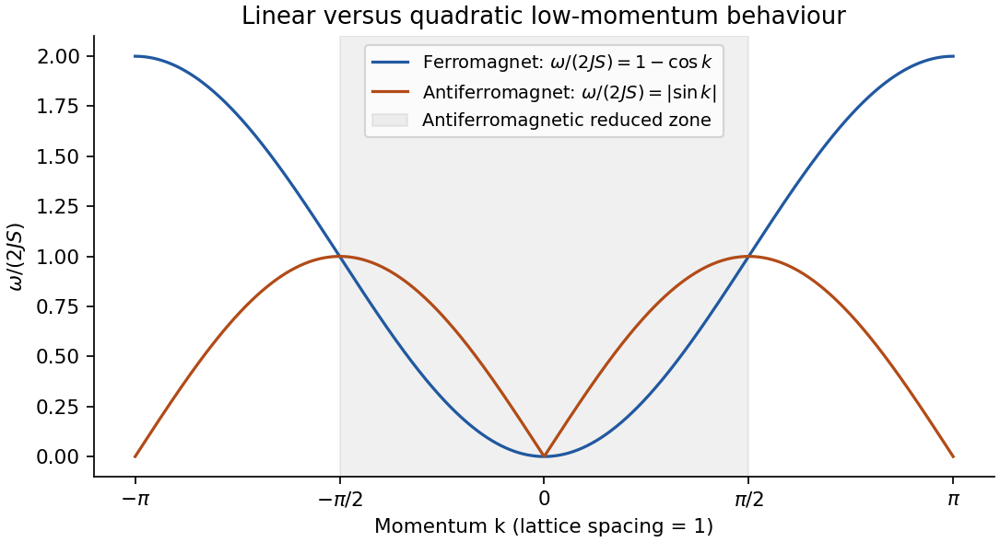

<h1 id="2/a/solution">Solution</h1>

↑ **Parent:** [A](../a.md)

The [Holstein–Primakoff transformation](../../../../../holstein-primakoff-transformation.md) converts a [spin](../../../../../spin.md) algebra into bosonic operators while retaining the finite physical [spin](../../../../../spin.md) [Hilbert space](../../../../../hilbert-space-split.md). With $[a_n,a_m^\dagger]=\delta_{nm}$, write

$$
S_n^z=S-a_n^\dagger a_n,\qquad
S_n^+=\sqrt{2S-a_n^\dagger a_n}\,a_n,\qquad
S_n^-=a_n^\dagger\sqrt{2S-a_n^\dagger a_n}.
$$

The [Holstein–Primakoff occupation constraint](../../../../../holstein-primakoff-occupation-constraint.md) is $0\le n_n\le2S$. Acting on $|n\rangle$, the raising [matrix](../../../../../matrix.md) element is $\sqrt{n(2S-n+1)}$ and the lowering element is $\sqrt{(n+1)(2S-n)}$. Their squared difference is $2(S-n)$, reproducing $[S^+,S^-]=2S^z$. Operator ordering inside the square roots is essential. For low [boson](../../../../../boson.md) occupation relative to $S$, expand them to obtain $S^+\simeq\sqrt{2S}\,a$ and $S^-\simeq\sqrt{2S}\,a^\dagger$. Keeping quadratic terms gives the [linear spin-wave approximation](../../../../../linear-spin-wave-approximation.md); higher terms describe [magnon](../../../../../magnon.md) interactions. Large $S$ helps control the expansion, but a low-dimensional [infrared divergence](../../../../../infrared-divergence.md) can invalidate it even at large finite $S$.

For the [ferromagnet](../../../../../ferromagnet.md) choose $H_F=-J\sum_n\mathbf S_n\cdot\mathbf S_{n+1}$, $J>0$, with unit lattice spacing and $\hbar=1$. Expand around the all-up state. A longitudinal bond contributes $-JS^2+JS(n_n+n_{n+1})$, and the transverse exchange contributes $-JS(a_n^\dagger a_{n+1}+a_{n+1}^\dagger a_n)$. After a [Fourier transform](../../../../../fourier-transform-split.md),

$$
H_F^{(2)}=-JNS^2+\sum_k\omega_F(k)a_k^\dagger a_k,
\qquad\boxed{\omega_F(k)=2JS(1-\cos k)\simeq JS k^2.}
$$

These are [ferromagnetic magnons](../../../../../ferromagnetic-magnon.md). The polarized vacuum is an exact [ground state](../../../../../ground-state.md) of the full ferromagnetic [Hamiltonian](../../../../../hamiltonian.md): every bond is in its maximum [total-spin sector](../../../../../total-spin-sector.md), minimizing that bond [energy](../../../../../energy-split.md). It therefore has no quantum zero-point reduction of its [magnetization](../../../../../magnetization.md). The one-magnon dispersion is also exact, although interacting many-magnon states need not be free [bosons](../../../../../boson.md). Rotating the [polarization](../../../../../polarization-waves.md) generates the maximum-total-spin ground-state multiplet. Selecting a definite direction in a thermodynamic symmetry-breaking description breaks $SU(2)$ to $U(1)$; the two transverse [spin](../../../../../spin.md) components form a canonical pair, producing a single quadratic [type-B Goldstone boson](../../../../../type-b-goldstone-boson.md). A small aligning field gaps it by the Zeeman [energy](../../../../../energy-split.md).

At nonzero [temperature](../../../../../temperature-split.md) the one-dimensional [ferromagnet](../../../../../ferromagnet.md) is different: its thermal [magnon](../../../../../magnon.md) number contains $\int dk\,[e^{\beta JS k^2}-1]^{-1}$, with infrared behaviour $\int dk\,T/k^2$. The divergent [magnetization](../../../../../magnetization.md) reduction signals the absence of finite-temperature [long-range order](../../../../../long-range-order.md) in an infinite short-range isotropic chain, consistent with the [Mermin-Wagner theorem](../../../../../mermin-wagner-theorem.md). It does not disallow the polarized zero-temperature [ground states](../../../../../ground-state.md) just constructed.[abstract and finite-temperature theorem](../../../../../absence-of-ferromagnetism-or-antiferromagnetism-in-one-or-two-dimensional-isotropic-heisenberg-models-by-n-d-mermin-and-h-wagner.md)

For the [antiferromagnet](../../../../../antiferromagnetism.md) use $H_{AF}=+J\sum_n\mathbf S_n\cdot\mathbf S_{n+1}$, still $J>0$, on an even bipartite chain. The classical reference state alternates up and down. Rotate one sublattice through $\pi$ so that both local quantization axes point along their reference [spins](../../../../../spin.md). In unrotated physical components, to leading order $S_A^z=S-a^\dagger a$, $S_B^z=-S+b^\dagger b$, $S_A^+\simeq\sqrt{2S}\,a$ and $S_B^+\simeq\sqrt{2S}\,b^\dagger$. Choosing Fourier phases using the actual site [positions](../../../../../position.md) gives

$$
H_{AF}^{(2)}=-JNS^2+2JS\sum_{k\in\mathrm{RBZ}}
\left[a_k^\dagger a_k+b_k^\dagger b_k+
\cos k\,(a_kb_{-k}+a_k^\dagger b_{-k}^\dagger)\right].
$$

The reduced [Brillouin zone](../../../../../brillouin-zone.md) has $M=N/2$ momenta and [length](../../../../../length.md) $\pi$. The pair creation and annihilation terms express the fact that an antiparallel reference product state is not an [eigenstate](../../../../../eigenstate.md). A bosonic [Bogoliubov transformation](../../../../../bogoliubov-transformation.md) with $u_k=\cosh\theta_k$, $v_k=\sinh\theta_k$, $\tanh2\theta_k=\cos k$ diagonalizes each two-mode block. With the sign convention $a_k=u_k\alpha_k-v_k\beta_{-k}^\dagger$ and $b_{-k}=u_k\beta_{-k}-v_k\alpha_k^\dagger$, the result is

$$
H_{AF}^{(2)}=E_{AF}^{(2)}+\sum_{k\in\mathrm{RBZ}}\omega_{AF}(k)
(\alpha_k^\dagger\alpha_k+\beta_k^\dagger\beta_k),
$$

$$
\boxed{\omega_{AF}(k)=2JS\sqrt{1-\cos^2 k}=2JS|\sin k|\simeq2JS|k|,}
\qquad E_{AF}^{(2)}=-JNS^2+\sum_{k\in\mathrm{RBZ}}[\omega_{AF}(k)-2JS].
$$

Thus the harmonic antiferromagnetic modes have linear, rather than quadratic, long-wave dispersion. In an unfolded Brillouin-zone description the same result is represented by zeros at both zero and the antiferromagnetic [wavevector](../../../../../wavevector.md); these are not extra independent degrees of freedom beyond the two-sublattice accounting.

The Bogoliubov vacuum has no $\alpha$ or $\beta$ excitations but contains original [spin](../../../../../spin.md) [bosons](../../../../../boson.md), with $v_k^2=\tfrac12(|\sin k|^{-1}-1)$. Its [staggered magnetization](../../../../../staggered-magnetization.md) is $m_s=S-M^{-1}\sum_{k\in\mathrm{RBZ}}v_k^2$. This [quantum depletion of Néel order](../../../../../quantum-depletion-of-neel-order.md) diverges logarithmically at small $k$ in one dimension. **Linear spin-wave theory therefore does not establish a stable ordered antiferromagnetic [ground state](../../../../../ground-state.md) for this chain.** Its nominal gapless dispersion is a result of expanding around an invalid ordered reference, not a general proof of the exact excitation spectrum. For the nearest-neighbour isotropic chain, integer-spin systems have a Haldane gap, whereas half-integer-spin systems are gapless; the spin-one-half chain in particular has fractional [spin](../../../../../spin.md) excitations rather than a simple dilute gas of ordered-state [magnons](../../../../../magnon.md). This distinction requires physics beyond the harmonic expansion, including the topological term in the continuum theory.[pp.1153–1156, integer versus half-integer spin](../../../../../nonlinear-field-theory-of-large-spin-heisenberg-antiferromagnets-semiclassically-quantized-solitons-of-the-one-dimensional-easy-axis-neel-state-by-f-duncan-m-haldane.md)

**[Figure 2](#2/a/image-original-harmonic-chain-dispersions-the-antiferromagnetic-curve-is-a-spin-wave-approximation-not-the-exact-spectrum-for-every-spin). Original harmonic chain dispersions; the antiferromagnetic curve is a spin-wave approximation, not the exact spectrum for every spin**.

## ↑ Ancestors (14)

1. [A](../a.md)
2. [2](../../2.md)
3. [Paper 1](../../../paper-1-split.md)
4. [2015](../../../split.md)
5. [Past exam of the quantum Condensed Matter Field Theory course of the University of Cambridge](../../../../split.md)
6. [Quantum Condensed Matter Field Theory course of the University of Cambridge](../../../../../quantum-condensed-matter-field-theory-course-of-the-university-of-cambridge.md)
7. [Physics course of the year 4 of the natural sciences course of the University of Cambridge](../../../../../physics-course-of-the-year-4-of-the-natural-sciences-course-of-the-university-of-cambridge.md)
8. [Year 4 of the natural sciences course of the University of Cambridge](../../../../../year-4-of-the-natural-sciences-course-of-the-university-of-cambridge.md)
9. [Year of the natural sciences course of the University of Cambridge](../../../../../year-of-the-natural-sciences-course-of-the-university-of-cambridge.md)
10. [Natural sciences course of the University of Cambridge](../../../../../natural-sciences-course-of-the-university-of-cambridge.md)
11. [Course of the University of Cambridge](../../../../../course-of-the-university-of-cambridge.md)
12. [University of Cambridge](../../../../../university-of-cambridge-split.md)
13. [List of universities](../../../../../list-of-universities.md)
14. [Codex Wiki](../../../../../split.md)
