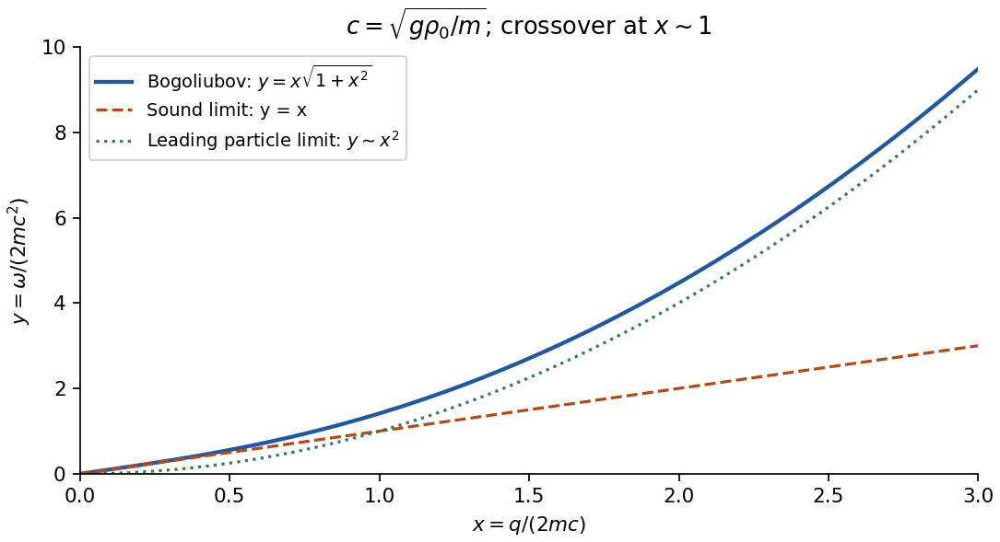

<h1 id="3/d/solution">Solution</h1>

↑ **Parent:** [D](../d.md)

At wavelengths with $q^2/(4m\rho_0)\ll g$, neglect the density-gradient term in the [quadratic density-phase action](../../../../../quadratic-density-phase-action.md). Complete the square in its remaining density terms:

$$
\frac g2(\delta\rho)^2+i\delta\rho\partial_\tau\varphi
=\frac g2\left(\delta\rho+\frac i g\partial_\tau\varphi\right)^2
+\frac1{2g}(\partial_\tau\varphi)^2.
$$

The convergent [Gaussian integral](../../../../../gaussian-integral.md) can be performed by a contour shift or by its Fourier-transform identity. Its [determinant](../../../../../determinant.md) is independent of $\varphi$ at this order. Combining that normalization with the saddle [action](../../../../../action.md) into a constant $S_0$ gives

$$
\boxed{Z=e^{-S_0}\int\mathcal D\varphi\,e^{-S_{\rm eff}[\varphi]},\qquad
S_{\rm eff}=\frac12\int_0^\beta d\tau\int_Vd^dr
\left[\frac{(\partial_\tau\varphi)^2}{g}+\frac{\rho_0}{m}|\nabla\varphi|^2\right].}
$$

The saddle contribution to $S_0$ is $-\beta V\mu^2/(2g)$; the additional measure-dependent constant need not be assigned an invented numerical value. The density Gaussian extends the fluctuation integration beyond its exact positivity domain, which is justified only while fluctuations around $\rho_0>0$ are small. The smooth zero-winding assumption is also required as discussed above. A constant [global phase](../../../../../global-phase.md) zero mode gives a finite compact-group volume, handled separately from nonzero [phonon](../../../../../phonon.md) modes.

Fourier transforming the [Bose-gas phase-only action](../../../../../bose-gas-phase-only-action.md) gives a kernel $\omega_n^2/g+(\rho_0/m)q^2$. Analytically continuing $\omega_n\mapsto-i(\omega+i0^+)$ gives its real-frequency poles,

$$
\boxed{\omega(q)=c|q|,\qquad c=\sqrt{g\rho_0/m}.}
$$

In the present units the excitation [energy](../../../../../energy-split.md) equals $\omega$. Each real Fourier coordinate is a [harmonic oscillator](../../../../../simple-harmonic-motion.md) with inertia coefficient $1/g$ and spring coefficient $\rho_0q^2/m$, hence [frequency](../../../../../frequency.md) equal to the square root of their ratio. This is the direct relation to a quantum [harmonic chain](../../../../../harmonic-chain.md). The mode is a gapless sound [phonon](../../../../../phonon.md); its finite speed reflects both the [compressibility](../../../../../compressibility.md) $\partial\rho/\partial\mu=1/g$ and the [phase stiffness](../../../../../phase-stiffness.md) $\rho_0/m$.

Retaining the density-gradient term provides a useful check. Its integration instead gives a temporal coefficient $1/A_q$, so

$$
\omega^2(q)=\frac{\rho_0 q^2}{m}\left(g+\frac{q^2}{4m\rho_0}\right)
=c^2q^2+\frac{q^4}{4m^2},
\qquad\omega(q)=\sqrt{\epsilon_q(\epsilon_q+2g\rho_0)},\quad\epsilon_q=\frac{q^2}{2m}.
$$

This is the [Bogoliubov spectrum](../../../../../bogoliubov-quasiparticle-dispersion.md). Its small-$q$ limit is the derived sound branch; at large $q$ within the contact model it crosses towards particle-like behaviour. The crossover in the squared dispersion is $q\sim2\sqrt{mg\rho_0}$, precisely the scale beyond which the discarded density [gradient](../../../../../gradient.md) is not small.

The same [action](../../../../../action.md) checks the dimensional restriction in the saddle analysis. At nonzero [temperature](../../../../../temperature-split.md) its zero Matsubara mode gives phase fluctuations proportional to $\int d^dq/q^2$; at zero [temperature](../../../../../temperature-split.md) integrating the [frequency](../../../../../frequency.md) gives $\int d^dq/|q|$. Their [infrared divergences](../../../../../infrared-divergence.md) invalidate uniform true [long-range order](../../../../../long-range-order.md) for $d\le2$ at nonzero [temperature](../../../../../temperature-split.md) and for $d=1$ at zero [temperature](../../../../../temperature-split.md). The long-wave collective description can remain useful for correlations even where a global condensate saddle is not a literal symmetry-broken state. The contact coupling here is an effective low-energy parameter; this calculation does not determine ultraviolet [renormalization](../../../../../renormalization.md) or trap-specific surface modes.

**[Figure 3](#3/d/image-original-dimensionless-bogoliubov-dispersion-and-its-sound-and-particle-limits). Original dimensionless Bogoliubov dispersion and its sound and particle limits**.

## ↑ Ancestors (14)

1. [D](../d.md)
2. [3](../../3.md)
3. [Paper 1](../../../paper-1-split.md)
4. [2015](../../../split.md)
5. [Past exam of the quantum Condensed Matter Field Theory course of the University of Cambridge](../../../../split.md)
6. [Quantum Condensed Matter Field Theory course of the University of Cambridge](../../../../../quantum-condensed-matter-field-theory-course-of-the-university-of-cambridge.md)
7. [Physics course of the year 4 of the natural sciences course of the University of Cambridge](../../../../../physics-course-of-the-year-4-of-the-natural-sciences-course-of-the-university-of-cambridge.md)
8. [Year 4 of the natural sciences course of the University of Cambridge](../../../../../year-4-of-the-natural-sciences-course-of-the-university-of-cambridge.md)
9. [Year of the natural sciences course of the University of Cambridge](../../../../../year-of-the-natural-sciences-course-of-the-university-of-cambridge.md)
10. [Natural sciences course of the University of Cambridge](../../../../../natural-sciences-course-of-the-university-of-cambridge.md)
11. [Course of the University of Cambridge](../../../../../course-of-the-university-of-cambridge.md)
12. [University of Cambridge](../../../../../university-of-cambridge-split.md)
13. [List of universities](../../../../../list-of-universities.md)
14. [Codex Wiki](../../../../../split.md)
