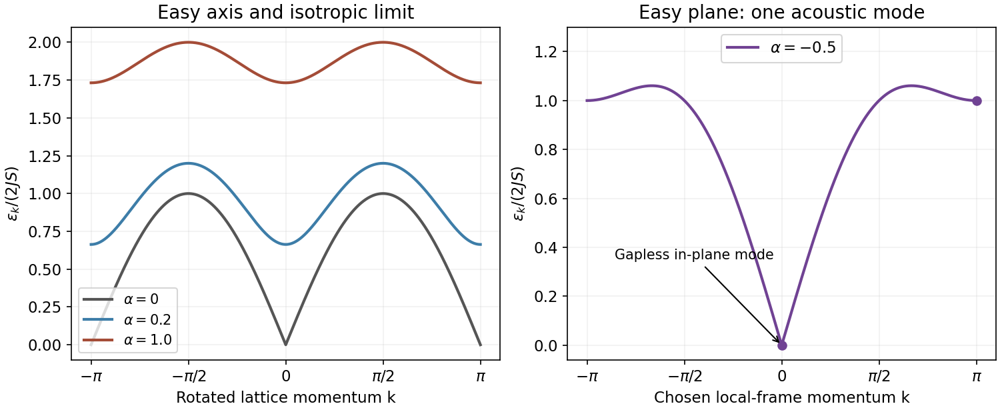

<h1 id="1/g/solution">Solution</h1>

↑ **Parent:** [G](../g.md)

For $\alpha>0$, the dispersion is periodic and has minima at $k=0,\pi$ in the rotated full-zone convention, with

$$
\boxed{\epsilon_{\min}=2JS\sqrt{(1+\alpha)^2-1}=2JS\sqrt{\alpha(2+\alpha)}.}
$$

The maximum is $2JS(1+\alpha)$ at $k=\pm\pi/2$. The easy-axis state has no continuously broken [symmetry](../../../../../symmetry-physics.md), so a gap is allowed. Near a minimum the energy behaves as $2JS\sqrt{\alpha(2+\alpha)+(\delta k)^2}$. At $\alpha=0$ it becomes **$\epsilon_k=2JS|\sin k|$**, linear near its zeros, with small-$k$ slope $2JS$ in the chosen units. Restoring lattice spacing $a$ and $\hbar$ gives spin-wave speed $2JSa/\hbar$. Zone folding reorganizes the same modes into the magnetic [Brillouin zone](../../../../../brillouin-zone.md).

**[Figure 1](#1/g/image-consistent-easy-axis-isotropic-and-easy-plane-linear-spin-wave-spectra-illustrative-anisotropies). Consistent easy-axis, isotropic and easy-plane linear spin-wave spectra; illustrative anisotropies**.

These are linear spin-wave predictions, not a statement that the exact one-dimensional quantum chain always has long-range Néel order. At the isotropic point the zero-point [spin](../../../../../spin.md) reduction contains $N^{-1}\sum_k(|\sin k|^{-1}-1)/2$, which diverges logarithmically as the infrared cutoff vanishes. This failure of the assumed ordered reference must not be mistaken for a calculation of the exact interacting spectrum.

## ↑ Ancestors (14)

1. [G](../g.md)
2. [1](../../1.md)
3. [Paper 1](../../../paper-1-split.md)
4. [2016](../../../split.md)
5. [Past exam of the quantum Condensed Matter Field Theory course of the University of Cambridge](../../../../split.md)
6. [Quantum Condensed Matter Field Theory course of the University of Cambridge](../../../../../quantum-condensed-matter-field-theory-course-of-the-university-of-cambridge.md)
7. [Physics course of the year 4 of the natural sciences course of the University of Cambridge](../../../../../physics-course-of-the-year-4-of-the-natural-sciences-course-of-the-university-of-cambridge.md)
8. [Year 4 of the natural sciences course of the University of Cambridge](../../../../../year-4-of-the-natural-sciences-course-of-the-university-of-cambridge.md)
9. [Year of the natural sciences course of the University of Cambridge](../../../../../year-of-the-natural-sciences-course-of-the-university-of-cambridge.md)
10. [Natural sciences course of the University of Cambridge](../../../../../natural-sciences-course-of-the-university-of-cambridge.md)
11. [Course of the University of Cambridge](../../../../../course-of-the-university-of-cambridge.md)
12. [University of Cambridge](../../../../../university-of-cambridge-split.md)
13. [List of universities](../../../../../list-of-universities.md)
14. [Codex Wiki](../../../../../split.md)
